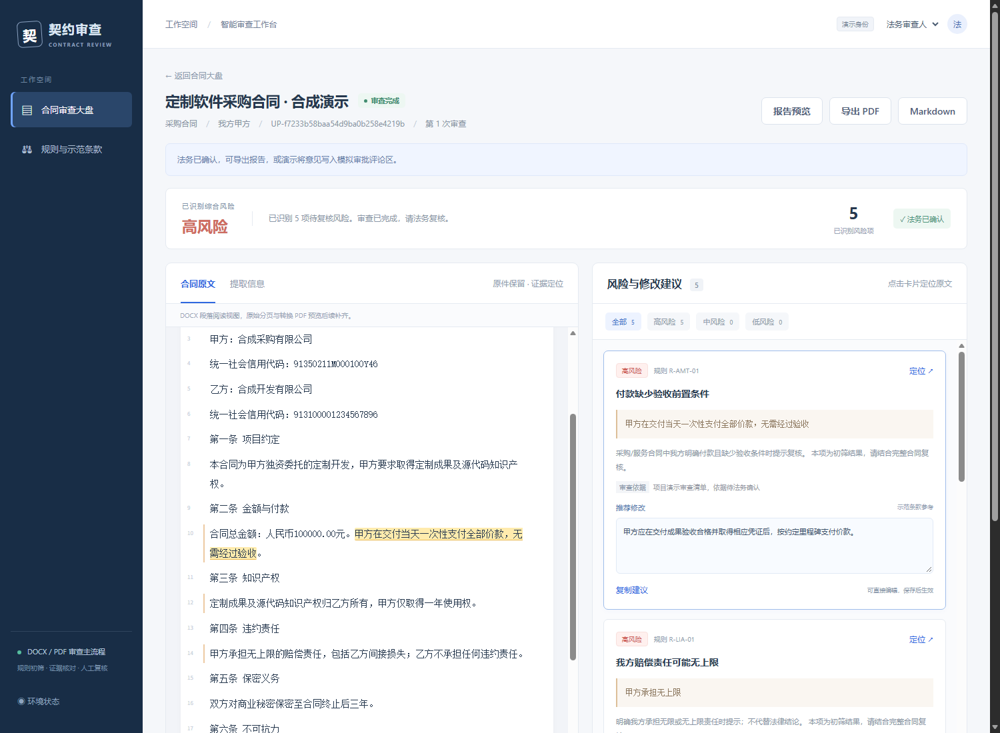
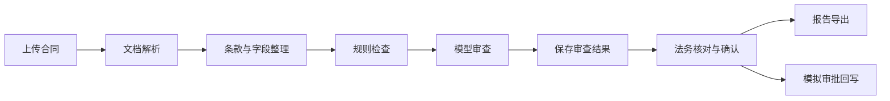

<div align="center">

# 契约审查 · Contract Review Agent

**基于 FastAPI、Vue 3 与 LangGraph 的合同辅助审查演示系统**

从合同上传、风险识别到法务复核、模拟审批回写与报告导出。


[快速开始](#快速开始) · [功能概览](#功能概览) · [使用流程](#使用流程) · [项目文档](#项目文档)

</div>

> **版本状态**：本地演示版本已完成收尾，更新于 2026-10-16。核心流程已用合成合同验证；真实合同效果、生产上线及原始任务书的全部扩展验收不在当前完成声明内。

## 界面预览



*合成合同演示：左侧核对原文，右侧查看风险、依据和修改建议。*

## 功能概览

| 能力 | 当前实现 |
|---|---|
| 多格式解析 | 支持 DOCX、文本 PDF、扫描 PDF、单张 PNG/JPG/JPEG；扫描件与图片接入 MinerU |
| 合同结构化 | 提取合同字段，切分和归类条款，保留原文证据位置 |
| 规则与模型审查 | 首批 7 条可解释规则结合 OpenAI 兼容模型服务，输出风险原因和修改建议 |
| 原文证据定位 | PDF/图片分页、缩放及证据框联动；DOCX 提供段落阅读与文字高亮 |
| 法务复核 | 编辑建议、补充意见、保存草稿、确认审查，支持版本冲突检查 |
| 审批与报告 | 法务确认后写入本地模拟审批评论，支持幂等及 Markdown/PDF 导出 |
| 任务与权限 | 业务、法务、管理员预置身份；后端核对角色与任务归属 |
| 简单规则维护 | 管理员可维护规则启停、风险等级、依据与示范修改文本 |

## 审查流程



五个自动处理步骤由 LangGraph 串联。上传接口保存原件并创建待处理任务，后台执行器随后领取处理。部分结果可以查看和导出，但关键模型审查未完成时不能确认完整审查。

## 快速开始

### 1. 准备环境

| 依赖 | 要求 |
|---|---|
| Python | 3.11，使用 uv 管理锁定依赖 |
| Node.js | 20+ |
| Docker Desktop | Linux containers，用于运行 MySQL 8 |
| 模型服务 | OpenAI 兼容接口 |
| MinerU | 扫描件或图片解析所需的云服务 Token |

首次克隆后，在项目根目录执行：

```powershell
pwsh -File scripts/setup.ps1
```

脚本安装依赖、创建缺失的 `.env`、启动 MySQL 并初始化数据库；已有 `.env` 不覆盖。仅安装语言环境可加 `-SkipDatabase`。

### 2. 配置服务

在根目录 `.env` 填写自己的模型与 MinerU 信息：

```dotenv
LLM_ENABLED=1
LLM_BASE_URL=https://your-provider.example/v1
LLM_MODEL_NAME=your-model-name
LLM_API_KEY=
LLM_TIMEOUT_SECONDS=90

MINERU_ENABLED=1
MINERU_BASE_URL=https://mineru.net/api/v4
MINERU_API_TOKEN=
MINERU_HEALTH_PATH=

APPROVAL_MODE=mock
```

模型名以服务商实际支持的 ID 为准。修改配置后重启后端，终端或 IDE 中同名环境变量会覆盖 `.env`。`LLM_ENABLED=0` 时只保留规则初筛，完整审查不可确认。密钥、本地原件和数据库备份均不提交 Git。

### 3. 启动项目

先启动 Docker Desktop，并在项目根目录确保数据库运行：

```powershell
docker compose up -d --wait mysql
```

另开两个 PowerShell 终端，分别启动：

```powershell
# 终端一：后端
pwsh -File scripts/start-backend.ps1

# 终端二：前端
pwsh -File scripts/start-frontend.ps1
```

| 入口 | 默认地址 |
|---|---|
| 合同审查大盘 | http://127.0.0.1:5173/ |
| 环境状态 | http://127.0.0.1:5173/environment |
| FastAPI 接口文档 | http://127.0.0.1:8000/docs |
| MySQL | `127.0.0.1:3307` |

同一数据库只启动一套本项目后端。8000 被其他项目占用时，后端脚本加 `-Port 8001`，前端脚本加 `-BackendPort 8001`。

<details>
<summary>不使用脚本，手动启动</summary>

在项目根目录分别执行：

```powershell
# 终端一
.\.venv\Scripts\python.exe -m uvicorn app.main:app --host 127.0.0.1 --port 8000 --reload

# 终端二
cd frontend
npm run dev
```

手动使用 8001 时，后端改为 `--port 8001`；前端运行前设置 `$env:API_PROXY_TARGET="http://127.0.0.1:8001"`。

停止前后端，在对应终端按 Ctrl+C；停止数据库使用 `docker compose stop mysql`，保留数据卷。日常启动不需要重复执行 setup。

</details>

## 使用流程

1. **业务上传**：选择业务身份，上传合同并明确我方甲/乙角色；也可点击“体验合成样例”，生成可重复体验的 DOCX 测试任务。
2. **查看结果**：等待审查完成，核对字段、原文和风险证据。扫描件使用 MinerU OCR，文字和位置仍需人工核对。
3. **法务复核**：切换法务身份，从大盘进入合同，编辑建议与补充意见，再保存草稿或确认审查。
4. **导出与协同**：下载 Markdown/PDF 报告，或点击“演示回写”，在本地模拟审批评论区核对已确认结果。
5. **管理与恢复**：管理员维护规则，查看受阻原因，并在修正配置后重新审查。

仓库提供[合成合同文字样例](docs/试验/01-合成软件采购合同.md)。本机生成的三格式原件位于 `data/手动测试合同/`；`data/` 属于运行数据，不随 Git 分发。新环境可使用“体验合成样例”按钮，不依赖历史任务编号。

## 技术栈与目录

| 层次 | 技术 |
|---|---|
| 前端 | Vue 3、Vite、Vue Router |
| 后端 | FastAPI、Pydantic、SQLAlchemy |
| 处理流程 | LangGraph、数据库待办、单槽后台执行器 |
| 文档解析 | python-docx、PyMuPDF、MinerU v4 |
| 存储与模型 | MySQL 8、本地文件、OpenAI 兼容模型接口 |

```text
app/
├── api/             # 接口、请求校验与权限
├── graph/           # LangGraph 状态、图和节点
├── parsing/         # 多格式解析与统一文档结构
├── structuring/     # 字段提取、条款切分与归类
├── review/          # 规则与模型审查
├── prompts/         # 集中维护的提示词
└── services/        # 后台执行、结果快照、原件预览与报告
frontend/            # 页面与交互
sql/                 # 数据库结构与预置身份
scripts/             # 部署、启动和联调脚本
tests/               # 定向测试
docs/                # PRD、Spec 与逐模块开发记录
```

## 验证与边界

DOCX、文本 PDF、扫描 PDF 和 PNG 已有合成材料真实调用记录；法务确认、幂等模拟回写、报告导出及浏览器证据联动已验证。最近修复了身份切换返回大盘、MinerU 独立页码类型兼容和轮询导致原件滚动跳动的问题，详见开发记录 34～36。

- 当前使用预置身份，未实现正式登录认证；审批回写仅操作本系统模拟数据。
- OCR 定位为内容块精度；DOCX 尚无可靠分页预览映射。
- 完整规则/模板平台、批量操作、真实审批适配等扩展暂缓，原始验收范围仍保留在 PRD。
- 目前主要使用合成合同验证；真实合同效果及性能尚未完成验收。

合同文字会发送到已配置的模型服务，扫描件/图片还会发送到 MinerU。真实材料请使用允许处理的脱敏副本。MinerU 是文档解析服务，与 Milvus 向量数据库不同。

<details>
<summary>常见问题与排查</summary>

| 现象 | 检查方向 |
|---|---|
| 模型未启用 | 核对 `LLM_ENABLED`、密钥及启动环境；配置变化后重启后端，旧失败任务需重新审查 |
| 模型响应超时 | 核对实际生效超时和服务耗时；本机演示使用 90 秒，不能保证所有请求均在该时间内返回 |
| MinerU 显示“待验证” | 健康检查不创建 OCR 任务；以实际扫描件/图片解析结果为准 |
| 前端无法连接后端 | 核对后端是否运行，以及前端代理是否指向实际端口 |
| 健康检查顶层为 `ok` | 只代表基础数据库检查通过，其他服务需分别查看状态 |

</details>

## 项目文档

| 文档 | 阅读目的 |
|---|---|
| [产品需求 PRD](docs/PRD.md) | 唯一产品范围与最终验收依据 |
| [技术设计 Spec](docs/SPEC.md) | 唯一技术设计、数据模型与接口约定 |
| [开发记录](docs/开发记录/) | 按模块阅读实现过程与验证结果 |
| [版本收尾记录](docs/开发记录/32-演示版本收尾与交付核对.md) | 当前交付状态与已知限制 |

旧规格从 Git 历史查询，历史开发记录不增加新的验收范围。
