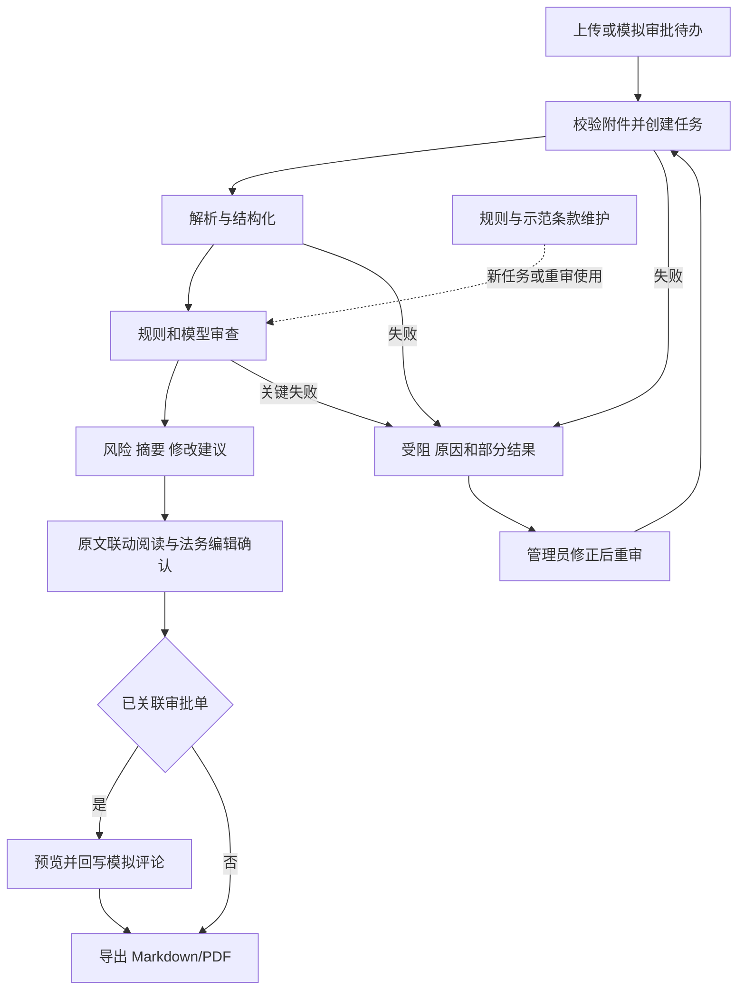

# 合同审批审查系统 PRD

| 项目 | 内容 |
|---|---|
| 版本 / 日期 | 1.0 / 更新于 2026-10-16 |
| 状态 / 作者角色 | 当前演示版本已收尾，原始最终验收范围保留 / 产品需求整理 |
| 需求来源 | 用户提供的《合同审查系统.md》2.4～2.4.10 及已确认产品决策 |
| 配套文档 | [SPEC.md](SPEC.md)：技术实现；[开发记录](开发记录/)：各模块实现过程 |

这是唯一维护的产品需求文档。旧版、重整草稿、简版、决策记录和开发清单已合并；历史从 Git 查询。产品范围与验收以本文件为准，技术实现以 Spec 为准，开发记录不增加另一套需求。本文的“必须”是交付要求，不表示功能已经实现。

## 1. 产品目标与范围

为企业合同审批提供辅助审查：提交合同 → 解析及结构化 → 规则与模型审查 → 原文核对 → 法务编辑确认 → 模拟审批回写与报告导出。审批决定由人作出。

最终交付保留原任务书全部能力：三类格式、三个核心页面、双向高亮、可编辑修改建议、人工复核、规则与模板维护、批量操作、审批模拟模块、Markdown/PDF 报告和示例合同。分阶段实现不代表删减范围。

| 目标 | 成功标准 |
|---|---|
| 多格式可处理 | DOCX、文本 PDF、扫描件/图片 3 类均有成功解析及审查用例 |
| 判断可追溯 | 提取字段、条款和风险证据可核对对应原件；缺项不编造位置 |
| 业务可交付 | 第 9 章原始八项验收全部通过，至少一个典型场景端到端成功 |
| 未知如实显示 | 未查询、失败、证据不足、依据待确认均有明确标记，不冒充完整安全结论 |

不额外建设注册/SSO、多租户、电子签章、任意代码规则平台、法规自动更新和历史相似合同检索；本期审批对接使用模拟模块。没有确认真实企业信用服务前，不宣称已经核验企业信用。不继承旧文档自定的 38 条规则、14 份样本、60 工时和准确率指标。

### 当前开发重点：先把已有演示流程用顺

当前先完成“上传 → 自动审查 → 原文核对 → 法务确认 → 导出 / 演示回写”的清晰操作。保留既有代码和最终验收范围；本阶段优先修正影响这条流程的实际问题，不继续扩展新模块。

批量操作、完整规则/模板管理、审批待办/HTTP 集成、重传审计和高级告警暂缓；Word 转换待用户提供试验材料后继续。分布式基础设施与新格式不作为当前工作。未完成项仍保留在第 10 章，后续按演示反馈逐项安排。

页面以中文显示处理阶段，按角色和状态提示下一步；法务确认后可一键演示回写，系统自动关联模拟审批单。该操作仍需通过后端权限与版本检查，不代表真实审批平台集成。

## 2. 用户角色与权限

| 操作 | 业务经办人 BIZ | 法务 LEGAL | 管理员 ADMIN |
|---|---|---|---|
| 上传发起任务 | 允许，申请人为本人 | 不提供 | 不提供 |
| 查看任务、原件、风险与报告 | 仅本人任务 | 全部送审任务 | 全部任务，便于排查 |
| 编辑建议、补充意见、人工确认 | 不允许 | 允许 | 不允许代替法务 |
| 确认后回写审批意见 | 不允许 | 允许 | 不允许代替法务 |
| 查看规则与模板 | 不提供管理入口 | 查看 | 查看和维护 |
| 维护审批参数、处理受阻、重试/修正原件 | 不允许管理其他任务 | 查看原因 | 允许并留痕 |
| 批量操作 | 导出本人有权查看的报告 | 导出有权查看的报告 | 批量重试、导出 |

课程演示采用预置身份选择。后端核对数据库中的用户状态、角色和任务归属，不直接信任前端声明；该方式不属于正式登录认证。

## 3. 用户故事

| 编号 | 作为用户，我希望……以便…… | 对应需求 |
|---|---|---|
| US-01 | 业务上传合同并明确我方身份，以便正确发起审查 | FR-01 |
| US-02 | 业务筛选任务和查看进度，以便跟踪结果 | FR-03、04 |
| US-03 | 法务阅读不同格式及提取信息，以便核对合同 | FR-05～07 |
| US-04 | 法务查看风险证据、原因和依据，以便判断是否成立 | FR-08、09、11 |
| US-05 | 法务查看并调整示范建议，以便形成适合当前合同的意见 | FR-10、12 |
| US-06 | 法务从卡片跳到原文并反向定位，以便快速复核 | FR-11 |
| US-07 | 法务预览并回写最终意见，以便衔接审批 | FR-13 |
| US-08 | 业务下载原文/建议对照报告，以便整改 | FR-14 |
| US-09 | 管理员处理受阻并重试，以便恢复任务 | FR-04、16 |
| US-10 | 管理员维护清单、规则和模板，以便调整审查标准 | FR-15 |
| US-11 | 管理员配置模拟审批并接收待办，以便演示完整集成 | FR-02、17 |
| US-12 | 法务区分部分结果与完整审查，以便避免把未知当安全 | FR-08～10、18 |

## 4. 功能需求与关键约定

### 4.1 需求清单

P0 为最终必须交付；P1 为建议改进；P2 为可选扩展。当前进度集中在第 10 章，不用“第一版已接通”代替最终验收。

| 编号 | 功能 | 优先级 | 要求 |
|---|---|---|---|
| FR-01 | 上传创建任务 | P0 | 必填文件、合同类型、我方甲/乙角色；申请人取当前身份；名称、主体、金额先提取，缺失提示 |
| FR-02 | 审批待办接入 | P0 | 模拟推送或拉取待办，下载附件、核对完整性、事件及附件去重 |
| FR-03 | 大盘与筛选 | P0 | 名称、申请人、类型、金额、审查状态、综合风险、创建时间；状态/风险筛选及分页 |
| FR-04 | 状态与进度 | P0 | 展示任务五态、回写四态、当前阶段、失败原因和重试结果 |
| FR-05 | 多格式解析 | P0 | DOCX、文本 PDF、扫描件/图片；加密、空白、损坏、模糊有明确原因 |
| FR-06 | 元数据提取 | P0 | 名称/编号、双方名称/信用代码、金额/币种、期限、生效条件、签署日期，保留证据与缺失状态 |
| FR-07 | 条款结构化 | P0 | 标的、支付、验收、违约、保密、数据安全、知识产权、争议等条款，保留层级与原文；不确定可见 |
| FR-08 | 风险审查 | P0 | 规则和模型结合，覆盖 4.3 情形，记录风险、成因、依据、证据及不确定性 |
| FR-09 | 综合等级和摘要 | P0 | 高/中/低风险、关注要点、通过/整改/建议拒绝；部分结果单独标识 |
| FR-10 | 修改建议 | P0 | 结合有来源的示范条款和模型，形成可编辑替代文本；失败可重试或人工补充 |
| FR-11 | 分页预览与联动 | P0 | 可阅读的原排版、分页/缩放；风险及字段高亮，原文/卡片双向定位，展示实际精度 |
| FR-12 | 法务复核 | P0 | 原文/建议对照、复制、编辑、采纳、补充意见、人工确认；保存后刷新不丢失 |
| FR-13 | 审批回写 | P0 | 预览并写回确认后的摘要/建议/批注，状态可查，异常可恢复，相同内容不重复评论 |
| FR-14 | 报告导出 | P0 | Markdown/PDF，包含合同基本信息、综合结论、风险依据、原文/建议对照、位置及法务意见 |
| FR-15 | 规则与模板维护 | P0 | 按类型维护必检清单、受支持触发条件、等级、启停、依据及标准示范文本；通过页面操作 |
| FR-16 | 阻塞修正与重试 | P0 | 关键失败进入 blocked，管理员可修正配置/重传/重审，保留操作记录 |
| FR-17 | 审批对接配置 | P0 | 管理员维护模拟接入/回写参数并验证连接，敏感值不回显 |
| FR-18 | 样例和演示 | P0 | 采购/销售/劳动等正常及风险样例，至少一个典型场景全链演示，异常有验证记录 |
| FR-19 | 批量操作 | P0 | 管理员批量重试、用户批量导出有权查看的报告，逐项鉴权和反馈 |
| FR-20 | 元数据人工修正 | P1 | 保留原始值和修正记录，具体安排待定 |
| FR-21 | 历史审查对比 | P2 | 比较不同批次结果，不作为原始验收前置 |

### 4.2 已确认行为

- 任务状态为 pending、parsing、reviewing、blocked、completed；回写状态独立为 not_written、writing、success、failed。completed 不等于法务确认或审批通过。
- 模型关键审查失败先有限自动重试，仍失败则 blocked，保留规则部分结果，不能显示完整审查完成。只有建议生成失败时保留风险，允许重试或法务补写。
- 缺失字段/条款没有真实位置，不编造证据。自然人不因没有企业信用代码被机械判为企业主体信息缺失。
- 综合等级取已识别风险最高等级；完整审查无风险可显示低风险/未发现风险，部分结果不能等同无风险。结论由可解释判断及法务复核形成，不机械把任意高风险当作法律禁止。
- 回写须有关联审批单、本次完整结果及法务确认。无关联的本地任务可导出报告，不能显示虚假回写成功。编辑、换原件或重审后重新确认，旧确认不得沿用。
- 规则/模板变更影响新任务或主动重审，不静默改写历史结果。依据区分企业要求、谈判建议、法律依据，不能用统一占位文字冒充已核验依据。
- Word 保留原件并转 PDF 预览；用户协助开发阶段转换，最终产品转换组件另定。人工转换安排不减少分页和定位验收要求，系统 PDF 报告仍由程序生成。

### 4.3 必须覆盖的审查情形

| 情形 | 等级 | 判断边界 |
|---|---|---|
| 主体信息缺失、经营异常 | 高 | 按企业/自然人及合同类型判断身份要求；异常演示用显式模拟数据，未查询显示未核实 |
| 我方无限责任或严重不对等 | 高 | 结合我方角色、范围、双方义务及其他条款的限制 |
| 违规管辖 | 高 | 区分违法、缺少事实、商业偏好；非我方所在地不自动等于违法 |
| 缺少付款前置验收条件 | 高 | 按交易适用性检查付款、验收及跨条款引用 |
| 保密期限不明确 | 中 | 检查中文数字、持续生效和引用条款 |
| 不可抗力通知时限不明确 | 中 | 检查有效期限及引用，不能只查同句数字 |
| 违约金比例合理性 | 中 | 标明标准和适用场景；示例 20% 不是普遍法定上限 |
| 软件采购知识产权与付款 | 原场景为高 | 定制采购取得源码权属的目标与供应商保留权属冲突，结合验收支付条件 |

至少选一个典型演示：①软件采购权属和到货全款无验收；②大额销售中客户轻微滞纳责任而我方无上限赔偿。不能单凭关键词下结论。

## 5. 非功能要求

| 类别 | 验证要求 |
|---|---|
| 权限与保密 | 每类受限操作各有允许/拒绝用例；明文密钥进入页面、日志和仓库为 0 |
| 持久性 | 建议、批注、确认、规则保存后刷新仍存在，每类至少一例 |
| 幂等与恢复 | 同一回写内容连续提交 3 次只留 1 条评论；中断任务可识别并重试，不假完成 |
| 并发 | 首轮至少两个同时提交的任务不丢失、有明确状态；生产并发预算待确认 |
| 可观测 | 每种验收异常有任务关联、原因及恢复入口，静默失败为 0；模型/OCR/审批覆盖成功、超时、错误返回 |
| 文件与兼容 | 当前上传上限 50MB，测边界内/外；Windows 固定浏览器演示，版本待记录 |
| 性能 | 记录解析、模型、整任务、查询、定位、导出耗时；查询/卡片操作 ≤2 秒仅为建议预算，待实测确认 |

以上用例数量是最小验收建议，不是已有测试结果。未确认生产 SLA、法律准确率百分比、固定并发上限或交付工时。

## 6. 业务流程

回写失败只改变回写状态，不撤销已经完成的解析。结果待核实不能当作回写成功。

## 7. 页面说明

| 页面 | 信息与主要操作 |
|---|---|
| 合同大盘 | 顶部身份/上传；统计、状态和风险筛选；列表及分页；勾选后批量操作；管理员查看受阻并修正/重试 |
| 审查工作台 | 顶部合同信息/状态；左栏原文分页、缩放、风险及字段高亮；右栏风险卡片、原因/依据、原文与可编辑建议；底部法务意见、确认、回写及导出 |
| 规则与模板 | 合同类型筛选；规则树/清单、条件表单、等级和启停；模板文本、适用说明和依据；管理员审批配置 |

当前段落视图只是首版阅读方式，不能替代最终 Word/PDF 分页验收。缺项风险显示“无可定位原文”；依据待确认、部分结果提示在页面和报告中一致。

## 8. 业务数据

用户提交任务；任务拥有原件及文件版本；一次审查产生文档、条款、字段、风险及建议；人工意见与确认绑定审查版本；规则/示范条款提供依据和模板；审批单关联任务与回写评论。

关键状态：任务五态、回写四态、结果完整性、人工确认。存储表和字段由 [Spec 第 5 章](SPEC.md#5-数据模型与版本) 统一定义，PRD 不重复数据库设计。

## 9. 验收标准

| 需求 | 可验证结果 |
|---|---|
| FR-01～04 | 合法上传/模拟待办可建任务，重复不串用户/角色；列表符合权限，筛选正确，进度和失败自动更新 |
| FR-05～07 | 三类格式各成功一例，异常明确；核心字段、主要条款、层级及位置对照原件正确，缺失不编造 |
| FR-08～09 | 4.3 每种情形有风险及适用的正常对照；检查等级、原因、依据、摘要，证据不足/未查询不假正常 |
| FR-10～12 | 三类原文分别与卡片双向正确定位；字段证据一致；建议可复制、编辑、采纳、批注和保存，刷新仍在，越权被拒绝 |
| FR-13 | 确认且关联后回写，实际评论与预览一致；相同内容不重复，失败可查可恢复；无确认/关联/权限时拒绝 |
| FR-14 | MD/PDF 包含合同标题/编号、部门/申请人、相对方、金额/周期、总评/结论、风险依据、位置、原文/建议、法务意见；中文和分页可读 |
| FR-15 | 页面修改条件、等级、启停、模板后新审查体现变化，历史不变；不能用手改 YAML 替代页面维护 |
| FR-16～17 | 解析/接口失败进入 blocked 并显示告警，修正/重传后能恢复；审批参数可脱敏维护和验证，越权被拒 |
| FR-18～19 | 至少一个典型全链场景完成；批量重试/导出逐项鉴权和反馈，单项失败不冒充整批成功 |

原始任务书 2.4.10 八项追溯：①三格式→FR-01/02/05；②元数据/位置→FR-06/07/11；③风险及依据→FR-08/09；④双向高亮→FR-11；⑤建议和编辑→FR-10/12/15；⑥审批评论→FR-02/13/17；⑦受阻重试→FR-04/16；⑧典型全链→FR-18 及相关功能。三页面、批量、模板和两种报告同样必须验收。

## 10. 依赖、阶段与当前进度

截至 2026-10-16，当前交付定位为本地演示版本，已有核心流程收尾并通过合成合同联调；不再继续扩展本阶段功能。下表未完成项保留为最终原始验收缺口，未计入当前完成成果。启动与体验统一见根目录 README，收尾验证见开发记录 32。

模型/MinerU 服务由用户提供并自行配置密钥；真实能力以实际调用验证为准。审查清单、示范条款及依据需要有来源的资料；演示企业异常采用标明的模拟数据。当前 Windows 开发机用于演示，最终浏览器/日期及性能预算待确认。

| 顺序 | 阶段 | 当前进度及下一步 |
|---|---|---|
| A | 先看 DOCX 整体流程 | 上传、解析、结构化、7 条规则、模型适配器、快照和后台、任务大盘已实现；合成任务真实规则部分结果联调通过 |
| A 已联调 | 真实模型审查 | 已用授权合成 DOCX 完成真实模型调用、确认、数据库内模拟回写与导出；规则 2 项、模型 3 项，有重叠尚未合并。进程临时启用模型/90 秒超时，.env 未改；真实合同效果未验收 |
| B | 多格式与定位 | 文本/扫描 PDF 与单张 PNG/JPG/JPEG 的 OCR、字段/条款和审查流程已接入；PDF/图片原件预览、缩放及证据框通过合成样例浏览器验证，OCR 明示内容块精度与不确定性。DOCX 仍为段落视图；Word 转换映射和更多真实样本验收待完成，多图合并为后续扩展 |
| C | 人工复核与管理 | 草稿/确认、简单规则编辑已有；逐项采纳记录、完整条件/分类清单、模板维护、批量和重传待完善 |
| D | 集成与交付 | 数据库内模拟评论、幂等、MD/PDF 导出已有；待办/附件/HTTP 评论接口、参数配置、完整报告要素和全链验收待完善 |

既有验证：合成 DOCX 命中付款无验收及责任无上限两项规则；真实模型复验识别付款、知识产权、责任不对等三项。法务权限/草稿/冲突、合成确认/幂等模拟回写、两页中文 PDF 下载/文本提取通过，详见开发记录 25。前端构建及合成 PDF/图片样例浏览器交互检查通过；更多样例、真实合同效果及最终完整验收尚未完成，单个调试样本不证明泛化能力。已有代码保留，不因整理文档重置数据。

按最新要求先完成可见整体流程，少量必要验证，每个模块继续写开发记录；Git 提交/推送须获用户授权。历史授权不自动延伸到后续开发成果，当前未推送改动须另获授权。

## 11. 待确认与待验证

| 事项 | 下一步 / 责任方 |
|---|---|
| 审查资料与依据 | 收集并核验各类清单、示范文本、阈值及法律来源 / 用户与业务审核方 |
| 模型效果 | 验证调用、证据、建议、漏误报；真实合同另由用户提供允许发送的脱敏样本 / 技术与用户 |
| Word 预览转换 | 用户协助试验，验证排版/文字/映射，确定最终转换组件 / 用户与技术 |
| 环境与性能 | 记录浏览器和依赖版本，测并发及耗时后确认预算和演示日期 / 用户与技术 |

自检：P0 范围、角色、故事、流程、页面、实体和验收均已覆盖；已确认决策纳入正文，建议预算和未验证事项明确保留。基线统一不代表待验功能已经交付。
