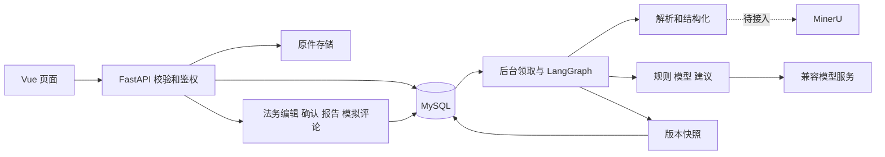
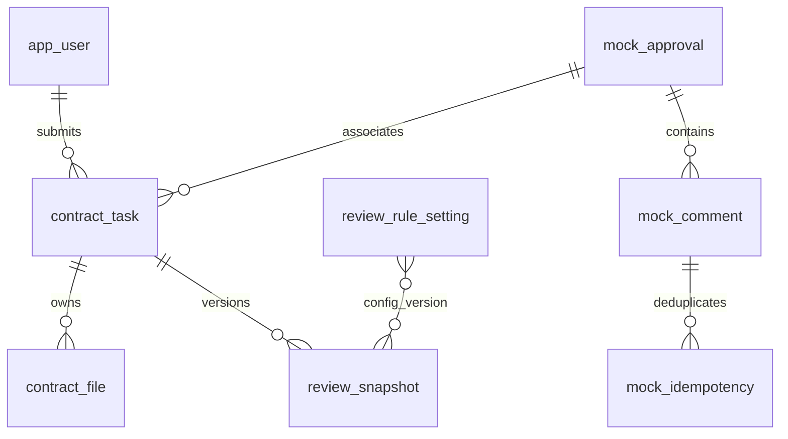
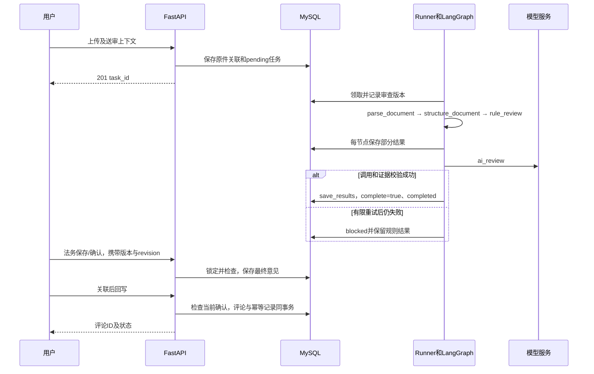

# 合同审批审查系统 Spec

| 项目 | 内容 |
|---|---|
| 版本 / 日期 | 1.0 / 2026-10-15 |
| 状态 / 作者角色 | 当前技术基线 / 技术设计整理 |
| 需求依据 | [PRD 1.0](PRD.md)，产品范围与验收由该文档定义 |

这是唯一维护的技术设计文档。正文区分“现有实现”和“待实现”，不把设计目标写成已完成。原始 DDL 和代码保留，后续数据库变更单独迁移；旧版设计与草稿从 Git 历史查询。[开发记录](开发记录/) 用于学习实现过程，其中旧章节号和历史状态不作为当前规格。

## 1. 架构设计

Vue 前端 + FastAPI 单体分层后端 + MySQL + 本地文件存储。LangGraph 串联业务步骤，节点内部调用普通函数；上传请求只保存原件、创建 pending 任务，不等待模型处理。

核心约束：结果绑定原件/审查版本；只有规则、关键模型审查成功并持久化才 completed；部分结果可看、可存草稿、可导出，但不能确认完整审查。正式认证、分布式队列、多租户和生产集群不在当前演示架构中。

## 2. 技术栈与依赖

| 层 | 使用技术与边界 |
|---|---|
| 前端 | Vue 3、Vite、Vue Router；当前页面用组合式 API 和共享样式，依赖项目已有包 |
| 接口与类型 | FastAPI、Pydantic，校验请求、IR、条款、字段与风险；SQLAlchemy 管理事务 |
| 数据与文件 | MySQL 8、本地 data/uploads；.env、data、日志、缓存不入库 |
| 流程 | LangGraph 五节点；单槽后台线程，MySQL pending 为持久待办来源 |
| 解析 | python-docx 已接入；PyMuPDF 文本 PDF 与 MinerU OCR 输入待接入 |
| 模型 | httpx 调用 OpenAI 兼容服务，Base URL/模型名/密钥由 .env 配置 |
| 报告与预览 | PyMuPDF 生成中文报告 PDF；合同 PDF 在线预览和 Word 映射待实现 |

标准条款先按合同类型、条款类别和适用说明选择维护的模板，不默认引入 embedding/Milvus；MinerU 是解析服务，与 Milvus 向量数据库不同。

## 3. 模块与边界



| 目录/模块 | 职责 | 对应 PRD |
|---|---|---|
| app/api、app/core/security.py | 请求格式、用户/角色/任务范围、业务接口 | FR-01/03/04/12/15/17/19 |
| app/services/runner.py | pending 领取、单槽执行、中断恢复、失败状态 | FR-02/04/16 |
| app/parsing | 文件到 ParsedDocument IR，校验文字和位置，不判断法律风险 | FR-05/11 |
| app/structuring | 条款切分/归类、字段提取、Anchor 证据 | FR-06/07/11 |
| app/review、app/graph | RuleReviewInput、规则、模型、建议及执行顺序 | FR-08/09/10/15 |
| app/services/result_store.py | 节点结果快照、版本保护、完整结果保存 | FR-04/08/09/16 |
| app/api/workspace.py、app/services/reports.py | 列表、复核、规则配置、数据库内模拟回写、报告 | FR-03/12/13/14/15 |
| frontend/src/views | 大盘、工作台、规则模板、环境页，调用后端，不替代后端鉴权 | FR-03/04/11～15 |

OCR、预览映射和外部审批协议适配后续单独实现；FR-18 样例贯穿各模块，FR-20/21 非当前 P0 前置。首版 workspace.py 路由较集中，后续随模块成熟拆服务，不重写已有解析结构。

## 4. 部署与后台执行

本地演示：浏览器 → Vite 5173 → API 8000（被占用可改 8001）→ MySQL 3307；模型/MinerU 为用户配置的外部服务。开发/测试复用现有 .venv，数据库集成用事务回滚的独立测试数据；不自动启动 Docker Desktop。

```powershell
# 两个终端分别执行；后端已有数据库时直接启动
pwsh -File scripts/start-backend.ps1 -Port 8001
pwsh -File scripts/start-frontend.ps1 -BackendPort 8001
```

ReviewRunner 使用 MySQL GET_LOCK 限制同库仅一个领取器，事务锁定待办并用 SKIP LOCKED 领取。一个任务执行，其余 pending；命名锁在连接结束时释放。外部调用和解析不长时间持有任务事务。

节点边界保存部分结果，错误转 blocked 并保留原因。启动时将残留 parsing/reviewing 标为 INTERRUPTED，由管理员重试；重试 review_version 加一，重新执行整份合同。当前未启用 LangGraph 检查点、任意节点续跑、处理总时限及分布式调度。旧执行保存须匹配当前版本，防止覆盖新结果。

## 5. 数据模型与版本

### 5.1 当前实际存储



规则版本与快照、审批编号与任务的关系是逻辑关联；物理主外键和唯一约束以 SQL 为准。

| 存储 | 关键字段与约束 |
|---|---|
| app_user | id、username、role_code、is_active；请求头 ID/角色必须与记录一致 |
| contract_task | task_no、申请人、类型、我方角色、状态、review_version、摘要/等级、阻塞、approval_no、writeback_status；送审信息不默认甲方 |
| contract_file | task_id、storage_path、original_name、file_md5、file_version；原件保留于 data/uploads，不向前端泄漏本地路径 |
| review_snapshot | `(task_id,review_version)` 唯一；payload JSON、human_review JSON、revision、confirmed_revision；新增于 002_workspace.sql |
| review_rule_setting | rule_code 主键、payload JSON、version；覆盖代码默认规则的已支持属性 |
| mock_approval/comment/idempotency | 审批编号、评论内容/作者；`(approval_no,idempotency_key)` 唯一，评论和幂等记录同事务写入 |

保留 [001_schema.sql](../sql/ddl/001_schema.sql) 已建细分表，首版不强行映射全部 ORM；后台启动仅额外执行 [002_workspace.sql](../sql/ddl/002_workspace.sql) 新建两张表，不重置旧数据。首版采用 JSON 快照缩短贯通时间；需要统计分析再迁移细分结果，不能同时维护两套事实来源。

payload 保存 document、clauses、metadata、rule_risks、ai_risks、suggestions、rule_versions、stage、complete、coverage_notes；人工编辑保存最终建议、补充意见、操作者与时间。revision 在人工保存时递增，确认绑定当次 revision；不是文件 ID 或审查批次号。

### 5.2 内存契约与证据

- `ParsedDocument`：full_text、段落、样式、表格关系、页/坐标及质量；段落/全文区间必须一致。
- `Clause`：顺序、层级、类型、原文区间；`MetadataResult/MetadataField`：标准值、原文、缺失状态、警告及 Anchor。
- `Anchor`：file_id、段落索引、局部/全文字符范围、证据文字、可用页码/bbox、精度。不得声明超出解析质量的精度；缺项风险不构造虚假 Anchor。
- `RuleReviewInput`：任务/文件/审查版本、合同类型、我方角色、原文、条款和字段。上下文从数据库加载，不让模型猜我方身份。
- `RiskResult/RiskItem`：风险类型/等级/来源、规则/条款编号、原因/依据与证据；建议单独带来源和草稿状态。

具体字段、枚举、长度与校验器以这些 Pydantic 类型为准；文档不重复复制代码表。State 引用上述结构，不在图里重定义 Clause/Risk。

### 5.3 待实现的预览与细分数据

Word 原件转换的 PDF 作为同原件版本的预览附件，记录原件/预览哈希、映射状态与页/矩形；不能当作新合同替换原件。重复文字需结合上下文或人工核验，唯一/已核验映射才能标精确；换原件使旧映射失效。

用户协助转换仅用于开发试验，最终转换组件待定。后续模板、逐项采纳、审计、审批 HTTP 请求日志等模块按需要复用现有细分表并写迁移；字段、约束和历史回填须在实施时验证，不直接执行旧草稿的 ALTER 建议。

## 6. 接口契约

### 6.1 已实现接口

成功包 `{code:0,message:"ok",data:...}`；错误包 `{code,message,data:null,errors?}`。下载为文件流。请求头使用 X-User-Id、X-User-Role；开发 `/demo/users` 仅返回预置身份，不能作为生产认证。

| 方法/路径 | 请求 | 成功 data / 主要失败 |
|---|---|---|
| POST /api/tasks/upload | multipart file、contract_type、our_party_role 必填；名称/部门/金额等可选 | 201 `{task_id,task_no,status,duplicated}`；422 格式、413 大小、415 类型、403 角色 |
| GET /api/tasks | status、risk_level、page、page_size | 200 `{items,total,page,page_size,stats}`；401/403 身份 |
| GET /api/tasks/{id} | 路径 id | 200 task、document、metadata、clauses、risks、complete、stage、human_review、revision、confirmed 等；403/404 |
| GET /api/tasks/{id}/original | 无请求体 | 授权原件文件流；403/404 |
| PATCH /api/tasks/{id}/review | review_version、expected_revision、suggestions 字典、comment、confirm | 200 `{revision,confirmed}`；403 非法务、409 版本/状态、422 未知风险或空最终建议 |
| POST /api/tasks/{id}/retry | review_version | 200 `{review_version,status}`；仅管理员，409 处理中或旧版本 |
| POST /api/tasks/{id}/mock-approval | 无请求体，开发法务/管理员 | 200 `{approval_no}`；403 非开发环境/角色 |
| POST /api/tasks/{id}/writeback | review_version、expected_revision | 200 `{writeback_status,comment_id,mode:"mock"}`；403 非法务、409 未完整/未确认/未关联 |
| GET /api/tasks/{id}/comments | 无请求体 | 200 评论数组；任务范围鉴权 |
| GET /api/tasks/{id}/report | format=md/pdf、download=false/true | 预览 `{markdown,review_version,partial}` 或文件流；409 尚无结果 |
| GET /api/rules；PATCH /api/rules/{code} | 编辑含 expected_version 和已支持字段 | 集合或保存后的版本；业务不能读，管理员才能改，冲突 409 |
| GET /api/workspace、/api/users/me；POST /api/demo/task | 能力、身份、业务创建合成 DOCX | 返回实际配置存在性/能力、身份、TaskCreated；样例入口仅开发环境 |

复核字段语义：suggestions 只合并传入风险 ID；comment 为此次保存的整段补充意见，省略按空串；confirm 默认为 false。保存会取消旧确认并重置回写状态。回写复用 ReviewEdit 入参类型，但仅消费版本/revision，必须先调用复核接口保存。

OpenAPI 节选（完整现有契约见运行服务 `/docs`）：

```yaml
paths:
  /api/tasks/{task_id}/review:
    patch:
      parameters:
        - {in: path, name: task_id, required: true, schema: {type: integer, minimum: 1}}
      requestBody:
        required: true
        content:
          application/json:
            schema:
              type: object
              required: [review_version, expected_revision]
              properties:
                review_version: {type: integer, minimum: 1}
                expected_revision: {type: integer, minimum: 0}
                suggestions: {type: object, additionalProperties: {type: string}}
                comment: {type: string, maxLength: 10000}
                confirm: {type: boolean, default: false}
      responses:
        '200': {description: 返回包装后的 revision 与 confirmed}
        '403': {description: 非法务或无任务权限}
        '409': {description: 版本冲突或关键审查未完成}
        '422': {description: 参数或最终建议无效}
```

错误段位：40001 参数（HTTP 422）、40100 身份、40300 权限、404xx 不存在、409xx 状态/版本、413xx/415xx 文件、500xx 内部。未实现外部适配的 502/504 具体错误码在所属模块落定，不宣称已有。

### 6.2 待实现接口

| 功能 | 目标契约与边界 |
|---|---|
| 模拟待办接入 FR-02 | POST /api/mock/events，event_id/approval_no/受控 attachment_ref/类型/我方角色，事件幂等；仅受控调用，不任意读本地路径/抓取地址 |
| 审批 HTTP 评论 FR-13 | POST/GET /api/mock/approvals/{no}/comments，idempotency_key/content；同键同内容重放、同键异内容拒绝 |
| 模板/条件 FR-15 | /api/templates 集合/对象维护及受限规则参数；expected_version 防覆盖，未知条件拒绝 |
| 审批配置 FR-17 | /api/admin/approval-config，脱敏读取/保存/验证，仅管理员 |
| 批量与重传 FR-16/19 | /api/tasks/batch 支持 retry/export 逐项反馈；版本化原件替换，不沿用旧确认/预览 |

以上是后续模块设计方向，最终请求模型和错误码随实现更新本章，前端不得提前当作已存在接口使用。

## 7. 图流程与人工操作



首批 7 条规则位于 engine.CATALOG，固定处理器检查主体、付款验收、责任上限、保密期限、不可抗力通知、保密缺项、大小写金额冲突。管理员可改启停、等级、依据和建议文本，暂不能编辑任意条件。模板建议标 template；现有覆盖不等于 PRD 全部风险已实现。

模型输入合同类型、我方角色及条款，明确合同内容是数据；输出 JSON 风险列表，由 Pydantic 校验，再检查条款编号及对应范围内唯一逐字证据，由程序生成 Anchor。建议标 llm，禁止编造外部信用/法条。当前一次发送全文条款，超过 45,000 字符明确受阻，后续实现分组审查，不能静默截断。未知类别条款仍进入模型候选。

模型超时当前默认 25 秒、最多额外重试 1 次，由 Settings 配置；实际 .env 可覆盖，尚未形成性能承诺。未启用/缺密钥为 AI_NOT_CONFIGURED；输出/调用错误为 AI_FAILED；过长为 AI_CONTEXT_LIMIT。用户已告知配置完成，下一轮须重启并实际验证，本文没有执行模型请求或改密钥。

当前模型风险与该风险建议同一响应校验；仅建议失败的独立重试/人工补充能力尚待拆分，不把这一产品要求计作已完成。规则风险建议使用示范文本；模型补充语义风险，跨来源去重和相关条款上下文判断仍需完善。

人工保存锁任务/快照，检查 review_version 和 expected_revision；仅 blocked/completed 可存草稿，仅完整结果可确认。回写再次检查完整/当前确认/审批关联；按任务、审查版本、最终报告内容计算幂等键，重复返回原评论。编辑与重审使旧确认失效。

当前模拟评论是本地数据库事务，不存在外部 HTTP 写回。外部适配实现时需持久请求快照、内容哈希、request_id 和结果日志；不持锁等待 HTTP，超时先按幂等键核对再重放，过期版本返回不得覆盖新状态。

报告和模拟回写共用已存快照生成 Markdown；PDF 用 PyMuPDF 内置中文字体换行分页，与合同转 PDF 预览是两项能力。当前报告基本字段/风险/建议/批注和完整性已有，送审部门、完整综合结论/关注要点等 PRD 全部要素及精细版式仍待补齐。

## 8. 非功能设计与必要验证

| PRD 目标 | 实现手段 / 待补 |
|---|---|
| 权限和密钥保密 | 身份格式先校验，再查数据库角色/任务范围；配置用 SecretStr，日志脱敏，不输出 Authorization/完整合同；生产认证另评审 |
| 持久和并发修改 | 数据库存待办及快照，任务锁+版本/revision，事务保存；前端保留未保存编辑并提示修订冲突 |
| 不丢任务/不假完成 | 单领取器、节点边界保存、启动恢复、有限重试；待补更完整审计、处理总时限及告警 |
| 查询和展示 | 列表分页/状态与申请人索引；大盘 4 秒、详情 3 秒轮询；长文档分页/按需加载待补，性能预算实测后定 |
| 外部依赖 | 模型有超时/有界重试；MinerU/审批接入时补对应超时和成功/失败用例，不声称已覆盖 |
| 回写一致性 | 同一快照渲染报告/评论，幂等唯一约束；后续 HTTP 结果不确定先核对再重放 |

本轮后续以少量必要验证为主，不为可逆文案变更增加全量回归。真实模型仅先用已授权合成合同，真实合同须用户另行提供允许发送的脱敏材料。已有定向结果见 PRD 第 10 章和开发记录 20～22；测试快照不证明真实模型有效。

## 9. 设计决策

| 决策 | 理由与后果 |
|---|---|
| 单体分层、节点内普通函数 | 复用已有代码，方便逐模块阅读；不拆微服务，模块成熟后再拆较大的路由服务 |
| 数据库待办+单槽执行 | 不依赖内存队列，避免重启丢待办；吞吐有限，后续按实测扩展 |
| 首版 JSON 版本快照 | 快速贯通并保留部分结果/人工意见，原细分表保留；分析查询能力有限，后续迁移需保持单一事实来源 |
| 固定处理器+受限配置 | 不执行用户任意表达式；完整条件表单和分类模板需逐模块补齐 |
| 先标签匹配示范条款 | 当前不强制向量库；必须有可维护的文本和来源，后续按检索不足再评估 |
| Word 保留原件+关联 PDF | 保持证据与显示版本一致；人工协助只用于开发试验，最终转换和映射待验证 |
| 关键模型失败受阻 | 保留可用结果，但不把规则初筛冒充完整审查；建议失败分离是后续缺口 |

## 10. 开发任务与依赖

阶段进度只在 [PRD 第 10 章](PRD.md#10-依赖阶段与当前进度) 维护，此处列技术顺序，不再另建开发清单。

| 顺序 | 任务 | 依赖及完成判断 |
|---|---|---|
| T-01 | 重启后端并联调已配置模型 | 已有后台/适配器；合成样本检查请求、结构、证据、建议和失败保护 |
| T-02 | 完整确认/模拟回写体验 | T-01；真实完整审查成功后法务确认、回写、导出，修正首轮页面问题 |
| T-03 | 文本 PDF 解析和预览 | 复用 IR/Anchor；页码、文字/坐标和风险对应，不能复用伪页码 |
| T-04 | Word 关联预览及映射 | T-03、用户转换试验；哈希/上下文/重复文字和跨页验证 |
| T-05 | MinerU 扫描件输入 | 验证真实协议/任务轮询/返回格式，统一 IR，成功样例及失败重试 |
| T-06 | 规则/模板与人工操作完善 | 已有首批配置/复核；补适用类型、条件、模板、依据、逐项采纳、仅建议失败处理 |
| T-07 | 审批待办/HTTP/配置/批量 | 已有本地幂等；事件和附件、参数脱敏、受控资源、失败核对、重传与逐项权限 |
| T-08 | 报告和完整验收 | 补全要素/版式/审计告警，三格式、正常/风险/异常及一个典型全链验收 |

每完成一个模块追加开发记录并同步本文件对应实现章节；不把记录当作新的产品规格。提交与推送按用户当次授权执行。

## 11. 待明确事项

| 事项 | 责任与处理 |
|---|---|
| 模型实际能力 | 技术用合成样本验证，之后用户提供允许发送的脱敏真实合同 |
| 模板和法律依据 | 用户/业务审核方提供和核验，待确认状态不当作已核验 |
| 转换器与 MinerU 协议 | 技术验证实际服务与文件，保留源版本和映射精度 |
| 性能、浏览器与演示日期 | 用户与技术在测量后确认；不恢复旧 60 工时承诺 |

自检：架构、职责、数据/版本、接口输入输出与错误、时序、非功能措施、设计决策及任务依赖齐全；当前与待实现明确区分，P0 缺口未删除。
