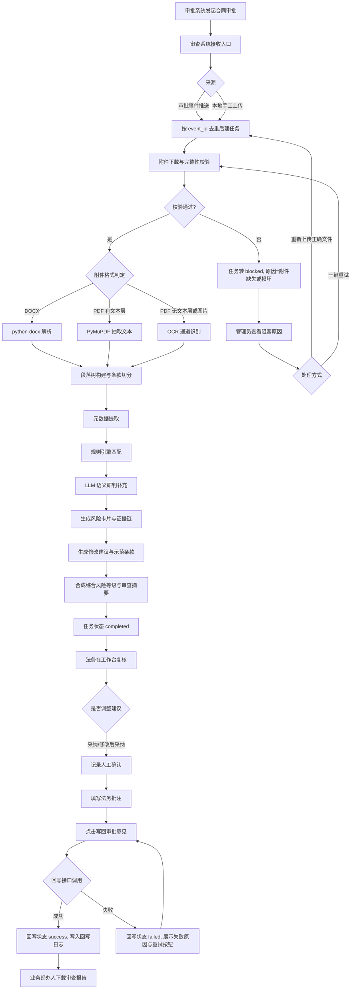
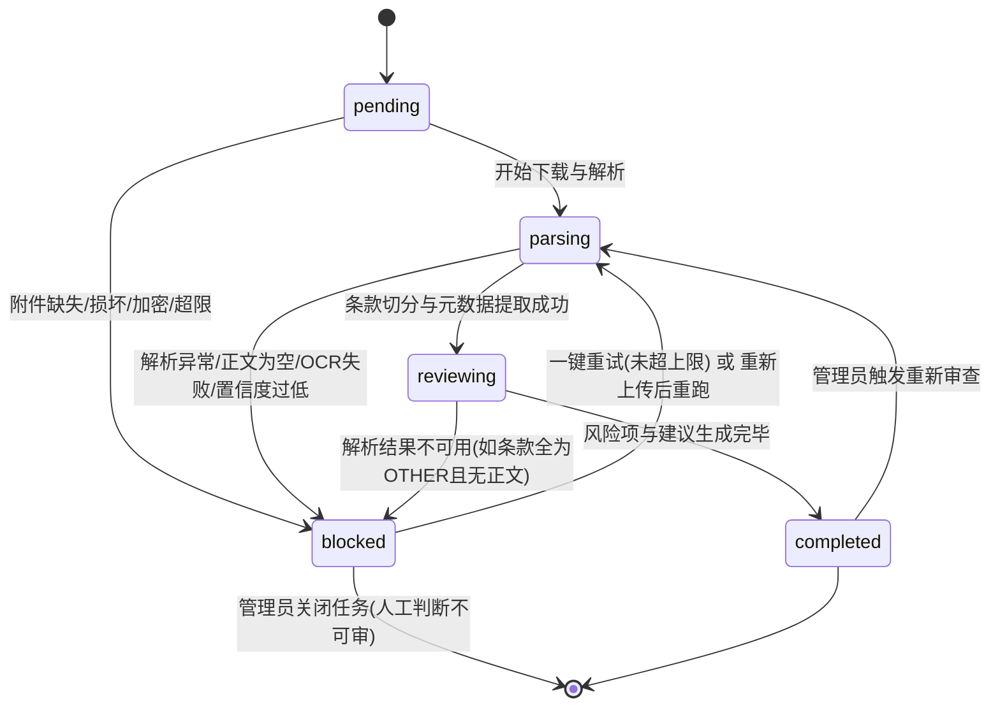
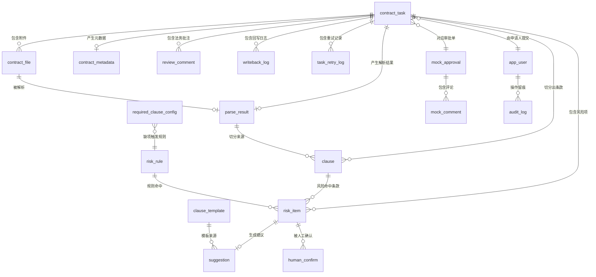

# 合同审批审查系统 PRD

## 1. 文档信息

### 1.1 版本与归属

| 项目 | 内容 |
|------|------|
| 文档名称 | 合同审批审查系统 产品需求文档（PRD） |
| 版本号 | V0.1 |
| 文档状态 | 评审稿 |
| 编制日期 | 2026-10-14 |
| 需求来源 | 《需求原文 2.4 合同审批审查系统》 |
| 适用范围 | 课程项目交付：可运行前端 + 后端审查服务 + 示例合同集 + 审批回写模拟模块 + 演示链路 |
| 文档负责人 | 产品负责人（待指派） |
| 技术负责人 | 后端负责人（待指派） |

### 1.2 角色与责任

| 角色 | 本项目中承担的职责 | 负责人 |
|------|-------------------|--------|
| 产品负责人 | 维护本文档、裁决需求优先级、确认待确认事项 | 待指派 |
| 后端负责人 | 解析引擎、审查引擎、状态机、接口实现 | 待指派 |
| 前端负责人 | 大盘页、双栏工作台、规则配置页实现 | 待指派 |
| 提示词/算法负责人 | LLM 提示词、规则引擎字段设计、风险判定准确率调优 | 待指派 |
| 法务顾问 | 确认法律依据表述、确认示范条款文本的合规性 | 待指派 |
| 测试负责人 | 示例合同集构造、验收标准逐条验证 | 待指派 |

### 1.3 修订记录

| 版本 | 日期 | 修订人 | 修订说明 |
|------|------|--------|---------|
| V0.1 | 2026-10-14 | 产品负责人（待指派） | 依据需求原文 2.4 与《prd生成提示词》首次成稿，覆盖 19 个章节 |
| V1.0 | 待定 | 待指派 | 评审通过、技术选型与待确认事项闭环后定基线 |

### 1.4 阅读指引

| 读者 | 必读章节 |
|------|---------|
| 后端工程师 | 第 7、8、9、10、11、12、13 章 |
| 前端工程师 | 第 7、10、13、14 章 |
| 提示词/算法工程师 | 第 8、9、15 章 |
| 测试工程师 | 第 7、15、16 章 |
| 项目管理者 | 第 2、4、18、19 章 |

## 2. 项目背景与目标

### 2.1 业务问题

企业在合同盖章前需要法务完成法律合规与商业风险审查。当前流程存在四个具体问题：

| 编号 | 问题 | 现状后果 |
|------|------|---------|
| P-01 | 人工逐条通读合同，单份 30 页合同平均耗时 40~60 分钟 | 高峰期法务积压，合同在审批流中等待超时 |
| P-02 | 审查依赖个人经验，不同法务对同一合同结论不一致 | 同一供应商的同类合同出现宽严不一的结论，业务方质疑公平性 |
| P-03 | 风险点仅口头或邮件说明，不与原文位置绑定 | 业务经办人无法定位到具体条款，整改沟通需反复往返 |
| P-04 | 审查意见散落在邮件、IM、审批备注中 | 事后追溯困难，同类风险无法沉淀为可复用规则 |

### 2.2 目标用户

| 用户 | 场景 | 核心诉求 |
|------|------|---------|
| 法务审查人 | 每日处理 5~20 份待审合同 | 快速定位风险条款、直接拿到可用的替换文本、一键回写审批单 |
| 业务经办人 | 提交合同并跟进审查结论 | 知道风险在哪一条、怎么改、多久能通过 |
| 系统管理员 | 维护规则、处理解析失败任务 | 规则改动即时生效、阻塞任务可查原因可重试 |

### 2.3 产品目标与成功指标

| 目标编号 | 目标 | 可量化成功指标 | 测量方式 |
|---------|------|--------------|---------|
| G-01 | 降低法务通读成本 | 单份 30 页以内合同从「原文本地打开、逐条阅读」到「拿到风险清单」的耗时 ≤ 3 分钟（P95） | 从任务 `parsing` 开始到 `completed` 的时间戳差值 |
| G-02 | 风险识别不漏项 | 对示例合同集中**预埋的**风险条款召回率 ≥ 90%（预埋清单见第 15 章） | 预埋风险数 vs 系统命中风险数 |
| G-03 | 建议可用 | 法务对 AI 修改建议的「采纳或轻微修改后采纳」比例 ≥ 60% | 工作台采纳按钮点击日志 / 展示的建议总数 |
| G-04 | 定位可溯源 | 风险卡片点击后跳转到原文正确位置的准确率 ≥ 95%（人工抽查 50 个卡片） | 抽查记录表 |
| G-05 | 回写闭环 | 审查意见回写审批 Mock 接口成功率 ≥ 98%（不含审批系统自身故障） | `writeback_log` 中 `success` 占比 |
| G-06 | 错误不静默 | 任何一次解析或回写失败，100% 在界面上可见原因，且可重试 | 阻塞任务列表 + 失败日志覆盖率检查 |
| G-07 | 误报可容忍 | 高风险误报率 ≤ 15%（即高风险项中经法务判定为误报的比例） | 法务复核时对高风险卡片标记「误报」的比例 |

### 2.4 不追求的指标

| 项 | 说明 |
|----|------|
| 全量合同类型覆盖 | 本期只覆盖采购、销售、服务、劳动四类，其他类型合同允许走「通用规则」降级审查 |
| 零误报 | 本系统定位为「辅助法务」，宁多报不漏报；指标只约束误报率上限 |
| 免人工确认的自动回写 | 任何回写必须由法务点击触发，不设计自动回写 |

## 3. 名词解释

| 名词 | 定义（本项目语境） |
|------|-------------------|
| 条款 | 合同中承载一项独立权利义务约定、可被单独引用与评价的最小文本单元。在本系统中指「解析后产生的、带锚点的一段文本」 |
| 必备条款 | 依据企业审查清单，某类合同必须出现的条款。缺失即产生一条 `MISSING_CLAUSE` 类型的风险项 |
| 权责对等 | 合同双方在违约责任、赔偿上限、解除条件等维度上承担的义务量级大致相当。系统用「我方赔偿上限是否存在」「双方违约金比例是否在同一量级」两条可判定条件近似判断 |
| 标的物 | 合同指向的交易对象，包括货物名称与规格、服务内容与范围、软件功能与许可范围 |
| 违约责任 | 一方未履行或未完全履行合同义务时承担的责任，含违约金比例、赔偿上限、滞纳金、继续履行与解除权 |
| 管辖地 | 争议解决的受理法院所在地或仲裁机构所在地。本项目关注「是否约定我方所在地」「是否约定与合同无实际联系的法院」 |
| 履约周期 | 合同生效到主要义务履行完毕的时间跨度，由起止日期或「自生效之日起 N 个自然日」表述 |
| 锚点 | 指回原文的一段定位信息，包含文件 ID、页码、段落索引、文本在解析文本中的字符起止位置，以及（扫描件）OCR 矩形框坐标 |
| 阻塞重试 | 文档无法完成解析时任务进入 `blocked` 状态并记录原因，由管理员修正后触发重新进入解析流水线的机制 |
| 回写 | 将审查结论、风险摘要与法务批注格式化为评论文本，通过审批系统评论接口写入审批单评论区 |
| 风险证据链 | 一条风险项从「命中哪条规则」到「原文哪一句」到「依据是什么」的完整可查证链条，由 `rule_id` + `clause_id` + `anchor` + `basis` 四要素构成 |
| 综合风险等级 | 单份合同的整体风险级别，取值「高风险 / 中风险 / 低风险」，由该合同全部风险项的最高等级决定 |
| 降级路径 | 某外部依赖（OCR、LLM、审批接口）不可用时，系统退而求其次的处理方式，且必须产生可见提示，不允许静默失败 |
| 人工确认 | 法务对某条 AI 建议点击「采纳」或「修改后采纳」的动作，是回写的前置条件之一 |

## 4. 范围界定

### 4.1 本期必做（P0）

判定标准：需求原文 2.4.10 验收标准中点名要求的能力均为 P0。

| 编号 | 范围项 | 理由 |
|------|-------|------|
| S-P0-01 | DOCX 格式合同接入与解析 | 2.4.10 第 1 条点名要求 |
| S-P0-02 | PDF（含文本层）格式合同接入与解析 | 2.4.10 第 1 条点名要求 |
| S-P0-03 | 扫描件（图片）走独立 OCR 通道解析 | 2.4.10 第 1 条点名要求，且主模型无视觉能力 |
| S-P0-04 | 合同元数据提取（主体、金额、期限等） | 2.4.10 第 2 条要求「核心元数据」且需记录位置 |
| S-P0-05 | 条款层级切分与条款类型归类 | 2.4.10 第 2 条要求「主要条款内容」，第 8 章依赖此能力 |
| S-P0-06 | 原文锚点定位（页码/段落/字符区间） | 2.4.10 第 2 条「记录原文页码与位置」、第 4 条「双向高亮定位」 |
| S-P0-07 | 合规风险审查（规则 + LLM），输出风险等级与依据 | 2.4.10 第 3 条点名要求 |
| S-P0-08 | 高风险/中风险判定规则集落地 | 2.4.9 两个示例场景均依赖高风险判定正确 |
| S-P0-09 | 修改建议示范条款生成，且支持法务编辑 | 2.4.10 第 5 条点名要求 |
| S-P0-10 | 双栏工作台：原文高亮 ↔ 风险卡片双向跳转 | 2.4.10 第 4 条点名要求 |
| S-P0-11 | 审查意见格式化与回写审批 Mock 接口 | 2.4.10 第 6 条点名要求 |
| S-P0-12 | 解析失败进入 `blocked` 并支持重试 | 2.4.10 第 7 条点名要求 |
| S-P0-13 | 审查报告导出（Markdown、PDF） | 需求原文 2.4 交付形式与 2.4.8 明确要求 |
| S-P0-14 | 端到端演示链路（拉取→解析→审查→复核→回写→导出） | 2.4.10 第 8 条点名要求 |
| S-P0-15 | 任务状态机与回写状态机落地 | 支撑 2.4.4 状态流转规则，是 P0 流程的基础 |
| S-P0-16 | 示例合同文件集（10~15 份，含 ≥5 份埋雷） | 2.4.10 全部条目都要靠它验证 |

### 4.2 本期可延后（P1）

| 编号 | 范围项 | 理由 | 延后代价 |
|------|-------|------|---------|
| S-P1-01 | 合规规则与模板配置页（可视化增删改规则） | 验收标准未点名；规则可先用 SQL/配置文件维护，不影响闭环 | 管理员改规则需重启服务或手工改库 |
| S-P1-02 | 规则版本管理与灰度生效 | 验收标准未点名；单实例演示无需版本灰度 | 规则变更无法回滚 |
| S-P1-03 | 审查任务批量操作（批量重试、批量导出） | 验收标准未点名；演示单份合同即为达标 | 大批量任务处理效率低 |
| S-P1-04 | 报告 Word 格式导出 | 2.4.8 只点名 PDF 与 Markdown | 业务方若坚持要 Word 需手工转换 |
| S-P1-05 | 风险卡片「误报」标注与规则调优闭环 | 不影响 G-07 的离线抽查方式 | 误报率只能靠离线统计，无法在线反馈 |
| S-P1-06 | 多轮对话式追问（针对某条款追问 LLM） | 非验收要求 | 法务需自行在外部工具中追问 |
| S-P1-07 | 审查大盘的多维度统计图表（趋势、Top 风险类型） | 需求只要求列表与筛选 | 缺少趋势洞察 |
| S-P1-08 | 条款相似度检索（历史相似条款复用） | 非验收要求，需要向量库投入 | 历史经验无法自动复用 |
| S-P1-09 | 服务/劳动合同的深度专项规则（超出通用规则部分） | 优先级排序：先跑通一份合同闭环（约束 4） | 服务、劳动类合同审查偏浅 |

### 4.3 明确不做（Out of Scope）

| 编号 | 不做项 | 理由 |
|------|-------|------|
| S-OUT-01 | 对接真实企业审批系统（钉钉、飞书、泛微、用友等） | 约束 3 明确审批系统用 Mock 实现 |
| S-OUT-02 | 电子签章、CA 证书、盖章流程 | 属于签署环节，不属于审查环节 |
| S-OUT-03 | 让主模型直接读图（多模态图像理解） | 约束 1 明确主模型无视觉能力 |
| S-OUT-04 | 自动批准/自动驳回审批单 | 审批决策权属于人，系统只输出意见 |
| S-OUT-05 | 合同正文在线编辑与在线签署版生成 | 系统只输出建议文本与报告，不改动原始合同文件 |
| S-OUT-06 | 用户注册、组织架构同步、SSO 单点登录 | 课程项目用预置账号与固定角色即可，不建设账号体系 |
| S-OUT-07 | 法律法规库的自动更新与法条检索 | 价格与合规风险不可控；法律依据统一标注「待法务确认」 |
| S-OUT-08 | 合同的机器翻译（中英互译合同） | 非验收要求，且 OCR + 翻译叠加会放大误差 |
| S-OUT-09 | 移动端适配 | 双栏工作台在移动端无法有效呈现 |
| S-OUT-10 | 多租户与数据隔离 | 单企业内网部署，无多租户需求 |

## 5. 用户角色与权限矩阵

### 5.1 角色定义

| 角色代号 | 角色名称 | 说明 |
|---------|---------|------|
| ROLE-LEGAL | 法务审查人 | 核心使用者，负责复核、采纳建议、批注、触发回写 |
| ROLE-BIZ | 业务经办人 | 提交合同、查看结论、下载报告 |
| ROLE-ADMIN | 系统管理员 | 维护规则与模板、处理阻塞任务、配置 Mock 对接参数 |

### 5.2 功能级权限矩阵

标记说明：`C` 创建，`R` 查看，`U` 修改，`D` 删除，`E` 执行（触发动作），`-` 无权限。

| 功能模块 | 功能点 | 法务审查人 | 业务经办人 | 系统管理员 |
|---------|-------|-----------|-----------|-----------|
| 合同任务 | 上传合同创建审查任务 | C E | C E | C E |
| 合同任务 | 查看合同任务列表 | R（全部） | R（仅本人提交） | R（全部） |
| 合同任务 | 查看任务详情与解析结果 | R | R（仅本人提交） | R |
| 合同任务 | 删除合同任务 | - | - | D |
| 文档解析 | 查看解析失败原因 | R | R（仅本人提交） | R |
| 文档解析 | 触发重新解析（重试） | E | - | E |
| 文档解析 | 手工修正元数据字段 | U | - | U |
| 风险审查 | 查看风险卡片与证据链 | R | R（仅本人提交） | R |
| 风险审查 | 标记风险为「误报」 | U | - | U |
| 修改建议 | 查看 AI 推荐修改条款 | R | R（仅本人提交） | R |
| 修改建议 | 编辑建议文本 | U | - | U |
| 修改建议 | 采纳建议（写入人工确认记录） | E | - | - |
| 法务批注 | 填写法务意见 | C U | - | - |
| 回写 | 触发回写到审批单评论区 | E | - | - |
| 回写 | 查看回写状态与回写日志 | R | R（仅本人提交） | R |
| 报告 | 导出审查报告（MD/PDF） | E | E（仅本人提交） | E |
| 规则模板 | 查看规则与示范条款库 | R | - | R |
| 规则模板 | 新增/修改/停用规则 | - | - | C U |
| 规则模板 | 新增/修改示范条款模板 | - | - | C U |
| 规则模板 | 删除规则或模板 | - | - | D |
| 系统配置 | 配置 Mock 审批系统对接参数 | - | - | U |
| 系统配置 | 查看系统审计日志 | - | - | R |
| 系统配置 | 查看阻塞任务告警 | R | - | R E |

### 5.3 权限实现约束

| 编号 | 约束 |
|------|------|
| AUTH-01 | 请求头携带 `X-User-Id` 与 `X-User-Role`，后端在依赖注入层校验，前端隐藏无权限按钮仅作体验优化，不作为安全边界 |
| AUTH-02 | 业务经办人的「仅本人提交」过滤条件在 SQL 层拼入 `applicant_id = :current_user_id`，不允许在前端过滤 |
| AUTH-03 | 越权访问返回 HTTP 403，响应体 `{"code": 40300, "message": "无权限操作该资源"}` |

## 6. 业务流程

### 6.1 端到端主流程



### 6.2 子流程一：审批触发与自动审查

| 步骤 | 执行方 | 动作 | 输入 | 输出 | 失败处理 |
|------|-------|------|------|------|---------|
| 1 | 审批 Mock / 业务经办人 | 发起合同审批或手工上传 | 审批单号、合同名称、申请人、部门、业务类型、附件 | 审查任务记录 | 参数缺失返回 40001 并拒绝建任务 |
| 2 | 接入与流转模块 | 按 `source_event_id` 去重，创建任务，状态置 `pending` | 上一步参数 | `contract_task` 一条记录，状态 `pending` | 重复事件直接返回既有任务 ID，不重复建任务 |
| 3 | 接入与流转模块 | 下载附件，校验文件可读性、大小、扩展名、是否加密 | 附件 URL 或上传文件 | 本地文件 + `contract_file` 记录 | 加密、空文件、超 50MB、扩展名不支持 → 状态 `blocked`，记录 `block_reason` |
| 4 | 文档解析引擎 | 判定格式通道：DOCX / PDF 文本层 / 图片 OCR | `contract_file` | 初始状态置 `parsing`，写 `parse_result` | 任一通道异常 → `blocked`，`block_reason` 记录异常类型 |
| 5 | 文档解析引擎 | 抽取文本、构建段落树、切分条款并归类 | 文件 | `clause` 记录列表（含锚点） | 条款切分结果为空 → `blocked`，原因 `EMPTY_BODY` |
| 6 | 文档解析引擎 | 提取元数据字段 | 段落树 | `contract_metadata` 记录 | 单个字段缺失不阻塞，字段值置 `null` 并在工作台标「未识别」 |
| 7 | 智能审查引擎 | 规则引擎模式匹配，产出候选风险 | 条款 + 元数据 + 规则库 | `risk_item` 记录（`source=rule`） | 规则库为空时记 `review_degraded=true` 并继续 |
| 8 | 智能审查引擎 | LLM 对候选条款做合规研判，回填证据链 | 条款文本 + 规则命中结果 | `risk_item` 记录（`source=llm`）及 `basis` | LLM 超时或失败 → 保留规则结果，任务标记「降级审查」 |
| 9 | 条款推荐引擎 | 为每条风险生成修改建议 | 风险项 + 示范条款库 | `suggestion` 记录 | 生成失败 → 该卡片展示「建议生成失败，请手工填写」，不阻塞任务 |
| 10 | 智能审查引擎 | 合成综合风险等级与摘要 | 全部风险项 | 任务综合等级、`review_summary` | 无风险项时等级为「低风险」 |
| 11 | 接入与流转模块 | 状态置 `completed`，记录完成时间与耗时 | 上述全部结果 | 状态 `completed` | 无 |

### 6.3 子流程二：法务人工复核与协同改写

| 步骤 | 执行方 | 动作 | 前置条件 | 结果 |
|------|-------|------|---------|------|
| 1 | 法务审查人 | 在大盘页筛选「审查完成 + 高风险」，进入工作台 | 任务状态为 `completed` | 左栏渲染合同原文，右栏渲染风险卡片 |
| 2 | 法务审查人 | 点击某张风险卡片 | 风险项锚点存在 | 左栏滚动到对应位置并高亮，高亮持续 3 秒后转为常驻淡色标记 |
| 3 | 法务审查人 | 核对风险成因与法律依据，判断是否成立 | 证据链完整展示 | 可点击「误报」标记，该风险项被排除出回写摘要 |
| 4 | 法务审查人 | 对成立的风险，采纳或编辑推荐修改条款 | 建议文本存在 | 写入 `human_confirm` 记录，含确认人、确认时间、最终文本 |
| 5 | 法务审查人 | 填写法务批注 | 任务状态 `completed` | 写入 `review_comment`，支持多条追加 |
| 6 | 法务审查人 | 点击「写回审批意见」 | 至少 1 条风险已确认或已填写批注 | 回写状态置 `writing`，异步调用 Mock 评论接口 |
| 7 | 审批回写模块 | 构建 Markdown 评论文本并写回 | 回写状态 `writing` | 成功置 `success` 并写 `writeback_log`；失败置 `failed` 并记录错误码 |
| 8 | 业务经办人 | 查看风险点与整改建议、下载报告 | 任务状态 `completed` | 可导出 Markdown 与 PDF，文件名为 `合同名称_审查报告_YYYYMMDD.md` |

### 6.4 子流程三：异常任务阻塞与重试

| 步骤 | 执行方 | 动作 | 触发条件 | 结果 |
|------|-------|------|---------|------|
| 1 | 接入与流转模块 | 捕获解析异常或依赖超时，任务置 `blocked` | 附件损坏、加密、正文为空、OCR 全失败、解析异常抛出 | 记录 `block_reason`（枚举见 11.3）与 `block_detail` 原文 |
| 2 | 接入与流转模块 | 推送告警 | 任务进入 `blocked` | 阻塞任务列表新增一条，列表页显示红色「阻塞」标签 |
| 3 | 系统管理员 | 在大盘页查看阻塞原因 | 存在 `blocked` 任务 | 展示原因枚举、原始异常摘要、建议处理动作 |
| 4 | 系统管理员 | 选择处理方式 | 上一步 | 方式 A「一键重试」：不换文件重跑解析；方式 B「重新上传」：替换附件后重跑；方式 C「手工录入」：跳过解析直接进入人工审查（P1） |
| 5 | 接入与流转模块 | 重试次数 +1，超过上限则锁定 | 触发重试 | 见 11.4 重试策略；超限后 `blocked` 转为不可自动重试，仅允许换文件或人工录入 |
| 6 | 接入与流转模块 | 重试成功则回到 `parsing` 并继续主流程 | 重试解析成功 | 状态流转 `blocked → parsing`，`retry_count` 保留用于统计 |

## 7. 功能需求

### 7.1 需求汇总表

| 编号 | 模块 | 功能名称 | 优先级 |
|------|------|---------|-------|
| FR-101 | 文档接入与流转 | 手动上传合同创建审查任务 | P0 |
| FR-102 | 文档接入与流转 | 审批系统事件接入与去重 | P0 |
| FR-103 | 文档接入与流转 | 附件下载与完整性校验 | P0 |
| FR-104 | 文档接入与流转 | 任务状态机驱动与查询 | P0 |
| FR-105 | 文档接入与流转 | 阻塞任务展示与重试 | P0 |
| FR-106 | 文档接入与流转 | 审查任务列表与多条件筛选 | P0 |
| FR-201 | 文档解析与条款切分 | DOCX 结构化解析 | P0 |
| FR-202 | 文档解析与条款切分 | PDF 文本层解析 | P0 |
| FR-203 | 文档解析与条款切分 | 扫描件 OCR 解析与降级 | P0 |
| FR-204 | 文档解析与条款切分 | 条款层级切分 | P0 |
| FR-205 | 文档解析与条款切分 | 条款类型归类 | P0 |
| FR-301 | 元数据提取 | 核心元数据字段提取 | P0 |
| FR-302 | 元数据提取 | 元数据人工修正 | P1 |
| FR-303 | 元数据提取 | 元数据锚点记录 | P0 |
| FR-401 | 合规风险审查 | 规则引擎模式匹配 | P0 |
| FR-402 | 合规风险审查 | LLM 语义研判与证据链生成 | P0 |
| FR-403 | 合规风险审查 | 风险等级判定与综合等级合成 | P0 |
| FR-404 | 合规风险审查 | 必检条款缺失检测 | P0 |
| FR-405 | 合规风险审查 | 审查降级与提示 | P0 |
| FR-406 | 合规风险审查 | 误报标记 | P1 |
| FR-501 | 修改建议生成 | 基于示范条款库的修改建议 | P0 |
| FR-502 | 修改建议生成 | 建议文本人工编辑与采纳 | P0 |
| FR-503 | 修改建议生成 | 建议生成失败兜底 | P0 |
| FR-601 | 双栏工作台交互 | 双栏联动与双向高亮 | P0 |
| FR-602 | 双栏工作台交互 | 文档分页与跨页滚动定位 | P0 |
| FR-603 | 双栏工作台交互 | 风险卡片分级展示与筛选 | P0 |
| FR-604 | 双栏工作台交互 | 审查摘要与完成度进度 | P0 |
| FR-605 | 双栏工作台交互 | 法务批注填写与管理 | P0 |
| FR-701 | 审批回写 | 回写内容生成 | P0 |
| FR-702 | 审批回写 | 一键回写与状态轮询 | P0 |
| FR-703 | 审批回写 | 回写失败重试 | P0 |
| FR-704 | 审批回写 | 审查报告导出 | P0 |
| FR-705 | 审批回写 | 回写日志与审计留痕 | P0 |
| FR-801 | 规则与模板管理 | 规则列表查看与检索 | P0 |
| FR-802 | 规则与模板管理 | 规则条件编辑 | P1 |
| FR-803 | 规则与模板管理 | 示范条款模板库维护 | P1 |
| FR-804 | 规则与模板管理 | 规则启用/停用与生效即时性 | P1 |
| FR-805 | 规则与模板管理 | Mock 审批对接参数配置 | P0 |

### 7.2 文档接入与流转

**FR-101 手动上传合同创建审查任务**

- **优先级**：P0
- **用户故事**：作为业务经办人，我希望直接上传本地合同文件发起审查，以便在审批系统尚未接入时也能送审。
- **验收标准**：
  1. Given 用户已登录且角色为业务经办人，When 上传一个 3MB 的 `.docx` 文件并填写合同名称、业务类型、合同金额，Then 系统返回 201 与 `task_id`，且合同名称、业务类型、申请人出现在大盘页首行，状态为「待处理」。
  2. Given 用户上传扩展名为 `.exe` 的文件，When 点击提交，Then 系统返回错误码 41501，不创建任务，页面提示「仅支持 docx / pdf / png / jpg 格式」。
  3. Given 用户上传一个 60MB 的文件，When 点击提交，Then 系统返回错误码 41301，页面提示「单个文件不超过 50MB」。
  4. Given 用户上传的文件名为空或仅含空格，When 点击提交，Then 返回 40001 并提示「合同名称不能为空」，文件不落盘。
- **依赖与备注**：文件落盘路径 `data/uploads/{task_id}/{task_id}_{file_version}.{ext}`，用户提供的原始文件名仅存于 `contract_file.original_name`，不参与路径拼接（见 NFR-S-04）；同一次上传若重复提交同一文件，按 `file_md5` 判重并复用已有任务。

**FR-102 审批系统事件接入与去重**

- **优先级**：P0
- **用户故事**：作为系统管理员，我希望审查系统能接收审批 Mock 推送的待办事件，以便合同在审批流中自动进入审查队列。
- **验收标准**：
  1. Given 审批 Mock 推送一条含 `event_id`、`approval_no`、`contract_name`、`applicant`、`attachment_url` 的事件，When 审查系统接收，Then 创建任务并返回 200，任务状态为 `pending`，`source_type` 记为 `APPROVAL_EVENT`。
  2. Given 同一条 `event_id` 被重复推送 3 次，When 审查系统连续接收，Then `contract_task` 表中该 `source_event_id` 只存在 1 条记录，后续 2 次返回 200 与既有 `task_id`。
  3. Given 推送事件缺少 `attachment_url`，When 审查系统接收，Then 返回 40001 且不创建任务，同时在接口日志中记录缺失字段名。
- **依赖与备注**：Mock 推送用「拉取待办」与「事件推送」两种方式各实现一个入口，`GET /api/mock/approval/todos` 供主动拉取；去重键为 `source_event_id`，建唯一索引。

**FR-103 附件下载与完整性校验**

- **优先级**：P0
- **用户故事**：作为法务审查人，我希望系统在校验不通过时立刻告诉我原因，以便不用等待解析超时才知道文件有问题。
- **验收标准**：
  1. Given 附件下载返回 404，When 系统尝试下载，Then 任务在 30 秒内进入 `blocked`，`block_reason` 为 `ATTACHMENT_MISSING`，列表页显示「附件缺失」。
  2. Given 附件是一个加密的 PDF，When 系统尝试打开，Then 任务进入 `blocked`，`block_reason` 为 `ENCRYPTED_FILE`，且不进入 OCR 通道。
  3. Given 附件下载成功且校验通过，When 校验结束，Then `contract_file.file_size`、`file_md5`、`mime_type` 三个字段均被写入且非空。
- **依赖与备注**：校验项包含 MIME 类型白名单、文件大小区间（1KB~50MB）、可读性（能被对应解析库打开）、去重（`file_md5` 命中同申请人历史任务时提示「疑似重复送审」但允许继续）。

**FR-104 任务状态机驱动与查询**

- **优先级**：P0
- **用户故事**：作为法务审查人，我希望实时看到任务处于待处理/解析中/审查中/阻塞/完成的哪个阶段，以便判断是否需要介入。
- **验收标准**：
  1. Given 任务当前为 `pending`，When 后端开始解析附件，Then 任务状态在 2 秒内变为 `parsing`，且前端轮询接口能读到新状态。
  2. Given 任务状态为 `parsing`，When 客户端发起 `pending → completed` 直接跳转的更新请求，Then 后端返回 42201 并拒绝，任务状态不变。
  3. Given 任务已完成，When 管理员触发重试，Then 任务状态从 `completed` 回到 `parsing`，`retry_count` 递增 1。
- **依赖与备注**：状态合法转移由第 11 章状态机表定义，后端用白名单字典校验，任何不在白名单内的转移一律拒绝并记 WARN 日志。

**FR-105 阻塞任务展示与重试**

- **优先级**：P0
- **用户故事**：作为系统管理员，我希望看到每个阻塞任务的具体原因并一键重试，以便在文件问题修复后快速恢复流转。
- **验收标准**：
  1. Given 存在 3 个 `blocked` 任务，When 管理员在大盘页筛选状态为「阻塞」，Then 列表仅返回这 3 条，并展示 `block_reason` 的可读中文说明与进入阻塞的时间。
  2. Given 管理员对某阻塞任务点击「一键重试」并已替换为新文件，When 重试成功，Then 任务状态变为 `parsing` 并继续主流程，最终到达 `completed`。
  3. Given 某任务 `retry_count` 已达 3，When 管理员再次点击「一键重试」，Then 按钮置灰，接口返回 42901 并提示「已达最大重试次数，请更换文件或人工录入」。
- **依赖与备注**：重试策略与上限见 11.4；重试记录写入 `task_retry_log`（`task_id`、`retry_no`、`operator`、`result`、`created_at`）。

**FR-106 审查任务列表与多条件筛选**

- **优先级**：P0
- **用户故事**：作为法务审查人，我希望按风险等级与状态筛选待审合同，以便优先处理高风险合同。
- **验收标准**：
  1. Given 库中存在 20 条任务，其中 5 条为高风险，When 筛选「综合风险等级 = 高风险 且 状态 = 审查完成」，Then 返回且仅返回这 5 条。
  2. Given 列表页每页展示 10 条，When 翻到第 3 页，Then 返回第 21~30 条，响应体包含 `total`、`page`、`page_size` 三个字段。
  3. Given 筛选条件中的 `status` 传入合法枚举之外的值，When 查询，Then 返回 40001 并列出合法枚举值。
- **依赖与备注**：可筛选字段为合同名称（模糊）、申请人、业务类型、审查状态、回写状态、综合风险等级、创建时间区间；默认按创建时间倒序。

### 7.3 文档解析与条款切分

**FR-201 DOCX 结构化解析**

- **优先级**：P0
- **用户故事**：作为法务审查人，我希望系统保留 Word 的标题层级与段落结构，以便条款切分符合合同的真实结构。
- **验收标准**：
  1. Given 一份含 5 个一级标题、18 个二级标题的 `.docx`，When 解析完成，Then 系统输出与标题层级一致的段落树，每个段落记录 `paragraph_index`（从 0 开始）与 `style_name`。
  2. Given 文档正文含一张条款表格，When 解析完成，Then 表格内容被抽取为文本并附加在原段落之后，且不产生空条款。
  3. Given 文档含页眉页脚中的公司名，When 解析完成，Then 正文解析文本中不包含页眉页脚文本（避免污染条款内容）。
- **依赖与备注**：使用 `python-docx`；DOCX 无固定义页码，页码字段统一记 `null`，锚点降级为「段落索引 + 字符区间」。

**FR-202 PDF 文本层解析**

- **优先级**：P0
- **用户故事**：作为法务审查人，我希望有文本层的 PDF 合同能得到逐页解析结果，以便风险卡片能精确跳到某一页。
- **验收标准**：
  1. Given 一份 12 页、有文本层的 PDF，When 解析完成，Then `parse_result.page_count` 为 12，每页都产生对应的解析文本，且每条条款的锚点 `page_no` 均落在 1~12 范围内。
  2. Given 某 PDF 每页可抽取文本少于 20 个字符，When 判定通道，Then 该文件被判定为「无有效文本层」并转入 OCR 通道。
  3. Given PDF 为双栏排版，When 解析完成，Then 文本按阅读顺序（先上后下、先左后右）拼接，不出现左右栏交错成句的情况。
- **依赖与备注**：使用 `PyMuPDF`；字符区间为「该页解析文本内的字符偏移」，与全文偏移同时记录，见第 10 章。

**FR-203 扫描件 OCR 解析与降级**

- **优先级**：P0
- **用户故事**：作为业务经办人，我希望扫描件合同也能被审查，以便纸质签署的合同不必重新录入。
- **验收标准**：
  1. Given 一份 300dpi 的扫描件 PDF（无文本层），When 提交审查，Then 系统调用 OCR 通道，输出带 `page_no`、`bbox`、`text` 的结构化结果，任务最终到达 `completed`。
  2. Given OCR 服务连接超时，When OCR 调用失败，Then 系统自动降级到本地 OCR 引擎重试一次；若本地同样失败，任务进入 `blocked`，`block_reason` 为 `OCR_FAILED`，并在界面提示「扫描件识别失败，请上传更清晰的文件」。
  3. Given 扫描件整体模糊且 OCR 输出的平均置信度低于 0.6，When 解析完成，Then 任务进入 `blocked`，`block_reason` 为 `OCR_LOW_CONFIDENCE`，`block_detail` 记录平均置信度数值。
- **依赖与备注**：降级链路为「MinerU 服务 → 本地 PaddleOCR → blocked」；OCR 输出的 `bbox` 是扫描件唯一可用的精确定位依据，精度说明见 10.4。

**FR-204 条款层级切分**

- **优先级**：P0
- **用户故事**：作为法务审查人，我希望合同被切成一条条可单独评价的条款，以便风险卡片能指向具体条款而不是整篇合同。
- **验收标准**：
  1. Given 文档中存在 `第一条`、`第二条` 形式的中文数字标题，When 切分完成，Then 每一条产生一个独立条款记录，`clause_no` 分别为「第一条」「第二条」。
  2. Given 文档中存在 `1.1`、`1.2`、`（一）`、`(1)` 四种编号形式，When 切分完成，Then 四者均被识别为编号前缀，`clause_level` 分别记为 1、1、2、3，且条款文本中不包含编号前缀本身。
  3. Given 一段文本长度超过 3000 字符且无任何编号，When 切分完成，Then 该段按自然段进一步拆分，每个子条款 `clause_level` 为 0，并记录 `parent_clause_id` 指向原段。
  4. Given 切分结果为 0 条条款，When 切分结束，Then 任务进入 `blocked`，`block_reason` 为 `EMPTY_BODY`。
- **依赖与备注**：切分优先级为「编号正则 → 标题样式 → 空行自然段 → 长度兜底」四级；每级规则命中情况写入 `parse_result.split_strategy` 便于排查。

**FR-205 条款类型归类**

- **优先级**：P0
- **用户故事**：作为法务审查人，我希望每条条款被自动打上类型标签，以便规则的适用判断有依据。
- **验收标准**：
  1. Given 一条含「乙方应于本合同签订之日起 30 日内支付货款」的条款，When 归类完成，Then `clause_type` 为 `PAYMENT`，`clause_type_confidence` ≥ 0.7。
  2. Given 一条条款同时命中「付款」与「验收」两个关键词，When 归类完成，Then 系统按第 8 章定义的关键词权重取最高分类型作为主类型，并把次高分类型写入 `clause_type_secondary`。
  3. Given 一条条款无法匹配任何类型关键词且 LLM 归类超时，When 归类完成，Then `clause_type` 记为 `OTHER`，且该条款不参与任何依赖条款类型的规则判定，不阻塞整份合同的审查。
- **依赖与备注**：类型枚举与判定权重见第 8 章；归类结果一经写入可被人工覆盖（P1）。

### 7.4 元数据提取

**FR-301 核心元数据字段提取**

- **优先级**：P0
- **用户故事**：作为法务审查人，我希望系统自动填好合同的主体、金额、期限等要素，以便不必在正文里反复搜索。
- **验收标准**：
  1. Given 合同正文含「甲方：某某科技有限公司 统一社会信用代码：91310000MA1XXXXX0A」，When 提取完成，Then `party_a_name` 与 `party_a_uscc` 两个字段均被填充，且 `party_a_uscc` 通过 18 位校验规则。
  2. Given 合同含「合同总金额：人民币壹佰贰拾万元整（¥1,200,000.00）」，When 提取完成，Then `amount` 为 `1200000.00`、`currency` 为 `CNY`，且保留原文表述在 `amount_raw` 字段。
  3. Given 合同中未出现任何金额表述，When 提取完成，Then `amount` 为 `null`，接口仍返回 200，工作台该字段显示「未识别」，并产生一条元数据缺失的风险项。
- **依赖与备注**：必提字段清单为 `party_a_name`、`party_a_uscc`、`party_b_name`、`party_b_uscc`、`amount`、`currency`、`perform_start_date`、`perform_end_date`、`effective_condition`、`contract_no`、`contract_title`。

**FR-302 元数据人工修正**

- **优先级**：P1
- **用户故事**：作为系统管理员，我希望在提取错误时手工改正元数据，以便后续规则判定基于正确数据。
- **验收标准**：
  1. Given 某任务的 `amount` 被错误提取为 `12000.00`，When 管理员修正为 `1200000.00` 并保存，Then 该字段的 `source` 变为 `manual`，并记录 `updated_by` 与 `updated_at`。
  2. Given 元数据被人工修正，When 法务重新打开工作台，Then 基于金额的规则（如违约金比例上限）按修正后的值重新判定，界面提示「元数据已修正，请重新审查以更新风险」。
- **依赖与备注**：修正不自动触发全量重审，避免误覆盖已确认的风险结论；由用户显式点击「重新审查」触发。

**FR-303 元数据锚点记录**

- **优先级**：P0
- **用户故事**：作为法务审查人，我希望点击元数据字段能跳到原文中的对应位置，以便核实提取是否正确。
- **验收标准**：
  1. Given 元数据 `amount` 被提取，When 查询该字段，Then 返回其锚点 `{page_no, paragraph_index, char_start, char_end}`，且 `char_end - char_start` 等于原文金额片段的长度。
  2. Given 元数据字段来自 OCR 结果，When 查询该字段，Then 锚点额外包含 `bbox`，前端据此在扫描件图片上绘制矩形框。
- **依赖与备注**：锚点结构定义见第 10 章；元数据锚点与条款锚点使用同一结构，区别仅在 `anchor_type` 取值。

### 7.5 合规风险审查

**FR-401 规则引擎模式匹配**

- **优先级**：P0
- **用户故事**：作为法务审查人，我希望明确的违规表述被规则稳定命中，以便不依赖大模型的随机性。
- **验收标准**：
  1. Given 条款文本含「乙方承担无限连带责任」且未出现赔偿上限表述，When 审查执行，Then 命中规则 `R-LIA-01`，生成 `risk_level=HIGH` 的风险项，`source=rule`。
  2. Given 某规则的 `applies_to_contract_type` 为 `PURCHASE`，When 审查一份 `SALES` 类型合同，Then 该规则不参与匹配，风险项中不出现该 `rule_id`。
  3. Given 一条条款同时命中 2 条规则，When 审查执行，Then 生成 2 条独立风险项，不合并、不覆盖。
- **依赖与备注**：规则表结构见 12 章 `risk_rule`；匹配方式为关键词命中 + 正则 + 数值比较三类条件的组合，条件表达能力见 9.1。

**FR-402 LLM 语义研判与证据链生成**

- **优先级**：P0
- **用户故事**：作为法务审查人，我希望规则没覆盖到的隐晦风险也能被识别，以便不依赖规则库的完备性。
- **验收标准**：
  1. Given 一条未命中任何规则但存在权责不对等的条款，When LLM 研判执行，Then 输出一条 `source=llm` 的风险项，且必须包含 `basis`（风险成因说明）与 `anchor`（指向原文的锚点）两个非空字段。
  2. Given LLM 返回的条款引用在前文段落中找不到匹配文本，When 结果入库前校验，Then 该风险项被丢弃并记 WARN 日志，不计入风险清单。
  3. Given LLM 对同一条款的两次调用返回不同的风险等级，When 结果入库，Then 风险等级取两次结果中的较高等级。
- **依赖与备注**：LLM 调用统一走 OpenAI 兼容协议，模型名由环境变量 `LLM_MODEL_NAME` 注入；要求模型输出严格 JSON，解析失败时按 FR-405 降级。

**FR-403 风险等级判定与综合等级合成**

- **优先级**：P0
- **用户故事**：作为业务经办人，我希望一眼看到整份合同是高风险还是低风险，以便判断这单能不能过。
- **验收标准**：
  1. Given 某合同存在 1 条高风险、3 条低风险风险项，When 合成综合等级，Then 任务 `overall_risk_level` 为 `HIGH`。
  2. Given 某合同全部风险项均为中风险，When 合成综合等级，Then 任务 `overall_risk_level` 为 `MEDIUM`。
  3. Given 某合同风险项为 0 条，When 合成综合等级，Then `overall_risk_level` 为 `LOW`，且 `review_summary` 输出「未发现风险项，建议按常规流程审批」。
- **依赖与备注**：合成规则为「取最高等级」；`overall_risk_level` 的计算逻辑不得放在前端。

**FR-404 必检条款缺失检测**

- **优先级**：P0
- **用户故事**：作为法务审查人，我希望系统明确告诉我哪条必备条款没写，以便补齐后再走流程。
- **验收标准**：
  1. Given 一份采购合同全文未出现任何保密相关表述，When 审查完成，Then 生成一条风险项，`risk_type=MISSING_CLAUSE`、`clause_type=CONFIDENTIALITY`、`risk_level` 按第 9 章 `R-MIS-03` 取值。
  2. Given 某合同类型的必检条款清单为空，When 审查完成，Then 不产生任何缺项风险，且 `review_degraded` 置为 `true` 并注明「未配置该合同类型的必检清单」。
- **依赖与备注**：必检条款清单按合同类型配置，见 12 章 `required_clause_config`。

**FR-405 审查降级与提示**

- **优先级**：P0
- **用户故事**：作为法务审查人，我希望在模型不可用时明确知道结果只来自规则，以便我自己多看一眼。
- **验收标准**：
  1. Given LLM 连续 3 次调用超时，When 审查继续执行，Then 任务仍到达 `completed`，但 `review_degraded=true`，工作台顶部展示黄色横幅「模型服务不可用，当前结果仅来自规则引擎，可能存在遗漏」。
  2. Given 规则库中启用的规则数为 0，When 审查执行，Then `review_degraded=true`，横幅提示「规则库为空」，其余流程照常。
  3. Given 降级发生，When 查看审查报告，Then 报告首页标注「本次审查为非完整审查（降级）」。
- **依赖与备注**：降级不阻塞流程是硬性要求，见约束 5；降级原因枚举写入 `review_degraded_reason`。

**FR-406 误报标记**

- **优先级**：P1
- **用户故事**：作为法务审查人，我希望把不成立的风险标为误报，以便回写摘要只包含真实风险。
- **验收标准**：
  1. Given 法务对某条高风险卡片点击「误报」，When 操作提交，Then 该风险项 `is_false_positive=true`，卡片置灰，且不出现在回写摘要中。
  2. Given 一条高风险被标记误报，When 重新计算综合等级，Then 若剩余风险项最高等级为中风险，`overall_risk_level` 更新为 `MEDIUM`。
- **依赖与备注**：误报标记需记录操作人与时间；误报统计数据用于后续规则调优（P1）。

### 7.6 修改建议生成

**FR-501 基于示范条款库的修改建议**

- **优先级**：P0
- **用户故事**：作为法务审查人，我希望拿到可直接替换的示范文本，而不是一句「建议修改」。
- **验收标准**：
  1. Given 规则 `R-LIA-01` 命中，When 生成建议，Then 返回的 `suggested_text` 是完整可替换的条款文本，长度 ≥ 20 个字符，且包含具体数值或具体义务主体。
  2. Given 示范条款库中存在 `clause_type=PAYMENT` 且 `contract_type=PURCHASE` 的模板，When 生成该类型风险的建议，Then 优先使用模板文本，`suggestion_source=template`。
  3. Given 示范条款库中无匹配模板，When 生成建议，Then 由 LLM 生成，`suggestion_source=llm`；两者都不可用时按 FR-503 兜底。
- **依赖与备注**：建议文本禁止出现「适当」「合理」等无法执行的表述，输出后做一次禁用词校验，命中则重新生成一次。

**FR-502 建议文本人工编辑与采纳**

- **优先级**：P0
- **用户故事**：作为法务审查人，我希望在 AI 建议基础上直接改字，以便不用再打开 Word 手工拼条款。
- **验收标准**：
  1. Given 法务在某条建议上点击编辑并修改了 3 个字符，When 点击「采纳」，Then `suggestion.final_text` 保存修改后文本，`status=adopted`，并记录 `confirmed_by` 与 `confirmed_at`。
  2. Given 法务未做任何修改直接点击「采纳」，When 提交，Then `status=adopted`，`final_text` 等于 `suggested_text`。
  3. Given 法务点击「不采纳」并填写 8 个字的理由，When 提交，Then `status=rejected`，`reject_reason` 被保存，该建议不出现在回写摘要中。
- **依赖与备注**：`human_confirm` 表记录每一次采纳动作，采纳率指标 G-03 从该表统计。

**FR-503 建议生成失败兜底**

- **优先级**：P0
- **用户故事**：作为法务审查人，我希望建议生成失败时风险卡片依然存在，以便我手工补写而不是整份合同重来。
- **验收标准**：
  1. Given LLM 生成建议时返回非法 JSON 且重试 2 次仍失败，When 风险卡片渲染，Then 卡片正常显示风险成因与依据，建议区显示「建议生成失败，请手工填写」与一个可编辑输入框。
  2. Given 建议生成失败，When 任务综合状态计算，Then 任务仍为 `completed`，不进入 `blocked`。
- **依赖与备注**：失败原因写入 `suggestion.error_msg`，便于排查提示词问题。

### 7.7 双栏工作台交互

**FR-601 双栏联动与双向高亮**

- **优先级**：P0
- **用户故事**：作为法务审查人，我希望点风险卡片就能跳到原文那一句，以便不必手工搜索。
- **验收标准**：
  1. Given 工作台已加载一份 12 页合同与 8 张风险卡片，When 点击第 4 张卡片，Then 左栏滚动到该风险锚点所在页并高亮对应文本，滚动与高亮在 300ms 内完成。
  2. Given 左栏已高亮某段文本，When 点击该高亮文本，Then 右栏滚动到对应风险卡片并使其处于选中态。
  3. Given 某风险的锚点 `char_start`/`char_end` 为空（精度降级场景），When 点击该卡片，Then 左栏滚动到对应页码顶部并高亮整页，同时提示「该文件无法精确定位到句，已定位到页」。
- **依赖与备注**：高亮定位依据第 10 章锚点规格；所有高亮使用同一视觉规范（背景色 + 左侧 3px 竖线），避免与文档自带样式混淆。

**FR-602 文档分页与跨页滚动定位**

- **优先级**：P0
- **用户故事**：作为法务审查人，我希望像看 PDF 一样翻页并保留排版，以便核对上下文。
- **验收标准**：
  1. Given 一份 12 页 PDF，When 打开工作台，Then 左栏按页渲染，页码显示为「当前页 / 总页数」，且可在 2 秒内跳到任意页。
  2. Given DOCX 无固有分页信息，When 渲染，Then 按解析时的段落分批渲染，页码显示为「段落 1-40 / 共 320 段」形式，不显示虚假页码。
  3. Given 用户在左栏滚动跨过 5 页，When 滚动停止，Then 页码指示器在 200ms 内更新为当前页。
- **依赖与备注**：DOCX 的页码一律显示为 `null`，不允许估算页码（会与锚点不一致）。

**FR-603 风险卡片分级展示与筛选**

- **优先级**：P0
- **用户故事**：作为法务审查人，我希望先看高风险，以便优先处理影响最大的条款。
- **验收标准**：
  1. Given 风险项为 2 条高风险、5 条中风险、3 条低风险，When 打开工作台，Then 右栏默认按高风险→中风险→低风险排序，且显示三类各自的数量徽标。
  2. Given 法务点击「仅看高风险」，When 筛选生效，Then 右栏只渲染 2 张卡片，左栏对应的高亮标记也同步只保留这 2 处。
  3. Given 某条风险的 `basis` 字段为空，When 渲染卡片，Then 卡片显示「依据待补充」，不允许留空白区域。
- **依赖与备注**：卡片必含字段为风险项名称、风险等级、涉及条款类型、原文片段、风险成因、合规依据、推荐修改条款。

**FR-604 审查摘要与完成度进度**

- **优先级**：P0
- **用户故事**：作为法务审查人，我希望知道还有多少条没处理，以便判断能不能提交回写。
- **验收标准**：
  1. Given 共 10 条风险，其中 4 条已采纳，When 查看摘要区，Then 显示「已确认 4 / 10」，进度条比例为 40%。
  2. Given 存在未处理的高风险项，When 点击「写回审批意见」，Then 弹出二次确认框，提示「仍有 N 条高风险未确认，确认继续回写？」，确认后方可回写。
- **依赖与备注**：摘要区同时展示综合风险等级、结论建议（通过/整改/建议拒绝）与核心风险摘要三条信息。

**FR-605 法务批注填写与管理**

- **优先级**：P0
- **用户故事**：作为法务审查人，我希望补充 AI 没提到的观察，以便回写意见完整。
- **验收标准**：
  1. Given 法务在批注框输入 200 字并点击保存，When 保存成功，Then 批注以列表项形式出现在批注区，包含填写人与填写时间。
  2. Given 法务已保存 2 条批注，When 触发回写，Then 回写文本按时间正序拼接这 2 条批注。
  3. Given 批注内容为空或仅含空格，When 点击保存，Then 返回 40001 并提示「批注内容不能为空」。
- **依赖与备注**：批注支持多条追加与删除（删除记逻辑删除标记），单条上限 2000 字。

### 7.8 审批回写

**FR-701 回写内容生成**

- **优先级**：P0
- **用户故事**：作为法务审查人，我希望系统自动把结论排版成审批单里能看的格式，以便不用手打。
- **验收标准**：
  1. Given 一份合同已确认 3 条风险并填写 1 条批注，When 生成回写文本，Then 文本为 Markdown 格式，依次包含「风险总评」「需重点关注事项」「法务批注」三段，且每段非空。
  2. Given 某条风险被标记为误报，When 生成回写文本，Then 该条不出现在文本中。
  3. Given 合同无任何风险项，When 生成回写文本，Then 「需重点关注事项」段落输出「未发现需重点关注事项」。
- **依赖与备注**：文本模板可在规则模板页配置（P1）；生成接口为 `POST /api/tasks/{id}/writeback/preview`，支持回写前预览。

**FR-702 一键回写与状态轮询**

- **优先级**：P0
- **用户故事**：作为法务审查人，我希望点一下就把意见写进审批单，并能看到成功或失败，以便确认闭环完成。
- **验收标准**：
  1. Given 法务点击「写回审批意见」，When 请求提交，Then 回写状态在 1 秒内变为 `writing`，前端每 2 秒轮询一次状态，最长轮询 60 秒。
  2. Given Mock 评论接口返回 200，When 回写结束，Then 状态变为 `success`，界面显示「已回写至审批单 {approval_no} 评论区」与回写时间。
  3. Given Mock 评论接口返回 500，When 回写结束，Then 状态变为 `failed`，界面显示失败原因与「重试」按钮。
- **依赖与备注**：回写为异步任务，接口立即返回 202 与 `writeback_id`；回写状态字段独立于任务状态，两者互不阻塞。

**FR-703 回写失败重试**

- **优先级**：P0
- **用户故事**：作为法务审查人，我希望回写失败后能直接重试而不用重新审查，以便不重复劳动。
- **验收标准**：
  1. Given 回写状态为 `failed`，When 法务点击「重试」，Then 回写状态回到 `writing` 并重新调用 Mock 接口，`retry_count` 递增 1。
  2. Given 回写 `retry_count` 已达到 3，When 再次点击重试，Then 返回 42902 并提示「回写重试已达上限，请检查审批系统连接配置」。
  3. Given 一次回写成功后再点击重试，When 请求提交，Then 返回 42202 并提示「已回写成功，如需更新请使用追加评论」。
- **依赖与备注**：回写重试上限独立于解析重试上限；重试不重新生成回写文本，沿用上次确认后的内容。

**FR-704 审查报告导出**

- **优先级**：P0
- **用户故事**：作为业务经办人，我希望能下载一份审查报告发给供应商，以便直接沟通整改。
- **验收标准**：
  1. Given 任务状态为 `completed`，When 导出 Markdown，Then 下载文件名格式为 `{合同名称}_审查报告_{YYYYMMDD}.md`，内容包含第 2.4.8 节规定的四个部分。
  2. Given 同一任务导出 PDF，When 导出完成，Then PDF 中文字正常显示（无乱码方块），风险清单以表格呈现，包含风险项名称、等级、条款类型、页码与段落、成因与依据、推荐修改条款六列。
  3. Given 任务状态为 `blocked`，When 点击导出，Then 按钮不可用，接口返回 42203 并提示「任务未完成审查，无法导出报告」。
- **依赖与备注**：PDF 生成需内嵌中文字体（如思源黑体），否则中文乱码；导出动作写入审计日志。

**FR-705 回写日志与审计留痕**

- **优先级**：P0
- **用户故事**：作为系统管理员，我希望每次回写都有记录，以便排查「到底写没写进去」。
- **验收标准**：
  1. Given 一次回写完成，When 查询回写日志，Then 日志包含 `task_id`、`approval_no`、`request_body`、`response_body`、`http_status`、`operator`、`created_at` 七个字段。
  2. Given 管理员按 `task_id` 查询，When 该任务有 3 次回写记录，Then 返回 3 条并按时间倒序排列。
- **依赖与备注**：`request_body` 与 `response_body` 完整保留原文，不做截断，便于定位 Mock 接口字段问题。

### 7.9 规则与模板管理

**FR-801 规则列表查看与检索**

- **优先级**：P0
- **用户故事**：作为系统管理员，我希望查看当前生效的规则清单，以便知道系统按什么标准在判。
- **验收标准**：
  1. Given 规则库中有 24 条规则，When 打开规则页，Then 以树状列表按合同类型分组展示，每个节点显示规则编号、名称、风险等级、启用状态。
  2. Given 管理员在搜索框输入「违约金」，When 搜索，Then 返回名称或触发条件中含该词的规则，命中关键词高亮显示。
- **依赖与备注**：规则数据来自 `risk_rule` 表，前端只读展示时也走同一接口，避免两套数据源。

**FR-802 规则条件编辑**

- **优先级**：P1
- **用户故事**：作为系统管理员，我希望不改代码就能调整判定条件，以便规则随业务变化快速迭代。
- **验收标准**：
  1. Given 管理员编辑规则 `R-LIA-03` 的违约金比例阈值从 20% 改为 10% 并保存，When 对同一份合同重新审查，Then 原本不命中的条款按新阈值命中。
  2. Given 管理员提交的触发条件为空，When 保存，Then 返回 40001 并提示「触发条件不能为空」。
  3. Given 管理员把规则的风险等级从 `MEDIUM` 改为 `HIGH`，When 保存后重新审查，Then 该风险项等级为 `HIGH`，且合同综合等级随之提升。
- **依赖与备注**：触发条件用「字段 + 操作符 + 值」的结构化表单编辑，不开放任意代码输入，避免注入风险。

**FR-803 示范条款模板库维护**

- **优先级**：P1
- **用户故事**：作为系统管理员，我希望维护标准条款文本，以便建议生成能优先用公司认可的口径。
- **验收标准**：
  1. Given 管理员新增一条 `contract_type=LABOR`、`clause_type=CONFIDENTIALITY` 的模板，When 保存，Then 该模板立即可被后续审查任务检索到。
  2. Given 某模板被停用，When 生成建议，Then 系统不再选用该模板，已有任务中已生成的建议不受影响。
- **依赖与备注**：模板字段包含适用合同类型、条款类型、模板文本、适用风险规则编号、备注。

**FR-804 规则启用/停用与生效即时性**

- **优先级**：P1
- **用户故事**：作为系统管理员，我希望停用某条误报多的规则后立即生效，以便不重启服务。
- **验收标准**：
  1. Given 管理员停用规则 `R-DAT-02`，When 在 30 秒内提交一份新合同审查，Then 该规则不参与匹配。
  2. Given 规则被停用，When 查看历史任务的审查结果，Then 历史结果保持不变，不被追溯修改。
- **依赖与备注**：规则缓存采用「写入即失效」策略，下一次审查任务重新加载；历史结果不可变性是审计要求。

**FR-805 Mock 审批对接参数配置**

- **优先级**：P0
- **用户故事**：作为系统管理员，我希望配置 Mock 审批系统的地址与重试参数，以便联调时不必改代码。
- **验收标准**：
  1. Given 管理员修改 `mock_approval_base_url` 并保存，When 触发一次回写，Then 请求发往新地址。
  2. Given 管理员在配置页点击「测试连接」，When Mock 服务可达，Then 返回 200 并显示「连接正常」；不可达时显示「连接失败：{错误摘要}」。
- **依赖与备注**：配置项存储于 `system_config` 表；不涉及真实凭据，避免密钥管理问题（本系统为 Mock）。

## 8. 条款分类体系

本章是条款切分与归类（FR-204、FR-205）的实现依据。一个未读过需求原文的工程师，仅凭本章即可实现条款归类。

### 8.1 条款类型总表

| 类型代码 | 类型名称 | 主类型关键词（权重 3） | 次类型关键词（权重 2） | 弱关键词（权重 1） |
|---------|---------|---------------------|---------------------|-----------------|
| `PARTY_INFO` | 主体信息 | 甲方、乙方、当事人、统一社会信用代码、住所地、法定代表人 | 签约主体、供方、需方、买方、卖方、用人单位、劳动者 | 联系方式、开户行、账号 |
| `SUBJECT_MATTER` | 标的物 | 标的、货物名称、服务内容、产品型号、规格、数量 | 品名、许可范围、服务范围、工作内容 | 交付物、清单、附件一 |
| `PAYMENT` | 金额与付款 | 合同金额、价款、付款、支付、结算、币种 | 预付款、尾款、进度款、发票、账户 | 对账、汇款、税费 |
| `DELIVERY_ACCEPTANCE` | 交付与验收 | 交付、验收、验收标准、交付时间、签收 | 到货、安装调试、验收期限、初验、终验 | 发货、运输、包装 |
| `LIABILITY` | 违约责任 | 违约责任、违约金、赔偿、滞纳金、损失 | 赔偿上限、连带责任、补救、罚则 | 逾期、解除赔偿、惩罚 |
| `CONFIDENTIALITY` | 保密义务 | 保密、商业秘密、机密信息 | 保密期限、披露、保密义务 | 竞业、不得泄露、脱密 |
| `IP` | 知识产权 | 知识产权、著作权、专利权、商标、软件著作权 | 成果归属、所有权、许可使用、源代码 | 技术资料、衍生作品 |
| `DATA_SECURITY` | 数据安全 | 个人信息、数据安全、数据保护、数据处理 | 用户数据、数据删除、数据泄露、合规 | 隐私、加密、备份 |
| `DISPUTE` | 争议解决与管辖 | 争议解决、管辖、仲裁、诉讼、人民法院 | 仲裁委员会、管辖法院、适用法律 | 协商、调解、地点 |
| `TERM_EFFECTIVE` | 合同期限与生效 | 有效期、合同期限、生效、履行期限 | 起止日期、续签、自动续约 | 签订日期、履行地 |
| `TERMINATION` | 解除与终止 | 解除、终止、提前终止、终止后义务 | 单方解除、解约、退出机制 | 通知期、交接 |
| `FORCE_MAJEURE` | 不可抗力 | 不可抗力、自然灾害、战争 | 疫情、政府行为、通知时效 | 免责、恢复履行 |
| `OTHER` | 其他 | 无 | 无 | 无 |

### 8.2 各类型条款规则

**8.2.1 主体信息（`PARTY_INFO`）**

- **定义**：标识合同双方身份、法律地位与联系要素的条款或段落，含签约主体名称、统一社会信用代码、住所地、法定代表人、联系方式。
- **典型表述特征**：出现在合同首部或末尾签署页；形式为「甲方：X 公司」「统一社会信用代码：9131…」；常以冒号分隔的键值对成组出现。
- **必须包含的要素**：双方完整注册名称、统一社会信用代码（企业）、住所地或送达地址、法定代表人或授权代表姓名、签署日期。
- **缺失即视为风险的情形**：无双方名称、无统一社会信用代码、只有简称无全称、签署日期缺失（命中 `R-SUB-01`、`R-MIS-05`）。

**8.2.2 标的物（`SUBJECT_MATTER`）**

- **定义**：界定交易对象的条款，包含货物名称与规格数量、服务内容与范围、软件功能与许可范围。
- **典型表述特征**：「标的物名称」「服务内容为…」「许可范围为…」；常以表格或附件清单形式出现。
- **必须包含的要素**：标的物名称、规格或功能描述、数量或工作量、质量标准或技术要求。
- **缺失即视为风险的情形**：采购、销售合同完全无标的物描述，或仅有标的名称而无规格与数量（命中 `R-MIS-01`）。

**8.2.3 金额与付款（`PAYMENT`）**

- **定义**：约定合同金额、币种、付款方式、付款节点与发票义务的条款。
- **典型表述特征**：「合同总金额」「付款方式」「甲方应于…日内支付」；含大小写金额、百分比节点。
- **必须包含的要素**：合同总金额（含币种）、付款节点及其触发条件、付款方式、发票类型与开票时点。
- **缺失即视为风险的情形**：无金额、无币种、付款节点与交付/验收无关联（到货即付全款）命中 `R-AMT-01`。

**8.2.4 交付与验收（`DELIVERY_ACCEPTANCE`）**

- **定义**：约定交付时间地点方式、验收标准、验收流程与验收不合格处理的条款。
- **典型表述特征**：「乙方应于…前交付」「验收标准为…」「验收合格后出具验收单」。
- **必须包含的要素**：交付时间、交付方式与地点、验收标准、验收期限、验收不通过的补救与再验收。
- **缺失即视为风险的情形**：有交付无验收标准，或验收期限缺失（命中 `R-ACC-01`）。

**8.2.5 违约责任（`LIABILITY`）**

- **定义**：约定一方未履行或不完全履行义务时的责任承担方式，含违约金、赔偿范围、赔偿上限、继续履行与解除权。
- **典型表述特征**：「违约金为合同总额的 X%」「赔偿对方因此遭受的全部损失」「逾期每日按 X‰ 支付滞纳金」。
- **必须包含的要素**：违约情形枚举、违约金计算方式、赔偿范围与上限、损失计算方法、违约金与赔偿的关系。
- **缺失即视为风险的情形**：无违约责任条款（`R-MIS-02`）；只约束我方不约束对方；我方赔偿无上限（`R-LIA-01`、`R-LIA-02`）。

**8.2.6 保密义务（`CONFIDENTIALITY`）**

- **定义**：约定保密信息范围、保密期限、使用限制与违约后果的条款。
- **典型表述特征**：「双方对…负有保密义务」「保密期限为本合同终止后 X 年」。
- **必须包含的要素**：保密信息范围、保密义务主体（应为双方）、保密期限、例外情形（已公开信息等）、违约后果。
- **缺失即视为风险的情形**：无保密期限（`R-CON-01`）；仅约束我方（`R-CON-02`）。

**8.2.7 知识产权（`IP`）**

- **定义**：约定合同履行过程中产生的或涉及的智力成果归属、使用许可与侵权责任的条款。
- **典型表述特征**：「知识产权归甲方所有」「乙方授予甲方非独占许可」「源代码交付」。
- **必须包含的要素**：成果归属规则、原有知识产权与新增成果的区分、许可范围与期限、第三方侵权责任承担。
- **缺失即视为风险的情形**：成果全部归对方（`R-IP-01`）；要求我方原有知识产权一并转让（`R-IP-02`）；软件采购未约定源代码交付或托管（`R-IP-03`）。

**8.2.8 数据安全（`DATA_SECURITY`）**

- **定义**：涉及个人信息或业务数据处理时，约定数据安全责任、处理边界、数据删除与泄露处置的条款。
- **典型表述特征**：「涉及个人信息处理」「数据安全保护义务」「合同终止后删除或返还数据」。
- **必须包含的要素**：数据范围与用途、安全保护措施、子处理方约束、数据泄露通知义务与时限、合同终止后的删除或返还。
- **缺失即视为风险的情形**：合同涉及个人信息处理但无任何数据安全约定（`R-DAT-01`）；无数据删除或返还义务（`R-DAT-02`）。

**8.2.9 争议解决与管辖（`DISPUTE`）**

- **定义**：约定争议解决方式、管辖机构、适用法律与争议期间的履行处理的条款。
- **典型表述特征**：「因本合同发生的争议，提交 X 仲裁委员会仲裁」「由 X 人民法院管辖」。
- **必须包含的要素**：解决方式（诉讼或仲裁，二选一）、明确的机构名称或法院、适用法律、争议期间其他条款是否继续履行。
- **缺失即视为风险的情形**：管辖地既非我方所在地也非被告所在地（`R-DIS-01`）；同时约定诉讼与仲裁（`R-DIS-02`）；仲裁机构名称不明确（`R-DIS-03`）。

**8.2.10 合同期限与生效（`TERM_EFFECTIVE`）**

- **定义**：约定合同生效条件、有效期、履行期限与续约机制的条款。
- **典型表述特征**：「本合同自双方签字盖章之日起生效」「有效期自…至…」「期满前 X 日协商续签」。
- **必须包含的要素**：生效条件或生效时点、合同期限的起止、履行期限、续约或自动续约规则。
- **缺失即视为风险的情形**：无生效条件且无生效时间（`R-TRM-01`）；自动续约无退出机制（`R-TRM-02`）。

**8.2.11 解除与终止（`TERMINATION`）**

- **定义**：约定合同提前解除权、终止条件与终止后义务处理的条款。
- **典型表述特征**：「任何一方可提前 X 日书面通知解除」「本合同终止后…义务继续有效」。
- **必须包含的要素**：解除权主体（应体现对等）、解除的触发条件与通知期、终止后的结算与交接义务、存续条款。
- **缺失即视为风险的情形**：仅对方有单方解除权（`R-TER-01`）；无终止后义务处理（`R-TER-02`）。

**8.2.12 不可抗力（`FORCE_MAJEURE`）**

- **定义**：约定不可抗力事件的范围、通知义务与时限、证明责任与免责后果的条款。
- **典型表述特征**：「因不可抗力导致不能履行的，不承担违约责任」「应在 X 日内书面通知对方」。
- **必须包含的要素**：不可抗力事件范围、通知义务与时限、证明材料要求、影响持续的终止权。
- **缺失即视为风险的情形**：无通知时限（`R-FOR-01`）；不可抗力后果只对我方免责而对对方保留追责（`R-FOR-02`）。

### 8.3 条款顺序不固定时的归类方法

合同条款的物理顺序不受约束——同一份合同里付款条款可能出现在第二条，也可能出现在附件中。归类不依赖位置，只依赖内容与结构，按以下五步执行：

| 步骤 | 判定依据 | 处理方式 | 优先级 |
|------|---------|---------|-------|
| 1 | 意图明确的标题行（如「第五条 违约责任」「知识产权条款」） | 用标题文本匹配 8.1 关键词表，得分最高者为该条款及其所有子条款的主类型 | 最高 |
| 2 | 无标题但有条目编号（`第X条`、`X.X`、`（一）`、`(1)`） | 先按 FR-204 建立层级，子条款默认继承父条款类型，除非步骤 3 给出更高分 | 高 |
| 3 | 条款正文关键词加权打分 | 按 8.1 的三个权重档累加：主类型关键词 +3、次类型 +2、弱关键词 +1；得分最高者为该条款类型 | 高 |
| 4 | 正文得分并列或最高分 < 3 | 调用 LLM 归类，提示词中提供 12 个类型的定义与示例，要求输出类型代码与置信度 | 中 |
| 5 | LLM 不可用或返回非法值 | 归为 `OTHER`，不参与依赖条款类型的规则判定 | 兜底 |

补充约束：

| 编号 | 约束 |
|------|------|
| CLS-01 | 一条条款只允许一个主类型，次高分类型写入 `clause_type_secondary`，不产生第二条条款记录 |
| CLS-02 | 「定义与解释」「通知与送达」两类通用段落归为 `OTHER`，不计入必备条款缺失检测 |
| CLS-03 | 出现「附件」「附录」且指向外部文件的条款，类型继承附件正文；附件正文无法解析时，该条款类型记为 `OTHER` 并在工作台提示「附件内容未纳入审查」 |
| CLS-04 | 同一条款正文被拆成多页（PDF 跨页）时，切分按正文连续性优先，不因分页而断开条款；锚点记录起始页 |
| CLS-05 | 归类结果写入 `clause.clause_type` 与 `clause.classify_rule_hit`（记录命中的关键词与得分），便于排查误分类 |

## 9. 风险判定规则表

本章是合规风险审查（FR-401 至 FR-406）的实现依据。触发条件均写成可直接翻译为代码判定的形式，操作符定义如下：

| 操作符 | 含义 |
|--------|------|
| `CONTAINS(a, b)` | 文本 a 包含字符串 b |
| `REGEX(a, p)` | 文本 a 匹配正则 p |
| `NUM(a) > n` | 从文本 a 抽取的数值大于 n |
| `FIELD(x)` | 取元数据字段或条款属性 x |
| `MISSING(x)` | 字段 x 为空或不存在 |
| `NOT_EXISTS(type)` | 全文不存在该类型的条款 |
| `DISTANCE(a, b) > n` | 位置 a 与位置 b 的段落索引距离大于 n |

### 9.1 需求原文点名规则（必做）

| 规则编号 | 规则名称 | 适用合同类型 | 触发条件 | 风险等级 | 判定依据 | 推荐修改方向 |
|---------|---------|-------------|---------|---------|---------|-------------|
| R-SUB-01 | 主体信息缺失 | 全部 | `MISSING(FIELD(party_a_name)) OR MISSING(FIELD(party_a_uscc)) OR MISSING(FIELD(party_b_name)) OR MISSING(FIELD(party_b_uscc))` | 高 | 依据：待法务确认。缺主体身份信息将导致责任主体无法确定，且不符合企业合同用印前置审查要求 | 要求业务方补充双方全称与统一社会信用代码后方可提交审查 |
| R-SUB-02 | 相对方列入经营异常名录 | 全部 | `FIELD(party_b_credit_status) IN ('ABNORMAL','DISHONEST')` | 高 | 依据：待法务确认。相对方存在经营异常或失信记录时履约能力存疑 | 建议补充履约担保或预付保证金，并将付款改为按里程碑分期 |
| R-LIA-01 | 我方单方承担无限责任 | 全部 | `FIELD(clause_type) = 'LIABILITY' AND REGEX(text, '无限责任\|全部损失\|一切损失\|任何损失\|全部赔偿责任') AND NOT REGEX(text, '上限\|不超过\|最高不超过')` | 高 | 依据：待法务确认。赔偿无上限使我方承担不可预估的敞口 | 建议增加赔偿上限条款，示范方向「一方对另一方的累计赔偿责任总额不超过本合同总金额的 100%」 |
| R-LIA-02 | 违约责任严重不对等 | 全部 | `FIELD(clause_type) = 'LIABILITY' AND REGEX(text, '乙方承担\|我方承担\|甲方不承担\|对方不承担') AND NOT REGEX(text, '双方\|各自\|均')` | 高 | 依据：待法务确认。单方面设定违约责任使权利义务显失对等 | 建议改为对等表述，示范方向「双方各自承担因其违约给对方造成的直接损失」 |
| R-DIS-01 | 管辖地约定违规 | 全部 | `FIELD(clause_type) = 'DISPUTE' AND FIELD(our_party_role) = 'A' AND NOT CONTAINS(text, '甲方所在地') AND NOT CONTAINS(text, '被告所在地')` | 高 | 依据：待法务确认。管辖地与合同无实际联系的约定在争议时可能被认定无效或对我方不利 | 建议修改为「由甲方所在地有管辖权的人民法院管辖」或「由被告所在地人民法院管辖」 |
| R-AMT-01 | 未设置付款前置验收条件 | 采购、服务、销售 | `FIELD(clause_type) = 'PAYMENT' AND REGEX(text, '货到付款\|到货即付\|交付后即付\|验收前支付\|一次性支付全款') AND NOT_REGEX = 0` 即 `NOT REGEX(text, '验收合格\|验收通过\|验收后')` | 高 | 依据：待法务确认。付款与验收脱钩使我方丧失质量救济手段 | 建议改为按里程碑付款，示范方向「验收合格并出具验收单后 30 日内支付合同总额的 X%」 |
| R-CON-01 | 缺少保密义务期限 | 全部 | `FIELD(clause_type) = 'CONFIDENTIALITY' AND NOT REGEX(text, '\d+\s*年\|长期\|永久\|合同终止后')` | 中 | 依据：待法务确认。保密期限缺失导致义务终止时点不明 | 建议补充期限，示范方向「保密义务自本合同生效之日起至本合同终止后 3 年止」 |
| R-FOR-01 | 未明确不可抗力通知时效 | 全部 | `FIELD(clause_type) = 'FORCE_MAJEURE' AND NOT REGEX(text, '\d+\s*(日\|天\|工作日)内.*通知\|通知.*\d+\s*(日\|天\|工作日)')` | 中 | 依据：待法务确认。无通知时限将导致事后举证争议 | 建议补充时限，示范方向「受影响方应在不可抗力事件发生后 5 个工作日内书面通知对方并提供证明」 |
| R-LIA-03 | 违约金比例超出合理范围 | 全部 | `FIELD(clause_type) = 'LIABILITY' AND ((REGEX(text,'违约金.*合同总额的\s*(\d+)%') AND NUM(extract) > 20) OR (REGEX(text,'每日.*万分之(\d+)') AND NUM(extract) > 5) OR (REGEX(text,'每日.*千分之(\d+)') AND NUM(extract) > 5))` | 中 | 依据：待法务确认。违约金过分高于实际损失时存在被调整空间，也反映谈判地位失衡 | 建议下调比例，示范方向「违约金不超过合同总额的 20%；逾期付款滞纳金按每日万分之五计算」 |

### 9.2 补充规则（自设计）

| 规则编号 | 规则名称 | 适用合同类型 | 触发条件 | 风险等级 | 判定依据 | 推荐修改方向 |
|---------|---------|-------------|---------|---------|---------|-------------|
| R-SUB-03 | 签署主体与审批申请人不一致 | 全部 | `FIELD(contract_party_a_name) != FIELD(applicant_company)` | 中 | 主体不一致时合同权利义务可能落到非授权主体 | 确认是否为子公司签约，若为集团内关联方需补充授权文件说明 |
| R-SUB-04 | 我方主体名称前后不一致 | 全部 | 全文出现两种及以上语义相同但字面不同的我方主体名称（编辑距离 ≤ 2 且均含我方核心字号） | 中 | 主体名称写法不一致可能导致条款指向争议 | 统一为营业执照登记全称 |
| R-SUB-05 | 签署日期缺失 | 全部 | `MISSING(FIELD(sign_date))` | 高 | 无签署日期无法确定生效时点与诉讼时效起点 | 补充双方签署日期 |
| R-AMT-02 | 预付款比例过高 | 采购、服务 | `FIELD(clause_type) = 'PAYMENT' AND REGEX(text,'预付|首付|定金') AND NUM(百分比) > 50` | 中 | 预付比例过高使我方在对方不履约时回收困难 | 建议预付比例降至 30% 以内，并要求对方提供同等金额的履约担保 |
| R-AMT-03 | 币种缺失或前后不一致 | 全部 | `MISSING(FIELD(currency)) OR FIELD(currency) != 条款内出现的币种符号` | 中 | 币种不明确将导致结算金额争议 | 明确唯一币种并在全文统一书写 |
| R-AMT-04 | 金额大小写不一致 | 全部 | `FIELD(amount) != FIELD(amount_in_words_value)` | 中 | 大小写不一致时以合同约定的解释规则为准，易生争议 | 校准大小写金额，必要时在合同中约定以大写为准 |
| R-AMT-05 | 付款与发票义务倒挂 | 采购、服务 | `REGEX(text,'先开票后付款|收到发票后付款') AND NOT REGEX(text,'发票|开票')` 即付款条款提及发票条件但全文无开票义务约定 | 低 | 仅约定付款以发票为条件却未约定开票义务，会导致付款期限无限拖延 | 补充开票义务与开票时限 |
| R-LIA-04 | 违约金与赔偿叠加且无总额上限 | 全部 | `FIELD(clause_type) = 'LIABILITY' AND REGEX(text,'违约金.*及.*赔偿|违约金.*并.*赔偿') AND NOT REGEX(text,'累计不超过|总额不超过')` | 中 | 叠加责任无上限会放大我方赔付敞口 | 增加总额上限，示范方向「违约金与赔偿金累计不超过合同总额的 30%」 |
| R-LIA-05 | 责任限制仅对对方有利 | 全部 | `FIELD(clause_type) = 'LIABILITY' AND REGEX(text,'对方不承担间接损失|对方不承担任何间接|我方承担一切间接')` | 中 | 单向责任限制使双方风险承担失衡 | 改为互相限制，示范方向「双方均不就间接损失、可得利益损失承担赔偿责任」 |
| R-IP-01 | 成果知识产权全部归对方 | 采购、服务、劳动 | `FIELD(clause_type) = 'IP' AND REGEX(text,'知识产权.*归.*(乙方|对方|供应商|客户).*所有') AND NOT REGEX(text,'共同所有|双方共有|各自所有')` | 高 | 成果权属全部让渡将使我方丧失后续使用与二次开发权利 | 建议改为共同所有或我方享有永久免费使用许可 |
| R-IP-02 | 我方原有知识产权一并转让 | 采购、服务 | `FIELD(clause_type) = 'IP' AND REGEX(text,'原有.*知识产权.*转让|既有.*知识产权.*归.*(乙方|对方)')` | 高 | 既有知识产权被纳入转让范围会损害我方核心资产 | 明确排除我方在本合同签署前已拥有的知识产权 |
| R-IP-03 | 软件采购未约定源代码交付或托管 | 采购 | `REGEX(全文,'软件|系统|平台') AND NOT_REGEX(全文,'源代码|源码|代码托管')` | 中 | 供应商停止服务时我方无法自行维护系统 | 建议约定源代码托管或接受源代码的触发条件 |
| R-ACC-01 | 缺失验收标准或验收期限 | 采购、服务 | `NOT_EXISTS('DELIVERY_ACCEPTANCE') OR (FIELD(clause_type)='DELIVERY_ACCEPTANCE' AND NOT REGEX(text,'验收标准|验收合格|验收单') )` | 高 | 无验收标准将导致质量争议时无判定依据 | 补充验收标准、验收期限与验收不合格的处理方式 |
| R-ACC-02 | 默示验收期限过短 | 采购、服务 | `REGEX(text,'\d+\s*(日|天|工作日)内未提出异议.*视为.*验收合格') AND NUM(天数) < 5` | 中 | 期限过短使我方客观上无法完成检验 | 建议将默示验收期限调整为不少于 10 个工作日 |
| R-DAT-01 | 涉及个人信息但无数据安全约定 | 采购、服务、劳动 | `REGEX(全文,'个人信息|用户数据|客户数据|员工信息') AND NOT_EXISTS('DATA_SECURITY')` | 高 | 涉及个人信息处理而无安全约定，将放大合规责任 | 补充数据处理目的、范围、安全措施与泄露通知义务 |
| R-DAT-02 | 未约定数据删除或返还义务 | 采购、服务 | `FIELD(clause_type) = 'DATA_SECURITY' AND NOT REGEX(text,'删除|销毁|返还.*数据|清除')` | 中 | 合同终止后数据留存将带来持续合规风险 | 补充「合同终止后 X 日内删除或返还全部数据并出具书面确认」 |
| R-DIS-02 | 同时约定诉讼与仲裁 | 全部 | `FIELD(clause_type) = 'DISPUTE' AND CONTAINS(text,'仲裁') AND CONTAINS(text,'诉讼')` | 高 | 争议解决方式约定冲突将导致条款效力争议 | 二者择一，建议保留对我方便利的一种方式 |
| R-DIS-03 | 仲裁机构名称不明确 | 全部 | `FIELD(clause_type) = 'DISPUTE' AND CONTAINS(text,'仲裁') AND NOT REGEX(text,'仲裁委员会|仲裁院|仲裁中心')` | 中 | 机构不明确可能导致仲裁条款无效 | 明确写出具体仲裁机构全称 |
| R-TRM-01 | 未约定生效条件或生效时点 | 全部 | `NOT_EXISTS('TERM_EFFECTIVE') OR (FIELD(clause_type)='TERM_EFFECTIVE' AND NOT REGEX(text,'生效|有效期|期限'))` | 中 | 生效时点不明会影响履行起点与违约认定 | 补充生效条款，示范方向「本合同自双方法定代表人或授权代表签字并加盖公章之日起生效」 |
| R-TRM-02 | 自动续约无退出机制 | 服务、劳动 | `REGEX(text,'自动续约|自动顺延|自动延长') AND NOT REGEX(text,'提前.*(通知|告知)|不予续约')` | 中 | 无退出机制会导致合同被动延长 | 补充「任一方可在期满前 30 日书面通知不再续约」 |
| R-TER-01 | 单方解除权不对等 | 全部 | `FIELD(clause_type) = 'TERMINATION' AND REGEX(text,'(乙方|对方|供应商)有权.*解除') AND NOT REGEX(text,'(甲方|我方|双方).{0,10}有权.*解除')` | 高 | 单方解除权不对等使我方履约预期不稳定 | 建议改为双方对等解除权或增加我方对应解除情形 |
| R-TER-02 | 无终止后义务处理 | 服务、劳动 | `FIELD(clause_type) = 'TERMINATION' AND NOT REGEX(text,'终止后|解除后|存续')` | 中 | 终止后数据、资料、款项交接无依据易生纠纷 | 补充终止后结算、交接与存续条款清单 |
| R-FOR-02 | 不可抗力后果单向 | 全部 | `FIELD(clause_type) = 'FORCE_MAJEURE' AND REGEX(text,'(乙方|对方).*不承担|(甲方|我方).*仍应承担')` | 中 | 不可抗力免责单向适用违背公平原则 | 改为双方均适用，示范方向「因不可抗力致合同不能履行的，双方互不承担违约责任」 |
| R-MIS-01 | 缺失标的物条款 | 采购、销售 | `NOT_EXISTS('SUBJECT_MATTER')` | 高 | 无标的物条款合同缺乏核心内容 | 补充标的物名称、规格、数量或服务范围 |
| R-MIS-02 | 缺失违约责任条款 | 采购、销售 | `NOT_EXISTS('LIABILITY')` | 高 | 无违约责任条款将导致违约救济缺乏依据 | 补充违约责任条款，包含违约金计算方式与赔偿上限 |
| R-MIS-03 | 缺失保密条款 | 采购、销售、服务 | `NOT_EXISTS('CONFIDENTIALITY')` | 中 | 无保密约定时商业秘密泄露难以追责 | 补充保密条款，包含保密范围、期限与违约后果 |
| R-MIS-04 | 缺失解除与终止条款 | 服务、劳动 | `NOT_EXISTS('TERMINATION')` | 中 | 无解除约定时只能依法定条件解除，退出成本高 | 补充解除条件、通知期与终止后义务 |
| R-MIS-05 | 缺失主体信息或签署日期 | 全部 | `NOT_EXISTS('PARTY_INFO') OR MISSING(FIELD(sign_date))` | 高 | 主体与签署信息缺失影响合同成立与主体确定 | 补齐双方主体信息与签署日期 |
| R-TER-03 | 解除后仍需支付全部款项 | 采购、服务 | `FIELD(clause_type) IN ('TERMINATION','PAYMENT') AND REGEX(text,'解除.*(仍|应|须).*支付.*全部')` | 中 | 解除后仍支付全款使我方丧失对价平衡 | 改为按已完成工作量结算，示范方向「合同解除时按实际交付并验收合格部分结算」 |

### 9.3 规则组合与等级合成

| 编号 | 规则 |
|------|------|
| AGG-01 | 合同综合风险等级 = 该合同全部非误报风险项中的最高等级；不存在风险项时为「低风险」 |
| AGG-02 | 结论建议映射：综合等级为高 → 「建议拒绝或整改后重提」；中 → 「建议整改后通过」；低 → 「建议通过」 |
| AGG-03 | 同一 `rule_id` 在同一合同内命中多个条款时，逐条生成风险项（便于逐条整改），但回写摘要中合并为一条并注明涉及条款数 |
| AGG-04 | 规则按 `priority` 字段排序执行，编号小者优先；同一风险项被多条规则命中时不去重，保留全部证据链 |
| AGG-05 | 规则命中数与风险等级分布写入任务摘要，用于第 2 章指标的统计口径 |

## 10. 原文定位锚点规格

本章是锚点定位（FR-303、FR-601）的实现依据。

### 10.1 锚点数据结构

锚点写入 `anchor` 字段（JSON），结构如下：

| 字段 | 类型 | 必填 | 说明 |
|------|------|------|------|
| `anchor_type` | string | 是 | `clause` 或 `metadata`，标明锚定对象是条款还是元数据字段 |
| `file_id` | bigint | 是 | 所属文件，跨文件不复用 |
| `page_no` | int | 否 | 页码，从 1 开始；DOCX 固定为 `null` |
| `paragraph_index` | int | 否 | 段落序号，从 0 开始；扫描件为 OCR 结果块序号 |
| `char_start` | int | 否 | 在**该页/该段落解析文本内**的起始字符偏移，从 0 开始，左闭 |
| `char_end` | int | 否 | 在上述文本内的结束字符偏移，右开；`char_end - char_start` 等于引用文本长度 |
| `global_char_start` | int | 是 | 在**该文件全文解析文本**中的起始字符偏移 |
| `global_char_end` | int | 是 | 全文解析文本中的结束字符偏移 |
| `bbox` | object | 否 | `{x0, y0, x1, y1}`，坐标系为该页图片像素坐标，原点左上 |
| `precision` | string | 是 | `EXACT`、`PARAGRAPH`、`PAGE`、`NONE` 四档，见 10.3 |
| `matched_text` | string | 是 | 实际被锚定的原文片段，最长 500 字符，超出部分截断但保留首尾各 250 字符 |
| `match_method` | string | 是 | `STRUCT`（解析阶段直接生成）、`SEARCH`（事后文本检索）、`OCR_BOX`（OCR 坐标） |

约束：

| 编号 | 约束 |
|------|------|
| ANC-01 | `global_char_start < global_char_end` 恒成立，且必须落在全文解析文本长度范围内，越界视为非法锚点并拒绝入库 |
| ANC-02 | 一条风险项必须且只能有一个锚点；锚点非法时该风险项按 FR-402 的规则被丢弃并记 WARN |
| ANC-03 | 恒等式校验：`全局解析文本[global_char_start:global_char_end]` 必须与 `matched_text` 的首尾片段一致（截断情形校验首尾 50 字符） |
| ANC-04 | 锚点一经生成不可修改；重试导致重新解析时，旧锚点随旧解析结果一并作废（`parse_result` 版本号递增） |

### 10.2 三种格式的定位依据

| 格式 | 主定位依据 | 辅助依据 | 生成方式 |
|------|-----------|---------|---------|
| DOCX | `paragraph_index` + 段落内字符偏移 | 标题样式 `style_name` 用于校验 | `STRUCT`：解析时就记录每段的全局偏移起点，条款切片直接换算 |
| PDF（有文本层） | `page_no` + 页内字符偏移 | `bbox`（由 PyMuPDF `search_for` 取词框矩形） | `STRUCT` 记录页内偏移；风险项生成后按 `matched_text` 用 `SEARCH` 回补 `bbox` |
| 扫描件 / 图片 | `page_no` + `bbox` | OCR 行内字符偏移（仅在同一 OCR 行内有效） | `OCR_BOX`：直接采用 OCR 返回的行级矩形 |

### 10.3 精度分档与降级路径

| 精度档 | 含义 | 前端表现 |
|--------|------|---------|
| `EXACT` | 能精确到句子或更细，`char_start`/`char_end` 可用 | 对原文文本层做字符级高亮 |
| `PARAGRAPH` | 只能定位到段落，字符偏移不可用 | 整段高亮，段落左侧显示 3px 风险色竖线 |
| `PAGE` | 只能定位到页，段落索引也不可用 | 滚动到该页，页顶显示风险提示条，不绘制文本高亮 |
| `NONE` | 无法定位 | 卡片可查看但不提供跳转按钮，按钮置灰并提示「该文件无法定位原文」 |

各格式的降级链：

| 格式 | 一级（最优） | 二级 | 三级 | 四级（兜底） |
|------|-------------|------|------|-------------|
| DOCX | `EXACT`：段落内字符偏移 | `PARAGRAPH`：段落级（该段含表格无法精确到句时） | `PAGE` 不可用（DOCX 无页码），直接跳到段落后提示「Word 文档无页码，已定位到段落 N」 | `NONE`：段落树为空时 |
| PDF 有文本层 | `EXACT` + `bbox` | `EXACT` 无 `bbox`（`search_for` 未命中矩形） | `PAGE`：整页高亮 | `NONE` |
| PDF 无文本层 | 走 OCR 通道，见下一行 | — | — | — |
| 扫描件 / 图片 | `EXACT`：OCR 行级矩形 + 行内偏移，且该行 OCR 置信度 ≥ 0.85 | `PARAGRAPH`：OCR 段落块矩形，置信度 0.6~0.85 | `PAGE`：仅页级定位，置信度 < 0.6 且任务未阻塞时 | `NONE`：无 bbox 返回时 |

扫描件解析的完整降级链（与约束 5 一致）：`文本层抽取 → 抽取字符数 < 20 → 切换 OCR 通道（MinerU）→ 调用失败则本地 OCR → 仍失败或平均置信度 < 0.6 → 任务 blocked（block_reason=OCR_FAILED 或 OCR_LOW_CONFIDENCE）`。

### 10.4 前端高亮实现要求

| 编号 | 要求 |
|------|------|
| HL-01 | PDF 左栏用 pdf.js 渲染 Canvas 与文本层（TextLayer），字符级高亮通过文本层 span 的字符偏移包裹 `<mark>`；若文本层不可用但有 `bbox`，则在 Canvas 上叠一层绝对定位的 `div`，坐标按「缩放比例 × bbox」计算 |
| HL-02 | DOCX 左栏渲染后端返回的段落 HTML（每段带 `data-paragraph-index`），段落级高亮直接给段落加 class，字符级高亮在段落文本节点内按偏移插入 `<mark>` |
| HL-03 | 扫描件左栏渲染后端返回的页面图片，按 `bbox × (显示宽度 / 原始像素宽度)` 绘制绝对定位矩形 |
| HL-04 | 高亮状态互斥：同一时刻只允许一个风险项处于「选中高亮（深色）」状态，其余风险项的高亮为「常驻淡色」，避免大面积高亮导致原文不可读 |
| HL-05 | 跳转反馈：跳转后目标位置在视口内垂直居中，若目标在页首或页尾无法居中也必须完整可见 |
| HL-06 | 精度降级时必须在界面上显式提示降级档位，不允许静默降级 |

## 11. 任务状态机

### 11.1 任务状态定义

| 状态 | 中文名 | 含义 | 是否终态 |
|------|-------|------|---------|
| `pending` | 待处理 | 任务已创建，附件尚未开始下载与解析 | 否 |
| `parsing` | 解析中 | 正在下载附件、抽文本、OCR、切分条款、提取元数据 | 否 |
| `reviewing` | 审查中 | 条款切分完成，正在执行规则匹配与 LLM 研判、生成建议 | 否 |
| `blocked` | 解析受阻 | 解析或依赖调用失败，需要人工介入 | 否（可恢复） |
| `completed` | 审查完成 | 风险清单、建议与摘要均已生成 | 是（可被手工重审唤醒） |

回写状态定义（独立字段 `writeback_status`）：

| 状态 | 中文名 | 含义 | 是否终态 |
|------|-------|------|---------|
| `not_written` | 未回写 | 尚未触发回写 | 否 |
| `writing` | 回写中 | 已提交回写请求，接口尚未返回 | 否 |
| `success` | 回写成功 | Mock 评论接口返回 2xx | 是 |
| `failed` | 回写失败 | 接口返回非 2xx 或超时 | 否（可重试） |

### 11.2 状态转移表

图例：`→` 表示允许的转移；触发条件说明该转移在什么情况下发生。



| 当前状态 | 可转入状态 | 触发条件 | 失败处理 |
|---------|-----------|---------|---------|
| `pending` | `parsing` | 接入与流转模块取到任务并开始下载附件 | 下载异常直接转 `blocked` |
| `pending` | `blocked` | 附件 URL 无效、附件大小超 50MB、扩展名不在白名单、文件加密 | 记录 `block_reason`，不消耗重试次数（属于业务数据问题） |
| `parsing` | `reviewing` | 条款切分产出 ≥ 1 条条款且元数据提取流程执行完毕（允许字段为 `null`） | 切分产出 0 条条款转 `blocked`，`block_reason=EMPTY_BODY` |
| `parsing` | `blocked` | 解析库抛出异常、OCR 全通道失败、OCR 平均置信度 < 0.6、解析超时（单文件 10 分钟） | 记录 `block_reason` 与 `block_detail`，消耗 1 次重试次数 |
| `reviewing` | `completed` | 风险项与建议写入完成（允许 0 条风险项、允许单条建议生成失败） | 无失败路径；LLM 异常走降级，不转 `blocked` |
| `reviewing` | `blocked` | 解析结果非法（条款全部为 `OTHER` 且全文解析文本为空） | 记录 `block_reason=EMPTY_BODY` |
| `blocked` | `parsing` | 管理员点击「一键重试」且 `retry_count < 3`；或替换附件后自动重跑 | 重试再次失败则 `retry_count + 1` 并停留在 `blocked` |
| `blocked` | 终止 | 管理员点击「关闭任务」并填写 5 字以上关闭原因 | 任务不可再自动流转，保留记录 |
| `completed` | `parsing` | 管理员或法务点击「重新审查」（例如修正元数据后重跑） | 旧审查结果归档为历史版本，`review_version` 递增 |
| 其他任意转移 | — | 不在上表范围内的转移请求 | 返回 42201，拒绝执行并记 WARN 日志 |

回写状态转移表：

| 当前状态 | 可转入状态 | 触发条件 | 失败处理 |
|---------|-----------|---------|---------|
| `not_written` | `writing` | 法务点击「写回审批意见」且任务状态为 `completed` | 任务未完成时返回 42203 |
| `writing` | `success` | Mock 评论接口返回 2xx | 无 |
| `writing` | `failed` | 接口返回非 2xx、连接超时（单次 10 秒）、响应体非法 JSON | 记录 `http_status` 与错误摘要，`writeback_retry_count + 1` |
| `failed` | `writing` | 法务点击「重试」且 `writeback_retry_count < 3` | 超上限返回 42902 |
| `success` | — | 不允许转移；如需更新走「追加评论」新记录 | 返回 42202 |

### 11.3 `block_reason` 枚举

| 枚举值 | 含义 | 界面文案 | 建议处理动作 |
|--------|------|---------|-------------|
| `ATTACHMENT_MISSING` | 附件 URL 返回 404 或为空 | 附件缺失，无法获取合同文件 | 重新上传附件 |
| `ATTACHMENT_TOO_LARGE` | 单文件超过 50MB | 文件超过 50MB 上限 | 压缩后重新上传 |
| `UNSUPPORTED_FORMAT` | 扩展名或 MIME 不在白名单 | 文件格式不支持 | 转换为 docx 或 pdf 后重新上传 |
| `ENCRYPTED_FILE` | 文件有密码或加密保护 | 文件已加密，无法解析 | 去除密码后重新上传 |
| `EMPTY_BODY` | 解析后正文为空或条款切分为 0 条 | 未识别到合同正文 | 确认文件内容后重新上传 |
| `PARSE_ERROR` | 解析库抛出未预期异常 | 解析失败：{异常摘要} | 一键重试，仍失败则重新上传 |
| `PARSE_TIMEOUT` | 单文件解析超过 10 分钟 | 解析超时 | 一键重试 |
| `OCR_FAILED` | OCR 主通道与本地通道均失败 | 扫描件识别失败 | 上传更清晰的文件后重试 |
| `OCR_LOW_CONFIDENCE` | OCR 平均置信度低于 0.6 | 扫描件过于模糊，识别置信度不足 | 重新扫描后上传 |
| `ATTACHMENT_CORRUPT` | 文件无法被对应解析库打开 | 文件已损坏 | 重新上传 |

### 11.4 重试策略

| 对象 | 最大重试次数 | 重试间隔 | 退避方式 | 超限后行为 |
|------|-------------|---------|---------|-----------|
| 文档解析（一键重试） | 3 | 首次立即，之后 30 秒、120 秒 | 指数退避 | 「一键重试」按钮置灰，仅允许替换文件或人工录入（P1）；返回 42901 |
| OCR 主通道调用 | 2（每次解析内） | 3 秒、8 秒 | 线性退避 | 切换到本地 OCR 通道 |
| 本地 OCR 调用 | 1（每次解析内） | 5 秒 | 无 | 任务转 `blocked`，`block_reason=OCR_FAILED` |
| LLM 调用 | 3（每次审查内） | 2 秒、5 秒、10 秒 | 线性退避 | 该条款跳过 LLM 研判，`review_degraded=true`，任务继续 |
| 审批回写调用 | 3 | 5 秒、15 秒、45 秒 | 线性退避 | 回写状态置 `failed`，界面提供手动重试；返回 42902 |
| 附件下载 | 3 | 2 秒、5 秒、10 秒 | 线性退避 | 任务转 `blocked`，`block_reason=ATTACHMENT_MISSING` 或 `PARSE_TIMEOUT` 视错误类型而定 |

约束：

| 编号 | 约束 |
|------|------|
| RT-01 | 所有重试计数持久化到数据库，服务重启后不归零 |
| RT-02 | 解析重试与回写重试的计数相互独立 |
| RT-03 | 每次重试写入 `task_retry_log`，包含任务 ID、重试序号、操作人、触发方式（自动/手动）、结果、错误摘要、时间 |
| RT-04 | 自动重试仅用于单次解析内的依赖调用（OCR、LLM、下载）；跨解析的「一键重试」必须由人触发 |

## 12. 数据模型设计

数据库为 MySQL 8，字符集统一 `utf8mb4`，排序规则 `utf8mb4_0900_ai_ci`。所有表包含 `created_at`（`datetime(3)`，默认 `CURRENT_TIMESTAMP(3)`）与 `updated_at`（`datetime(3)`，默认 `CURRENT_TIMESTAMP(3)`，`ON UPDATE CURRENT_TIMESTAMP(3)`），下表不再重复列出这两个字段。

### 12.1 实体关系图



### 12.2 `app_user`（用户表）

| 字段 | 类型 | 必填 | 默认值 | 说明 | 索引 |
|------|------|------|-------|------|------|
| `id` | bigint unsigned | 是 | 自增 | 主键 | PK |
| `username` | varchar(64) | 是 | 无 | 登录名 | UNIQUE |
| `display_name` | varchar(64) | 是 | 无 | 显示姓名 | — |
| `role_code` | varchar(16) | 是 | 无 | 角色：`LEGAL`、`BIZ`、`ADMIN` | INDEX |
| `company_name` | varchar(128) | 否 | `NULL` | 所属企业全称，用于 R-SUB-03 判定 | — |
| `is_active` | tinyint(1) | 是 | 1 | 是否启用 | — |

### 12.3 `contract_task`（审查任务表）

| 字段 | 类型 | 必填 | 默认值 | 说明 | 索引 |
|------|------|------|-------|------|------|
| `id` | bigint unsigned | 是 | 自增 | 主键 | PK |
| `task_no` | varchar(32) | 是 | 无 | 任务编号，格式 `CR` + yyyyMMdd + 6 位序号 | UNIQUE |
| `contract_name` | varchar(255) | 是 | 无 | 合同名称 | INDEX |
| `contract_type` | varchar(16) | 是 | `UNKNOWN` | 业务类型：`PURCHASE`、`SALES`、`SERVICE`、`LABOR`、`UNKNOWN` | INDEX |
| `contract_no` | varchar(64) | 否 | `NULL` | 合同编号（来自合同正文） | — |
| `applicant_id` | bigint unsigned | 是 | 无 | 申请人用户 ID | INDEX |
| `applicant_dept` | varchar(64) | 否 | `NULL` | 送审部门 | — |
| `amount` | decimal(18,2) | 否 | `NULL` | 合同金额（元） | — |
| `currency` | char(3) | 否 | `NULL` | 币种 ISO 4217 代码 | — |
| `our_party_role` | char(1) | 否 | `NULL` | 我方角色：`A` 或 `B`，供 R-DIS-01 使用 | — |
| `source_type` | varchar(16) | 是 | `UPLOAD` | 来源：`UPLOAD`、`APPROVAL_EVENT`、`APPROVAL_TODO` | — |
| `source_event_id` | varchar(64) | 否 | `NULL` | 审批事件 ID，用于去重 | UNIQUE |
| `approval_no` | varchar(64) | 否 | `NULL` | 审批单号 | INDEX |
| `status` | varchar(16) | 是 | `pending` | 任务状态，枚举见 11.1 | INDEX |
| `block_reason` | varchar(32) | 否 | `NULL` | 阻塞原因枚举，见 11.3 | — |
| `block_detail` | varchar(512) | 否 | `NULL` | 阻塞详情（异常摘要，超长截断） | — |
| `retry_count` | tinyint unsigned | 是 | 0 | 解析重试次数，上限 3 | — |
| `overall_risk_level` | varchar(8) | 否 | `NULL` | 综合风险等级：`HIGH`、`MEDIUM`、`LOW` | INDEX |
| `review_conclusion` | varchar(16) | 否 | `NULL` | 结论：`PASS`、`RECTIFY`、`REJECT` | — |
| `review_summary` | varchar(1024) | 否 | `NULL` | 核心风险摘要 | — |
| `review_degraded` | tinyint(1) | 是 | 0 | 是否降级审查 | — |
| `review_degraded_reason` | varchar(128) | 否 | `NULL` | 降级原因 | — |
| `review_version` | int unsigned | 是 | 1 | 审查版本号，重新审查时递增 | — |
| `writeback_status` | varchar(16) | 是 | `not_written` | 回写状态，枚举见 11.1 | INDEX |
| `writeback_retry_count` | tinyint unsigned | 是 | 0 | 回写重试次数，上限 3 | — |
| `parse_started_at` | datetime(3) | 否 | `NULL` | 解析开始时间，用于 G-01 计时 | — |
| `review_finished_at` | datetime(3) | 否 | `NULL` | 审查完成时间，用于 G-01 计时 | — |
| `is_deleted` | tinyint(1) | 是 | 0 | 逻辑删除标记 | — |

复合索引：`idx_status_risk_created(status, overall_risk_level, created_at)`。

### 12.4 `contract_file`（合同文件表）

| 字段 | 类型 | 必填 | 默认值 | 说明 | 索引 |
|------|------|------|-------|------|------|
| `id` | bigint unsigned | 是 | 自增 | 主键 | PK |
| `task_id` | bigint unsigned | 是 | 无 | 所属任务 ID | INDEX |
| `original_name` | varchar(255) | 是 | 无 | 原始文件名 | — |
| `storage_path` | varchar(512) | 是 | 无 | 服务端存储路径 | — |
| `file_size` | bigint unsigned | 是 | 无 | 文件字节数 | — |
| `file_md5` | char(32) | 是 | 无 | 文件 MD5，用于重复送审提示 | INDEX |
| `mime_type` | varchar(128) | 是 | 无 | 文件 MIME 类型 | — |
| `file_ext` | varchar(16) | 是 | 无 | 扩展名，小写无点 | — |
| `parse_channel` | varchar(16) | 否 | `NULL` | 实际解析通道：`DOCX`、`PDF_TEXT`、`OCR`、`IMAGE_OCR` | — |
| `is_encrypted` | tinyint(1) | 是 | 0 | 是否加密 | — |
| `page_count` | int | 否 | `NULL` | 页数；DOCX 为 `NULL` | — |
| `file_version` | int unsigned | 是 | 1 | 文件版本，重新上传时递增 | — |

### 12.5 `parse_result`（解析结果表）

| 字段 | 类型 | 必填 | 默认值 | 说明 | 索引 |
|------|------|------|-------|------|------|
| `id` | bigint unsigned | 是 | 自增 | 主键 | PK |
| `task_id` | bigint unsigned | 是 | 无 | 任务 ID | UNIQUE（与 `version` 组合） |
| `file_id` | bigint unsigned | 是 | 无 | 文件 ID | INDEX |
| `version` | int unsigned | 是 | 1 | 解析版本，重试时递增 | — |
| `full_text` | longtext | 是 | 无 | 全文解析文本，锚点全局偏移的基准 | — |
| `paragraph_tree` | json | 是 | 无 | 段落树：`[{paragraph_index, page_no, text, style_name, char_start, char_end}]` | — |
| `split_strategy` | varchar(64) | 是 | 无 | 命中的切分策略，如 `NUMBER_REGEX+STYLE` | — |
| `page_count` | int | 否 | `NULL` | 页数 | — |
| `char_count` | int | 是 | 0 | 全文字符数 | — |
| `ocr_avg_confidence` | decimal(4,3) | 否 | `NULL` | OCR 平均置信度 | — |
| `parse_duration_ms` | int | 是 | 0 | 解析耗时（毫秒） | — |
| `ocr_engine` | varchar(32) | 否 | `NULL` | 实际使用的 OCR 引擎名 | — |
| `status` | varchar(16) | 是 | `success` | 解析结果状态：`success`、`partial` | — |

### 12.6 `contract_metadata`（合同元数据表）

| 字段 | 类型 | 必填 | 默认值 | 说明 | 索引 |
|------|------|------|-------|------|------|
| `id` | bigint unsigned | 是 | 自增 | 主键 | PK |
| `task_id` | bigint unsigned | 是 | 无 | 任务 ID | UNIQUE（与 `field_key` 组合） |
| `field_key` | varchar(48) | 是 | 无 | 字段名，见 FR-301 清单 | — |
| `field_label` | varchar(64) | 是 | 无 | 中文标签，用于界面展示 | — |
| `field_value` | varchar(512) | 否 | `NULL` | 提取值（日期用 `YYYY-MM-DD`，金额用纯数字字符串） | — |
| `field_value_raw` | varchar(512) | 否 | `NULL` | 原文表述，如大小写金额原文 | — |
| `value_type` | varchar(16) | 是 | `string` | 值类型：`string`、`decimal`、`date`、`int` | — |
| `is_required` | tinyint(1) | 是 | 0 | 是否必提字段 | — |
| `is_missing` | tinyint(1) | 是 | 0 | 是否未识别 | — |
| `source` | varchar(16) | 是 | `auto` | 来源：`auto`、`manual` | — |
| `confidence` | decimal(4,3) | 否 | `NULL` | 提取置信度 0~1 | — |
| `anchor` | json | 否 | `NULL` | 锚点结构，见 10.1 | — |
| `updated_by` | bigint unsigned | 否 | `NULL` | 人工修正人 ID | — |

### 12.7 `clause`（条款表）

| 字段 | 类型 | 必填 | 默认值 | 说明 | 索引 |
|------|------|------|-------|------|------|
| `id` | bigint unsigned | 是 | 自增 | 主键 | PK |
| `task_id` | bigint unsigned | 是 | 无 | 任务 ID | INDEX |
| `parse_result_id` | bigint unsigned | 是 | 无 | 解析结果 ID | INDEX |
| `parent_clause_id` | bigint unsigned | 否 | `NULL` | 父条款 ID，顶级为 `NULL` | INDEX |
| `clause_no` | varchar(32) | 否 | `NULL` | 条款编号原文，如「第三条」「3.2」 | — |
| `clause_level` | tinyint unsigned | 是 | 0 | 层级，0 表示无编号的顶层段 | — |
| `clause_title` | varchar(255) | 否 | `NULL` | 条款标题 | — |
| `clause_text` | text | 是 | 无 | 条款正文（不含编号前缀） | FULLTEXT |
| `clause_type` | varchar(32) | 是 | `OTHER` | 条款类型代码，见第 8 章 | INDEX |
| `clause_type_secondary` | varchar(32) | 否 | `NULL` | 次高分类型代码 | — |
| `clause_type_confidence` | decimal(4,3) | 否 | `NULL` | 归类置信度 | — |
| `classify_rule_hit` | varchar(255) | 否 | `NULL` | 归类命中的关键词与得分 | — |
| `char_count` | int | 是 | 0 | 条款字符数 | — |
| `sort_order` | int | 是 | 0 | 全文顺序号，从 1 开始 | INDEX |
| `anchor` | json | 是 | 无 | 锚点结构，见 10.1 | — |

### 12.8 `risk_item`（风险项表）

| 字段 | 类型 | 必填 | 默认值 | 说明 | 索引 |
|------|------|------|-------|------|------|
| `id` | bigint unsigned | 是 | 自增 | 主键 | PK |
| `task_id` | bigint unsigned | 是 | 无 | 任务 ID | INDEX |
| `clause_id` | bigint unsigned | 否 | `NULL` | 命中条款 ID；缺项类风险为 `NULL` | INDEX |
| `rule_id` | varchar(16) | 否 | `NULL` | 命中规则编号；LLM 独有风险为 `NULL` | INDEX |
| `risk_name` | varchar(128) | 是 | 无 | 风险项名称 | — |
| `risk_type` | varchar(24) | 是 | `CLAUSE_RISK` | 类型：`CLAUSE_RISK`（条款风险）、`MISSING_CLAUSE`（缺项）、`METADATA_RISK`（元数据风险） | INDEX |
| `clause_type` | varchar(32) | 否 | `NULL` | 涉及条款类型 | — |
| `risk_level` | varchar(8) | 是 | 无 | 风险等级：`HIGH`、`MEDIUM`、`LOW` | INDEX |
| `source` | varchar(8) | 是 | 无 | 来源：`rule`、`llm`、`rule+llm` | — |
| `risk_reason` | text | 是 | 无 | 风险成因分析 | — |
| `legal_basis` | text | 否 | `NULL` | 合规依据，未确认时写「依据：待法务确认」 | — |
| `original_text` | text | 否 | `NULL` | 涉及原文片段 | — |
| `anchor` | json | 否 | `NULL` | 锚点结构；缺项类风险为 `NULL` | — |
| `anchor_precision` | varchar(16) | 否 | `NULL` | 锚点精度档，冗余存储便于列表查询 | — |
| `is_false_positive` | tinyint(1) | 是 | 0 | 是否被标记为误报 | INDEX |
| `false_positive_by` | bigint unsigned | 否 | `NULL` | 标记人 ID | — |
| `review_version` | int unsigned | 是 | 1 | 所属审查版本 | — |

### 12.9 `suggestion`（修改建议表）

| 字段 | 类型 | 必填 | 默认值 | 说明 | 索引 |
|------|------|------|-------|------|------|
| `id` | bigint unsigned | 是 | 自增 | 主键 | PK |
| `risk_item_id` | bigint unsigned | 是 | 无 | 关联风险项 ID | UNIQUE |
| `suggestion_source` | varchar(16) | 是 | 无 | 来源：`template`、`llm`、`manual` | — |
| `template_id` | bigint unsigned | 否 | `NULL` | 使用的模板 ID | INDEX |
| `suggested_text` | text | 是 | 无 | AI 生成的推荐条款文本 | — |
| `final_text` | text | 否 | `NULL` | 人工确认后的最终文本 | — |
| `status` | varchar(16) | 是 | `pending` | 状态：`pending`、`adopted`、`rejected` | INDEX |
| `reject_reason` | varchar(255) | 否 | `NULL` | 不采纳理由 | — |
| `error_msg` | varchar(255) | 否 | `NULL` | 生成失败原因 | — |
| `confirmed_by` | bigint unsigned | 否 | `NULL` | 采纳人 ID | — |
| `confirmed_at` | datetime(3) | 否 | `NULL` | 采纳时间 | — |

### 12.10 `human_confirm`（人工确认记录表）

| 字段 | 类型 | 必填 | 默认值 | 说明 | 索引 |
|------|------|------|-------|------|------|
| `id` | bigint unsigned | 是 | 自增 | 主键 | PK |
| `task_id` | bigint unsigned | 是 | 无 | 任务 ID | INDEX |
| `risk_item_id` | bigint unsigned | 是 | 无 | 风险项 ID | INDEX |
| `action` | varchar(16) | 是 | 无 | 动作：`adopted`、`adopted_modified`、`rejected` | — |
| `text_before` | text | 否 | `NULL` | 动作前文本 | — |
| `text_after` | text | 否 | `NULL` | 动作后文本 | — |
| `operator_id` | bigint unsigned | 是 | 无 | 操作人 ID | — |
| `review_version` | int unsigned | 是 | 1 | 审查版本 | — |

### 12.11 `review_comment`（法务批注表）

| 字段 | 类型 | 必填 | 默认值 | 说明 | 索引 |
|------|------|------|-------|------|------|
| `id` | bigint unsigned | 是 | 自增 | 主键 | PK |
| `task_id` | bigint unsigned | 是 | 无 | 任务 ID | INDEX |
| `content` | varchar(2000) | 是 | 无 | 批注内容，上限 2000 字 | — |
| `author_id` | bigint unsigned | 是 | 无 | 填写人 ID | — |
| `is_deleted` | tinyint(1) | 是 | 0 | 逻辑删除 | — |

### 12.12 `writeback_log`（回写日志表）

| 字段 | 类型 | 必填 | 默认值 | 说明 | 索引 |
|------|------|------|-------|------|------|
| `id` | bigint unsigned | 是 | 自增 | 主键 | PK |
| `task_id` | bigint unsigned | 是 | 无 | 任务 ID | INDEX |
| `writeback_no` | varchar(32) | 是 | 无 | 回写流水号 | UNIQUE |
| `approval_no` | varchar(64) | 是 | 无 | 审批单号 | INDEX |
| `request_body` | mediumtext | 是 | 无 | 完整请求体，不截断 | — |
| `response_body` | mediumtext | 否 | `NULL` | 完整响应体，不截断 | — |
| `http_status` | int | 否 | `NULL` | HTTP 状态码 | — |
| `result` | varchar(16) | 是 | 无 | 结果：`success`、`failed` | INDEX |
| `error_msg` | varchar(512) | 否 | `NULL` | 错误摘要 | — |
| `operator_id` | bigint unsigned | 是 | 无 | 触发人 ID | — |
| `retry_no` | tinyint unsigned | 是 | 0 | 第几次尝试 | — |
| `duration_ms` | int | 否 | `NULL` | 接口耗时 | — |

### 12.13 `task_retry_log`（重试日志表）

| 字段 | 类型 | 必填 | 默认值 | 说明 | 索引 |
|------|------|------|-------|------|------|
| `id` | bigint unsigned | 是 | 自增 | 主键 | PK |
| `task_id` | bigint unsigned | 是 | 无 | 任务 ID | INDEX |
| `retry_no` | tinyint unsigned | 是 | 无 | 该任务第几次重试 | — |
| `trigger_mode` | varchar(16) | 是 | 无 | 触发方式：`manual`、`auto` | — |
| `retry_target` | varchar(24) | 是 | `parse` | 重试对象：`parse`、`ocr`、`llm`、`writeback` | — |
| `result` | varchar(16) | 是 | 无 | 结果：`success`、`failed` | — |
| `error_msg` | varchar(512) | 否 | `NULL` | 错误摘要 | — |
| `operator_id` | bigint unsigned | 否 | `NULL` | 操作人 ID；自动重试为 `NULL` | — |

### 12.14 `risk_rule`（审查规则表）

| 字段 | 类型 | 必填 | 默认值 | 说明 | 索引 |
|------|------|------|-------|------|------|
| `id` | bigint unsigned | 是 | 自增 | 主键 | PK |
| `rule_code` | varchar(16) | 是 | 无 | 规则编号，如 `R-LIA-01` | UNIQUE |
| `rule_name` | varchar(128) | 是 | 无 | 规则名称 | — |
| `rule_group` | varchar(32) | 是 | 无 | 分组：主体、金额、违约、知识产权、数据、争议、缺项等 | INDEX |
| `applies_to_contract_type` | varchar(64) | 是 | `ALL` | 适用合同类型，多值用逗号分隔，`ALL` 表示全部 | — |
| `trigger_condition` | text | 是 | 无 | 触发条件表达式，语法见第 9 章操作符表 | — |
| `condition_json` | json | 否 | `NULL` | 结构化条件，供可视化编辑使用 | — |
| `risk_level` | varchar(8) | 是 | 无 | 风险等级：`HIGH`、`MEDIUM`、`LOW` | INDEX |
| `basis` | text | 是 | 无 | 判定依据说明 | — |
| `fix_direction` | text | 是 | 无 | 推荐修改方向 | — |
| `threshold_value` | decimal(10,4) | 否 | `NULL` | 阈值型规则的阈值，如 20.0000 表示 20% | — |
| `is_enabled` | tinyint(1) | 是 | 1 | 是否启用 | INDEX |
| `priority` | int | 是 | 100 | 执行优先级，数值小者优先 | INDEX |
| `version` | int unsigned | 是 | 1 | 规则版本 | — |

### 12.15 `clause_template`（示范条款模板表）

| 字段 | 类型 | 必填 | 默认值 | 说明 | 索引 |
|------|------|------|-------|------|------|
| `id` | bigint unsigned | 是 | 自增 | 主键 | PK |
| `template_name` | varchar(128) | 是 | 无 | 模板名称 | — |
| `contract_type` | varchar(16) | 是 | 无 | 适用合同类型 | INDEX |
| `clause_type` | varchar(32) | 是 | 无 | 适用条款类型 | INDEX |
| `rule_code` | varchar(16) | 否 | `NULL` | 关联规则编号，优先级高于条款类型匹配 | INDEX |
| `template_text` | text | 是 | 无 | 模板正文 | — |
| `is_enabled` | tinyint(1) | 是 | 1 | 是否启用 | INDEX |
| `remark` | varchar(255) | 否 | `NULL` | 备注 | — |

### 12.16 `required_clause_config`（必检条款配置表）

| 字段 | 类型 | 必填 | 默认值 | 说明 | 索引 |
|------|------|------|-------|------|------|
| `id` | bigint unsigned | 是 | 自增 | 主键 | PK |
| `contract_type` | varchar(16) | 是 | 无 | 合同类型 | UNIQUE（与 `clause_type` 组合） |
| `clause_type` | varchar(32) | 是 | 无 | 必检条款类型 | — |
| `missing_rule_code` | varchar(16) | 是 | 无 | 缺失时触发的规则编号，如 `R-MIS-03` | — |
| `is_enabled` | tinyint(1) | 是 | 1 | 是否启用 | — |

### 12.17 `mock_approval`（Mock 审批单表）

| 字段 | 类型 | 必填 | 默认值 | 说明 | 索引 |
|------|------|------|-------|------|------|
| `id` | bigint unsigned | 是 | 自增 | 主键 | PK |
| `approval_no` | varchar(64) | 是 | 无 | 审批单号 | UNIQUE |
| `contract_name` | varchar(255) | 是 | 无 | 合同名称 | — |
| `applicant` | varchar(64) | 是 | 无 | 申请人姓名 | — |
| `applicant_dept` | varchar(64) | 否 | `NULL` | 申请人部门 | — |
| `contract_type` | varchar(16) | 是 | 无 | 业务类型 | — |
| `attachment_url` | varchar(512) | 是 | 无 | 附件下载地址 | — |
| `status` | varchar(16) | 是 | `PENDING_REVIEW` | 审批单状态 | INDEX |
| `pushed` | tinyint(1) | 是 | 0 | 是否已作为待办推送 | INDEX |

### 12.18 `mock_comment`（Mock 审批评论表）

| 字段 | 类型 | 必填 | 默认值 | 说明 | 索引 |
|------|------|------|-------|------|------|
| `id` | bigint unsigned | 是 | 自增 | 主键 | PK |
| `approval_no` | varchar(64) | 是 | 无 | 审批单号 | INDEX |
| `author` | varchar(64) | 是 | 无 | 评论人 | — |
| `content` | text | 是 | 无 | 评论内容（Markdown 文本） | — |
| `source` | varchar(16) | 是 | `REVIEW_SYSTEM` | 来源标识 | — |

### 12.19 `audit_log`（审计日志表）

| 字段 | 类型 | 必填 | 默认值 | 说明 | 索引 |
|------|------|------|-------|------|------|
| `id` | bigint unsigned | 是 | 自增 | 主键 | PK |
| `operator_id` | bigint unsigned | 否 | `NULL` | 操作人 ID | INDEX |
| `action` | varchar(32) | 是 | 无 | 动作：`CREATE_TASK`、`ADOPT_SUGGESTION`、`WRITEBACK`、`RETRY`、`UPDATE_RULE` 等 | INDEX |
| `target_type` | varchar(24) | 是 | 无 | 目标类型：`task`、`risk_item`、`rule`、`config` | — |
| `target_id` | varchar(64) | 否 | `NULL` | 目标 ID | — |
| `detail` | json | 否 | `NULL` | 变更前后快照 | — |
| `ip` | varchar(45) | 否 | `NULL` | 客户端 IP | — |

## 13. 接口设计

### 13.1 通用约定

| 项 | 约定 |
|----|------|
| 前缀 | 所有业务接口以 `/api` 开头 |
| 认证 | 请求头 `X-User-Id`、`X-User-Role`；缺失返回 40100 |
| 时间格式 | ISO 8601，`YYYY-MM-DDTHH:mm:ss.SSS+08:00` |
| 分页参数 | `page`（从 1 开始，默认 1）、`page_size`（默认 10，最大 100） |
| 响应体 | 成功 `{"code": 0, "message": "ok", "data": {...}}`；失败 `{"code": <错误码>, "message": "...", "data": null}` |
| 异步接口 | 返回 202 与业务流水号，客户端通过轮询或 SSE 获取结果 |

### 13.2 接口清单

| 编号 | 方法 | 路径 | 说明 | 请求参数 | 响应结构 | 主要错误码 |
|------|------|------|------|---------|---------|-----------|
| API-01 | POST | `/api/tasks/upload` | 上传本地合同创建审查任务 | `multipart/form-data`：`file`、`contract_name`、`contract_type`、`amount`、`our_party_role` | `{task_id, task_no, status}` | 40001、41301、41501 |
| API-02 | POST | `/api/tasks/from-approval` | 接收审批事件创建任务 | body：`event_id`、`approval_no`、`contract_name`、`applicant`、`applicant_dept`、`contract_type`、`attachment_url` | `{task_id, task_no, duplicated}` | 40001 |
| API-03 | GET | `/api/mock/approval/todos` | 拉取 Mock 审批系统待办 | `page`、`page_size` | `{total, items:[{approval_no, contract_name, applicant, attachment_url}]}` | 50203 |
| API-04 | POST | `/api/mock/approval/push` | 模拟审批系统主动推送事件 | body 同 API-02 | `{received: true}` | 40001 |
| API-05 | GET | `/api/tasks` | 审查任务列表与多条件筛选 | `keyword`、`contract_type`、`status`、`writeback_status`、`overall_risk_level`、`applicant_id`、`created_from`、`created_to`、`page`、`page_size` | `{total, page, page_size, items:[...]}` | 40001 |
| API-06 | GET | `/api/tasks/{task_id}` | 任务详情 | 路径参数 `task_id` | 任务全字段 + 关联文件信息 | 40401 |
| API-07 | GET | `/api/tasks/{task_id}/stream` | SSE 订阅任务进度 | 路径参数 `task_id` | `text/event-stream`，事件见 13.3 | 40401 |
| API-08 | GET | `/api/tasks/{task_id}/file` | 获取原文渲染数据 | `page`（PDF/扫描件必填） | PDF：文本层 JSON + `page_size`；DOCX：段落 HTML；扫描件：页面图片 URL + `bbox` 列表 | 40401、42203 |
| API-09 | GET | `/api/tasks/{task_id}/clauses` | 获取条款列表 | `clause_type`、`page`、`page_size` | `{total, items:[{clause_id, clause_no, clause_type, clause_text, anchor}]}` | 40401 |
| API-10 | GET | `/api/tasks/{task_id}/metadata` | 获取元数据 | 无 | `{items:[{field_key, field_label, field_value, is_missing, anchor}]}` | 40401 |
| API-11 | PATCH | `/api/metadata/{metadata_id}` | 人工修正元数据 | body：`field_value` | `{updated: true}` | 40001、40300 |
| API-12 | GET | `/api/tasks/{task_id}/risks` | 获取风险清单 | `risk_level`、`clause_type`、`include_false_positive`、`page`、`page_size` | `{overall_risk_level, counts:{high,medium,low}, items:[...]}` | 40401 |
| API-13 | GET | `/api/risks/{risk_id}` | 获取单条风险详情（含建议） | 路径参数 `risk_id` | 风险项全字段 + `suggestion` + `anchor` | 40401 |
| API-14 | PATCH | `/api/risks/{risk_id}/false-positive` | 标记或取消误报 | body：`is_false_positive` | `{overall_risk_level}` | 40001、40300 |
| API-15 | PUT | `/api/suggestions/{suggestion_id}` | 编辑建议文本 | body：`final_text` | `{updated: true}` | 40001、40300 |
| API-16 | POST | `/api/suggestions/{suggestion_id}/adopt` | 采纳建议 | body：`final_text`（可选） | `{status: "adopted", confirmed_at}` | 42202 |
| API-17 | POST | `/api/suggestions/{suggestion_id}/reject` | 不采纳建议 | body：`reject_reason` | `{status: "rejected"}` | 40001 |
| API-18 | POST | `/api/tasks/{task_id}/comments` | 新增法务批注 | body：`content`（≤2000 字） | `{comment_id}` | 40001 |
| API-19 | GET | `/api/tasks/{task_id}/comments` | 查询批注列表 | 无 | `{items:[{comment_id, content, author, created_at}]}` | 40401 |
| API-20 | DELETE | `/api/comments/{comment_id}` | 删除批注（逻辑删除） | 路径参数 | `{deleted: true}` | 40300、40401 |
| API-21 | POST | `/api/tasks/{task_id}/writeback/preview` | 预览回写 Markdown 文本 | 无 | `{markdown}` | 42203 |
| API-22 | POST | `/api/tasks/{task_id}/writeback` | 触发回写 | 无 | 202 + `{writeback_id, writeback_status}` | 42202、42203 |
| API-23 | GET | `/api/tasks/{task_id}/writeback/status` | 查询回写状态 | 无 | `{writeback_status, http_status, error_msg, last_at}` | 40401 |
| API-24 | POST | `/api/tasks/{task_id}/writeback/retry` | 回写失败重试 | 无 | 202 + `{writeback_id}` | 42902、42202 |
| API-25 | GET | `/api/tasks/{task_id}/report` | 导出审查报告 | `format=md\|pdf` | 文件流，`Content-Disposition` 带文件名 | 42203 |
| API-26 | POST | `/api/tasks/{task_id}/retry` | 解析失败一键重试 | 无 | `{status:"parsing", retry_count}` | 42901、42201 |
| API-27 | POST | `/api/tasks/{task_id}/reupload` | 替换附件并重跑 | `multipart/form-data`：`file` | `{status:"parsing", file_version}` | 41301、41501、42901 |
| API-28 | POST | `/api/tasks/{task_id}/reopen` | 重新审查（新版本） | 无 | `{review_version, status}` | 42201 |
| API-29 | POST | `/api/tasks/{task_id}/close` | 关闭阻塞任务 | body：`close_reason`（≥5 字） | `{status: "closed"}` | 40001、42201 |
| API-30 | GET | `/api/rules` | 规则列表 | `rule_group`、`contract_type`、`keyword`、`is_enabled` | `{total, items:[...]}` | 40001 |
| API-31 | POST | `/api/rules` | 新增规则 | body：见 12.14 | `{rule_id}` | 40001、40901 |
| API-32 | PUT | `/api/rules/{rule_id}` | 修改规则 | body：可变字段 | `{updated: true}` | 40001、40401 |
| API-33 | DELETE | `/api/rules/{rule_id}` | 删除规则（逻辑删除并停用） | 路径参数 | `{deleted: true}` | 40300、40401 |
| API-34 | GET | `/api/templates` | 示范条款模板列表 | `contract_type`、`clause_type`、`keyword` | `{total, items:[...]}` | 40001 |
| API-35 | POST | `/api/templates` | 新增模板 | body：见 12.15 | `{template_id}` | 40001 |
| API-36 | PUT | `/api/templates/{template_id}` | 修改模板 | body：可变字段 | `{updated: true}` | 40001、40401 |
| API-37 | DELETE | `/api/templates/{template_id}` | 停用模板 | 路径参数 | `{disabled: true}` | 40401 |
| API-38 | GET | `/api/config` | 查询系统配置 | 无 | `{items:[{config_key, config_value}]}` | 40300 |
| API-39 | PUT | `/api/config` | 修改系统配置 | body：`{items:[{config_key, config_value}]}` | `{updated: true}` | 40001、40300 |
| API-40 | POST | `/api/config/test` | 测试 Mock 审批连接 | 无 | `{reachable, message, duration_ms}` | 50203 |
| API-41 | GET | `/api/audit-logs` | 查询审计日志 | `operator_id`、`action`、`target_type`、`from`、`to`、`page`、`page_size` | `{total, items:[...]}` | 40300 |
| API-42 | GET | `/api/health` | 健康检查 | 无 | `{status, db, llm, ocr, approval}` | — |

### 13.3 SSE 事件类型

路径：`GET /api/tasks/{task_id}/stream`，响应头 `Content-Type: text/event-stream`。

| 事件名 | 触发时机 | data 结构 | 前端处理 |
|--------|---------|----------|---------|
| `task_status` | 任务状态发生任何变化 | `{task_id, status, block_reason, at}` | 更新顶部状态标签；`blocked` 时弹出原因提示 |
| `parse_progress` | 解析阶段推进 | `{task_id, stage, current, total}`；`stage` 取值 `DOWNLOAD`、`EXTRACT`、`OCR`、`SPLIT`、`METADATA` | 更新进度条百分比 |
| `review_progress` | 审查阶段推进 | `{task_id, processed_clauses, total_clauses}` | 更新进度条与文案「已审查 N/M 条条款」 |
| `risk_ready` | 单条风险项入库 | `{risk_item_id, risk_level, risk_name, clause_id}` | 右栏增量插入卡片，无需刷新 |
| `suggestion_ready` | 单条建议生成完成 | `{risk_item_id, suggestion_id}` | 对应卡片建议区渲染文本 |
| `summary_ready` | 综合风险等级与摘要生成完成 | `{overall_risk_level, review_conclusion, review_summary}` | 渲染摘要区 |
| `writeback_status` | 回写状态变化 | `{writeback_status, http_status, error_msg}` | 更新回写按钮状态与提示 |
| `degraded` | 发生降级 | `{reason}` | 顶部显示黄色横幅 |
| `error` | 服务端处理中发生可继续的错误 | `{code, message}` | 显示非阻塞式错误提示 |
| `heartbeat` | 每 15 秒一次 | `{at}` | 前端据此判断连接存活，超过 45 秒无心跳则重连 |

约束：

| 编号 | 约束 |
|------|------|
| SSE-01 | 连接建立后先推送一次当前 `task_status` 与 `summary_ready`（若已存在），保证刷新页面后状态不丢 |
| SSE-02 | 任务到达终态（`completed` 或 `blocked`）后服务端保持连接 30 秒再关闭，避免前端丢失最后一次事件 |
| SSE-03 | 前端断线后 3 秒重连，最多重连 5 次；仍失败则降级为每 5 秒轮询 `GET /api/tasks/{task_id}` |

### 13.4 错误码表

| 错误码 | HTTP 状态 | 含义 | 客户端处理 |
|-------|----------|------|-----------|
| 40001 | 400 | 请求参数校验失败 | 展示 message，定位到具体表单项 |
| 40100 | 401 | 未携带身份信息 | 跳转登录（课程项目为选择用户） |
| 40300 | 403 | 无权限操作该资源 | 展示「无权限」，隐藏操作入口 |
| 40401 | 404 | 资源不存在 | 展示「数据不存在或已删除」 |
| 40901 | 409 | 规则编号或名称冲突 | 提示已存在同编号规则 |
| 41301 | 413 | 文件超过 50MB | 提示压缩后重传 |
| 41501 | 415 | 文件格式不支持 | 提示支持的格式清单 |
| 42201 | 422 | 非法状态转移 | 刷新任务详情以获取最新状态 |
| 42202 | 422 | 已回写成功，不可重复回写 | 引导使用「追加评论」 |
| 42203 | 422 | 任务未完成审查，无法执行该操作 | 提示当前任务状态 |
| 42901 | 429 | 解析重试次数超限 | 置灰重试按钮，引导重新上传 |
| 42902 | 429 | 回写重试次数超限 | 引导检查审批连接配置 |
| 50001 | 500 | 服务内部错误 | 展示错误追踪号，提示稍后重试 |
| 50201 | 502 | LLM 服务不可用 | 提示降级审查，继续查看规则结果 |
| 50202 | 502 | OCR 服务不可用 | 提示任务将转入阻塞 |
| 50203 | 502 | 审批 Mock 接口不可用 | 提示回写失败，提供重试 |

## 14. 前端页面与交互规格

技术栈 Vue3 + Vite，路由三个页面，全站共用顶部导航（用户切换、角色标识）与全局消息条（用于展示降级、阻塞、回写结果三类通知）。

### 14.1 页面一：合同审查大盘页

路由：`/dashboard`

**布局分区**

```
┌──────────────────────────────────────────────────────────────┐
│ 顶部导航：标题 | 用户/角色切换 | 全局消息条                    │
├──────────────────────────────────────────────────────────────┤
│ 筛选区：[关键词] [业务类型▾] [审查状态▾] [风险等级▾]          │
│         [回写状态▾] [创建时间起止] [查询] [重置] [上传合同]     │
├──────────────────────────────────────────────────────────────┤
│ 统计条：待处理 N | 解析中 N | 阻塞 N | 已完成 N | 高风险 N      │
├──────────────────────────────────────────────────────────────┤
│ 列表区（表格）                                                │
│ 合同名称 | 申请人 | 业务类型 | 金额 | 审查状态 | 风险等级 |     │
│ 回写状态 | 创建时间 | 操作                                      │
├──────────────────────────────────────────────────────────────┤
│ 分页：[上一页] 1 2 3 [下一页] 共 N 条                          │
└──────────────────────────────────────────────────────────────┘
```

**关键组件**

| 组件 | 职责 |
|------|------|
| `TaskFilterBar` | 条件输入与查询触发，条件写入 URL query 便于分享与刷新保持 |
| `TaskStatBar` | 展示各状态数量，数据来自列表接口的 `counts` 字段，点击数字等价于设置对应筛选 |
| `TaskTable` | 表格渲染、状态标签、操作列 |
| `TaskStatusTag` | 状态标签，颜色映射：待处理灰、解析中蓝、审查中蓝、阻塞红、完成绿 |
| `RiskLevelTag` | 风险等级标签，高红、中橙、低绿 |
| `UploadDialog` | 上传表单，含文件选择、合同名称、业务类型、金额、我方角色 |
| `RetryDialog` | 阻塞任务处理弹窗，展示阻塞原因与三个动作按钮 |

**交互动作**

| 编号 | 动作 | 反馈 |
|------|------|------|
| IN-1-01 | 点击合同名称 | 跳转 `/workspace/{task_id}` |
| IN-1-02 | 点击「上传合同」 | 打开 `UploadDialog`，提交成功后关闭并刷新列表，新任务高亮 2 秒 |
| IN-1-03 | 点击状态为「阻塞」的行的「处理」 | 打开 `RetryDialog`，展示 `block_reason` 中文说明与 `retry_count`，提供「一键重试」「重新上传」「关闭任务」 |
| IN-1-04 | 点击「一键重试」 | 按钮进入 loading，成功后行状态刷新为「解析中」，失败按错误码展示提示 |
| IN-1-05 | 点击「重新上传」 | 弹出文件选择器，选择后调用 API-27，成功后行状态刷新 |
| IN-1-06 | 业务经办人登录 | 列表自动仅展示本人提交的任务，筛选区隐藏「申请人」筛选 |

**状态与异常展示**

| 场景 | 展示 |
|------|------|
| 列表为空 | 空状态插画 + 文案「暂无审查任务，点击右上角上传合同开始」+ 上传按钮 |
| 请求失败 | 表格区显示错误占位「加载失败：{message}」+「重试」按钮，不白屏 |
| 解析中任务 | 状态标签旁显示小号旋转图标，鼠标悬停显示「已用时 N 秒」 |
| 降级审查的任务 | 风险等级标签右侧加黄色感叹号，悬停显示「本次为降级审查：{reason}」 |
| 阻塞任务 | 整行左侧加 4px 红色竖线 |

### 14.2 页面二：智能审查工作台

路由：`/workspace/{task_id}`

**布局分区**

```
┌──────────────────────────────────────────────────────────────┐
│ 顶部：合同名称 | 任务状态 | 综合风险等级 | 回写状态 | [重新审查] │
│       [导出报告▾] [写回审批意见]                                │
├──────────────────────────┬───────────────────────────────────┤
│ 左栏 双栏合同视窗区        │ 右栏 审查结果与建议区               │
│ [◀上页] 3/12 [下页▶]      │ [全部 N][高 N][中 N][低 N]         │
│ ┌──────────────────────┐ │ ┌──────────────────────────────┐ │
│ │ 合同正文（分页渲染）    │ │ │ 卡片1 高风险 违约责任   [跳转]│ │
│ │ 高亮风险条款           │ │ │ 原文片段 / 成因 / 依据        │ │
│ │ 高亮元数据字段         │ │ │ 推荐条款 + [采纳][编辑][误报] │ │
│ │ 风险色块与页码          │ │ └──────────────────────────────┘ │
│ └──────────────────────┘ │ ┌──────────────────────────────┐ │
│ 元数据折叠面板            │ │ 卡片2 …                       │ │
│                          │ └──────────────────────────────┘ │
├──────────────────────────┴───────────────────────────────────┤
│ 底部 审批协同与回写区                                          │
│ 综合风险评估摘要 | 已确认 4/10 | 法务批注输入框 [保存批注]      │
│ [回写预览] [写回审批意见] [导出 Markdown] [导出 PDF]            │
└──────────────────────────────────────────────────────────────┘
```

**关键组件**

| 组件 | 职责 |
|------|------|
| `DocViewer` | 按格式渲染：PDF 用 pdf.js（Canvas + TextLayer）、DOCX 用段落 HTML、扫描件用页面图片 + 矩形层 |
| `AnchorHighlightLayer` | 按锚点精度绘制高亮，管理选中态与常驻态两类高亮 |
| `MetadataPanel` | 元数据字段列表，每项含值、来源标记、跳转按钮；`manual` 来源显示「已修正」标记 |
| `RiskCardList` | 风险卡片列表与等级筛选，支持卡片选中联动 |
| `RiskCard` | 单张风险卡片，含等级、名称、原文片段、成因、依据、推荐条款、三个操作按钮 |
| `SuggestionEditor` | 推荐条款的编辑态，`textarea` + 保存与采纳按钮，含禁用词实时校验 |
| `ConfirmProgress` | 确认进度展示「已确认 N/M」与进度条 |
| `CommentBox` | 法务批注输入与列表，单条上限 2000 字，超限时输入框边框变红并显示剩余字数 |
| `WritebackPanel` | 回写预览、一键回写、状态轮询、重试按钮、导出入口 |

**交互动作**

| 编号 | 动作 | 反馈 |
|------|------|------|
| IN-2-01 | 点击风险卡片 | 左栏跳转到锚点位置并选中高亮，卡片进入选中态；若锚点精度为 `PAGE` 或 `NONE`，按 10.3 提示 |
| IN-2-02 | 点击左栏高亮文本 | 右栏滚动到对应卡片并选中 |
| IN-2-03 | 点击卡片内「采纳」 | 调用 API-16，按钮变为「已采纳」且不可重复点击，进度条更新 |
| IN-2-04 | 点击卡片内「编辑」 | 展开 `SuggestionEditor`，保存后调用 API-15 |
| IN-2-05 | 点击卡片内「误报」 | 二次确认后调用 API-14，卡片置灰并移出「需重点关注事项」 |
| IN-2-06 | 切换等级筛选标签 | 右栏过滤卡片，左栏仅保留对应等级的高亮 |
| IN-2-07 | 点击「写回预览」 | 弹窗展示 Markdown 渲染后的评论文本，含复制按钮 |
| IN-2-08 | 点击「写回审批意见」 | 存在未确认高风险时弹出二次确认；确认后按钮置 loading，通过 SSE 或轮询更新状态 |
| IN-2-09 | 点击元数据字段的跳转图标 | 左栏跳转到该字段锚点并临时高亮 3 秒 |
| IN-2-10 | 点击「重新审查」 | 二次确认提示「将生成新版本审查结果，当前结论将归档」，确认后触发 API-28 |

**状态与异常展示**

| 场景 | 展示 |
|------|------|
| 任务为 `parsing` / `reviewing` | 双栏置为骨架屏，顶部显示进度条与阶段文案；已生成的卡片增量插入，不打断阅读 |
| 任务为 `blocked` | 整页替换为阻塞页：原因文案 + 建议动作 + 「一键重试」「重新上传」按钮；不展示空的左右栏 |
| 降级审查 | 顶部黄色横幅，文案含具体降级原因，可关闭但刷新后再次出现 |
| 锚点精度不足 | 跳转时在左栏顶部浮出提示条「该文件无法精确定位到句，已定位到第 N 页」，3 秒后自动消失 |
| 建议生成失败 | 卡片建议区显示「建议生成失败，请手工填写」+ 可编辑输入框 |
| 回写失败 | 底部区域变红，展示 `http_status` 与错误摘要，并显示「重试」按钮与剩余重试次数 |
| 回写成功 | 底部区域变绿，文案「已回写至审批单 {approval_no} 评论区，时间 {at}」，按钮置灰 |
| 左栏内容未加载 | 左栏显示「原文加载中…」，右栏仍可正常阅读卡片文本 |

### 14.3 页面三：合规规则与模板页

路由：`/rules`

**布局分区**

```
┌──────────────────────────────────────────────────────────────┐
│ 顶部：[规则管理] [示范条款模板] [系统配置]  三个页签            │
├───────────────┬──────────────────────────────────────────────┤
│ 左侧 规则树     │ 右侧 规则详情 / 编辑表单                       │
│ ▾ 采购合同      │ 规则编号 R-LIA-01（只读）                      │
│   R-LIA-01 高   │ 规则名称 [——]   规则分组 [——▾]                 │
│   R-AMT-01 高   │ 适用合同类型 [多选]                            │
│ ▾ 销售合同      │ 触发条件 [结构化条件行 + 添加条件]              │
│   …            │ 风险等级 [高/中/低]  阈值 [—]                   │
│ ▾ 通用规则      │ 判定依据 [textarea]  推荐修改方向 [textarea]     │
│   …            │ [保存] [停用] [取消]                            │
├───────────────┴──────────────────────────────────────────────┤
│ 页签二：示范条款模板表格（名称 | 合同类型 | 条款类型 | 状态 | 操作）│
│ 页签三：系统配置表单（Mock 地址 | 超时 | 重试次数 | [测试连接]）  │
└──────────────────────────────────────────────────────────────┘
```

**关键组件**

| 组件 | 职责 |
|------|------|
| `RuleTree` | 按合同类型分组展示规则，节点显示编号、名称、等级色点、启用开关 |
| `RuleDetailForm` | 规则字段编辑，触发条件用结构化条件行编辑（字段、操作符、值三列） |
| `ConditionRow` | 单条条件行，字段下拉（条款类型、文本、数值、元数据字段）、操作符下拉、值输入框 |
| `TemplateTable` | 示范条款模板列表与新增、编辑、停用 |
| `SystemConfigForm` | Mock 审批地址、超时秒数、重试次数的配置与连接测试 |

**交互动作**

| 编号 | 动作 | 反馈 |
|------|------|------|
| IN-3-01 | 点击规则树节点 | 右侧加载该规则详情 |
| IN-3-02 | 切换启用开关 | 立即调用 API-32，成功提示「已生效，30 秒内对新的审查任务生效」 |
| IN-3-03 | 点击「添加条件」 | 新增一行 `ConditionRow`，最多 5 行 |
| IN-3-04 | 保存规则 | 校验必填项（名称、触发条件、等级、依据、修改方向），任一项为空则定位到该项并提示 |
| IN-3-05 | 新增模板 | 打开表单，保存后列表插入新行 |
| IN-3-06 | 点击「测试连接」 | 调用 API-40，按钮 loading，结果以成功或失败样式展示 |

**状态与异常展示**

| 场景 | 展示 |
|------|------|
| 非管理员访问 | 页面展示「仅管理员可访问」并隐藏所有编辑控件，接口返回 40300 |
| 规则总数超过 200 条 | 规则树默认折叠到合同类型分组层级，按需展开 |
| 触发条件保存失败 | 表单内联错误提示，保留用户已输入内容 |
| 停用全部规则 | 顶部展示红色警告「当前无启用规则，审查结果将完全依赖模型，可能出现漏检」 |

## 15. 示例合同文件集规格

### 15.1 文件集总览

共 14 份合同，覆盖采购、销售、服务、劳动四类；其中 10 份故意埋入风险条款，4 份为标准用例（预期无风险或仅低风险），用于验证误报率指标 G-07。

| 编号 | 合同名称 | 业务类型 | 格式 | 页数 | 是否埋雷 | 主要用途 |
|------|---------|---------|------|------|---------|---------|
| C-01 | 某软件采购合同 | 采购 | PDF（有文本层） | 12 | 是（4 高 2 中） | 验收标准第 8 条的端到端演示主用例 |
| C-02 | 服务器硬件采购合同 | 采购 | DOCX | 8 | 是（2 高 2 中） | 验证 DOCX 解析与条款顺序不固定场景 |
| C-03 | 办公用品框架采购合同 | 采购 | DOCX | 5 | 否 | 标准用例，验证误报率 |
| C-04 | 原材料采购合同 | 采购 | 扫描件 PDF（无文本层） | 10 | 是（1 高 1 中） | 验证 OCR 通道与扫描件锚点精度 |
| C-05 | 云服务采购合同 | 采购 | PDF（有文本层） | 15 | 是（2 高 3 中） | 验证数据安全与知识产权规则 |
| C-06 | 大额设备销售合同 | 销售 | DOCX | 14 | 是（3 高 1 中） | 验收标准第 8 条的备选演示用例 |
| C-07 | 标准设备销售合同 | 销售 | PDF（有文本层） | 6 | 否 | 标准用例，验证跨页锚点 |
| C-08 | 货物出口销售合同 | 销售 | DOCX | 11 | 是（1 高 1 中 1 低） | 验证币种与管辖地规则 |
| C-09 | 技术服务合同 | 服务 | DOCX | 9 | 是（1 高 2 中） | 验证服务类必备条款缺失检测 |
| C-10 | 管理咨询服务合同 | 服务 | PDF（有文本层） | 7 | 否 | 标准用例 |
| C-11 | 系统运维服务合同 | 服务 | 扫描件 PDF（无文本层） | 12 | 是（1 高 2 中） | 验证扫描件降级提示与置信度门槛 |
| C-12 | 标准劳动合同 | 劳动 | DOCX | 6 | 否 | 标准用例 |
| C-13 | 高级管理人员聘用协议 | 劳动 | DOCX | 8 | 是（2 高 1 中） | 验证劳动类规则与竞业条款 |
| C-14 | 竞业限制协议 | 劳动 | PDF（有文本层） | 4 | 是（1 高 1 中） | 验证短文档与单方解除权规则 |

### 15.2 异常测试附件（不计入上述 14 份合同）

| 编号 | 文件 | 期望行为 |
|------|------|---------|
| E-01 | 加密 PDF（打开需密码） | 任务进入 `blocked`，`block_reason=ENCRYPTED_FILE` |
| E-02 | 严重模糊的扫描件（50dpi 复印件照片） | 任务进入 `blocked`，`block_reason=OCR_LOW_CONFIDENCE` |
| E-03 | 仅有页眉页码、正文为空的 DOCX | 任务进入 `blocked`，`block_reason=EMPTY_BODY` |
| E-04 | 45MB 超长 PDF（300 页） | 任务正常完成，用于验证 `PARSE_TIMEOUT` 边界与耗时指标 |

### 15.3 逐份埋雷明细与预期识别清单

**C-01 某软件采购合同**（采购 / PDF / 12 页）

| 埋入位置 | 埋入内容 | 预期风险项 | 预期规则 | 预期等级 |
|---------|---------|-----------|---------|---------|
| 第 7 条 知识产权 | 「本合同项下开发成果的知识产权归乙方所有」 | 成果知识产权全部归对方 | R-IP-01 | 高 |
| 第 4 条 付款方式 | 「甲方应于到货后 7 日内一次性支付全部合同款」且全文无验收条款 | 未设置付款前置验收条件 | R-AMT-01 | 高 |
| 第 5 条 交付 | 全文无验收标准表述 | 缺失验收标准或验收期限 | R-ACC-01 | 高 |
| 第 9 条 保密 | 「双方对保密信息负有保密义务」无期限 | 缺少保密义务期限 | R-CON-01 | 中 |
| 第 10 条 争议解决 | 「提交甲方所在地仲裁委员会仲裁或向乙方所在地人民法院起诉」 | 同时约定诉讼与仲裁 | R-DIS-02 | 高 |
| 全文 | 出现「软件」但无源代码交付约定 | 软件采购未约定源代码交付或托管 | R-IP-03 | 中 |

预期综合风险等级：高。预期识别率要求：6 条中至少命中 5 条。

**C-02 服务器硬件采购合同**（采购 / DOCX / 8 页）

| 埋入位置 | 埋入内容 | 预期风险项 | 预期规则 | 预期等级 |
|---------|---------|-----------|---------|---------|
| 违约责任（物理位置在第 3 条） | 「甲方逾期付款按合同总额 0.5% 每日支付滞纳金；乙方逾期交货不承担责任」 | 违约责任严重不对等 | R-LIA-02 | 高 |
| 同一条 | 滞纳金比例折算超过阈值 | 违约金比例超出合理范围 | R-LIA-03 | 中 |
| 合同首部 | 甲方名称写作「华信科技」而在签署页写作「华信科技有限公司」 | 我方主体名称前后不一致 | R-SUB-04 | 中 |
| 管辖条款 | 「由乙方所在地人民法院管辖」 | 管辖地约定违规 | R-DIS-01 | 高 |

注意本条用于验证「条款顺序不固定」：违约责任出现在第 3 条而非惯例的第 8 条之后，归类必须仍正确。

**C-03 办公用品框架采购合同**（采购 / DOCX / 5 页）— 标准用例

包含完整的主体信息、标的物、金额与付款（验收后付款）、交付与验收、违约责任（对等且含上限）、保密（含 2 年期限）、争议解决（单一诉讼管辖且为我方所在地）、生效条款、解除条款、不可抗力（含 5 个工作日通知时限）。
预期被识别的风险项：0 条。若系统报出风险，全部计入误报，用于 G-07 统计。

**C-04 原材料采购合同**（采购 / 扫描件 PDF / 10 页）

| 埋入位置 | 埋入内容 | 预期风险项 | 预期规则 | 预期等级 |
|---------|---------|-----------|---------|---------|
| 第 6 条 | 「甲方承担因本协议产生的一切损失，无上限」 | 我方单方承担无限责任 | R-LIA-01 | 高 |
| 第 8 条 不可抗力 | 「遭受不可抗力的一方应及时通知对方」无时限 | 未明确不可抗力通知时效 | R-FOR-01 | 中 |

该文件用于验证：文本层缺失时切换 OCR 通道；锚点精度为 `PARAGRAPH` 或 `EXACT`（取决于 OCR 置信度）；若平均置信度低于 0.85，工作台须显示降级提示。

**C-05 云服务采购合同**（采购 / PDF / 15 页）

| 埋入位置 | 埋入内容 | 预期风险项 | 预期规则 | 预期等级 |
|---------|---------|-----------|---------|---------|
| 第 11 条 数据条款 | 全文出现「用户个人信息」「客户数据」但无任何数据安全条款 | 涉及个人信息但无数据安全约定 | R-DAT-01 | 高 |
| 第 6 条 知识产权 | 「甲方在合作前已拥有的技术资料一并归乙方所有」 | 我方原有知识产权一并转让 | R-IP-02 | 高 |
| 第 12 条 | 出现「合同终止后乙方可继续保留相关数据」无删除义务 | 未约定数据删除或返还义务 | R-DAT-02 | 中 |
| 第 9 条 付款 | 「首付款为合同总额的 70%」 | 预付款比例过高 | R-AMT-02 | 中 |
| 第 14 条 生效 | 全文无生效条款 | 未约定生效条件或生效时点 | R-TRM-01 | 中 |

**C-06 大额设备销售合同**（销售 / DOCX / 14 页）

| 埋入位置 | 埋入内容 | 预期风险项 | 预期规则 | 预期等级 |
|---------|---------|-----------|---------|---------|
| 第 12 条 违约责任 | 「买方逾期付款按每日万分之一支付滞纳金；卖方违约应赔偿买方全部损失」 | 违约责任严重不对等 | R-LIA-02 | 高 |
| 同一条 | 「赔偿买方全部损失」无上限 | 我方单方承担无限责任 | R-LIA-01 | 高 |
| 第 15 条 解除 | 「买方有权随时解除本合同，卖方无解除权」 | 单方解除权不对等 | R-TER-01 | 高 |
| 第 8 条 保密 | 无保密期限 | 缺少保密义务期限 | R-CON-01 | 中 |

预期综合风险等级：高；预期结论：`REJECT` 或 `RECTIFY`。

**C-07 标准设备销售合同**（销售 / PDF / 6 页）— 标准用例

对等违约金、双方赔偿上限、明确 3 年保密期、管辖为买方所在地（我方为卖方时按 `our_party_role=B` 判定，不触发 R-DIS-01）。
预期风险项：0 条。该文件同时用于验证跨页条款（第 3 条横跨第 2 页与第 3 页）不被错误切分。

**C-08 货物出口销售合同**（销售 / DOCX / 11 页）

| 埋入位置 | 埋入内容 | 预期风险项 | 预期规则 | 预期等级 |
|---------|---------|-----------|---------|---------|
| 金额条款 | 金额出现美元符号但币种字段为空 | 币种缺失或前后不一致 | R-AMT-03 | 中 |
| 第 10 条 管辖 | 「因本合同发生争议由新加坡国际仲裁中心仲裁，亦可向中国法院起诉」 | 同时约定诉讼与仲裁 | R-DIS-02 | 高 |
| 第 7 条 付款 | 「买方收到发票后付款」但全文无开票义务约定 | 付款与发票义务倒挂 | R-AMT-05 | 低 |

**C-09 技术服务合同**（服务 / DOCX / 9 页）

| 埋入位置 | 埋入内容 | 预期风险项 | 预期规则 | 预期等级 |
|---------|---------|-----------|---------|---------|
| 全文 | 无任何解除或终止条款 | 缺失解除与终止条款 | R-MIS-04 | 中 |
| 全文 | 无保密条款 | 缺失保密条款 | R-MIS-03 | 中 |
| 第 5 条 | 「服务成果的全部知识产权归委托方所有」 | 成果知识产权全部归对方 | R-IP-01 | 高 |

**C-10 管理咨询服务合同**（服务 / PDF / 7 页）— 标准用例

包含完整必备条款，保密期限 3 年，知识产权双方共有，验收标准明确。
预期风险项：0 条。

**C-11 系统运维服务合同**（服务 / 扫描件 PDF / 12 页）

| 埋入位置 | 埋入内容 | 预期风险项 | 预期规则 | 预期等级 |
|---------|---------|-----------|---------|---------|
| 第 4 条 | 「甲方每月支付全部服务费」无验收环节 | 未设置付款前置验收条件 | R-AMT-01 | 高 |
| 第 9 条 | 「本合同自动续约」无退出机制 | 自动续约无退出机制 | R-TRM-02 | 中 |
| 第 10 条 解除 | 「解除合同后甲方仍应支付全部服务费」 | 解除后仍需支付全部款项 | R-TER-03 | 中 |

该文件用于验证：OCR 通道解析成功但平均置信度处于 0.6~0.85 区间时，锚点降级为 `PARAGRAPH` 且界面显示降级提示。

**C-12 标准劳动合同**（劳动 / DOCX / 6 页）— 标准用例

含试用期、薪酬、社保、保密、竞业限制、解除条件（对等）、争议解决（劳动仲裁）。
预期风险项：0 条。

**C-13 高级管理人员聘用协议**（劳动 / DOCX / 8 页）

| 埋入位置 | 埋入内容 | 预期风险项 | 预期规则 | 预期等级 |
|---------|---------|-----------|---------|---------|
| 第 7 条 | 「公司可单方解除本协议，个人无解除权」 | 单方解除权不对等 | R-TER-01 | 高 |
| 第 5 条 保密与成果 | 「任职期间及离职后所有技术成果的知识产权归公司所有，包括入职前已有的成果」 | 我方原有知识产权一并转让 | R-IP-02 | 高 |
| 第 6 条 | 保密条款无期限表述 | 缺少保密义务期限 | R-CON-01 | 中 |

**C-14 竞业限制协议**（劳动 / PDF / 4 页）

| 埋入位置 | 埋入内容 | 预期风险项 | 预期规则 | 预期等级 |
|---------|---------|-----------|---------|---------|
| 第 3 条 | 「如违反竞业限制义务，应赔偿公司因此遭受的全部损失」无上限 | 我方单方承担无限责任 | R-LIA-01 | 高 |
| 第 4 条 | 无终止后义务与补偿金支付安排 | 无终止后义务处理 | R-TER-02 | 中 |

### 15.4 文件集构造要求

| 编号 | 要求 |
|------|------|
| DS-01 | 所有合同正文使用中文，字体为宋体或思源宋体，正文 10.5pt |
| DS-02 | DOCX 文件必须使用真实的 Word 标题样式（标题 1、标题 2）标记条款标题，不得仅用加粗模拟 |
| DS-03 | PDF 有文本层文件必须由 Word 导出生成，不得使用截图拼版，以保证文本层可抽取 |
| DS-04 | 扫描件文件由实体打印件扫描生成，分辨率 300dpi，允许轻微倾斜（≤ 3 度），不得加入水印遮挡正文 |
| DS-05 | 每份合同的埋入风险条款必须使用自然商业语言书写，不得出现「此处为风险点」等测试痕迹 |
| DS-06 | 标准用例（C-03、C-07、C-10、C-12）必须由法务或项目组对照第 8、9 章逐条自查，确认无风险命中 |
| DS-07 | C-04、C-11 两份扫描件的 OCR 平均置信度需实测记录，实测值写入 `parse_result.ocr_avg_confidence` 供验收核对 |
| DS-08 | 每个埋入风险在文件中的页码与段落位置需登记到验收对照表，供 G-02 召回率统计使用 |

### 15.5 预期识别效果汇总

| 指标 | 目标值 | 统计口径 |
|------|-------|---------|
| 埋入高风险条款数 | 18 条 | 见 15.3 各表「预期等级 = 高」行数合计 |
| 埋入中风险条款数 | 16 条 | 见 15.3 各表「预期等级 = 中」行数合计 |
| 埋入低风险条款数 | 1 条 | C-08 的 R-AMT-05 |
| 埋入风险条款总数 | 35 条 | 上述三项之和 |
| 高风险召回率 | ≥ 90%（即 ≥ 17/18） | 命中的埋入高风险数 / 18 |
| 中风险召回率 | ≥ 70%（即 ≥ 12/16） | 命中的埋入中风险数 / 16 |
| 标准用例误报数 | ≤ 2 条 | C-03、C-07、C-10、C-12 四份合计命中数 |
| 高风险误报率 | ≤ 15% | 被法务标记误报的高风险项数 / 全部高风险项数 |

注：18 条预期高风险中，C-01 的「[无验收标准]」与「[到货即付全款]」为同一处缺失引发的两个不同判定维度（前者为必备条款缺失，后者为付款条件缺陷），按 AGG-04 保留为两条风险项，不视为重复。

## 16. 验收标准

### 16.1 需求原文 2.4.10 验收标准映射

| 序号 | 需求原文验收标准 | 对应需求编号 | 验证方式 |
|------|----------------|-------------|---------|
| A-01 | 能接入并解析 DOCX、PDF 及图片扫描件格式的合同附件 | FR-101、FR-102、FR-103、FR-201、FR-202、FR-203 | 用 C-03（DOCX）、C-01（PDF）、C-04（扫描件）三份分别提交，检查三者均到达 `completed`；再提交 E-01、E-02、E-03 检查阻塞行为 |
| A-02 | 能准确提取合同核心元数据与主要条款内容，并记录原文页码与位置 | FR-301、FR-303、FR-204、FR-205、第 10 章 | 对 C-01 检查 11 个必提字段的填充率 ≥ 90%（≥ 10/11 非空）且每字段锚点可跳转；抽查 10 条条款的 `anchor` 与原文一致 |
| A-03 | 能对必备条款缺失、权责不对等与高危表述完成合规审查，输出风险等级与依据 | FR-401、FR-402、FR-403、FR-404、第 9 章 | 对 14 份合同全量审查，按 15.5 统计召回率；逐条检查风险项 `risk_level` 与 `legal_basis` 非空 |
| A-04 | 能在审查工作台实现原文与风险卡片的双向高亮定位与跳转 | FR-601、FR-602、FR-603、第 10 章 | 抽取 50 张卡片，逐张点击「跳转」记录是否定位正确，正确率 ≥ 95%；反向点击原文高亮验证卡片滚动 |
| A-05 | 能针对风险条款生成可落地的修改示范条款并支持法务编辑 | FR-501、FR-502、FR-503 | 检查每条风险项均有 `suggested_text` 且长度 ≥ 20 字符；由法务编辑后采纳 10 条，验证 `final_text` 与 `human_confirm` 记录 |
| A-06 | 能生成格式化审查意见并成功写回审批系统评论区 | FR-701、FR-702、FR-705、FR-805 | 对 C-01 触发回写，检查 Mock 评论表新增记录且内容含「风险总评」「需重点关注事项」「法务批注」三段；连续回写 20 次统计成功率 ≥ 98% |
| A-07 | 解析失败或接口异常时能正确进入阻塞状态并支持重试 | FR-105、FR-703、第 11 章 | 提交 E-01 验证 `block_reason=ENCRYPTED_FILE`；替换为正常文件后点击「一键重试」验证恢复；模拟 Mock 接口 500 验证回写 `failed` 与重试 |
| A-08 | 能完成至少一个典型合同的拉取、解析、审查、复核、回写与报告导出演示 | FR-102、FR-103、FR-201 至 FR-205、FR-401 至 FR-403、FR-501、FR-502、FR-601、FR-605、FR-702、FR-704 | 对 C-01 走完整链路：Mock 推送待办 → 审查完成 → 法务采纳 2 条建议并填批注 → 回写成功 → 导出 Markdown 与 PDF |

### 16.2 需求原文其他条目的验收映射

| 需求原文条目 | 对应需求编号 | 验证方式 |
|-------------|-------------|---------|
| 2.4.1 对接审批系统待办任务或本地上传合同 | FR-101、FR-102、API-03 | 两个入口各操作一次，均生成任务 |
| 2.4.2 三类角色与权限 | 第 5 章、AUTH-01 至 AUTH-03 | 用三个角色账号访问权限矩阵中标注 `-` 的功能，全部返回 40300 |
| 2.4.3 大盘页展示字段与筛选、上传入口 | FR-106、14.1 | 检查列表列与筛选条件与文档一致 |
| 2.4.3 工作台三个分区 | FR-601 至 FR-605、14.2 | 逐项对照 14.2 的布局分区与组件表 |
| 2.4.3 合规规则与模板页 | FR-801 至 FR-805、14.3 | 逐项对照 14.3 |
| 2.4.4 任务状态与回写状态流转 | 第 11 章 | 按 11.2 转移表逐条构造请求，合法的通过、非法的返回 42201 |
| 2.4.5 五个前端模块 | 14.1、14.2、14.3 | 检查组件清单与模块职责对应 |
| 2.4.6 五个后端模块 | 第 7 章各模块、12 章表结构 | 检查代码目录与模块划分一致 |
| 2.4.7 三条核心业务流程 | 6.1 至 6.4、FR-102、FR-702、FR-105 | 按 6.2、6.3、6.4 的分步表逐步骤走通 |
| 2.4.8 审查报告四个部分 | FR-704 | 导出报告逐项核对四部分内容完整 |
| 2.4.9 两个示例业务场景 | C-01、C-06 | 按 15.3 的预期清单逐条核对识别结果 |

### 16.3 交付物清单

| 编号 | 交付物 | 完成判据 |
|------|-------|---------|
| D-01 | 可运行前端（Vue3 + Vite） | `npm run dev` 启动，三个页面可访问且功能可用 |
| D-02 | 后端审查服务（FastAPI） | `uvicorn` 启动，`/api/health` 返回四项依赖状态 |
| D-03 | 示例合同文件集 | 14 份合同 + 4 份异常附件，存放在 `data/samples/` |
| D-04 | 审批回写模拟模块 | Mock 审批单、待办推送、评论写入三个接口可用 |
| D-05 | 端到端演示脚本 | 一键启动脚本 + 演示步骤文档，能在 15 分钟内走完 A-08 |
| D-06 | 数据库初始化脚本 | 含建表 DDL、规则种子数据、必检条款配置种子数据、示例用户 |

## 17. 非功能需求

### 17.1 性能

| 编号 | 指标 | 目标值 | 测量点 |
|------|------|-------|-------|
| NFR-P-01 | DOCX 解析耗时（30 页以内） | ≤ 15 秒 | `parse_result.parse_duration_ms` |
| NFR-P-02 | PDF 文本层解析耗时（30 页以内） | ≤ 20 秒 | 同上 |
| NFR-P-03 | 扫描件 OCR 解析耗时（15 页以内） | ≤ 180 秒 | 同上，含 OCR 服务往返 |
| NFR-P-04 | 单条条款 LLM 研判耗时 | ≤ 6 秒（P95） | LLM 调用日志 |
| NFR-P-05 | 单份 30 页以内合同端到端审查耗时 | ≤ 3 分钟（P95，不含 OCR 场景） | `review_finished_at - parse_started_at` |
| NFR-P-06 | 非 LLM 类接口响应时间 | ≤ 500ms（P95） | 接口访问日志 |
| NFR-P-07 | 审查报告导出耗时 | ≤ 10 秒（PDF，30 页以内） | 导出接口耗时 |
| NFR-P-08 | 工作台首屏可交互时间 | ≤ 3 秒（后端数据已就绪时） | 前端性能打点 |
| NFR-P-09 | 风险卡片跳转响应 | ≤ 300ms | 前端打点，含滚动与高亮 |

### 17.2 并发与容量

| 编号 | 指标 | 目标值 |
|------|------|-------|
| NFR-C-01 | 同时进行中的审查任务数 | ≥ 5 |
| NFR-C-02 | SSE 长连接并发数 | ≥ 20 |
| NFR-C-03 | 单份合同页数上限 | 300 页 |
| NFR-C-04 | 单份合同文件大小上限 | 50MB |
| NFR-C-05 | 审查任务并发上限超出时 | 超出部分排队，状态保持 `pending`，不丢弃，不报错 |
| NFR-C-06 | 单条条款字符数上限 | 20000 字符，超出部分截断送检并在摘要中标注 |
| NFR-C-07 | LLM 单次请求条款批量 | 每次 1 条条款，禁止合并多条以规避上下文长度与定位精度问题 |

### 17.3 安全与权限

| 编号 | 指标 |
|------|------|
| NFR-S-01 | 所有接口在依赖注入层校验 `X-User-Id` 与 `X-User-Role`，未携带返回 40100 |
| NFR-S-02 | 业务经办人访问非本人任务返回 40300，过滤在 SQL 层实现 |
| NFR-S-03 | 上传文件扩展名白名单为 `docx`、`pdf`、`png`、`jpg`、`jpeg`，并对文件头魔数做二次校验，不匹配则拒绝 |
| NFR-S-04 | 存储文件名由服务端生成（`{task_id}_{file_version}.{ext}`），不使用用户提供的文件名作为存储路径，防止路径穿越 |
| NFR-S-05 | 合同原文与解析文本仅保存于服务端本地目录，前端通过鉴权接口获取，不暴露静态目录直链 |
| NFR-S-06 | 数据库连接使用独立账号，仅授予本库 DML 与 DDL 权限，不授予 `FILE`、`SUPER` 权限 |
| NFR-S-07 | 所有配置项（数据库连接、模型地址、模型名、Mock 地址）从环境变量或 `.env` 读取，代码中禁止硬编码 |
| NFR-S-08 | LLM 提示词中不注入完整合同原文以外的用户隐私信息，仅传条款文本与必要上下文 |
| NFR-S-09 | 报告导出接口校验任务归属，禁止通过遍历 `task_id` 下载他人报告 |

### 17.4 日志与审计

| 编号 | 要求 |
|------|------|
| NFR-L-01 | 使用 loguru，输出到控制台与文件 `logs/app_{date}.log`，保留 30 天 |
| NFR-L-02 | 日志格式含 `time`、`level`、`module`、`task_id`、`message`，`task_id` 通过上下文绑定注入 |
| NFR-L-03 | 每个审查任务必须能通过 `task_id` 在日志中检索出完整生命周期记录 |
| NFR-L-04 | LLM 调用必须记录：模型名、提示词哈希、输入字符数、输出字符数、耗时、是否解析成功 |
| NFR-L-05 | 审计日志（`audit_log`）覆盖：任务创建、元数据修正、建议采纳/拒绝、误报标记、回写、重试、规则变更、配置变更 |
| NFR-L-06 | 审计日志只允许追加与查询，不提供修改与删除接口 |
| NFR-L-07 | 日志中禁止输出合同正文全文，超过 200 字符的文本一律截断 |

### 17.5 可用性与降级

| 编号 | 依赖 | 降级路径 | 降级后的用户可见提示 |
|------|------|---------|-------------------|
| NFR-A-01 | OCR 服务（MinerU） | 切换本地 OCR 引擎 | 无提示（用户无感）；两次均失败则任务 `blocked` |
| NFR-A-02 | LLM 服务 | 仅规则引擎审查，`review_degraded=true` | 工作台黄色横幅「模型服务不可用，当前结果仅来自规则引擎，可能存在遗漏」 |
| NFR-A-03 | 审批 Mock 接口 | 回写置 `failed`，提供手动重试，不阻塞审查 | 底部红色区域与「重试」按钮 |
| NFR-A-04 | 示范条款模板库 | 直接由 LLM 生成建议 | 无提示 |
| NFR-A-05 | LLM 与模板库同时不可用 | 卡片展示「建议生成失败，请手工填写」+ 可编辑输入框 | 卡片内提示 |
| NFR-A-06 | SSE 连接中断 | 自动重连 → 失败后降级为 5 秒轮询 | 顶部提示「实时连接已断开，已切换为轮询更新」 |
| NFR-A-07 | 数据库不可用 | 接口返回 50001，前端展示错误占位 | 「服务暂时不可用，请稍后重试」 |
| NFR-A-08 | 降级状态持久化 | 降级标记写入任务记录，刷新页面后仍可见 | 刷新后横幅仍在 |

### 17.6 兼容性

| 编号 | 要求 |
|------|------|
| NFR-X-01 | 前端支持 Chrome 120+ 与 Edge 120+，不要求兼容 IE 与 Firefox 老旧版本 |
| NFR-X-02 | 工作台最小可用分辨率为 1440×900，低于该分辨率时右栏折叠为抽屉 |
| NFR-X-03 | 后端运行于 Python 3.11，依赖通过 uv 管理，提供 `pyproject.toml` 与锁文件 |
| NFR-X-04 | 数据库为 MySQL 8.0，不使用 8.0 以下版本不支持的语法 |

## 18. 里程碑与排期

以 6 周为一个交付周期，每周结束时产出可验证的成果。每周的验收方式均要求「可实际操作并给出结果」，不接受「代码已完成但无法演示」。

| 周次 | 阶段 | 交付物 | 验收方式 |
|------|------|-------|---------|
| 第 1 周 | 底座搭建 | 后端 FastAPI 骨架（含 `/api/health`）、数据库 DDL 与种子数据、Mock 审批系统三个接口、任务创建与状态机骨架、前端 Vite 项目与路由骨架 | 调用 `/api/health` 返回四项依赖状态；用 Mock 推送创建 1 条任务并能在列表接口查到；状态机非法转移返回 42201 |
| 第 2 周 | 解析与切分 | DOCX 解析、PDF 文本层解析、条款切分与归类、元数据提取、锚点生成与校验接口 | 提交 C-03、C-01，检查条款条数、类型分布与锚点校验（ANC-03 恒等式）全部通过 |
| 第 3 周 | OCR 与规则引擎 | OCR 通道（含降级链）、空白/加密/超限文件的阻塞处理、规则引擎与全部 9.1、9.2 规则入库、必检条款缺失检测 | 提交 C-04、C-11 走通 OCR；提交 E-01~E-03 检查三种 `block_reason`；对 C-01 检查规则命中结果符合 15.3 预期 |
| 第 4 周 | LLM 研判与建议 | LLM 研判接入、证据链校验、建议生成（模板优先 + LLM 兜底 + 失败兜底）、降级标记、SSE 事件推送 | 对 C-01 检查 6 条预期风险全部生成且建议文本非空；手动断掉 LLM 配置验证降级横幅与 `review_degraded=true` |
| 第 5 周 | 前端与回写 | 大盘页、双栏工作台（三种格式渲染与高亮）、风险卡片、批注、回写预览与写回、报告导出（MD 与 PDF） | 演示 A-04 的 20 张卡片跳转正确率；对 C-01 完成回写并在 Mock 评论表查到记录；导出 PDF 中文无乱码 |
| 第 6 周 | 集成与验收 | 14 份合同集与 4 份异常附件齐备、一键启动脚本、演示脚本、全量指标统计 | 按第 16 章逐条验收；输出 15.5 的召回率与误报率统计表 |

阶段依赖：第 3 周依赖第 2 周的 `parse_result` 与 `clause` 结构；第 4 周依赖第 3 周的规则命中结果；第 5 周依赖第 4 周的 SSE 事件契约；第 6 周依赖前五周全部产出。

风险缓冲：第 3 周的 OCR 与第 4 周的 LLM 研判是两个最易超期的环节。若第 3 周结束时 OCR 通道仍未跑通，第 4 周只投入 3 天做 LLM 研判，剩余时间继续攻 OCR，并同步把 C-04、C-11 从演示用例中移出，改用 C-01 作为唯一端到端演示用例（满足 2.4.9「至少任选一个场景」的要求）。

## 19. 风险与应对

### 19.1 项目风险

| 编号 | 风险 | 影响 | 概率 | 应对措施 |
|------|------|------|------|---------|
| RK-01 | OCR 服务（MinerU）部署困难或识别质量不达标 | 扫描件链路无法闭环，A-01 验收不通过 | 高 | 第 1 周即完成 OCR 服务可用性验证；准备本地 PaddleOCR 作为并行方案；仍不达标则按 18 章的缓冲方案缩减扫描件演示范围 |
| RK-02 | LLM 输出不稳定，风险研判召回率低于 90% | G-02 不达标，核心价值打折 | 高 | 规则引擎作为确定性兜底，9.1 的 7 条点名规则全部用规则实现而非依赖模型；提示词采用「先给条款类型与规则命中结果，再要求判定」的结构化两段式；每类风险建立 3~5 条回归样例 |
| RK-03 | DOCX 无页码导致锚点与用户预期不符 | 用户认为定位不准，A-04 抽查不通过 | 中 | 明确在界面提示「Word 文档无页码，已定位到段落」；文档与答辩材料中说明差异；不估算页码 |
| RK-04 | 扫描件 OCR 无字符级精度 | 字符级高亮无法实现，验收指标下降 | 中 | 采用矩形框标注代替字符高亮；精度档位显式展示，避免用户误判为定位错误 |
| RK-05 | MySQL 在文档存储与检索上的性能瓶颈（全文解析文本为 longtext） | 条款列表与锚点查询变慢 | 中 | 全文文本单独存放于 `parse_result`，条款表只存切片文本；`clause_text` 建全文索引但列表接口不返回全文；查询全部走上索引 |
| RK-06 | 提示词迭代缺乏回归机制，改一处坏两处 | 已达标的风险识别能力回退 | 中 | 第 6 周建立固定的回归合同集（14 份中抽 6 份）与自动比对脚本，输出命中差异表 |
| RK-07 | 示例合同集构造耗时超预期 | 第 6 周验收缺素材 | 中 | 第 2 周起每周构造 2~3 份，不集中在最后一周；标准用例优先构造以便尽早验证误报率 |
| RK-08 | 法务顾问无法到位，示范条款文本无专业确认 | 条款文本质量存疑，法律依据表述无背书 | 中 | 全部法律依据统一写「依据：待法务确认」，只给修改方向不给法律结论；条款文本标注为「建议方向示例」 |
| RK-09 | 前端三种格式渲染复杂度叠加，第 5 周超期 | 工作台无法演示，A-04 与 A-08 不通过 | 中 | 按 PDF → DOCX → 扫描件的顺序实现，每完成一种即单独可演示；扫描件渲染若超期，先降级为「页级高亮 + 侧边缩略图」 |
| RK-10 | 课程周期内成员时间投入不均 | 里程碑延后 | 高 | 每周固定一次 30 分钟同步；任务拆到以天为单位并明确负责人；第 18 章的每周验收物即为止损检查点 |
| RK-11 | Mock 审批接口字段与真实系统差异大，实用性被质疑 | 答辩时被质疑「脱离实际」 | 低 | 在接口设计上保留真实系统常见字段（审批单号、评论体、附件 URL）；在文档中说明替换为真实接口时的适配点为 `approval_client` 单个模块 |
| RK-12 | 模型调用成本与限流导致演示中断 | 演示现场失败 | 中 | 演示前预跑并缓存结果；准备「离线结果回放」开关，可在模型不可用时用已入库结果继续演示前端与回写链路 |

### 19.2 待确认事项

| 编号 | 待确认问题 | 影响范围 | 建议确认方 | 建议默认取值（未确认时按此执行） |
|------|-----------|---------|-----------|---------------------------|
| Q-01 | 9.1 中 7 条点名规则的法律依据具体条文编号 | 第 9 章「判定依据」列、风险卡片的法律依据展示 | 法务顾问 | 统一写「依据：待法务确认」，仅保留判定逻辑与修改方向 |
| Q-02 | 我方角色如何确定（合同签署主体中的哪一方是我方） | R-DIS-01、R-IP-01 等依赖 `our_party_role` 的规则 | 业务方 | 由上传人手工选择，缺省不选，未选择时这些规则跳过并记 `review_degraded_reason` |
| Q-03 | 相对方经营异常状态的数据来源 | R-SUB-02 是否可用 | 业务方 | 本期不接入外部数据源，改为上传时由申请人手工勾选，未勾选则不触发该规则 |
| Q-04 | 高风险误报率 15% 的口径（谁判定、抽样多少） | G-07 指标验收 | 项目组与法务顾问 | 由法务对 14 份合同的高风险项逐条判定，以「误报数 / 高风险总数」为口径 |
| Q-05 | 违约金比例合理范围的具体阈值（9.1 R-LIA-03 的 20% 与每日万分之五） | 规则命中率与误报率 | 法务顾问 | 按 20% 与每日万分之五执行，阈值存于 `risk_rule.threshold_value` 可随时调整 |
| Q-06 | 演示用哪一份合同作为端到端主用例 | 第 6 周验收与演示安排 | 项目组 | 选用 C-01（软件采购合同），其埋雷 6 条、覆盖两类高风险，满足 2.4.9 场景要求 |
| Q-07 | 是否需要保留合同原文文件在服务端，保留多久 | 存储与合规 | 项目组 | 保留至项目验收结束，验收后由管理员手工清理，不设计自动清理策略 |
