# 合同审批审查系统 技术方案设计

## 1. 文档信息

### 1.1 版本与归属

| 项目 | 内容 |
|------|------|
| 文档名称 | 合同审批审查系统 技术方案设计（Technical Design Spec） |
| 版本号 | V0.1 |
| 文档状态 | 评审稿 |
| 编制日期 | 2026-10-14 |
| 上游输入 | [合同审批审查系统-PRD.md](./合同审批审查系统-PRD.md) V0.1 |
| 技术选型 | Python 3.11 / FastAPI / Uvicorn / SQLAlchemy / MySQL 8 / LangGraph / SSE / Vue3 / Vite / uv / loguru |
| 负责人 | 全栈开发（1 人，本文档作者即实现者） |
| 团队约束 | 1 人，熟悉 Python / FastAPI / LangGraph / SQLAlchemy / MySQL；前端会基础 HTML 与原生 JS，Vue3 刚上手；总周期 3 周，每天 4 小时（合计 60 工时） |

### 1.2 修订记录

| 版本 | 日期 | 修订人 | 修订说明 |
|------|------|--------|---------|
| V0.1 | 2026-10-14 | 全栈开发 | 依据 PRD V0.1 与《spec 生成提示词》成稿。**本版对 PRD 的部分 P0 范围做了缩减，缩减项集中记录在 2.4 节，需产品负责人确认** |
| V1.0 | 待定 | 全栈开发 | 评审通过、19.2 节的未决问题闭环后定基线 |

### 1.3 阅读顺序建议

| 目的 | 建议阅读章节 |
|------|-------------|
| 想直接开工写解析代码 | 第 5、6、7 章 |
| 想直接开工写审查与规则代码 | 第 11、12 章 |
| 想直接开工写接口与数据库 | 第 9、10 章 |
| 想直接开工写前端 | 第 7.4、7.5、13 章 |
| 只想看取舍与代价 | 第 2.4、4、19 章 |

### 1.4 与 PRD 的关系

本文档是 PRD 的实现方案，不是 PRD 的复述。凡本文档与 PRD 冲突之处，以本文档 2.4 节记录的**范围缩减**与 19.2 节记录的**未决问题**为准，其余细节以 PRD 为准。凡 PRD 未定义的技术细节（类型定义、算法、DDL、JSON 示例、幂等键构造、锁策略），以本文档为准。

## 2. 设计目标与非目标

### 2.1 设计目标

| 编号 | 目标 | 可验证标志 |
|------|------|-----------|
| DG-01 | 三种来源（DOCX / PDF 文本层 / 扫描件）产出**同一种中间表示**，使下游结构化、审查、定位三个环节完全不感知来源格式差异 | 结构化层代码中不出现 `if format == 'docx'` 这类分支；`grep -r "source_format" app/structuring app/review` 返回空 |
| DG-02 | 条款切分与风险判定**可回归**：同一份合同、同一份规则版本，两次运行产出完全一致的风险清单 | 关掉 LLM（`LLM_ENABLED=false`）后对同一文件跑两次，`risk_item` 的内容哈希一致 |
| DG-03 | 锚点定位做到「点卡片 → 原文可见」，且**降级路径显式可见**，不允许静默错位 | PRD 第 16.1 节 A-04 的 50 张卡片抽查，正确率 ≥ 95%，降级档位在界面上有文字提示 |
| DG-04 | 回写幂等：同一审查版本重复点击回写，Mock 评论区只出现一条评论 | 对同一任务连续调用回写接口 5 次，`mock_comment` 中该 `approval_no` 只新增 1 行 |
| DG-05 | 规则引擎与 LLM 职责分离且可独立开关：关掉 LLM 仍能出风险清单（召回下降但系统可用） | 设置 `LLM_ENABLED=false`，任务仍能到达 `completed`，`review_degraded=true` |
| DG-06 | 单人在 60 工时内交付可演示闭环，且每个工时都可被第 18 章的任务卡片对上号 | 第 18 章工时合计 ≤ 60，且每个任务的「可验证标志」均可在 5 分钟内演示 |
| DG-07 | 外部依赖（LLM / OCR / 审批）全部走适配器，替换真实系统时改动面不超过 1 个文件 | 集成层每个外部系统对应 1 个模块，其他层不 import 具体 HTTP 客户端 |

### 2.2 设计原则

| 编号 | 原则 | 具体含义 |
|------|------|---------|
| DP-01 | 规则定界，模型定质 | 能写成确定性判定的（数值比较、关键词、缺项检测）一律用规则；只有需要语义理解的才交给模型 |
| DP-02 | 锚点先于文本 | 解析阶段必须产出锚点，任何后续环节都不允许产生无法回溯到原文的文本 |
| DP-03 | 降级必须可见 | 任何降级都要落库 + 上界面，禁止 `except: pass` |
| DP-04 | 能不加依赖就不加 | 不引入 Redis、Celery、向量数据库、消息队列；并发与异步用 MySQL + FastAPI 现有能力解决 |
| DP-05 | 幂等优先于重试 | 先保证重复调用安全，再谈失败重试；所有写操作都要能回答「重复执行会怎样」 |

### 2.3 非目标

| 编号 | 非目标 | 原因 |
|------|--------|------|
| DN-01 | 不做多进程 / 多实例水平扩展 | 单人项目单实例部署，并发只要求 ≥ 5（PRD NFR-C-01） |
| DN-02 | 不做合同的在线编辑与版本对比（diff 视图） | PRD 明确不做（S-OUT-05），且双栏工作台已能承担对照阅读 |
| DN-03 | 不做规则的可视化拖拽编辑 | PRD 将规则配置页列为 P1（S-P1-01），本设计用 YAML 种子文件 + 只读接口替代 |
| DN-04 | 不做 OCR 的本地引擎（PaddleOCR）落地 | 本地 OCR 需要额外 GPU/模型权重与 3~5 小时调试，60 工时内不划算；降级链保留接口不落实现，见 ADR-001 的代价说明 |
| DN-05 | 不做前端工程化基建（TS、ESLint、单元测试框架、故事书） | Vue3 刚上手，工时优先给功能；用 JS + 组合式 API 直写 |
| DN-06 | 不做用户体系、登录、SSO | PRD S-OUT-06；用请求头 `X-User-Id` 模拟登录态 |
| DN-07 | 不做审查结果的历史版本对比界面 | 数据层保留 `review_version`，界面只展示最新版本，历史版本仅供排查 |
| DN-08 | 不做真实的法条检索与法规库更新 | PRD S-OUT-07；法律依据字段统一写「依据：待法务确认」 |

### 2.4 与 PRD 的范围冲突与缩减说明（需确认）

PRD 按 6 周多角色排期，本节按「1 人 / 3 周 / 每天 4 小时」重排。以下缩减项**改变了 PRD 的 P0 范围**，需产品负责人签字确认；不确认则应同步把交付周期从 3 周改为 6 周。

| 编号 | PRD 原范围 | 本设计处理 | 缩减理由 | 若不缩减的代价 |
|------|-----------|-----------|---------|--------------|
| RC-01 | PRD A-01 要求扫描件可解析（S-P0-03、FR-203） | **保留 OCR 通道代码**（HTTP 调 MinerU + IR 映射 + 失败转 `blocked`），**不实现本地 PaddleOCR 兜底**；若第 3 周第 2 天结束前 MinerU 未跑通，则降级为「调用即返回 `blocked(OCR_FAILED)`」的存根 | 本地 OCR 兜底需装模型权重与调参，约 6 工时；存根方案仍满足 PRD A-07（阻塞与重试）的验收，只牺牲 A-01 的扫描件成功路径 | 需砍掉前端 PDF 高亮或示例合同集构造，二者均为 A-04、A-08 的验收前提 |
| RC-02 | PRD S-P0-13 要求导出 PDF 与 Markdown 报告 | **Markdown 导出为 P0，PDF 导出为 P1** | PDF 中文排版与字体内嵌约 4 工时，且 A-06 只要求「生成格式化审查意见」，未点名 PDF | 砍掉示例合同集的地道文本润色（DS-05），影响演示可信度 |
| RC-03 | PRD FR-802/803/804 规则与模板的增删改界面 | **只做只读列表接口**，规则与模板用 YAML 种子文件维护，重启服务生效 | 界面化增删改 + 条件编辑器约 6 工时；验收标准 A-01~A-08 均未点名要求界面化 | 砍掉报告导出（A-06 相关）或元数据人工修正 |
| RC-04 | PRD 第 9 章共 38 条规则 | **实现 21 条**：9.1 的 9 条全部实现 + 9.2 中选 12 条（覆盖 15.5 全部 18 条埋入高风险所需的规则） | 每条规则的实现 + 回归验证约 0.3 工时，38 条约 11 工时；21 条约 6 工时 | 高风险召回率无法达到 90%（G-02），A-03 验收不通过 |
| RC-05 | PRD 14.3 合规规则与模板页 | **页面保留，但只读**，三个页签均不可编辑，页面上直接展示 YAML 文件的路径与「修改后需重启」提示 | 同 RC-03 | 同上 |
| RC-06 | PRD FR-704 PDF 报告中的风险清单表格（六列） | 延后到 P1，随 RC-02 一起延后 | 同 RC-02 | — |

**最小可交付版本（MVD）边界**：第 3 周结束时必须可演示的完整闭环为——「上传或 Mock 推送 DOCX/PDF 合同 → 解析 → 条款切分与归类 → 元数据抽取 → 21 条规则命中 + LLM 研判 → 风险卡片与建议 → 双栏工作台双向高亮 → 采纳与批注 → 幂等回写 Mock 评论区 → 导出 Markdown 报告」。超出此边界的均为 P1。

## 3. 总体架构

### 3.1 分层架构图

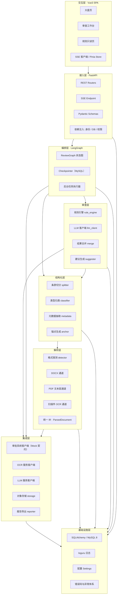

### 3.2 逐层职责与依赖方向

| 层 | 包路径 | 职责 | 允许依赖 | 禁止依赖 |
|----|-------|------|---------|---------|
| 交互层 | `frontend/src` | 渲染、交互、SSE 订阅、本地状态 | 接入层 HTTP 接口 | 除接口契约外的任何后端知识 |
| 接入层 | `app/api`、`app/schemas` | HTTP 协议适配、鉴权、参数校验、错误码映射 | 编排层、基础设施层 | 审查层、结构化层、解析层的内部函数 |
| 编排层 | `app/graph` | 定义审查流水线的状态图、条件边、检查点、失败恢复 | 审查层、结构化层、集成层、基础设施层 | 接入层 |
| 审查层 | `app/review` | 规则匹配、LLM 研判、结果合并、建议生成 | 结构化层（只读 IR 与条款）、集成层、基础设施层 | 解析层的格式细节、接入层 |
| 结构化层 | `app/structuring` | 切分、归类、元数据抽取、锚点生成与校验 | 解析层的 IR、基础设施层 | 审查层、接入层 |
| 解析层 | `app/parsing` | 三种格式 → 统一 IR；质量判定与通道降级 | 集成层的 OCR 客户端、基础设施层 | 结构化层、审查层、接入层 |
| 集成层 | `app/integration` | 一切外部系统的适配器；文件存储；报告导出 | 基础设施层 | 上层任何模块 |
| 基础设施层 | `app/core` | DB 会话、配置、日志、异常、错误码 | 无 | 以上所有层 |

依赖方向恒为**自上而下单向**。跨层反向调用（如解析层 import 审查层）一律拒绝。层与层之间只传数据对象（IR、pydantic 模型、ORM 实体），不传 HTTP 请求对象或 FastAPI 依赖。

### 3.3 目录结构

```
contract-review-agent/
├── pyproject.toml                 # uv 管理，锁定依赖
├── .env.example                   # 环境变量样例
├── alembic/                       # 建表迁移；也可直接用 sql/schema.sql
├── sql/
│   ├── schema.sql                 # 全量建表 DDL（见第 9 章）
│   └── seed/                      # 种子数据
│       ├── rules.yaml             # 规则定义（见第 11 章）
│       ├── templates.yaml         # 示范条款模板
│       ├── required_clauses.yaml  # 必检条款配置
│       └── users.yaml             # 示例用户
├── app/
│   ├── main.py                    # FastAPI 入口
│   ├── core/                      # 基础设施层
│   │   ├── config.py              # pydantic-settings
│   │   ├── db.py                  # engine / SessionLocal
│   │   ├── logging.py             # loguru 配置
│   │   ├── errors.py              # AppError + 错误码枚举
│   │   └── security.py            # 当前用户依赖
│   ├── models/                    # SQLAlchemy ORM（对应第 9 章 DDL）
│   ├── schemas/                   # pydantic 请求/响应模型（第 10 章）
│   ├── api/                       # 接入层
│   │   ├── deps.py
│   │   ├── tasks.py
│   │   ├── risks.py
│   │   ├── suggestions.py
│   │   ├── comments.py
│   │   ├── writeback.py
│   │   ├── report.py
│   │   ├── rules.py
│   │   ├── config.py
│   │   ├── mock_approval.py
│   │   └── stream.py              # SSE
│   ├── graph/                     # 编排层
│   │   ├── state.py               # ReviewState
│   │   ├── review_graph.py        # 状态图定义
│   │   └── runner.py              # 后台执行与检查点恢复
│   ├── parsing/                   # 解析层
│   │   ├── ir.py                  # 统一 IR（第 5.2 节）
│   │   ├── detector.py            # 格式与质量探测
│   │   ├── docx_channel.py
│   │   ├── pdf_channel.py
│   │   ├── ocr_channel.py
│   │   └── exceptions.py
│   ├── structuring/               # 结构化层
│   │   ├── splitter.py
│   │   ├── classifier.py
│   │   ├── metadata.py
│   │   ├── cn_num.py              # 中文大写金额/日期解析
│   │   └── anchor.py
│   ├── review/                    # 审查层
│   │   ├── rules/
│   │   │   ├── ast.py             # 条件 AST
│   │   │   ├── compiler.py        # AST → 可调用对象
│   │   │   ├── loader.py          # YAML → AST，缓存
│   │   │   ├── engine.py          # 匹配执行
│   │   │   └── builtins.py        # 自定义判定器
│   │   ├── llm/
│   │   │   ├── client.py          # OpenAI 兼容客户端 + 重试
│   │   │   ├── prompts.py         # 四类提示词（第 12 章）
│   │   │   ├── parsers.py         # JSON 输出解析与校验
│   │   │   └── chunker.py         # 分块策略（ADR-005）
│   │   ├── merge.py               # 规则结果与 LLM 结果合并
│   │   ├── suggester.py
│   │   └── summary.py             # 综合等级与摘要
│   ├── integration/               # 集成层
│   │   ├── approval_client.py     # 回写客户端（幂等）
│   │   ├── mock_approval.py       # Mock 审批系统实现
│   │   ├── ocr_client.py
│   │   ├── storage.py
│   │   └── reporter.py
│   └── workers/
│       └── task_worker.py         # 后台任务消费（ADR-010）
├── data/
│   ├── uploads/{task_id}/
│   ├── renders/{task_id}/         # PDF 页图、扫描件页图
│   └── samples/                   # 示例合同集（PRD 第 15 章）
├── tests/
│   ├── unit/
│   ├── integration/
│   └── e2e/
└── frontend/
    ├── vite.config.js
    └── src/
        ├── main.js
        ├── router.js
        ├── api/                   # axios 封装
        ├── stores/                # Pinia
        ├── views/                 # Dashboard / Workspace / Rules
        ├── components/
        └── utils/anchor.js        # 锚点解析与 DOM Range 定位（第 7.4 节）
```

### 3.4 端到端数据流

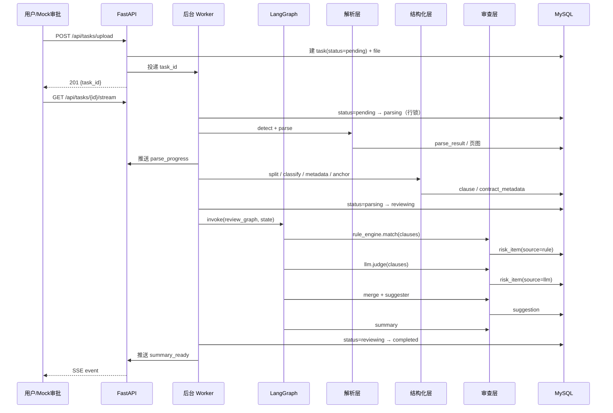

## 4. 关键技术决策记录（ADR）

### ADR-001 文档解析如何统一三种格式

| 项 | 内容 |
|----|------|
| **决策点** | DOCX、PDF 文本层、扫描件三种输入，如何让下游只面对一种数据结构 |
| **备选方案** | A. 全部转成 PDF 再解析；B. 全部抽成纯文本；C. 每种格式写独立下游；D. 通道适配器 + 统一 IR |
| **最终选择** | **D**。三种格式各自实现一个 `Channel`，输出同一个 pydantic 模型 `ParsedDocument` |
| **选择理由** | 下游的切分、归类、审查、定位逻辑只写一遍；新增格式只需新增一个 Channel；IR 中的 `quality` 字段天然承载降级信息 |
| **放弃理由** | A：DOCX→PDF 要装 LibreOffice（Windows 下约 500MB，且转换会丢失标题样式，切分依赖标题）；PDF 转换后字符偏移与原文不一致，锚点会错位。B：丢层级与坐标，锚点无法实现，PRD 第 10 章直接作废。C：切分与审查逻辑要写三遍，60 工时内不可能，且三份实现的行为差异会成为 bug 温床 |
| **代价** | IR 必须为三种格式的并集设计，出现「DOCX 没有的字段（bbox）」与「PDF 没有的字段（样式名）」，下游必须处理 `None`。本设计用 `quality.precision_cap` 显式声明当前 IR 能达到的锚点精度上限，把 `None` 的影响收敛到一个字段 |

### ADR-002 条款切分用规则还是模型

| 项 | 内容 |
|----|------|
| **决策点** | 把合同正文切成条款，用确定性规则还是交给大模型 |
| **备选方案** | A. 全部交给 LLM（整篇或逐段让模型输出切分边界）；B. 纯规则（正则 + 样式）；C. 规则切分，模型只做边界仲裁与类型归类 |
| **最终选择** | **C** |
| **选择理由** | 切分结果必须**可复现**（DG-02）且**可回归**：规则切分对同一输入永远给出同一结果，改提示词不会让已通过的合同切分结果漂移。而 PRD 第 8 章的条款类型归类确实需要语义判断（「乙方应妥善保管甲方提供的资料」属于保密还是数据安全，规则判不准），这部分才用模型 |
| **放弃理由** | A：模型输出的字符偏移不可信，PRD ANC-03 要求「`full_text[char_start:char_end]` 必须与 `matched_text` 一致」，模型给不出稳定偏移，锚点会大面积失效；且 30 页合同整篇送检必然超上下文。B：合同里存在「无编号、无标题、靠空行分隔」的条款，纯规则会把它整段吞成一条，风险定位粒度不够 |
| **代价** | 需要维护一套编号正则（中文数字、阿拉伯数字、括号层级）与标题样式识别逻辑，约 200 行代码；遇到非典型排版（如条款标题居中且无编号）会走长度兜底，切分粒度变粗。这个代价用 `parse_result.split_strategy` 字段记录每份合同实际命中的策略，便于事后发现规律、补正则 |

### ADR-003 锚点定位用什么精度

| 项 | 内容 |
|----|------|
| **决策点** | 锚点记录到什么粒度，以及三种格式精度不齐时怎么办 |
| **备选方案** | A. 只记录字符全局偏移；B. 只记录页码；C. 只记录 bbox 坐标；D. 分档双轨锚点（逻辑锚点 + 可选几何锚点），精度用 `precision` 字段显式声明 |
| **最终选择** | **D** |
| **选择理由** | 三种格式的可达精度天然不同：DOCX 有段落与字符但没有坐标；PDF 有页、字符与坐标；扫描件只有坐标没有可靠字符。用一条统一的锚点结构承载「逻辑定位（页 + 段落 + 字符区间）」与「几何定位（bbox）」两条轨道，谁有能力填谁，`precision` 声明当前档位，前端按档位切换渲染策略 |
| **放弃理由** | A：扫描件没有可用字符流，OCR 出的字符偏移在重新 OCR 后会漂移，不可作为持久锚点。B：精度太粗，一条条款可能横跨 2 页，定位到页等于没定位，PRD A-04 的 95% 正确率不可能达到。C：DOCX 没有坐标，且 bbox 与渲染缩放强耦合，缩放一变就错位 |
| **代价** | 锚点结构变复杂（10 个字段），且必须实现 `ANC-03` 的一致性校验，否则会出现「锚点合法但指向错文本」的静默错误。本设计把校验做成入库前的强校验（`anchor.py::validate()`），不通过直接丢弃该风险项并记 WARN，宁可少报不可错报 |

### ADR-004 规则引擎与 LLM 的分工边界

| 项 | 内容 |
|----|------|
| **决策点** | 哪些风险判定必须由规则完成，哪些交给模型，二者结论冲突时以谁为准 |
| **备选方案** | A. 全规则；B. 全模型；C. 规则与模型并行、结果全并；D. 规则定界（可判定的形式特征）+ 模型定质（语义与上下文），冲突时**规则封顶、模型可升级** |
| **最终选择** | **D**。具体规则：① 规则与模型命中同一条款同一风险维度 → 取两者中**较高**的风险等级，`source=rule+llm`；② 模型给出的等级**低于**规则命中等级 → 以规则为准，理由记入 `risk_reason`；③ 模型给出的等级**高于**规则 → 允许提升，但必须在 `risk_reason` 中给出原文引用，无引用则驳回提升，回落为规则等级 |
| **选择理由** | 规则在「数值比较、关键词缺失、必检项缺失」上是确定且零成本的，把它交给模型是浪费且引入不确定性；反过来，模型在「这条保密条款只约束我方而没约束对方」这种需要阅读语义的判断上远强于关键词。冲突时偏向规则，是因为规则的误报率可预估、可解释，而模型的高等级误报会直接抬高法务的复核成本（PRD G-07 要求高风险误报率 ≤ 15%） |
| **放弃理由** | A：9.1 的规则用关键词表达，「权责不对等」这类没有固定措辞的风险永远召回不了，G-02 的 90% 达不到。B：成本与稳定性都不可接受，且关掉模型系统就完全不可用，违反 DG-05。C：同一条款同一个风险会出现两张卡片，法务要重复判断，且等级取哪个没有原则 |
| **代价** | 合并逻辑本身需要测试覆盖（至少 4 个用例：同等级、模型更低、模型更高且有引用、模型更高且无引用）；且模型无法发现规则完全没覆盖的风险维度——本设计的规则池与提示词必须同步维护，规则池的空白处必须靠提示词里的维度清单补上（见 12.3 节的维度枚举） |

### ADR-005 长文档如何分块送模型

| 项 | 内容 |
|----|------|
| **决策点** | 30 页合同远超单次请求的合理输入量，按什么粒度切分送模型、上下文怎么给 |
| **备选方案** | A. 整篇送（超长则截断）；B. 固定 token 滑窗（如每 2000 token 重叠 200）；C. 按条款粒度逐条送，另加合同级共享上下文头 |
| **最终选择** | **C** |
| **选择理由** | 条款是审查的最小单元，也是锚点的载体。逐条送天然解决三个问题：① 模型输出可以**直接对应到 `clause_id`**，不需要从自由文本里反推位置，锚点必然准确；② 单条条款通常 100~800 字，输入稳定；③ 某条失败可以单独重试，不影响其他条款 |
| **放弃理由** | A：超上下文必被截断，被截断的部分永远审查不到，且用户无法知道漏了什么。B：滑窗会把条款从中间切开，切出来的半句话模型理解不了；更致命的是滑窗边界与条款边界不重合，模型返回的片段无法映射回 `clause_id`，锚点要靠字符串搜索反查，PRD ANC-03 的恒等式校验会大量失败 |
| **代价** | 逐条送导致请求数等于条款数（30 页合同约 60~120 条条款），单份合同 LLM 调用 120 次，按 P95 6 秒算串行要 12 分钟，超过 PRD NFR-P-05 的 3 分钟。**因此必须并发**：本设计用 `asyncio.gather` 限制并发 4，实际耗时约 3 分钟（120 条 ÷ 4 × 6 秒 = 180 秒），刚好压在目标线上。这是本方案最紧的性能约束，第 15.1 节给出兜底手段 |

### ADR-006 审批回写如何保证幂等

| 项 | 内容 |
|----|------|
| **决策点** | 网络超时导致「请求已到达但响应未收到」时，重试会不会产生重复评论 |
| **备选方案** | A. 重试前先查询评论列表，存在则跳过；B. 本地 `writeback_log` 唯一约束防重；C. 客户端生成确定性幂等键随请求发送，服务端按幂等键去重并返回既有结果 |
| **最终选择** | **C**，并在本地额外加 B 作为第二道防线 |
| **选择理由** | A 有竞态：查询与写入之间对方可能刚好写入，且评论列表接口通常有分页与延迟，判不准。B 只保护本地库，不保护对方系统——超时场景下对方的评论已经写进去了，本地却认为失败，重试仍会重复。C 把去重责任放到服务端，只要幂等键稳定，无论调用多少次都只有一条评论 |
| **放弃理由** | 幂等键本身需要一个稳定的构造方式，如果用时间戳或 UUID 就又回到 A 的问题。因此本设计用**内容确定性哈希**：`idempotency_key = sha256(f"{task_id}|{review_version}|{content_sha256}")`，其中 `content_sha256` 是回写正文（Markdown 规范化后，去掉首尾空白、统一换行符）的 sha256。含义是「同一任务的同一审查版本、同一份内容，只写一次」——这正是业务语义 |
| **代价** | 内容一旦变化（法务改了批注再回写），幂等键就变了，会在评论区追加一条新评论。这是**有意为之**：内容不同就是新的意见，不应该去重。代价是评论区可能出现多条来自本系统的评论，需要在回写正文头部标注「第 N 次回写（内容已更新）」让读者区分，这个标注由 `writeback_log` 计数生成 |

### ADR-007 编排是否全流程走 LangGraph

| 项 | 内容 |
|----|------|
| **决策点** | LangGraph 用在整条流水线（解析→结构化→审查→回写）还是只用在其中一段 |
| **备选方案** | A. 全流程单一状态图；B. 只在「审查」段用状态图，解析与结构化用顺序代码；C. 完全不用 LangGraph，手写 pipeline |
| **最终选择** | **B** |
| **选择理由** | LangGraph 的价值在「有条件边 + 状态持久化 + 断点恢复」。有价值的部分是：规则命中后是否需要补 LLM 研判、LLM 降级后是否继续、建议生成失败后是否重试。这些是审查段的真实分支，且检查点能让失败的第 60 条条款不必从第 1 条重来。而解析与切分是线性的、每步都必然执行，套进图里只会增加理解成本 |
| **放弃理由** | A：解析与切分没有分支，把它们做成节点会引入大量无意义的状态传递，且解析是 CPU 密集 + 第三方库调用，放在图的节点里调试困难。C：手写 pipeline 要自己实现断点与恢复，PRD 第 11 章的重试要求会变成一堆 `if` 嵌套，且团队明确熟悉 LangGraph，不用是浪费既有能力 |
| **代价** | 出现两种编排风格（图 + 顺序代码），新人需要知道「边界在哪」。本设计把边界定死为：`app/graph/review_graph.py` 是唯一的图，它的输入是「已切分好的 `list[Clause]` + 元数据」，输出是「风险项 + 建议 + 摘要」，图里不做任何 I/O 之外的解析工作 |

### ADR-008 并发同一合同的锁策略

| 项 | 内容 |
|----|------|
| **决策点** | 同一任务被重复触发（用户连点重试、SSE 重连触发、事件重复推送）时如何避免重复审查 |
| **备选方案** | A. Redis 分布式锁；B. 进程内 `asyncio.Lock` 字典；C. MySQL 行锁 `SELECT ... FOR UPDATE` + 状态条件更新 |
| **最终选择** | **C** |
| **决策方法** | 状态转移用带条件的 UPDATE 实现：「仅当状态为 X 时更新为 Y」，靠影响行数判断是否抢到执行权 |
| **选择理由** | 单实例部署下 MySQL 行锁足够，且**零额外依赖**（DP-04）。条件 UPDATE 的语义比锁更贴切：真正要防的不是「并发执行」，而是「非法状态转移」，这正是 PRD 11.2 的要求 |
| **放弃理由** | A：为一个单实例项目引入 Redis 实例与运维成本，违反 DP-04。B：`asyncio` 锁只在单进程有效，且一旦 worker 崩溃锁不会释放，需要额外的心跳机制，反而更复杂 |
| **代价** | 依赖数据库事务边界正确。本设计的硬性规定是：**所有状态转移必须在独立事务中提交后，才允许开始耗时工作**，避免长事务把行锁占用 3 分钟。具体写法见 8.5 节 |

### ADR-009 前端文档渲染与高亮的实现路线

| 项 | 内容 |
|----|------|
| **决策点** | 三种格式的原文如何在浏览器里渲染，以及高亮怎么落到正确的字符上 |
| **备选方案** | A. 全部用 pdf.js 渲染（DOCX 先转 PDF）；B. DOCX 用 `docx-preview`、PDF 用 `pdf.js`、扫描件用 ``；C. 后端产出统一渲染模型（页图 / 段落 HTML / 文本层 JSON），前端只实现一套锚点解析器 |
| **最终选择** | **C**，这是对 PRD 第 10.4 节方案的**修订版**：PRD 让 DOCX 走「后端返回段落 HTML」，PDF 走「pdf.js 文本层 + bbox」，扫描件走「页图 + 矩形」。本设计保留这三种渲染路径，但把**锚点解析**抽成前端的单一函数 `resolveAnchor(anchor) → {pageNo, domRange\|rects}`，三种渲染路径只负责提供「DOM 容器」与「坐标基准」，定位逻辑只有一份 |
| **选择理由** | PRD 方案的真正风险不在渲染，而在**三份定位逻辑**：DOCX 里按 `data-pid` 找节点算偏移、PDF 里按文本层 item 累加字符、扫描件里按 bbox 画框——三份代码三套 bug。抽出 `resolveAnchor` 后，三处只回答两个问题：「第 N 页的文本层在哪个 DOM 节点下」「这一页的字符总长是多少」，定位与高亮的逻辑统一 |
| **放弃理由** | A：DOCX→PDF 依赖后端装 LibreOffice（同 ADR-001），且转换后的文本与 IR 内偏移不一致，锚点全部失效。B：`docx-preview` 渲染的 DOM 结构不受我们控制，无法可靠地按 `data-pid` 定位，退化成字符串搜索，遇到重复文本就定位到错误位置 |
| **代价** | 后端要为每个任务产出三种渲染资源（PDF 页图 PNG、DOCX 段落 HTML、文本层 JSON），`data/renders/` 的磁盘占用上升（30 页 PDF 页图约 15MB）。可接受：演示项目不做容量规划，且页图按需生成、缓存到磁盘，不做 GC |

### ADR-010 后台任务执行方式

| 项 | 内容 |
|----|------|
| **决策点** | 审查耗时 1~3 分钟，不能阻塞 HTTP 请求，用什么执行 |
| **备选方案** | A. Celery + Redis/RabbitMQ；B. APScheduler；C. FastAPI `BackgroundTasks`；D. 自建 `asyncio.Queue` + 常驻协程 worker |
| **最终选择** | **D**，并把任务状态机作为唯一事实来源（队列只是触发器，丢了也能从数据库恢复） |
| **选择理由** | D 无外部依赖、无额外进程、可控制并发度（`asyncio.Semaphore(5)` 正好对应 PRD NFR-C-01 的并发 ≥ 5）。更重要的是：**队列不是必需的**，因为任务状态已经存在数据库里，进程重启后只需一条 `SELECT ... WHERE status IN ('pending','parsing','reviewing')` 就能把所有中断的任务重新捡起来 |
| **放弃理由** | A：引入 broker 与独立 worker 进程，Windows 下 Celery 的 fork 问题需要额外处理，60 工时内不划算。B：APScheduler 是定时器语义，不适合「事件立即触发」，用它做即时消费需要 1 秒轮询，且并发控制要自己写。C：`BackgroundTasks` 在响应返回后才执行，没有并发上限，10 个人同时上传会同时起 10 个 1~3 分钟的解析，把内存打爆 |
| **代价** | 单进程内并发，无法横向扩展（已在 DN-01 声明为非目标）。且进程崩溃时正在执行的任务会停留在中间状态，需要启动时的恢复扫描（`app/workers/task_worker.py::recover_on_startup()`），该函数必须在 8.4 节的重试上限内做幂等判断，避免与用户的手工重试打架 |

### ADR-011 条款归类兜底：是否引入向量检索

| 项 | 内容 |
|----|------|
| **决策点** | 关键词加权归类失败（得分并列或不足）时，用什么兜底 |
| **备选方案** | A. 引入向量库 + 条款样本做最近邻检索；B. 直接调用 LLM 归类；C. 归为 `OTHER` 不兜底 |
| **最终选择** | **B** |
| **选择理由** | 需要兜底的条款比例低（PRD CLS-04 的兜底路径，预计不超过总条款数的 15%），LLM 归类一次调用约 2 秒、成本可忽略；且 LLM 归类不需要维护样本库与 embedding 服务，改提示词即可迭代。向量检索的收益是稳定性与速度，但这两个问题在 60 工时里都不是瓶颈 |
| **放弃理由** | A：需要引入 embedding 模型（本地跑要下权重，远程调要多一个外部依赖）与向量存储（chromadb / faiss / MySQL 向量列三选一），且需要先构造标注样本集，工作量约 8 工时，收益是给 15% 的条款提速 1.5 秒。C：`OTHER` 条款不参与依赖类型的规则判定，PRD 第 9 章有 21 条规则依赖 `clause_type`，兜底为 `OTHER` 会直接让这些规则失明 |
| **代价** | LLM 归类失败时仍然退化为 `OTHER`（这是不可避免的最终兜底），但此时必须在 `review_degraded_reason` 中记录「N 条条款未成功归类」，让法务知道覆盖率的缺口在哪里，而不是悄悄少报 |

### ADR-012 报告 PDF 导出方案

| 项 | 内容 |
|----|------|
| **决策点** | 审查报告的 PDF 怎么生成（本设计将 PDF 导出列为 P1，但方案要先定，避免后期返工） |
| **备选方案** | A. WeasyPrint（HTML + CSS → PDF）；B. xhtml2pdf（纯 Python）；C. Playwright 调 Chromium 打印；D. 前端 `window.print()` |
| **最终选择** | **B `xhtml2pdf`**，报告中文字体内嵌思源黑体 `SourceHanSansSC-Regular.ttf` |
| **选择理由** | 纯 Python 依赖，Windows 上 `uv add xhtml2pdf` 即装即用，不需要装 GTK（A 的痛点）也不需要下载 150MB 浏览器内核与处理子进程（C 的痛点）。报告是表格 + 标题的简单结构，xhtml2pdf 的能力足够 |
| **放弃理由** | A：WeasyPrint 在 Windows 上依赖 GTK3 运行时，安装步骤多且容易失败，一个人排查环境问题不值。C：渲染质量最好（就是 Chrome），但要引入 Playwright 与浏览器下载，且打印任务需要进程池管理，复杂度远超收益。D：无法服务端批量导出，且 PRD FR-704 的验收要求是后端接口返回文件流 |
| **代价** | xhtml2pdf 的 CSS 支持弱（不支持 flex、部分不支持 `border-radius`），报告 HTML 必须用 `<table>` 布局，样式能力受限。可接受：报告是内部文档，不需要精细排版。**若 RC-02 确认 PDF 导出必须进 P0，则改用 B 并在第 18 章把 T-28 的工时从 2 提到 4** |

## 5. 文档解析层设计

### 5.1 架构：探测器 + 三个通道

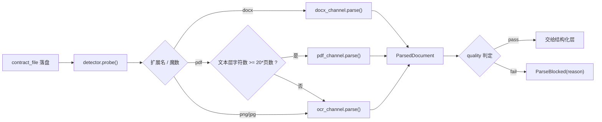

三个通道的实现步骤如下。

#### 5.1.1 DOCX 通道（`python-docx`）

| 步骤 | 操作 | 关键 API | 产出 |
|------|------|---------|------|
| 1 | 打开文档，捕获 `PackageNotFoundError` → `ATTACHMENT_CORRUPT` | `Document(path)` | `Document` 对象 |
| 2 | **按文档物理顺序**遍历正文子元素，同时处理段落与表格 | `doc.element.body.iterchildren()` + 判断 `{...}w:p` / `{...}w:tbl` | `(kind, element)` 序列 |
| 3 | 段落 → 文本、样式名、heading 级别 | `Paragraph(el, doc).text`、`.style.name` | `raw_text`、`style_name`、`heading_level` |
| 4 | 表格 → 逐单元格的段落，标记 `in_table=True` | `Table(el, doc).rows[i].cells[j].paragraphs` | 追加到序列，`table_id` 自增 |
| 5 | 过滤空段落（`text.strip() == ""`），但**保留**样式名为标题的空段落（用于层级判定） | — | 有效段落列表 |
| 6 | 拼接 `full_text`（段落间以 `\n` 连接），写入全局字符偏移 | — | `ParagraphNode.char_start/char_end` |
| 7 | 采集 run 级样式（`bold`、`italic`、字号）供切分器识别伪标题 | `paragraph.runs[*].bold/font.size` | `ParagraphNode.runs` |
| 8 | 质量判定：有效段落数 ≥ 1 且总字符数 ≥ 50 | — | `QualityReport` |

**关键点**：`doc.paragraphs` 会**跳过表格内的段落**，`doc.tables` 又**丢失与段落的相对顺序**。因此必须走 `body.iterchildren()` 手工遍历，这是本通道最容易写错的地方。页眉页脚不在 `body` 下，因此天然被排除，满足 PRD FR-201 验收标准第 3 条。

#### 5.1.2 PDF 文本层通道（`PyMuPDF`）

| 步骤 | 操作 | 关键 API | 产出 |
|------|------|---------|------|
| 1 | 打开文档；`needs_pass` 为真 → `ENCRYPTED_FILE` | `fitz.open(path)` | `Document` |
| 2 | 逐页抽取结构化文本 | `page.get_text("dict")` | `blocks`（含 `bbox`、`lines`、`spans`） |
| 3 | 按页统计可抽取字符数（`span["text"].strip()` 累加） | — | `page_char_count` |
| 4 | 文本层判定：`sum(page_char_count) < 20 * page_count` → 判定无有效文本层，改走 OCR 通道 | — | 路由决策 |
| 5 | 每个非空 `block` → 一个 `ParagraphNode`，`bbox` 取 block 的 `bbox` | `block["bbox"]` | 段落 + 段落级坐标 |
| 6 | 每个 `line` → 一条 `line_boxes` 记录 `(line_char_start_in_para, line_char_end, line_bbox)`，供字符级高亮做区间求交 | `line["bbox"]` | 行级坐标 |
| 7 | 样式采集：`span["font"]`、`span["size"]`、`flags` 中的粗体位 → 拼成 `style_name`（如 `SimSun-Bold-14`） | — | `style_name` |
| 8 | 页图渲染（供前端预览） | `page.get_pixmap(dpi=144).save(...)` | `PageNode.render_ref` |
| 9 | 拼接 `full_text`，写全局偏移；`page_no` 由 block 所属页决定 | — | 完整 IR |

**关键点**：PDF 没有「段落」概念，本设计把 `get_text("dict")` 的 **block 定义为段落**。这是必要的简化——block 是 PyMuPDF 给出的最大自然文本单元，且自带 bbox。代价是双栏排版的 PDF 中，左右栏可能是两个 block，导致「同一条款被拆成两个段落」；处理方式见 7.6 节（跨段落条款合并）。

#### 5.1.3 扫描件 OCR 通道（`httpx` 调 MinerU HTTP API）

| 步骤 | 操作 | 关键 API / 工具 | 产出 |
|------|------|---------------|------|
| 1 | 输入归一化：图片直接用；无文本层的 PDF 先用 PyMuPDF 按 200dpi 逐页栅格化为 PNG | `page.get_pixmap(dpi=200)` | 待识别图片列表 |
| 2 | 逐张图片 POST 到 OCR 服务，表单字段 `file`，超时 90 秒 | `httpx.AsyncClient(timeout=90)` | OCR JSON |
| 3 | 解析 OCR 返回：按行取 `text` 与 `bbox`（归一化坐标需按页宽高换算为像素） | — | 行级结果 |
| 4 | 同一页内的行按 `bbox.y0` 升序排列，再按行间垂直间距（> 1.8 倍行高）聚合为**段落** | 自实现 `group_lines_to_paragraphs()` | 段落 + 段落 bbox |
| 5 | 每个段落 → `ParagraphNode`，`ocr_confidence` 取该段内所有行置信度的均值 | — | IR |
| 6 | 质量判定：置信度均值 < 0.6 → `OCR_LOW_CONFIDENCE`；无 bbox 字段 → 降级为 `PAGE` 精度 | — | `QualityReport` |
| 7 | 采集页面尺寸（像素）写入每个 `BBox` 的 `page_width/page_height` | — | 坐标可换算 |
| 8 | 拼接 `full_text`（OCR 文本顺序即阅读顺序，不做重排） | — | 完整 IR |

**未决点（见 19.2 的 Q-03）**：MinerU 的部分版本返回的版面结果**不含逐行置信度**。若实际部署版本确实不返回置信度，则 `ocr_avg_confidence` 置 `None`，并改用替代质量信号：

| 替代信号 | 阈值 | 判定 |
|---------|------|------|
| 中文字符占比 | < 0.5 | 说明识别出大量乱码，转 `OCR_LOW_CONFIDENCE` |
| 平均行字符数 | < 3 | 说明只识别出零散字符，转 `OCR_LOW_CONFIDENCE` |
| 单页平均行数 | < 2 | 说明整页几乎空白，转 `OCR_LOW_CONFIDENCE` |
| 可疑字符占比（`�`、`□`、连续重复同一字符 ≥ 5） | > 0.05 | 转 `OCR_LOW_CONFIDENCE` |

这套替代信号是**降级方案**，不是主方案：优先使用 OCR 返回的置信度，取不到才启用。

### 5.2 统一中间表示（IR）

下面是可以直接落到 `app/parsing/ir.py` 的完整实现（pydantic v2）。

```python
from __future__ import annotations

import hashlib
from enum import Enum

from pydantic import BaseModel, Field, model_validator


class SourceFormat(str, Enum):
    DOCX = "DOCX"
    PDF_TEXT = "PDF_TEXT"
    PDF_OCR = "PDF_OCR"      # 无文本层的 PDF，栅格化后走 OCR
    IMAGE_OCR = "IMAGE_OCR"  # 图片扫描件


class Precision(str, Enum):
    EXACT = "EXACT"          # 可定位到字符区间
    PARAGRAPH = "PARAGRAPH"  # 可定位到段落
    PAGE = "PAGE"            # 只能定位到页
    NONE = "NONE"            # 无法定位


class BBox(BaseModel):
    """像素坐标，原点左上，y 轴向下。page_width/height 用于归一化与缩放换算。"""

    x0: float
    y0: float
    x1: float
    y1: float
    page_width: float = Field(gt=0)
    page_height: float = Field(gt=0)

    def normalized(self) -> tuple[float, float, float, float]:
        return (
            self.x0 / self.page_width,
            self.y0 / self.page_height,
            self.x1 / self.page_width,
            self.y1 / self.page_height,
        )

    def scaled(self, render_width: float) -> tuple[float, float, float, float]:
        """换算到前端实际渲染宽度下的像素坐标。"""
        k = render_width / self.page_width
        return (self.x0 * k, self.y0 * k, self.x1 * k, self.y1 * k)


class RunSpan(BaseModel):
    """段落内的 run 级样式，仅 DOCX 通道填充。供切分器识别伪标题。"""

    text: str
    bold: bool | None = None
    italic: bool | None = None
    font_name: str | None = None
    font_size_pt: float | None = None


class LineBox(BaseModel):
    """行级坐标。char_start/char_end 是相对所在段落的偏移，用于字符级高亮区间求交。"""

    char_start: int = Field(ge=0)
    char_end: int = Field(ge=0)
    bbox: BBox

    @model_validator(mode="after")
    def _check(self) -> "LineBox":
        if self.char_end <= self.char_start:
            raise ValueError("LineBox.char_end 必须大于 char_start")
        return self


class ParagraphNode(BaseModel):
    """IR 的最小文本单元。DOCX 的段落、PDF 的 block、OCR 的聚合段落都映射到这里。"""

    pid: str                                   # 形如 "{doc_id}:p{index}"，全局唯一
    index: int = Field(ge=0)                   # 文档内顺序号，0 起
    page_no: int | None                        # DOCX 为 None
    text: str
    char_start: int = Field(ge=0)              # 在 full_text 中的偏移
    char_end: int = Field(ge=0)
    style_name: str | None = None              # DOCX 样式名 / PDF 字体描述 / OCR 为 None
    heading_level: int | None = None           # 1..6；非标题为 None
    bbox: BBox | None = None                   # 段落级坐标；DOCX 为 None
    line_boxes: list[LineBox] = Field(default_factory=list)
    runs: list[RunSpan] = Field(default_factory=list)
    in_table: bool = False
    table_id: str | None = None
    ocr_confidence: float | None = Field(default=None, ge=0, le=1)

    @model_validator(mode="after")
    def _check_range(self) -> "ParagraphNode":
        if self.char_end <= self.char_start:
            raise ValueError(f"{self.pid}: char_end 必须大于 char_start")
        if len(self.text) != (self.char_end - self.char_start):
            raise ValueError(
                f"{self.pid}: text 长度 {len(self.text)} "
                f"与字符区间长度 {self.char_end - self.char_start} 不一致"
            )
        return self


class PageNode(BaseModel):
    page_no: int = Field(ge=1)
    width: float = Field(gt=0)
    height: float = Field(gt=0)
    text: str
    char_start: int = Field(ge=0)
    char_end: int = Field(ge=0)
    render_ref: str | None = None              # 前端预览用的页图相对路径
    has_text_layer: bool = False
    paragraph_indexes: list[int] = Field(default_factory=list)


class QualityReport(BaseModel):
    """IR 的质量报告。下游所有降级判断只看这里，不看格式。"""

    precision_cap: Precision                   # 本份 IR 能达到的最高锚点精度
    has_text_layer: bool = False
    char_count: int = 0
    paragraph_count: int = 0
    page_count: int | None = None
    ocr_engine: str | None = None
    ocr_avg_confidence: float | None = None
    ocr_low_conf_ratio: float | None = None
    empty_paragraph_ratio: float = 0.0
    truncated: bool = False                    # 是否因超限截断（PRD NFR-C-06）
    warnings: list[str] = Field(default_factory=list)


class ParsedDocument(BaseModel):
    """通道唯一输出。结构化层与审查层只认识这个类型。"""

    doc_id: str
    file_id: int
    source_format: SourceFormat
    channel: str                               # "docx" | "pdf_text" | "ocr"
    pages: list[PageNode]
    paragraphs: list[ParagraphNode]
    full_text: str
    quality: QualityReport
    parse_duration_ms: int = 0

    def content_hash(self) -> str:
        return hashlib.sha256(self.full_text.encode("utf-8")).hexdigest()

    def by_index(self, index: int) -> ParagraphNode | None:
        for p in self.paragraphs:
            if p.index == index:
                return p
        return None

    def slice_text(self, char_start: int, char_end: int) -> str:
        """锚点校验的唯一入口。所有锚点在写库前必须用它与 matched_text 比对。"""
        return self.full_text[char_start:char_end]

    @model_validator(mode="after")
    def _check_consistency(self) -> "ParsedDocument":
        # IR-01: full_text 必须恰好等于全部段落按 index 升序以 "\n" 连接
        ordered = sorted(self.paragraphs, key=lambda p: p.index)
        rebuilt = "\n".join(p.text for p in ordered)
        if rebuilt != self.full_text:
            raise ValueError("IR-01 违反：full_text 与段落拼接结果不一致")

        # IR-02: 段落字符区间必须严格递增且与拼接位置一致
        cursor = 0
        for p in ordered:
            if p.char_start != cursor:
                raise ValueError(f"IR-02 违反：{p.pid} char_start={p.char_start} 期望 {cursor}")
            cursor = p.char_end + 1  # +1 是段落间的 "\n"
        if cursor - 1 != len(self.full_text) and self.paragraphs:
            raise ValueError("IR-02 违反：段落字符区间未覆盖 full_text")

        # IR-03: 段落的 index 必须连续且从 0 开始
        if [p.index for p in ordered] != list(range(len(ordered))):
            raise ValueError("IR-03 违反：段落 index 不连续")

        # IR-04: line_boxes 的 char 区间不得越出所在段落
        for p in ordered:
            for lb in p.line_boxes:
                if lb.char_end > len(p.text):
                    raise ValueError(f"IR-04 违反：{p.pid} 的 LineBox 越界")
        return self
```

**IR 的四条不变量**（上面的 `_check_consistency` 逐条强制，构造失败即在解析阶段暴露，不会流到下游）：

| 编号 | 不变量 | 为什么必须是hard invariant |
|------|-------|------------------------|
| IR-01 | `full_text == "\n".join(p.text for p in paragraphs)` | 锚点的全局偏移以 `full_text` 为基准。若 `full_text` 来自原始抽取文本而段落文本经过了清洗（去空格、合并换行），两边偏移就会错位，PRD 的 ANC-03 校验会大面积失败。**把 full_text 定义为段落拼接的结果**，是本设计消除这个整类 bug 的核心手段 |
| IR-02 | 段落字符区间严格递增、无空洞、与拼接位置一致 | 保证「最大/最小偏移」能直接定位到段落，前端做二分查找即可 |
| IR-03 | `index` 连续且从 0 开始 | 让 `paragraph_index` 可以作为稳定主键使用；跳段落不需要容器 |
| IR-04 | `line_boxes` 的字符区间在段落内 | 字符级高亮靠「请求区间 ∩ 行区间」求交，越界会算出负宽度矩形 |

### 5.3 三种格式的 IR 填充矩阵

| IR 字段 | DOCX | PDF 文本层 | 扫描件 OCR | 空值对下游的影响 |
|---------|------|-----------|-----------|---------------|
| `doc_id` | 填充 | 填充 | 填充 | — |
| `source_format` | `DOCX` | `PDF_TEXT`/`PDF_OCR` | `IMAGE_OCR` | 前端据此选渲染路径 |
| `ParagraphNode.text` | 填充（`p.text`） | 填充（span 拼接） | 填充（OCR 行聚合） | 空则整段丢弃 |
| `ParagraphNode.page_no` | **None** | 填充 | 填充 | DOCX 页码显示为「段落 N~M」；前端不渲染页码指示器 |
| `ParagraphNode.style_name` | 填充（`Heading 1`、`标题 2`、`Normal`） | 填充（`SimSun-Bold-14` 形式） | **None** | 切分器对 OCR 文档不走样式判定，只走编号 + 长度兜底 |
| `ParagraphNode.heading_level` | 填充（样式名解析） | **None**（PDF 无样式层级） | **None** | 同上；PDF 的章节归属靠编号推断 |
| `ParagraphNode.bbox` | **None** | 填充（block bbox） | 填充（段落聚合 bbox） | DOCX 无法画矩形，只能做 DOM 高亮 |
| `ParagraphNode.line_boxes` | **空列表** | 填充（line bbox） | 填充（每行一条，段落内多条） | 空列表 → 该段落只能整段高亮，精度降为 `PARAGRAPH` |
| `ParagraphNode.runs` | 填充 | **空列表** | **空列表** | 伪标题识别（粗体 + 居中）在 PDF/OCR 上不可用 |
| `ParagraphNode.in_table` / `table_id` | 填充 | **None**（无法可靠判定） | **None** | 表格内条款视为普通段落参与审查；PDF 的表格文本可能顺序错乱，记 warning |
| `PageNode` | **`pages` 为空列表** | 填充 | 填充 | 空列表 → 前端按段落分批渲染，不显示页码 |
| `PageNode.render_ref` | **None** | 页图路径 | 页图路径 | DOCX 无页图，前端渲染段落 HTML |
| `precision_cap` | `EXACT` | `EXACT` | `PARAGRAPH`（有 bbox）或 `PAGE`（无 bbox） | 决定风险卡片跳转按钮是否可用、提示哪一档降级 |
| `ocr_*` 字段 | 全为 None | 全为 None | 填充（置信度不可得时为 None 并记 warning） | 影响 `OCR_LOW_CONFIDENCE` 判定 |

**注意 DOCX 的 `precision_cap` 是 `EXACT` 而 `page_no` 是 `None`**。这两个不矛盾：DOCX 能在段落 HTML 内按字符偏移精确包裹 `<mark>`（EXACT），但**没有页码概念**，因此前端跳转后展示的定位反馈是「已定位到第 12 段」而非「第 3 页」。这是 PRD 第 10.3 节「PAGE 档对 DOCX 不可用」的直接体现。

### 5.4 解析失败判定与降级链路

#### 5.4.1 失败判定表

| 判定点 | 条件 | `block_reason` | 抛出时机 |
|--------|------|---------------|---------|
| 文件不可读 | `open()` 或解析库抛异常 | `ATTACHMENT_CORRUPT` | 通道入口 |
| 文件加密 | PDF `needs_pass`；DOCX 抛加密异常 | `ENCRYPTED_FILE` | 通道入口 |
| 格式不支持 | 魔数与扩展名都在白名单外 | `UNSUPPORTED_FORMAT` | 探测器 |
| 文件过大 | `file_size > 50MB` | `ATTACHMENT_TOO_LARGE` | 接入层拦截（早于解析） |
| 正文为空 | 有效段落数 = 0，或 `full_text.strip()` 长度 < 50 | `EMPTY_BODY` | 通道出口 |
| PDF 检索不到文本层 | `sum(page_char_count) < 20 * page_count` | 不阻塞，**转 OCR 通道** | 探测器 |
| OCR 服务不可达 | 两次重试均连接失败 | `OCR_FAILED` | OCR 通道 |
| OCR 质量不达标 | 置信度均值 < 0.6（或替代信号命中） | `OCR_LOW_CONFIDENCE` | OCR 通道出口 |
| 解析超时 | 单文件耗时 > 600 秒 | `PARSE_TIMEOUT` | `asyncio.wait_for` 包裹 |
| 其它未预期异常 | `Exception` | `PARSE_ERROR` | 最外层兜底 |

#### 5.4.2 降级链路（与 PRD 第 10.3 节一致，此处给实现细节）

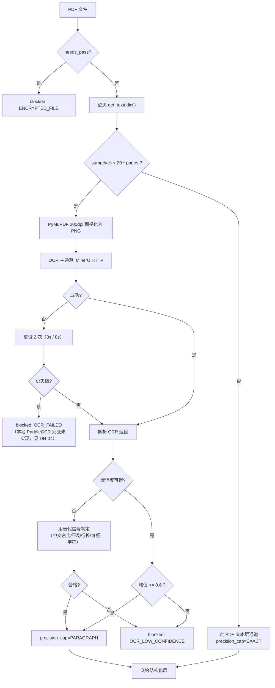

**关于 OCR 精度的两级降级**：有 bbox 时 `precision_cap=PARAGRAPH`（段落级矩形高亮）；若 OCR 返回结果缺少 bbox 字段（少数版面分析失败的页会出现），则该页段落 `bbox=None`，整份 IR 的 `precision_cap` 降为 `PAGE`，前端只做页级定位并显示提示。这两种情况都必须写进 `QualityReport.warnings`。

### 5.5 渲染资源产出

解析阶段除 IR 外，还需为前端产出渲染资源，统一存放在 `data/renders/{task_id}/`。

| 格式 | 渲染资源 | 生成方式 | 命名 | 大小估算（30 页） |
|------|---------|---------|------|-----------------|
| DOCX | 无页图，返回段落 HTML | 后端按 IR 段落生成 HTML 字符串，见 7.4.1 | — | — |
| PDF | 每页 PNG | `page.get_pixmap(dpi=144)` | `p{page_no}.png` | 约 15MB |
| 扫描件 | 每页 PNG（即 OCR 用的栅格化结果，直接复用） | 同 PDF | `p{page_no}.png` | 约 20MB |

页图在解析阶段一次性生成并落盘；`PageNode.render_ref` 存相对路径（`{task_id}/p3.png`），前端通过 `GET /api/tasks/{task_id}/page-image/{page_no}` 获取（该接口做鉴权，不暴露静态目录）。前端做懒加载：只请求当前页与前后各一页。

DOCX 的段落 HTML 由后端在 `GET /api/tasks/{task_id}/document` 中按需生成（不在解析阶段落盘），生成规则见 7.4.1。

## 6. 条款结构化设计

### 6.1 条款切分算法

切分分四级依次尝试，命中即用该级策略，**不在同一份文档里混用不同级别**（避免同一文档的切分粒度不一致）。

| 级别 | 策略 | 命中条件 | `split_strategy` 取值 |
|------|------|---------|---------------------|
| L1 | 编号识别 | 段落开头匹配任一编号正则 | `NUMBER` |
| L2 | 标题样式识别 | 段落 `heading_level is not None` 或 `style_name` 命中标题规则 | `STYLE` |
| L3 | 伪标题识别 | 段落 `runs` 全为粗体、或短段（≤ 30 字）以冒号结尾、或全段无句末标点 | `PSEUDO_HEADING` |
| L4 | 自然段 + 长度兜底 | 前三级都判不出边界 | `BLANK_LINE` 或 `LENGTH_FALLBACK` |

#### 6.1.1 编号正则表

```python
# app/structuring/splitter.py

import re

# (正则, 该编号对应的层级, 策略标识)。层级用于 parent_clause_id 归并，不表示严格缩进。
CLAUSE_NO_PATTERNS: list[tuple[re.Pattern[str], int, str]] = [
    # 第三条 / 第十条 / 第二十条
    (re.compile(r"^第\s*([一二三四五六七八九十百零〇两]{1,6})\s*条"), 1, "cn_article"),
    # 第3条 / 第 12 条
    (re.compile(r"^第\s*(\d{1,3})\s*条"), 1, "ar_article"),
    # 第三条之一
    (re.compile(r"^第\s*([一二三四五六七八九十百零〇两]{1,6})\s*条之\s*([一二三四五六七八九十]+)"), 1, "cn_article_sub"),
    # 一、 二、
    (re.compile(r"^([一二三四五六七八九十]{1,3})\s*[、．.]\s*"), 1, "cn_dun"),
    # 1.1.1
    (re.compile(r"^(\d{1,2})(?:\.(\d{1,2}))(?:\.(\d{1,2}))\s*[、．.]?\s+"), 3, "dot3"),
    # 1.1
    (re.compile(r"^(\d{1,2})\.(\d{1,2})\s*[、．.]?\s+"), 2, "dot2"),
    # 1. / 1、 / 1）
    (re.compile(r"^(\d{1,2})\s*[、．.]\s*(?!\d)"), 1, "dot1"),
    # （一） / (一)
    (re.compile(r"^[（(]\s*([一二三四五六七八九十]{1,3})\s*[）)]"), 2, "cn_paren"),
    # （1） / (1)
    (re.compile(r"^[（(]\s*(\d{1,2})\s*[）)]"), 3, "ar_paren"),
    # 【第三条】
    (re.compile(r"^【\s*第?\s*([一二三四五六七八九十百零〇两\d]{1,6})\s*条?\s*】"), 1, "bracket_cn"),
]

# 编号后允许的最大间隔字符数。超过则认为该数字不是编号（避免把正文里的数字误判为编号）。
MAX_NO_PREFIX_LEN = 12


def match_clause_no(text: str) -> tuple[int, str, str] | None:
    """返回 (level, prefix_text, strategy)；不匹配返回 None。"""
    head = text[:MAX_NO_PREFIX_LEN + 8]
    for pattern, level, tag in CLAUSE_NO_PATTERNS:
        m = pattern.match(head)
        if not m:
            continue
        # 编号前缀必须短，且其后仍有实质内容
        prefix_len = m.end()
        if prefix_len > MAX_NO_PREFIX_LEN:
            continue
        if len(text) - prefix_len < 2:
            continue
        return level, m.group(0), tag
    return None
```

#### 6.1.2 切分主流程

```python
def split_clauses(doc: ParsedDocument, clause_types: ClauseTypeTable) -> list[Clause]:
    paragraphs = sorted(doc.paragraphs, key=lambda p: p.index)
    strategy = _decide_strategy(paragraphs)          # 见 6.1.3
    boundaries = _detect_boundaries(paragraphs, strategy)

    clauses: list[Clause] = []
    cur_start = 0
    for i, para_index in enumerate(boundaries + [len(paragraphs)]):
        group = paragraphs[cur_start:para_index]
        cur_start = para_index
        if not group:
            continue
        clause = _build_clause(group, level=_level_of(group[0], strategy), strategy=strategy)
        clauses.append(clause)

    # 长度兜底：超长条款按句子再拆
    clauses = _apply_length_fallback(clauses, max_len=3000, target_len=800)

    # 噪声过滤：去掉纯编号、纯页码、长度 < 4 且非边界起的段落组
    clauses = [c for c in clauses if len(c.text.strip()) >= 4 or c.level > 0]

    _assign_parents(clauses)
    return clauses


def _build_clause(group: list[ParagraphNode], level: int, strategy: str) -> Clause:
    text = "\n".join(p.text for p in group)
    char_start = group[0].char_start
    char_end = group[-1].char_end
    first = group[0].text
    no = match_clause_no(first)
    prefix = no[1] if no else None
    # 条款正文去掉编号前缀，但 char 区间仍覆盖原文（锚点必须指向含前缀的完整区间）
    body = first[len(prefix):].strip() if prefix else first
    body = body + ("\n" + "\n".join(p.text for p in group[1:]) if len(group) > 1 else "")
    return Clause(
        clause_no=prefix,
        level=level,
        title=_extract_title(first, prefix),
        text=body.strip(),
        paragraph_index_start=group[0].index,
        paragraph_index_end=group[-1].index,
        char_start=char_start,
        char_end=char_end,
        page_start=group[0].page_no,
        page_end=group[-1].page_no,
        split_strategy=strategy,
    )
```

注意 `Clause.text`（去掉编号前缀的正文，供模型阅读）与 `Clause` 的字符区间（含编号前缀的完整原文区间，供锚点使用）**是两套东西**，不可混用。这是 PRD CLS-05 与 7.3 节锚点校验的前提。

#### 6.1.3 策略决策与边界检测

```python
def _decide_strategy(paragraphs: list[ParagraphNode]) -> str:
    no_hits = sum(1 for p in paragraphs if match_clause_no(p.text))
    if no_hits >= 3:
        return "NUMBER"
    heading_hits = sum(1 for p in paragraphs if p.heading_level is not None)
    if heading_hits >= 3:
        return "STYLE"
    pseudo_hits = sum(1 for p in paragraphs if _looks_like_pseudo_heading(p))
    if pseudo_hits >= 3:
        return "PSEUDO_HEADING"
    return "LENGTH_FALLBACK"


def _looks_like_pseudo_heading(p: ParagraphNode) -> bool:
    text = p.text.strip()
    if not (2 <= len(text) <= 30):
        return False
    if text.endswith(("。", "；", "，", ".", ";", ",")):
        return False
    all_bold = bool(p.runs) and all(r.bold for r in p.runs if r.text.strip())
    return all_bold or text.endswith(("：", ":"))


def _detect_boundaries(paragraphs: list[ParagraphNode], strategy: str) -> list[int]:
    """返回所有"条款起始段落"的 index（升序，不含 0 时会在最前面补 0）。"""
    marks: list[int] = []
    for p in paragraphs:
        if strategy == "NUMBER" and match_clause_no(p.text):
            marks.append(p.index)
        elif strategy == "STYLE" and p.heading_level is not None:
            marks.append(p.index)
        elif strategy == "PSEUDO_HEADING" and _looks_like_pseudo_heading(p):
            marks.append(p.index)
        elif strategy == "LENGTH_FALLBACK":
            marks.append(p.index)   # 每个自然段一条
    if marks and marks[0] != paragraphs[0].index:
        marks.insert(0, paragraphs[0].index)
    return marks
```

**关于「条款顺序不固定」**（PRD 第 8.3 节的要求）：切分**完全不依赖位置**，只依赖每段文本自身的形态（编号前缀、样式、粗体）。因此付款条款出现在第 2 条还是第 12 条，切分结果无差别。归类阶段同理（见 6.2）。

#### 6.1.4 长度兜底

```python
SENTENCE_END = re.compile(r"(?<=[。；！？])")

def _apply_length_fallback(clauses: list[Clause], max_len: int, target_len: int) -> list[Clause]:
    out: list[Clause] = []
    for c in clauses:
        if len(c.text) <= max_len:
            out.append(c)
            continue
        sentences = SENTENCE_END.split(c.text)
        buf, buf_len, part = [], 0, 1
        for s in sentences:
            if buf_len + len(s) > target_len and buf:
                out.append(c.sub_clause(part, "".join(buf), level=0))
                buf, buf_len, part = [], 0, part + 1
            buf.append(s)
            buf_len += len(s)
        if buf:
            out.append(c.sub_clause(part, "".join(buf), level=0))
    return out
```

被拆出的子条款 `level=0`、`parent_index` 指向原条款，其**锚点使用子条款自己的字符区间**（由原区间按句子边界切分算出），因此仍能精确高亮。长条款拆分只影响展示粒度，不影响定位精度。

### 6.2 条款类型分类

**结论：规则优先（关键词加权 + 标题覆盖），LLM 只做兜底。** 理由见 ADR-002 与 ADR-011。

```python
# app/structuring/classifier.py

def classify(clause: Clause, table: ClauseTypeTable, llm: LlmClient) -> TypeResult:
    # 步骤 1：标题覆盖。标题命中类型关键词时直接定案，不再看正文。
    if clause.title:
        hit = table.match_title(clause.title)         # 标题关键词权重 ×2
        if hit and hit.score >= 2:
            return TypeResult(hit.type, None, 0.95, hit.evidence)

    # 步骤 2：正文加权打分。主类型词 +3、次类型词 +2、弱关键词 +1（词表见 PRD 8.1）
    scores = table.score(clause.text)
    if not scores:
        ranked = []
    else:
        ranked = sorted(scores.items(), key=lambda kv: kv[1], reverse=True)

    if ranked and ranked[0][1] >= 3 and (len(ranked) == 1 or ranked[0][1] > ranked[1][1]):
        top, second = ranked[0], (ranked[1] if len(ranked) > 1 else None)
        # 次高分差距 <= 1 时记为 secondary，供人工排查，不影响主类型
        return TypeResult(top[0], second[0] if second and second[1] >= top[1] - 1 else None,
                          min(0.5 + top[1] * 0.1, 0.95), ",".join(f"{k}:{v}" for k, v in ranked[:3]))

    # 步骤 3：兜底调 LLM。仅这一步依赖模型。
    if llm.enabled:
        result = llm.classify_clause(clause.text, clause.title)   # 提示词 P1，见 12.3
        if result and result.type in table.codes:
            return TypeResult(result.type, None, result.confidence, "llm")
        llm.mark_degraded("分类提示词返回非法类型")

    # 步骤 4：最终兜底
    return TypeResult("OTHER", None, 0.0, None)
```

三条硬性约束：

| 编号 | 约束 |
|------|------|
| CLS-01 | 一条条款只有一个主类型；次高分只在差 ≤ 1 时写入 `clause_type_secondary` |
| CLS-02 | 「定义与解释」「通知与送达」等通用段落（标题命中 `OTHER` 关键词表）归 `OTHER`，不参与必备条款缺失检测 |
| CLS-03 | 命中 `OTHER` 的条款不参与任何依赖 `clause_type` 的规则判定（PRD 第 9 章 21 条规则中有 14 条依赖类型）；`OTHER` 占比 > 40% 时记 `review_degraded_reason` |

### 6.3 元数据字段抽取与校验

#### 6.3.1 字段抽取规则表

| `field_key` | 抽取方式 | 正则/算法 | 校验规则 | 抽不到时 |
|------------|---------|----------|---------|---------|
| `contract_title` | 首段或封面 | 首个长度 6~60 且含「合同/协议/契约」的段落 | 非空 | 用任务名兜底，`source=manual` 不置（记 warning） |
| `contract_no` | 全文 | `(?:合同编号\|合同编码\|编号)\s*[:：]\s*([A-Za-z0-9\-_/]{4,32})` | 长度 ≥ 4 | `is_missing=1` |
| `party_a_name` | 全文 | `甲\s*方\s*[（(]?[^)）]{0,10}[)）]?\s*[:：]\s*([^\n，,。；;]{2,60})` | 含「公司/中心/部/厂/所/院/集团/个体」等主体后缀之一 | 触发 `R-SUB-01` |
| `party_a_uscc` | 全文 | `(?:统一社会信用代码\|信用代码\|税号)\s*[:：]?\s*([0-9A-Za-z]{15,20})` | **18 位校验码算法**（见 6.3.2） | 触发 `R-SUB-01` |
| `party_b_name` | 同 `party_a_name`，前缀为「乙方/供方/卖方/买方/需方/劳动者」 | 同上 | 同上 | 触发 `R-SUB-01` |
| `party_b_uscc` | 同 `party_a_uscc` | 同上 | 同上 | 触发 `R-SUB-01` |
| `amount` | 全文 | 优先取小写：`[¥￥]\s*([\d,]+(?:\.\d{1,2})?)`；无小写取大写转阿拉伯（见 6.3.3） | > 0 且 ≤ 10^12 | 触发元数据缺失风险；`amount` 为 `null` |
| `currency` | 全文 | 就近取 `¥/￥/元/人民币`→`CNY`，`$/USD/美元`→`USD`，`€/EUR/欧元`→`EUR`，`HK$/港币`→`HKD` | 必须落在白名单 | 触发 `R-AMT-03` |
| `amount_in_words` | 全文 | `(?:大写)\s*[:：]?\s*(人民币)?([壹贰叁肆伍陆柒捌玖拾佰仟万亿元角分整零]{2,40})` | 转十进制后与 `amount` 比对（差 > 0.01 触发 `R-AMT-04`） | 记 warning，不触发风险 |
| `perform_start_date` / `perform_end_date` | 全文 | `自\s*(\d{4})\s*年\s*(\d{1,2})\s*月\s*(\d{1,2})\s*日\s*(?:起\|开始)` 等 3 条模式 | 合法日期且 start ≤ end | `is_missing=1` |
| `contract_period_days` | 全文 | `(\d{1,4})\s*(?:个)?\s*(?:自然)?\s*[日月年]` | 与起止日期互校，冲突时以日期为准 | `is_missing=1` |
| `effective_condition` | 全文 | 含「生效」的段落整体截取 ≤ 200 字 | 非空 | 触发 `R-TRM-01` |
| `sign_date` | 签署页 | `(\d{4})\s*年\s*(\d{1,2})\s*月\s*(\d{1,2})\s*日`（取最后一个匹配） | 合法日期，且 ≥ 今天 - 5 年 | 触发 `R-SUB-05` |

#### 6.3.2 统一社会信用代码校验

```python
# app/structuring/metadata.py

USCC_CHARS = "0123456789ABCDEFGHJKLMNPQRTUWXY"   # 不含 I O S V Z
USCC_WEIGHTS = (1, 3, 9, 27, 19, 26, 16, 17, 20, 29, 25, 13, 8, 24, 10, 30, 28)


def validate_uscc(code: str) -> bool:
    s = code.strip().upper()
    if len(s) != 18:
        return False
    if any(ch not in USCC_CHARS for ch in s):
        return False
    total = sum(USCC_CHARS.index(ch) * w for ch, w in zip(s[:17], USCC_WEIGHTS))
    expected = USCC_CHARS[(31 - total % 31) % 31]
    return expected == s[17]
```

校验失败的处理：**不丢弃该值**，而是把 `confidence` 降到 0.3 并在 `field_value_raw` 保留原文、`warnings` 中记「USCC 校验位不通过」。因为真实合同里打印错误或缺位的情况存在，直接丢弃会让法务看不到异常，反而更差。校验位不通过本身也写入 `review_degraded_reason`。

#### 6.3.3 中文大写金额转十进制

```python
from decimal import Decimal

_CN_DIGIT = {"零": 0, "壹": 1, "贰": 2, "叁": 3, "肆": 4, "伍": 5, "陆": 6, "柒": 7, "捌": 8, "玖": 9,
             "一": 1, "二": 2, "两": 2, "三": 3, "四": 4, "五": 5, "六": 6, "七": 7, "八": 8, "九": 9}
_CN_UNIT = {"拾": 10, "佰": 100, "仟": 1000}


def cn_amount_to_decimal(raw: str) -> Decimal | None:
    """把「壹佰贰拾万元整」「叁亿伍仟万元」「...元陆角柒分」转为 Decimal。失败返回 None。"""
    s = raw.strip().replace(" ", "")
    for noise in ("人民币", "大写", "整", "正", "￥", "¥"):
        s = s.replace(noise, "")
    if not s:
        return None

    total = Decimal(0)     # 已结算的整数部分
    section = Decimal(0)   # 当前「万」以内的段
    number = Decimal(0)    # 待结算的数字
    seen_any = False

    for ch in s:
        if ch in _CN_DIGIT:
            number = Decimal(_CN_DIGIT[ch])
            seen_any = True
        elif ch in _CN_UNIT:
            section += (number if number != 0 else Decimal(1)) * _CN_UNIT[ch]
            number = Decimal(0)
            seen_any = True
        elif ch == "万":
            total += (section + number) * 10000
            section, number = Decimal(0), Decimal(0)
            seen_any = True
        elif ch == "亿":
            total = (total + section + number) * 100000000
            section, number = Decimal(0), Decimal(0)
            seen_any = True
        elif ch == "元":
            total += section + number
            section, number = Decimal(0), Decimal(0)
            seen_any = True
        elif ch == "角":
            total += number * Decimal("0.1")
            number = Decimal(0)
            seen_any = True
        elif ch == "分":
            total += number * Decimal("0.01")
            number = Decimal(0)
            seen_any = True
        else:
            return None

    if not seen_any:
        return None
    result = total + section + number
    return result if result > 0 else None
```

这个函数必须有单元测试覆盖以下 6 个用例（写在 `tests/unit/test_cn_num.py`）：

| 输入 | 期望输出 |
|------|---------|
| `壹佰贰拾万元整` | `1200000` |
| `叁亿伍仟万元` | `350000000` |
| `壹万贰仟叁佰肆拾伍元陆角柒分` | `12345.67` |
| `壹亿零伍佰万元` | `105000000` |
| `五千元` | `5000` |
| `壹佰元` | `100` |

### 6.4 抽不到字段时的处理

| 情形 | 处理 | 用户可见结果 |
|------|------|-------------|
| 字段未抽到且非必提 | `is_missing=1`、`confidence=0`，记 warning | 工作台该字段显示「未识别」，无跳转按钮 |
| 字段未抽到且必提 | 同上，并触发对应 `METADATA_RISK` 类风险项（`R-SUB-01`、`R-SUB-05`、`R-AMT-03`、`R-TRM-01`） | 风险卡片中出现「主体信息缺失」等条目 |
| 抽到值但校验不通过 | 保留值、`confidence=0.3`、`field_value_raw` 存原文、记 warning | 字段值旁显示黄色感叹号，悬停显示「校验未通过：USCC 校验位不匹配」 |
| 抽到多个候选值 | 取「位置最靠前 + 长度最长」的一个；其余写入 `field_value_raw` 的候选列表（JSON 数组字符串） | 人工修正时可从候选中选 |
| 大写金额与小写金额不一致 | 以**小写**为 `amount`，大写转出的值存 `field_value_raw`，触发 `R-AMT-04` | 风险卡片提示金额大小写不一致，两值都展示 |

**任何情况下元数据抽取失败都不阻塞任务**（PRD FR-301 验收标准第 3 条）。元数据缺失只产生风险项，任务的 `status` 仍会推进到 `reviewing`。

### 6.5 结构化层输出模型

```python
# app/structuring/models.py

class Clause(BaseModel):
    index: int                                   # 在文档中的顺序号，1 起
    clause_no: str | None                        # 原文编号前缀，如「第三条」
    level: int = Field(ge=0)                     # 0 表示无编号的兜底段
    title: str | None
    text: str                                    # 去编号前缀的正文，供模型阅读与全文检索
    paragraph_index_start: int
    paragraph_index_end: int
    char_start: int                              # 含编号前缀的原文区间起点
    char_end: int
    page_start: int | None
    page_end: int | None
    split_strategy: str
    parent_index: int | None = None              # 长条款拆出的子条款指向父条款
    part_no: int | None = None                   # 子条款序号，1 起

    # 以下由 classifier 填充
    clause_type: ClauseType = ClauseType.OTHER
    clause_type_secondary: ClauseType | None = None
    type_confidence: float = 0.0
    classify_rule_hit: str | None = None

    def is_cross_page(self) -> bool:
        return self.page_start is not None and self.page_end is not None and self.page_start != self.page_end
```

## 7. 锚点定位协议

### 7.1 锚点数据结构

```python
# app/structuring/anchor.py

class Anchor(BaseModel):
    anchor_type: Literal["clause", "metadata"]
    file_id: int

    # ---- 逻辑定位轨道（DOCX 无 page_no，扫描件无精确 char 区间）----
    page_no: int | None = None                   # 起始页，1 起；DOCX 为 None
    page_no_end: int | None = None               # 结束页；跨页时 > page_no
    paragraph_index: int | None = None           # 起始段落 index
    paragraph_index_end: int | None = None       # 结束段落 index；跨段时 > paragraph_index
    char_start: int | None = None                # 起始段落内偏移，左闭
    char_end: int | None = None                  # 结束段落内偏移，右开
    global_char_start: int                       # full_text 中的全局起始偏移，必填
    global_char_end: int                         # full_text 中的全局结束偏移，必填

    # ---- 几何定位轨道（DOCX 恒为 None）----
    bbox: BBox | None = None                     # 起始位置的矩形；DOCX 为 None
    bbox_list: list[BBox] = Field(default_factory=list)   # 跨页/跨行时的全部矩形

    # ---- 精度与溯源 ----
    precision: Precision
    matched_text: str = Field(max_length=500)    # 实际被锚定的原文片段
    matched_text_truncated: bool = False
    match_method: Literal["STRUCT", "SEARCH", "OCR_BOX"]

    def char_len(self) -> int:
        return self.global_char_end - self.global_char_start


class AnchorValidationError(Exception):
    pass


def validate(anchor: Anchor, doc: ParsedDocument) -> None:
    """写库前的强校验。不通过则抛异常，调用方丢弃该风险项并记 WARN。"""
    # ANC-01：全局区间必须落在 full_text 内且非空
    n = len(doc.full_text)
    if not (0 <= anchor.global_char_start < anchor.global_char_end <= n):
        raise AnchorValidationError(
            f"ANC-01 越界: [{anchor.global_char_start},{anchor.global_char_end}) 全文长度 {n}"
        )

    # ANC-03：切片必须与 matched_text 一致（截断时只校验首尾各 50 字符）
    actual = doc.slice_text(anchor.global_char_start, anchor.global_char_end)
    if anchor.matched_text_truncated:
        if not (actual.startswith(anchor.matched_text[:50])
                and actual.endswith(anchor.matched_text[-50:])):
            raise AnchorValidationError("ANC-03 首尾片段不一致")
    elif normalize_ws(actual) != normalize_ws(anchor.matched_text):
        raise AnchorValidationError(
            f"ANC-03 切片不一致: 期望 {anchor.matched_text[:40]!r} 实得 {actual[:40]!r}"
        )

    # ANC-05：段落索引必须存在
    if anchor.paragraph_index is not None and doc.by_index(anchor.paragraph_index) is None:
        raise AnchorValidationError(f"ANC-05 段落 {anchor.paragraph_index} 不存在")

    # ANC-06：精度与可用字段必须自洽
    if anchor.precision is Precision.EXACT and anchor.char_start is None:
        raise AnchorValidationError("ANC-06 声明 EXACT 但缺少段落内字符偏移")
    if anchor.precision is Precision.PARAGRAPH and anchor.paragraph_index is None:
        raise AnchorValidationError("ANC-06 声明 PARAGRAPH 但缺少段落索引")
    if anchor.precision in (Precision.EXACT, Precision.PARAGRAPH) and anchor.page_no is None \
            and doc.pages:
        raise AnchorValidationError("ANC-06 有页信息却未填 page_no")
```

`normalize_ws` 折叠连续空白与换行为单个空格，用来吸收 PDF 抽取时行尾空格、断行符造成的差异。

### 7.2 三种格式的锚点生成与精度上限

| 格式 | 生成方式 | `match_method` | 可达精度 | 精度的实际含义 |
|------|---------|---------------|---------|--------------|
| DOCX | **STRUCT**：切分时已知条款由哪些段落组成，直接把 `paragraph.char_start/char_end` 作为锚点区间。`char_start/char_end` 填「在起始段落内的偏移」 | `STRUCT` | `EXACT` | 字符级：前端能在段落 HTML 的文本节点里原生包裹 `<mark>`。**无 `page_no`、无 bbox** |
| PDF 文本层 | **STRUCT** 生成全局区间；随后按 `matched_text` 在该页文本层中 `SEARCH` 回补 `bbox_list`（每命中一次产生一个矩形） | `STRUCT` → `SEARCH` | `EXACT` | 字符级 + 行级矩形：文字高亮由文本层 DOM 完成，矩形用于画侧边标记条 |
| 扫描件 OCR | **OCR_BOX**：直接采用 OCR 行/段落的 bbox；`char_start/char_end` 相对「本页 OCR 全文」 | `OCR_BOX` | `PARAGRAPH` | 段落级矩形：只画框，不做文字级高亮（OCR 文本与页面无字符级对应关系） |
| 扫描件（无 bbox） | 只填 `page_no` 与全局区间 | `OCR_BOX` | `PAGE` | 页级：滚到该页 + 页顶提示条 |

**为什么扫描件的 `char_start/char_end` 是「相对本页 OCR 全文」而不是相对段落**：OCR 的段落聚合是启发式的，重新聚合会变；而「页内偏移 + `page_no`」在 OCR 结果未变的情况下是稳定的，且足以支撑「页内保序高亮」。这个精度差异必须在界面上说清楚，不能假装是字符级。

PDF 的 `bbox` 回补算法：

```python
def backfill_bboxes(anchor: Anchor, page: fitz.Page, target_text: str) -> list[BBox]:
    """在页面上按目标文本搜索矩形。PyMuPDF 的 search_for 对中文与空格敏感，因此
    先用整段搜，搜不到再退化为按前后各 12 字搜，再搜不到就返回空（精度降一级）。"""
    pw, ph = page.rect.width, page.rect.height
    candidates = [target_text]
    if len(target_text) > 24:
        candidates += [target_text[:12], target_text[-12:]]
    for cand in candidates:
        cand = cand.strip()
        if not cand:
            continue
        rects = page.search_for(cand, quads=False)
        if rects:
            return [BBox(x0=r.x0, y0=r.y0, x1=r.x1, y1=r.y1, page_width=pw, page_height=ph)
                    for r in rects[:20]]
    return []
```

`search_for` 返回空时锚点仍保留（`precision` 仍为 `EXACT`，因为文本层 DOM 高亮不依赖矩形），只是没有侧边标记条。**矩形缺失不降级**——这一点与 PRD 第 10.3 节「PDF 二级降级为 EXACT 无 bbox」一致。

### 7.3 锚点校验时机

| 时机 | 校验内容 | 失败动作 |
|------|---------|---------|
| 解析出口 | IR 的四条不变量（IR-01~04） | 抛异常 → `blocked(PARSE_ERROR)` |
| 切分后 | 每个 `Clause` 的 `char_start/char_end` 必须落在 `full_text` 内且切片非空 | 丢弃该条款，记 WARN，`split_strategy` 追加 `+DROP{n}` |
| 风险项入库前 | `validate(anchor, doc)`（ANC-01/03/05/06） | 丢弃该风险项，记 WARN，`review_degraded_reason` 追加「N 条风险因锚点非法被丢弃」 |
| 元数据入库前 | 同上，`anchor_type="metadata"` | 字段保留但 `anchor=None`，界面不提供跳转 |

**丢弃而非兜底**是刻意的选择：一条指向错误位置的风险卡片，比一条看不到位置的风险卡片危害更大（法务会照着错位置核对并得出错误结论）。丢弃后用户感知到的是「这条没定位」，而不是「定位错了」。

### 7.4 前端高亮渲染方案

#### 7.4.1 对 PRD 第 10.4 节方案的评估与修订

PRD 的方案是：DOCX 走结构渲染 + 字符偏移，PDF 走文本层 bbox，扫描件降级为整页 + 段落级定位。**这个方向正确，但有三个缺陷**：

| 缺陷 | 具体表现 | 本设计的修订 |
|------|---------|-------------|
| 三份定位逻辑 | DOCX 按 `data-pid` 找节点算偏移、PDF 按文本层 item 累加字符、扫描件按 bbox 画框，是三套独立代码，三套 bug | 抽出**单一解析器** `resolveAnchor(anchor) → HighlightSpec`，三种渲染路径只提供「容器 + 坐标基准」两个输入 |
| PDF 文本层字符偏移不可靠 | pdf.js 的 TextLayer 按 item 渲染，item 顺序与 `get_text("dict")` 的 block 顺序**不保证一致**，直接用全局偏移会错位 | 前端**自建页内文本索引**：把该页所有 item 的文本按 DOM 顺序拼成 `pageText`，同时记录每个 item 的字符区间；再用「全局偏移 − 页起始偏移」映射到页内偏移。前端索引与后端偏移的唯一耦合点是**页字符总数**，这个值由后端在 `document` 接口中给出，前端只做校验 |
| 降级不可见 | PRD 只说「精度不够时提示」，没说在哪提示 | `HighlightSpec` 强制带 `precisionNotice` 字段，前端只要拿到非 `EXACT` 就必然渲染提示条，从类型上杜绝静默降级 |

#### 7.4.2 统一的锚点解析器

```javascript
// frontend/src/utils/anchor.js

/**
 * 页内文本索引：把一页的 DOM 文本层按 DOM 顺序串成一个字符串，
 * 并记录每段文本的字符区间，用于「页内偏移 → DOM Range」的映射。
 */
export function buildPageTextIndex(root) {
  const parts = []
  let cursor = 0
  const walker = document.createTreeWalker(root, NodeFilter.SHOW_TEXT)
  let node
  while ((node = walker.nextNode())) {
    const len = node.nodeValue.length
    if (len === 0) continue
    parts.push({ node, start: cursor, end: cursor + len })
    cursor += len
  }
  return { parts, length: cursor }
}

/** 页内字符区间 → DOM Range。区间跨越多个文本节点时返回 Range 列表。 */
export function rangeFromOffsets(index, start, end) {
  const ranges = []
  for (const part of index.parts) {
    const s = Math.max(start, part.start)
    const e = Math.min(end, part.end)
    if (e <= s) continue
    const r = document.createRange()
    r.setStart(part.node, s - part.start)
    r.setEnd(part.node, e - part.start)
    ranges.push(r)
  }
  return ranges
}

/**
 * 锚点 → 高亮规格。三种格式只走这一个函数。
 * ctx: { docType: 'docx'|'pdf'|'scan', pageIndexes: Map<pageNo, {root, pageCharStart}>,
 *        paragraphRoots: Map<pid, HTMLElement>, renderWidth, scale }
 */
export function resolveAnchor(anchor, ctx) {
  const spec = { kind: 'none', ranges: [], rects: [], pageNo: anchor.page_no, notice: null }

  if (anchor.precision === 'NONE' || anchor.global_char_start == null) {
    spec.notice = '该文件无法定位原文'
    return spec
  }

  if (ctx.docType === 'docx') {
    // DOCX：段落 HTML 渲染，每个段落带 data-pid。字符偏移是「段落内偏移」。
    const p = ctx.paragraphRoots.get(`p${anchor.paragraph_index}`)
    if (!p) { spec.notice = '段落未加载，请滚动到该段落'; return spec }
    const idx = buildPageTextIndex(p)
    spec.kind = 'text'
    spec.ranges = rangeFromOffsets(idx, anchor.char_start, anchor.char_end)
    spec.notice = 'Word 文档无页码，已定位到段落'
    return spec
  }

  if (ctx.docType === 'pdf') {
    // PDF：先定位到页（跨页锚点会产生多页的高亮区间），再在每页的文本层里做偏移映射。
    const pages = pagesCovered(anchor, ctx)
    spec.kind = 'text'
    for (const { pageNo, localStart, localEnd } of pages) {
      const pageCtx = ctx.pageIndexes.get(pageNo)
      if (!pageCtx) continue
      spec.ranges.push(...rangeFromOffsets(buildPageTextIndex(pageCtx.root), localStart, localEnd))
    }
    if (spec.ranges.length === 0) {
      for (const b of anchor.bbox_list || []) spec.rects.push(scaleRect(b, ctx.renderWidth))
      spec.kind = spec.rects.length ? 'rect' : 'page'
      spec.notice = '文本层未加载，已按位置框标注'
    }
    return spec
  }

  // scan：只用 bbox 画框；无 bbox 时整页提示
  if (ctx.docType === 'scan') {
    if (anchor.bbox_list && anchor.bbox_list.length) {
      spec.kind = 'rect'
      spec.rects = anchor.bbox_list.map(b => scaleRect(b, ctx.renderWidth))
      spec.notice = '扫描件无法精确定位到句，已标注所在区域'
    } else {
      spec.kind = 'page'
      spec.notice = '该页无法定位到具体区域，已定位到页'
    }
    return spec
  }

  spec.notice = '未知的文档类型'
  return spec
}

function scaleRect(b, renderWidth) {
  const k = renderWidth / b.page_width
  return { left: b.x0 * k, top: b.y0 * k, width: (b.x1 - b.x0) * k, height: (b.y1 - b.y0) * k }
}
```

**跨页锚点的处理在 `pagesCovered()` 里**：

```javascript
function pagesCovered(anchor, ctx) {
  const out = []
  for (const [pageNo, pageCtx] of ctx.pageIndexes) {
    const pageStart = pageCtx.pageCharStart
    const pageEnd = pageStart + pageCtx.pageCharLength
    const s = Math.max(anchor.global_char_start, pageStart)
    const e = Math.min(anchor.global_char_end, pageEnd)
    if (e > s) out.push({ pageNo, localStart: s - pageStart, localEnd: e - pageStart })
  }
  return out.sort((a, b) => a.pageNo - b.pageNo)
}
```

页边界由后端在 `GET /api/tasks/{id}/document` 返回的 `pages[].{char_start, char_end}` 给出。

#### 7.4.3 DOCX 段落 HTML 生成规则

后端在 `document` 接口里把 IR 段落渲染成 HTML，前端直接 `v-html`：

```python
def render_docx_paragraph_html(p: ParagraphNode) -> str:
    cls = "para"
    if p.heading_level:
        cls += f" heading heading-{p.heading_level}"
    if p.in_table:
        cls += " in-table"
    # 段落内字符偏移以 data-pid 与文本原样输出为准，前端按 DOM 文本节点计算偏移。
    # 因此这里绝不能插入额外的可见字符（如零宽空格、缩进占位符），否则偏移全错。
    safe = html.escape(p.text)
    return f'<p class="{cls}" data-pid="p{p.index}" data-page="{p.page_no or ""}">{safe}</p>'
```

硬性要求：**生成的 HTML 中，`data-pid` 元素的文本内容必须与 `ParagraphNode.text` 逐字符相同**。禁止插入 `&nbsp;`、缩进符、行号，否则前端按 DOM 文本节点计算的偏移会与后端偏移错位。CSS 的 `text-indent` 是允许的（它不改文本内容）。

### 7.5 双向定位的接口契约

#### 7.5.1 方向一：点击风险卡片 → 定位原文

不需要额外的后端接口，链路如下：

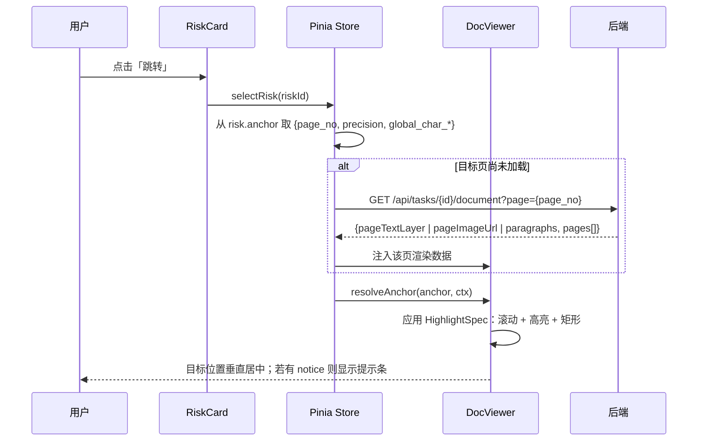

| 契约项 | 内容 |
|-------|------|
| 输入 | `RiskItem.anchor`（第 10.5 节响应模型中的 `anchor` 字段），前端不需要再请求接口拿锚点 |
| 页码来源 | `anchor.page_no`；DOCX 为 `null`，此时按 `anchor.paragraph_index` 找 `data-pid` |
| 页加载判据 | `anchor.page_no` 不在已加载集合内 → 调 `document` 接口取该页 |
| 定位结果 | `HighlightSpec`，`kind ∈ {text, rect, page, none}` |
| 提示规则 | `spec.notice` 非空则必须在左栏顶部渲染提示条，3 秒后自动消失 |
| 滚动对齐 | 首个高亮 Range 的 `getBoundingClientRect().top` 调整到视口垂直居中；若居中会露出空白则改为顶部对齐 |

#### 7.5.2 方向二：点击原文 → 高亮风险卡片

**也不走后端接口**。前端在风险列表加载完成后构建一个区间索引，用二分查找命中：

```javascript
// frontend/src/stores/risks.js
export const useRiskStore = defineStore('risks', {
  state: () => ({ risks: [], intervalIndex: [] }),
  actions: {
    buildIndex() {
      // 只索引有锚点且精度 >= PARAGRAPH 的风险项，按 global_char_start 升序
      this.intervalIndex = this.risks
        .filter(r => r.anchor && ['EXACT', 'PARAGRAPH'].includes(r.anchor.precision))
        .sort((a, b) => a.anchor.global_char_start - b.anchor.global_char_start)
    },
    /** 返回与 [start,end) 相交的全部风险项。区间在构建时保证不重叠或仅部分重叠，故用二分 + 线性回扫。 */
    hitsByRange(start, end) {
      const list = this.intervalIndex
      let lo = 0, hi = list.length
      while (lo < hi) {                       // 找到第一个 global_char_end > start 的位置
        const mid = (lo + hi) >> 1
        if (list[mid].anchor.global_char_end <= start) lo = mid + 1
        else hi = mid
      }
      const out = []
      for (let i = lo; i < list.length && list[i].anchor.global_char_start < end; i++) {
        out.push(list[i])
      }
      return out
    },
  },
})
```

| 契约项 | 内容 |
|-------|------|
| 触发方式 | 左栏文本层上的 `click` 事件，从事件目标向上找带 `data-pid` 的祖先容器 |
| 计算点击位置 | 在该容器的文本索引里，用 `range.setStart(node, offset)` 反查点击处的字符偏移（第 7.4.2 节的 `buildPageTextIndex` 结果可复用） |
| 命中查询 | `hitsByRange(localStart, localEnd)`；页内偏移先加上所在页的 `char_start` 换算为全局偏移 |
| 命中 0 条 | 不弹任何东西（点击空处是正常行为），仅清除现有选中态 |
| 命中 1 条 | 直接选中该卡片并滚动到视口内 |
| 命中多条 | 在点击位置旁弹出小浮层列出风险名称与等级，点击其一后选中 |
| 为什么不做后端接口 | 风险清单已在前端，区间索引构建成本 O(n log n)，n 为风险数（通常 &lt; 40）。加接口只会增加一次往返与一个状态同步点 |

### 7.6 跨页与跨段落条款的处理

| 情形 | 数据层表示 | 前端表现 |
|------|-----------|---------|
| 跨段落（同页） | `anchor.paragraph_index` 与 `paragraph_index_end` 不同；`global_char_start/end` 覆盖全部段落 | `resolveAnchor` 在 DOCX 路径下对**每个覆盖的段落**分别建索引与 Range，产生多个高亮片段；PDF 路径下因为走全局偏移 → 页内偏移，天然连续 |
| 跨页 | `anchor.page_no != anchor.page_no_end`；`bbox_list` 含多页的矩形 | `pagesCovered()` 产出多个页的局部区间；滚动定位到 `page_no`（起始页），并把 `page_no_end` 的页码指示器一并高亮，提示「该条款跨第 3~4 页」 |
| PDF 双栏导致条款被拆成两个 block | 切分阶段做**块合并**（见下） | 合并不成功时，该条款呈现为两条，各自有锚点；工作台显示「该条款可能被排版拆分为两段」提示 |
| OCR 段落被错误聚合 | 无自动修复 | 精度为 `PARAGRAPH`，矩形可能有偏移；提示条已声明「扫描件无法精确定位」，法务据此人工核对 |

PDF 双栏的块合并规则（在切分之前、IR 连通过程中执行）：

```python
def merge_parallel_blocks(doc: ParsedDocument) -> ParsedDocument:
    """处理双栏排版：同一页内水平不重叠、垂直重叠的两个 block 是左右栏，不合并；
    水平重叠、前一块末尾无句末标点、后一块以非编号内容开头的相邻 block，判定为同一条款的续接，合并。"""
    SENT_END = "。；！？："
    merged: list[ParagraphNode] = []
    for p in sorted(doc.paragraphs, key=lambda x: x.index):
        if merged and _same_page(merged[-1], p) and _x_overlap(merged[-1], p) \
                and not merged[-1].text.rstrip().endswith(tuple(SENT_END)) \
                and match_clause_no(p.text) is None:
            prev = merged.pop()
            joined_text = prev.text + p.text
            merged.append(prev.model_copy(update={
                "text": joined_text,
                "char_end": prev.char_start + len(joined_text),
                "line_boxes": prev.line_boxes + [
                    lb.model_copy(update={"char_start": lb.char_start + len(prev.text),
                                          "char_end": lb.char_end + len(prev.text)})
                    for lb in p.line_boxes
                ],
            }))
        else:
            merged.append(p)
    # 合并改变了文本，必须重排 index 与全局偏移，重跑 IR 不变量校验
    return rebuild_offsets(doc, merged)
```

`rebuild_offsets` 重排全部 `index`、`char_start/char_end`，并重新构造 `full_text` 与 `PageNode` 的页区间。**合并后必须重跑 IR 校验**，不通过则放弃合并、回退到合并前的 IR（记 warning），否则会出现偏移错乱。

## 8. 状态机设计

### 8.1 状态定义

任务状态（`contract_task.status`）与回写状态（`contract_task.writeback_status`）是两个**完全独立**的字段，互不阻塞：审查未完成时不允许回写，但回写失败不影响审查结果的可用性。

| 状态字段 | 取值 | 含义 | 终态 |
|---------|------|------|------|
| `status` | `pending` | 任务已创建，尚未开始解析 | 否 |
| `status` | `parsing` | 下载附件、抽文本、OCR、切分、抽元数据 | 否 |
| `status` | `reviewing` | 规则匹配、LLM 研判、建议生成、摘要合成 | 否 |
| `status` | `blocked` | 解析阶段失败，需人工介入 | 否（可恢复） |
| `status` | `completed` | 风险清单、建议、摘要均已生成 | 是 |
| `status` | `closed` | 管理员关闭的不可审任务 | 是 |
| `writeback_status` | `not_written` | 尚未回写 | 否 |
| `writeback_status` | `writing` | 回写请求已发出，未收到结果 | 否 |
| `writeback_status` | `success` | 回写成功 | 是 |
| `writeback_status` | `failed` | 回写失败 | 否（可重试） |

### 8.2 状态图

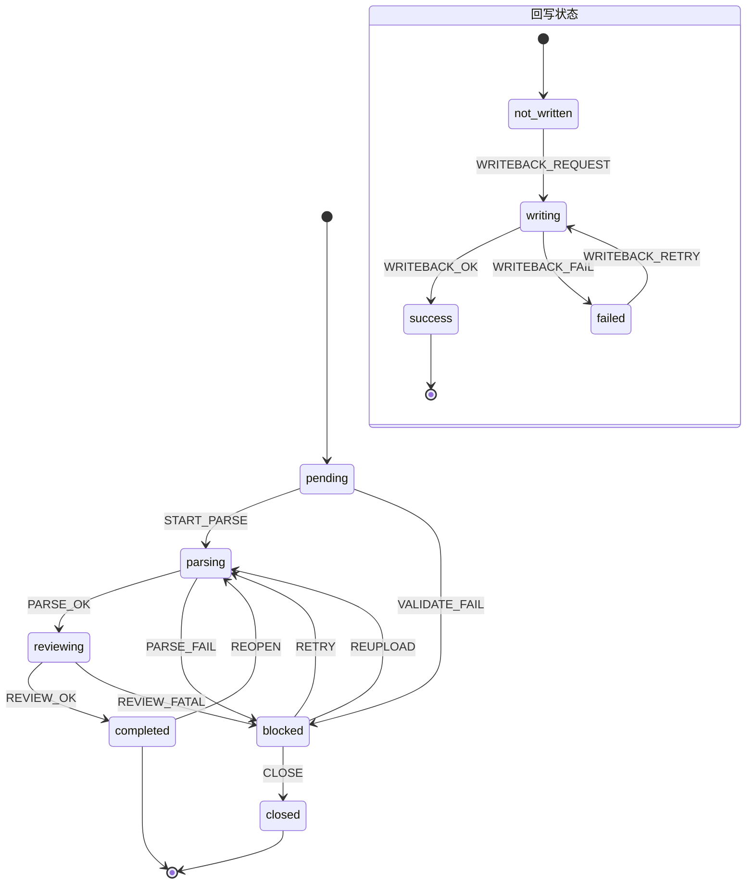

### 8.3 状态转移表

| # | 当前状态 | 事件 | 目标状态 | 副作用 | 失败处理 |
|---|---------|------|---------|-------|---------|
| 1 | （新建） | `CREATE` | `pending` | 插入 `contract_task`；`retry_count=0`；写审计日志 `CREATE_TASK` | 参数非法 → 40001，不建任务 |
| 2 | `pending` | `START_PARSE` | `parsing` | 条件 UPDATE 抢占；`parse_started_at = NOW(3)`；投递后台任务；SSE `task_status` | 抢占失败（行数 0）→ 说明已有 worker 在跑，静默放弃，不报错 |
| 3 | `pending` | `VALIDATE_FAIL` | `blocked` | 写 `block_reason`、`block_detail`；不消耗 `retry_count`（属业务数据问题）；SSE `task_status` | 无 |
| 4 | `parsing` | `PARSE_OK` | `reviewing` | 写 `parse_result`、`clause`、`contract_metadata`；删除旧版本解析数据（`version` 递增）；SSE `parse_progress` 与 `task_status` | 条款数为 0 → 转 `blocked(EMPTY_BODY)` |
| 5 | `parsing` | `PARSE_FAIL` | `blocked` | 写 `block_reason`/`block_detail`；`retry_count += 1`；写 `task_retry_log(result='failed')`；SSE `task_status` | 无（重试由人触发） |
| 6 | `reviewing` | `REVIEW_OK` | `completed` | 写 `risk_item`、`suggestion`、`overall_risk_level`、`review_summary`、`review_conclusion`；`review_finished_at = NOW(3)`；SSE `summary_ready` + `task_status` | 无（LLM 失败走降级，不转 `blocked`） |
| 7 | `reviewing` | `REVIEW_FATAL` | `blocked` | 解析结果不可用（IR 校验失败或条款全为 `OTHER` 且全文为空）；`block_reason=EMPTY_BODY`；`retry_count += 1` | 无 |
| 8 | `blocked` | `RETRY` | `parsing` | 校验 `retry_count < 3` 且 `status='blocked'`；`retry_count += 1`；清空 `block_reason`；写 `task_retry_log(trigger_mode='manual')`；重新投递；SSE `task_status` | 超上限 → 42901；状态不匹配 → 42201 |
| 9 | `blocked` | `REUPLOAD` | `parsing` | 新旧文件并存，`file_version += 1`；其余同 `RETRY`；不消耗 `retry_count`（换文件是新输入） | 格式/大小非法 → 41501/41301 |
| 10 | `blocked` | `CLOSE` | `closed` | 校验 `close_reason` 长度 ≥ 5；写审计日志 | 理由为空 → 40001 |
| 11 | `completed` | `REOPEN` | `parsing` | `review_version += 1`；旧版本 `risk_item`/`suggestion` 保留（`review_version` 区分），前端只查最新版本；清空回写状态为 `not_written`；不重置 `retry_count` | 非法转移 → 42201 |
| 12 | 任意 | `WRITEBACK_REQUEST` | `writeback_status: not_written → writing` | 校验 `status='completed'`；生成幂等键；异步调 Mock 评论区；SSE `writeback_status` | 任务未完成 → 42203；已 `success` → 42202 |
| 13 | `writing` | `WRITEBACK_OK` | `writeback_status: success` | 写 `writeback_log(result='success')`；SSE `writeback_status` | 无 |
| 14 | `writing` | `WRITEBACK_FAIL` | `writeback_status: failed` | `writeback_retry_count += 1`；写 `writeback_log(result='failed')`；SSE `writeback_status` | 无 |
| 15 | `failed` | `WRITEBACK_RETRY` | `writeback_status: writing` | 校验 `writeback_retry_count < 3`；**复用同一幂等键**（内容未变） | 超上限 → 42902 |
| 16 | 其他任意 | — | 不变 | 返回 42201，拒绝写库，记 WARN 日志（含 `task_id`、当前状态、目标状态） | 无 |

**为什么 `REUPLOAD` 不消耗 `retry_count`**：`retry_count` 的语义是「同一输入重试了几次」，用来识别「这个文件本身有问题」。换了文件就是换了输入，如果再计入上限，会出现「试了 3 个不同文件后彻底不能试了」的荒谬限制。这是本设计对 PRD 11.4 的明确细化。

### 8.4 幂等性保证

| 幂等对象 | 幂等键 | 保证方式 |
|---------|-------|---------|
| 事件接入建任务 | `source_event_id` | `contract_task.source_event_id` 唯一索引；插入冲突则查回既有任务返回，接口仍返 200 |
| 状态转移 | `(task_id, from_status)` | 条件 UPDATE：`WHERE id=:id AND status=:from`，`rowcount==1` 才算抢到执行权 |
| 解析结果写入 | `(task_id, version)` | `parse_result` 的 `(task_id, version)` 唯一索引；重复写入先删后插，同一事务内完成 |
| 风险项写入 | `(task_id, review_version, rule_code, clause_id)` | 唯一索引；同一审查版本重复执行只保留一条 |
| 建议生成 | `risk_item_id` | `suggestion.risk_item_id` 唯一索引 |
| **审批回写** | `sha256(f"{task_id}\|{review_version}\|{sha256(normalize(markdown))}")` | ① 请求头 `Idempotency-Key` 传给审批系统；② 本地 `writeback_log` 的 `(task_id, idempotency_key)` 唯一索引；③ Mock 端维护 `idempotency_key → comment_id` 映射表 |
| 后台任务重复投递 | `(task_id, status)` 条件 | 见上，抢占失败即静默退出 |

回写正文的规范化函数（幂等键的输入必须稳定）：

```python
def normalize_markdown(md: str) -> str:
    lines = [ln.rstrip() for ln in md.replace("\r\n", "\n").replace("\r", "\n").split("\n")]
    # 折叠连续空行为一个
    out: list[str] = []
    for ln in lines:
        if ln == "" and out and out[-1] == "":
            continue
        out.append(ln)
    return "\n".join(out).strip()


def build_idempotency_key(task_id: int, review_version: int, markdown: str) -> str:
    content_sha = hashlib.sha256(normalize_markdown(markdown).encode("utf-8")).hexdigest()
    raw = f"{task_id}|{review_version}|{content_sha}"
    return hashlib.sha256(raw.encode("utf-8")).hexdigest()
```

**回写正文中禁止出现随调用变化的内容**（时间戳、随机 ID、重试次数）。「第 N 次回写」的标注取自 `writeback_log` 的行数，而**不是**当前的 `writeback_retry_count`——否则一次失败重试就会让正文变、幂等键变、产生重复评论。这是最容易踩的坑，写在这里作为实现硬性要求。

### 8.5 并发控制

```python
# app/graph/runner.py

CLAIM_SQL = text("""
    UPDATE contract_task
       SET status = :to_status,
           parse_started_at = COALESCE(parse_started_at, NOW(3)),
           block_reason = NULL,
           block_detail = NULL,
           updated_at = NOW(3)
     WHERE id = :task_id
       AND status = :from_status
""")


def claim_task(session: Session, task_id: int, from_status: str, to_status: str) -> bool:
    """返回 True 表示抢到了执行权。必须在独立短事务中调用并立即提交。"""
    with session.begin():
        result = session.execute(CLAIM_SQL, {
            "to_status": to_status, "task_id": task_id, "from_status": from_status,
        })
    return result.rowcount == 1
```

三条并发规则：

| 编号 | 规则 |
|------|------|
| CON-01 | **状态转移必须在独立短事务中提交完成后，才开始耗时工作**。禁止把「status→parsing」与「解析 3 分钟」放在同一事务里，否则行锁被占用 3 分钟，所有重试请求全部阻塞 |
| CON-02 | 同一任务的并发防护靠条件 UPDATE，不靠应用层锁。应用层永远不假设「只有我在处理这个任务」 |
| CON-03 | 全进程并发上限 = `asyncio.Semaphore(settings.max_concurrent_tasks)`，默认 5（对应 PRD NFR-C-01）。信号量在 worker 入口获取，取不到就等待，任务保持 `pending` 状态被后续轮询捡起 |

### 8.6 重试与阻塞恢复

| 对象 | 上限 | 间隔 | 触发方 | 超限后 |
|------|------|------|-------|-------|
| 解析（`RETRY`） | 3 | 立即 / 30s / 120s（指数退避，但**每次都由人点击**，间隔仅用于展示建议等待时间） | 人工 | 按钮置灰，仅允许 `REUPLOAD` 或 `CLOSE`；返回 42901 |
| OCR 主通道 | 2 | 3s / 8s | 自动（同一次解析内） | 转 `blocked(OCR_FAILED)` |
| LLM 单条条款 | 3 | 2s / 5s / 10s | 自动 | 跳过该条款 LLM 研判，`review_degraded=true`，任务继续 |
| 附件下载 | 3 | 2s / 5s / 10s | 自动 | `blocked(ATTACHMENT_MISSING)` |
| 回写 | 3 | 5s / 15s / 45s | 人工 | 界面显示失败原因与配置检查建议；返回 42902 |

**进程重启后的恢复**（`app/workers/task_worker.py`）：

```python
async def recover_on_startup() -> None:
    """启动扫描：把卡在中间态的任务重新入队。
    注意：不修改 retry_count，也不区分是崩溃还是正常中断——因为状态本身
    就表达了"这件事没做完"，重跑是幂等的（见 8.4 的幂等键表）。"""
    with SessionLocal() as session:
        rows = session.execute(text("""
            SELECT id, status FROM contract_task
             WHERE status IN ('pending', 'parsing', 'reviewing')
               AND is_deleted = 0
             ORDER BY created_at ASC
        """)).all()
    for task_id, status in rows:
        if status != 'pending':
            with SessionLocal() as session:
                session.execute(text("""
                    UPDATE contract_task SET status = 'pending', updated_at = NOW(3)
                     WHERE id = :id AND status = :st
                """), {"id": task_id, "st": status})
                session.commit()
        await enqueue(task_id)
    logger.info(f"启动恢复：重新入队 {len(rows)} 个任务")
```

**为何把中间态强制回退到 `pending` 而不是直接续跑**：解析与审查阶段的中间状态没有可靠的外部检查点（只有 LangGraph 的审查段有），直接续跑要判断「哪些条款已审过」，逻辑复杂且容易半途出错。统一回退到 `pending` 重跑全流程，靠 8.4 的幂等键保证不产生脏数据，代价是多花一次解析时间（最长 3 分钟），收益是恢复逻辑只有 10 行。

## 9. 数据模型

### 9.1 ER 图

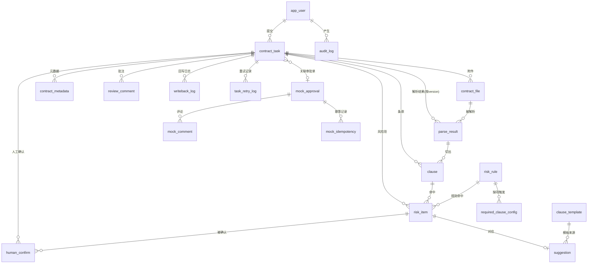

### 9.2 建表语句

```sql
-- ============================================================
-- 合同审批审查系统 建表 DDL
-- MySQL 8.0.16+ / InnoDB / utf8mb4_0900_ai_ci
-- 所有表均含 created_at / updated_at，见各表定义
-- ============================================================

SET NAMES utf8mb4;

-- ---------- 1. 用户 ----------
CREATE TABLE app_user (
    id            BIGINT UNSIGNED NOT NULL AUTO_INCREMENT,
    username      VARCHAR(64)     NOT NULL                COMMENT '登录名',
    display_name  VARCHAR(64)     NOT NULL                COMMENT '显示姓名',
    role_code     VARCHAR(16)     NOT NULL                COMMENT 'LEGAL/BIZ/ADMIN',
    company_name  VARCHAR(128)    NULL                    COMMENT '所属企业全称，用于 R-SUB-03',
    is_active     TINYINT(1)      NOT NULL DEFAULT 1      COMMENT '是否启用',
    created_at    DATETIME(3)     NOT NULL DEFAULT CURRENT_TIMESTAMP(3),
    updated_at    DATETIME(3)     NOT NULL DEFAULT CURRENT_TIMESTAMP(3) ON UPDATE CURRENT_TIMESTAMP(3),
    PRIMARY KEY (id),
    UNIQUE KEY uk_username (username),
    KEY idx_role (role_code),
    CONSTRAINT ck_user_role CHECK (role_code IN ('LEGAL','BIZ','ADMIN'))
) ENGINE=InnoDB COMMENT='用户（课程项目用预置账号，不做注册）';

-- ---------- 2. 审查任务 ----------
CREATE TABLE contract_task (
    id                     BIGINT UNSIGNED NOT NULL AUTO_INCREMENT,
    task_no                VARCHAR(32)     NOT NULL             COMMENT 'CR+yyyyMMdd+6位序号',
    contract_name          VARCHAR(255)    NOT NULL,
    contract_type          VARCHAR(16)     NOT NULL DEFAULT 'UNKNOWN' COMMENT 'PURCHASE/SALES/SERVICE/LABOR/UNKNOWN',
    contract_no            VARCHAR(64)     NULL                 COMMENT '合同编号（正文抽取）',
    applicant_id           BIGINT UNSIGNED NOT NULL,
    applicant_dept         VARCHAR(64)     NULL,
    amount                 DECIMAL(18,2)   NULL,
    currency               CHAR(3)         NULL,
    our_party_role         CHAR(1)         NULL                 COMMENT 'A/B，我方角色',
    source_type            VARCHAR(16)     NOT NULL DEFAULT 'UPLOAD' COMMENT 'UPLOAD/APPROVAL_EVENT/APPROVAL_TODO',
    source_event_id        VARCHAR(64)     NULL,
    approval_no            VARCHAR(64)     NULL,
    status                 VARCHAR(16)     NOT NULL DEFAULT 'pending',
    block_reason           VARCHAR(32)     NULL,
    block_detail           VARCHAR(512)    NULL,
    retry_count            TINYINT UNSIGNED NOT NULL DEFAULT 0   COMMENT '解析重试次数，上限3',
    overall_risk_level     VARCHAR(8)      NULL                 COMMENT 'HIGH/MEDIUM/LOW',
    review_conclusion      VARCHAR(16)     NULL                 COMMENT 'PASS/RECTIFY/REJECT',
    review_summary         VARCHAR(1024)   NULL,
    review_degraded        TINYINT(1)      NOT NULL DEFAULT 0,
    review_degraded_reason VARCHAR(255)    NULL,
    review_version         INT UNSIGNED    NOT NULL DEFAULT 1,
    writeback_status       VARCHAR(16)     NOT NULL DEFAULT 'not_written',
    writeback_retry_count  TINYINT UNSIGNED NOT NULL DEFAULT 0   COMMENT '回写重试，上限3',
    parse_started_at       DATETIME(3)     NULL,
    review_finished_at     DATETIME(3)     NULL,
    close_reason           VARCHAR(255)    NULL,
    is_deleted             TINYINT(1)      NOT NULL DEFAULT 0,
    created_at             DATETIME(3)     NOT NULL DEFAULT CURRENT_TIMESTAMP(3),
    updated_at             DATETIME(3)     NOT NULL DEFAULT CURRENT_TIMESTAMP(3) ON UPDATE CURRENT_TIMESTAMP(3),
    PRIMARY KEY (id),
    UNIQUE KEY uk_task_no (task_no),
    UNIQUE KEY uk_source_event (source_event_id),
    KEY idx_status_risk_created (status, overall_risk_level, created_at),
    KEY idx_applicant (applicant_id, created_at),
    KEY idx_approval_no (approval_no),
    KEY idx_writeback_status (writeback_status),
    KEY idx_blocked (status, block_reason),
    CONSTRAINT fk_task_applicant FOREIGN KEY (applicant_id) REFERENCES app_user (id),
    CONSTRAINT ck_task_status CHECK (status IN ('pending','parsing','reviewing','blocked','completed','closed')),
    CONSTRAINT ck_task_writeback CHECK (writeback_status IN ('not_written','writing','success','failed')),
    CONSTRAINT ck_task_risk CHECK (overall_risk_level IS NULL OR overall_risk_level IN ('HIGH','MEDIUM','LOW')),
    CONSTRAINT ck_task_party_role CHECK (our_party_role IS NULL OR our_party_role IN ('A','B'))
) ENGINE=InnoDB COMMENT='审查任务（状态机主体）';

-- ---------- 3. 合同文件 ----------
CREATE TABLE contract_file (
    id            BIGINT UNSIGNED NOT NULL AUTO_INCREMENT,
    task_id       BIGINT UNSIGNED NOT NULL,
    original_name VARCHAR(255)    NOT NULL                COMMENT '原始文件名，仅展示用',
    storage_path  VARCHAR(512)    NOT NULL                COMMENT '服务端生成路径',
    file_size     BIGINT UNSIGNED NOT NULL,
    file_md5      CHAR(32)        NOT NULL,
    mime_type     VARCHAR(128)    NOT NULL,
    file_ext      VARCHAR(16)     NOT NULL                COMMENT '小写，无点',
    parse_channel VARCHAR(16)     NULL                    COMMENT 'DOCX/PDF_TEXT/PDF_OCR/IMAGE_OCR',
    is_encrypted  TINYINT(1)      NOT NULL DEFAULT 0,
    page_count    INT             NULL                    COMMENT 'DOCX 为 NULL',
    file_version  INT UNSIGNED    NOT NULL DEFAULT 1,
    created_at    DATETIME(3)     NOT NULL DEFAULT CURRENT_TIMESTAMP(3),
    updated_at    DATETIME(3)     NOT NULL DEFAULT CURRENT_TIMESTAMP(3) ON UPDATE CURRENT_TIMESTAMP(3),
    PRIMARY KEY (id),
    KEY idx_task (task_id),
    KEY idx_md5 (file_md5),
    CONSTRAINT fk_file_task FOREIGN KEY (task_id) REFERENCES contract_task (id) ON DELETE CASCADE
) ENGINE=InnoDB COMMENT='合同文件（每次重新上传递增 file_version）';

-- ---------- 4. 解析结果 ----------
CREATE TABLE parse_result (
    id                  BIGINT UNSIGNED NOT NULL AUTO_INCREMENT,
    task_id             BIGINT UNSIGNED NOT NULL,
    file_id             BIGINT UNSIGNED NOT NULL,
    version             INT UNSIGNED    NOT NULL DEFAULT 1   COMMENT '与 task.review_version 对齐',
    full_text           LONGTEXT        NOT NULL             COMMENT '段落以 \n 拼接，锚点全局偏移的基准',
    paragraph_tree      JSON            NOT NULL             COMMENT '段落树快照，供文档接口渲染',
    page_index          JSON            NULL                 COMMENT '页区间 [{page_no,char_start,char_end,width,height,render_ref}]',
    split_strategy      VARCHAR(64)     NOT NULL,
    page_count          INT             NULL,
    char_count          INT             NOT NULL DEFAULT 0,
    paragraph_count     INT             NOT NULL DEFAULT 0,
    ocr_engine          VARCHAR(32)     NULL,
    ocr_avg_confidence  DECIMAL(4,3)    NULL,
    quality_warnings    JSON            NULL,
    parse_duration_ms   INT             NOT NULL DEFAULT 0,
    ir_status           VARCHAR(16)     NOT NULL DEFAULT 'success' COMMENT 'success/partial',
    created_at          DATETIME(3)     NOT NULL DEFAULT CURRENT_TIMESTAMP(3),
    updated_at          DATETIME(3)     NOT NULL DEFAULT CURRENT_TIMESTAMP(3) ON UPDATE CURRENT_TIMESTAMP(3),
    PRIMARY KEY (id),
    UNIQUE KEY uk_task_version (task_id, version),
    KEY idx_file (file_id),
    CONSTRAINT fk_pr_task FOREIGN KEY (task_id) REFERENCES contract_task (id) ON DELETE CASCADE,
    CONSTRAINT fk_pr_file FOREIGN KEY (file_id) REFERENCES contract_file (id)
) ENGINE=InnoDB COMMENT='解析结果（含 IR 快照，重试时按 version 覆盖）';

-- ---------- 5. 合同元数据 ----------
CREATE TABLE contract_metadata (
    id               BIGINT UNSIGNED NOT NULL AUTO_INCREMENT,
    task_id          BIGINT UNSIGNED NOT NULL,
    field_key        VARCHAR(48)     NOT NULL,
    field_label      VARCHAR(64)     NOT NULL,
    field_value      VARCHAR(512)    NULL,
    field_value_raw  VARCHAR(1024)   NULL                    COMMENT '原文表述 / 多候选 JSON',
    value_type       VARCHAR(16)     NOT NULL DEFAULT 'string',
    is_required      TINYINT(1)      NOT NULL DEFAULT 0,
    is_missing       TINYINT(1)      NOT NULL DEFAULT 0,
    source           VARCHAR(16)     NOT NULL DEFAULT 'auto' COMMENT 'auto/manual',
    confidence       DECIMAL(4,3)    NULL,
    anchor           JSON            NULL                    COMMENT 'Anchor 结构；无锚点为 NULL',
    updated_by       BIGINT UNSIGNED NULL,
    created_at       DATETIME(3)     NOT NULL DEFAULT CURRENT_TIMESTAMP(3),
    updated_at       DATETIME(3)     NOT NULL DEFAULT CURRENT_TIMESTAMP(3) ON UPDATE CURRENT_TIMESTAMP(3),
    PRIMARY KEY (id),
    UNIQUE KEY uk_task_field (task_id, field_key),
    CONSTRAINT fk_meta_task FOREIGN KEY (task_id) REFERENCES contract_task (id) ON DELETE CASCADE,
    CONSTRAINT fk_meta_user FOREIGN KEY (updated_by) REFERENCES app_user (id)
) ENGINE=InnoDB COMMENT='合同元数据（按字段一行，便于单字段修正）';

-- ---------- 6. 条款 ----------
CREATE TABLE clause (
    id                       BIGINT UNSIGNED  NOT NULL AUTO_INCREMENT,
    task_id                  BIGINT UNSIGNED  NOT NULL,
    parse_result_id          BIGINT UNSIGNED  NOT NULL,
    parent_clause_id         BIGINT UNSIGNED  NULL             COMMENT '长条款拆分的父条款',
    part_no                  INT              NULL             COMMENT '子条款序号',
    clause_index             INT              NOT NULL         COMMENT '文档内顺序号，1 起',
    clause_no                VARCHAR(32)      NULL             COMMENT '编号前缀原文',
    clause_level             TINYINT UNSIGNED NOT NULL DEFAULT 0,
    clause_title             VARCHAR(255)     NULL,
    clause_text              TEXT             NOT NULL         COMMENT '去编号前缀的正文，供模型与检索',
    clause_type              VARCHAR(32)      NOT NULL DEFAULT 'OTHER',
    clause_type_secondary    VARCHAR(32)      NULL,
    clause_type_confidence   DECIMAL(4,3)     NULL,
    classify_rule_hit        VARCHAR(255)     NULL,
    split_strategy           VARCHAR(24)      NOT NULL,
    paragraph_index_start    INT              NOT NULL,
    paragraph_index_end      INT              NOT NULL,
    page_start               INT              NULL,
    page_end                 INT              NULL,
    global_char_start        INT              NOT NULL,
    global_char_end          INT              NOT NULL,
    anchor                   JSON             NOT NULL         COMMENT 'Anchor 结构（与显式列同源）',
    char_count               INT              NOT NULL DEFAULT 0,
    created_at               DATETIME(3)      NOT NULL DEFAULT CURRENT_TIMESTAMP(3),
    updated_at               DATETIME(3)      NOT NULL DEFAULT CURRENT_TIMESTAMP(3) ON UPDATE CURRENT_TIMESTAMP(3),
    PRIMARY KEY (id),
    KEY idx_task_index (task_id, clause_index),
    KEY idx_task_type (task_id, clause_type),
    KEY idx_parent (parent_clause_id),
    KEY idx_char (task_id, global_char_start),
    FULLTEXT KEY ft_clause_text (clause_text) WITH PARSER ngram,
    CONSTRAINT fk_clause_task FOREIGN KEY (task_id) REFERENCES contract_task (id) ON DELETE CASCADE,
    CONSTRAINT fk_clause_pr FOREIGN KEY (parse_result_id) REFERENCES parse_result (id) ON DELETE CASCADE
) ENGINE=InnoDB COMMENT='条款（anchor 与显式定位列同源写入，显式列供查询，anchor 供前端整包渲染）';

-- ---------- 7. 风险项 ----------
CREATE TABLE risk_item (
    id                BIGINT UNSIGNED NOT NULL AUTO_INCREMENT,
    task_id           BIGINT UNSIGNED NOT NULL,
    clause_id         BIGINT UNSIGNED NULL                  COMMENT '缺项类风险为 NULL',
    rule_code         VARCHAR(16)     NULL                  COMMENT '命中规则；纯 LLM 风险为 NULL',
    risk_name         VARCHAR(128)    NOT NULL,
    risk_type         VARCHAR(24)     NOT NULL DEFAULT 'CLAUSE_RISK' COMMENT 'CLAUSE_RISK/MISSING_CLAUSE/METADATA_RISK',
    clause_type       VARCHAR(32)     NULL,
    risk_level        VARCHAR(8)      NOT NULL,
    source            VARCHAR(16)     NOT NULL              COMMENT 'rule/llm/rule+llm',
    risk_reason       TEXT            NOT NULL,
    legal_basis       TEXT            NULL,
    original_text     TEXT            NULL,
    anchor            JSON            NULL,
    anchor_precision  VARCHAR(16)     NULL                  COMMENT '冗余存储，供列表页直接展示降级标记',
    is_false_positive TINYINT(1)      NOT NULL DEFAULT 0,
    false_positive_by BIGINT UNSIGNED NULL,
    review_version    INT UNSIGNED    NOT NULL DEFAULT 1,
    created_at        DATETIME(3)     NOT NULL DEFAULT CURRENT_TIMESTAMP(3),
    updated_at        DATETIME(3)     NOT NULL DEFAULT CURRENT_TIMESTAMP(3) ON UPDATE CURRENT_TIMESTAMP(3),
    PRIMARY KEY (id),
    UNIQUE KEY uk_dedup (task_id, review_version, rule_code, clause_id),
    KEY idx_task_level (task_id, review_version, risk_level),
    KEY idx_task_fp (task_id, is_false_positive),
    KEY idx_clause (clause_id),
    CONSTRAINT fk_risk_task FOREIGN KEY (task_id) REFERENCES contract_task (id) ON DELETE CASCADE,
    CONSTRAINT fk_risk_clause FOREIGN KEY (clause_id) REFERENCES clause (id) ON DELETE CASCADE,
    CONSTRAINT ck_risk_level CHECK (risk_level IN ('HIGH','MEDIUM','LOW')),
    CONSTRAINT ck_risk_source CHECK (source IN ('rule','llm','rule+llm'))
) ENGINE=InnoDB COMMENT='风险项；uk_dedup 保证同版本同规则同条款只记一条（缺项类 clause_id 为 NULL 时需注意）';

-- ---------- 8. 修改建议 ----------
CREATE TABLE suggestion (
    id                BIGINT UNSIGNED NOT NULL AUTO_INCREMENT,
    risk_item_id      BIGINT UNSIGNED NOT NULL,
    suggestion_source VARCHAR(16)     NOT NULL              COMMENT 'template/llm/manual',
    template_id       BIGINT UNSIGNED NULL,
    suggested_text    TEXT            NOT NULL,
    final_text        TEXT            NULL,
    status            VARCHAR(16)     NOT NULL DEFAULT 'pending' COMMENT 'pending/adopted/rejected',
    reject_reason     VARCHAR(255)    NULL,
    error_msg         VARCHAR(255)    NULL                  COMMENT '生成失败原因',
    confirmed_by      BIGINT UNSIGNED NULL,
    confirmed_at      DATETIME(3)     NULL,
    created_at        DATETIME(3)     NOT NULL DEFAULT CURRENT_TIMESTAMP(3),
    updated_at        DATETIME(3)     NOT NULL DEFAULT CURRENT_TIMESTAMP(3) ON UPDATE CURRENT_TIMESTAMP(3),
    PRIMARY KEY (id),
    UNIQUE KEY uk_risk (risk_item_id),
    KEY idx_status (status),
    CONSTRAINT fk_sug_risk FOREIGN KEY (risk_item_id) REFERENCES risk_item (id) ON DELETE CASCADE,
    CONSTRAINT ck_sug_status CHECK (status IN ('pending','adopted','rejected'))
) ENGINE=InnoDB COMMENT='修改建议（一条风险最多一条建议）';

-- ---------- 9. 人工确认记录 ----------
CREATE TABLE human_confirm (
    id           BIGINT UNSIGNED NOT NULL AUTO_INCREMENT,
    task_id      BIGINT UNSIGNED NOT NULL,
    risk_item_id BIGINT UNSIGNED NOT NULL,
    action       VARCHAR(24)     NOT NULL COMMENT 'adopted/adopted_modified/rejected/false_positive',
    text_before  TEXT            NULL,
    text_after   TEXT            NULL,
    operator_id  BIGINT UNSIGNED NOT NULL,
    review_version INT UNSIGNED  NOT NULL DEFAULT 1,
    created_at   DATETIME(3)     NOT NULL DEFAULT CURRENT_TIMESTAMP(3),
    updated_at   DATETIME(3)     NOT NULL DEFAULT CURRENT_TIMESTAMP(3) ON UPDATE CURRENT_TIMESTAMP(3),
    PRIMARY KEY (id),
    KEY idx_task (task_id),
    KEY idx_risk (risk_item_id),
    CONSTRAINT fk_hc_risk FOREIGN KEY (risk_item_id) REFERENCES risk_item (id) ON DELETE CASCADE
) ENGINE=InnoDB COMMENT='人工确认留痕，采纳率指标 G-03 从此表统计';

-- ---------- 10. 法务批注 ----------
CREATE TABLE review_comment (
    id         BIGINT UNSIGNED NOT NULL AUTO_INCREMENT,
    task_id    BIGINT UNSIGNED NOT NULL,
    content    VARCHAR(2000)   NOT NULL,
    author_id  BIGINT UNSIGNED NOT NULL,
    is_deleted TINYINT(1)      NOT NULL DEFAULT 0,
    created_at DATETIME(3)     NOT NULL DEFAULT CURRENT_TIMESTAMP(3),
    updated_at DATETIME(3)     NOT NULL DEFAULT CURRENT_TIMESTAMP(3) ON UPDATE CURRENT_TIMESTAMP(3),
    PRIMARY KEY (id),
    KEY idx_task_alive (task_id, is_deleted, created_at),
    CONSTRAINT fk_rc_task FOREIGN KEY (task_id) REFERENCES contract_task (id) ON DELETE CASCADE
) ENGINE=InnoDB COMMENT='法务批注';

-- ---------- 11. 回写日志 ----------
CREATE TABLE writeback_log (
    id              BIGINT UNSIGNED NOT NULL AUTO_INCREMENT,
    task_id         BIGINT UNSIGNED NOT NULL,
    writeback_no    VARCHAR(40)     NOT NULL,
    approval_no     VARCHAR(64)     NOT NULL,
    idempotency_key CHAR(64)        NOT NULL COMMENT 'sha256(task_id|review_version|content_sha)',
    content_sha256  CHAR(64)        NOT NULL,
    content_body    MEDIUMTEXT      NOT NULL COMMENT '规范化后的 Markdown 正文',
    request_body    MEDIUMTEXT      NOT NULL,
    response_body   MEDIUMTEXT      NULL,
    http_status     INT             NULL,
    result          VARCHAR(16)     NOT NULL COMMENT 'success/failed',
    error_msg       VARCHAR(512)    NULL,
    operator_id     BIGINT UNSIGNED NOT NULL,
    retry_no        TINYINT UNSIGNED NOT NULL DEFAULT 0,
    duration_ms     INT             NULL,
    created_at      DATETIME(3)     NOT NULL DEFAULT CURRENT_TIMESTAMP(3),
    updated_at      DATETIME(3)     NOT NULL DEFAULT CURRENT_TIMESTAMP(3) ON UPDATE CURRENT_TIMESTAMP(3),
    PRIMARY KEY (id),
    UNIQUE KEY uk_writeback_no (writeback_no),
    UNIQUE KEY uk_idem (task_id, idempotency_key),
    KEY idx_approval (approval_no),
    KEY idx_result (result, created_at),
    CONSTRAINT fk_wb_task FOREIGN KEY (task_id) REFERENCES contract_task (id) ON DELETE CASCADE,
    CONSTRAINT ck_wb_result CHECK (result IN ('success','failed'))
) ENGINE=InnoDB COMMENT='回写日志；uk_idem 是回写幂等的第二道防线（第一道在 Mock 端）';

-- ---------- 12. 重试日志 ----------
CREATE TABLE task_retry_log (
    id           BIGINT UNSIGNED NOT NULL AUTO_INCREMENT,
    task_id      BIGINT UNSIGNED NOT NULL,
    retry_no     TINYINT UNSIGNED NOT NULL,
    trigger_mode VARCHAR(16)     NOT NULL COMMENT 'manual/auto',
    retry_target VARCHAR(24)     NOT NULL DEFAULT 'parse' COMMENT 'parse/ocr/llm/writeback',
    result       VARCHAR(16)     NOT NULL COMMENT 'success/failed',
    error_msg    VARCHAR(512)    NULL,
    operator_id  BIGINT UNSIGNED NULL COMMENT '自动重试为 NULL',
    created_at   DATETIME(3)     NOT NULL DEFAULT CURRENT_TIMESTAMP(3),
    updated_at   DATETIME(3)     NOT NULL DEFAULT CURRENT_TIMESTAMP(3) ON UPDATE CURRENT_TIMESTAMP(3),
    PRIMARY KEY (id),
    KEY idx_task_target (task_id, retry_target, created_at),
    CONSTRAINT fk_trl_task FOREIGN KEY (task_id) REFERENCES contract_task (id) ON DELETE CASCADE
) ENGINE=InnoDB COMMENT='重试日志，含自动重试与人工重试';

-- ---------- 13. 审查规则 ----------
CREATE TABLE risk_rule (
    id                       BIGINT UNSIGNED NOT NULL AUTO_INCREMENT,
    rule_code                VARCHAR(16)     NOT NULL COMMENT '如 R-LIA-01',
    rule_name                VARCHAR(128)    NOT NULL,
    rule_group               VARCHAR(32)     NOT NULL,
    applies_to_contract_type VARCHAR(64)     NOT NULL DEFAULT 'ALL' COMMENT '逗号分隔多个类型',
    condition_ast            JSON            NOT NULL COMMENT '条件 AST（见第 11 章）',
    condition_text           TEXT            NOT NULL COMMENT 'AST 的人类可读表达式，供界面展示与排查',
    risk_level               VARCHAR(8)      NOT NULL,
    basis                    TEXT            NOT NULL COMMENT '判定依据，未确认时写「依据：待法务确认」',
    fix_direction            TEXT            NOT NULL,
    threshold_value          DECIMAL(10,4)   NULL,
    is_enabled               TINYINT(1)      NOT NULL DEFAULT 1,
    priority                 INT             NOT NULL DEFAULT 100,
    version                  INT UNSIGNED    NOT NULL DEFAULT 1,
    created_at               DATETIME(3)     NOT NULL DEFAULT CURRENT_TIMESTAMP(3),
    updated_at               DATETIME(3)     NOT NULL DEFAULT CURRENT_TIMESTAMP(3) ON UPDATE CURRENT_TIMESTAMP(3),
    PRIMARY KEY (id),
    UNIQUE KEY uk_rule_code (rule_code),
    KEY idx_enabled_priority (is_enabled, priority),
    KEY idx_group (rule_group),
    CONSTRAINT ck_rule_level CHECK (risk_level IN ('HIGH','MEDIUM','LOW'))
) ENGINE=InnoDB COMMENT='审查规则；由 seed/rules.yaml 导入，本期不做界面化编辑';

-- ---------- 14. 示范条款模板 ----------
CREATE TABLE clause_template (
    id            BIGINT UNSIGNED NOT NULL AUTO_INCREMENT,
    template_name VARCHAR(128)    NOT NULL,
    contract_type VARCHAR(16)     NOT NULL,
    clause_type   VARCHAR(32)     NOT NULL,
    rule_code     VARCHAR(16)     NULL COMMENT '关联规则，命中时优先于 clause_type 匹配',
    template_text TEXT            NOT NULL,
    is_enabled    TINYINT(1)      NOT NULL DEFAULT 1,
    remark        VARCHAR(255)    NULL,
    created_at    DATETIME(3)     NOT NULL DEFAULT CURRENT_TIMESTAMP(3),
    updated_at    DATETIME(3)     NOT NULL DEFAULT CURRENT_TIMESTAMP(3) ON UPDATE CURRENT_TIMESTAMP(3),
    PRIMARY KEY (id),
    KEY idx_lookup (is_enabled, contract_type, clause_type),
    KEY idx_rule (rule_code)
) ENGINE=InnoDB COMMENT='示范条款模板库';

-- ---------- 15. 必检条款配置 ----------
CREATE TABLE required_clause_config (
    id                BIGINT UNSIGNED NOT NULL AUTO_INCREMENT,
    contract_type     VARCHAR(16)     NOT NULL,
    clause_type       VARCHAR(32)     NOT NULL,
    missing_rule_code VARCHAR(16)     NOT NULL COMMENT '缺失时触发的规则编号',
    is_enabled        TINYINT(1)      NOT NULL DEFAULT 1,
    created_at        DATETIME(3)     NOT NULL DEFAULT CURRENT_TIMESTAMP(3),
    updated_at        DATETIME(3)     NOT NULL DEFAULT CURRENT_TIMESTAMP(3) ON UPDATE CURRENT_TIMESTAMP(3),
    PRIMARY KEY (id),
    UNIQUE KEY uk_type_clause (contract_type, clause_type),
    KEY idx_missing_rule (missing_rule_code)
) ENGINE=InnoDB COMMENT='必检条款清单，驱动缺项类风险（R-MIS-*）';

-- ---------- 16. Mock 审批单 ----------
CREATE TABLE mock_approval (
    id             BIGINT UNSIGNED NOT NULL AUTO_INCREMENT,
    approval_no    VARCHAR(64)     NOT NULL,
    contract_name  VARCHAR(255)    NOT NULL,
    applicant      VARCHAR(64)     NOT NULL,
    applicant_dept VARCHAR(64)     NULL,
    contract_type  VARCHAR(16)     NOT NULL,
    attachment_url VARCHAR(512)    NOT NULL COMMENT '指向本服务的 mock 附件下载地址',
    status         VARCHAR(16)     NOT NULL DEFAULT 'PENDING_REVIEW',
    pushed         TINYINT(1)      NOT NULL DEFAULT 0,
    created_at     DATETIME(3)     NOT NULL DEFAULT CURRENT_TIMESTAMP(3),
    updated_at     DATETIME(3)     NOT NULL DEFAULT CURRENT_TIMESTAMP(3) ON UPDATE CURRENT_TIMESTAMP(3),
    PRIMARY KEY (id),
    UNIQUE KEY uk_approval_no (approval_no),
    KEY idx_pushed (pushed, status)
) ENGINE=InnoDB COMMENT='Mock 审批系统的审批单';

-- ---------- 17. Mock 审批评论 ----------
CREATE TABLE mock_comment (
    id          BIGINT UNSIGNED NOT NULL AUTO_INCREMENT,
    approval_no VARCHAR(64)     NOT NULL,
    author      VARCHAR(64)     NOT NULL,
    content     MEDIUMTEXT      NOT NULL,
    source      VARCHAR(24)     NOT NULL DEFAULT 'REVIEW_SYSTEM',
    comment_no  INT             NOT NULL COMMENT '同一审批单内的评论序号',
    created_at  DATETIME(3)     NOT NULL DEFAULT CURRENT_TIMESTAMP(3),
    updated_at  DATETIME(3)     NOT NULL DEFAULT CURRENT_TIMESTAMP(3) ON UPDATE CURRENT_TIMESTAMP(3),
    PRIMARY KEY (id),
    KEY idx_approval (approval_no, comment_no),
    CONSTRAINT fk_mc_approval FOREIGN KEY (approval_no) REFERENCES mock_approval (approval_no) ON DELETE CASCADE
) ENGINE=InnoDB COMMENT='Mock 审批系统的评论';

-- ---------- 18. Mock 幂等记录（ADR-006 的核心表） ----------
CREATE TABLE mock_idempotency (
    id              BIGINT UNSIGNED NOT NULL AUTO_INCREMENT,
    approval_no     VARCHAR(64)     NOT NULL,
    idempotency_key CHAR(64)        NOT NULL,
    comment_id      BIGINT UNSIGNED NOT NULL COMMENT '首次成功写入产生的评论 ID',
    created_at      DATETIME(3)     NOT NULL DEFAULT CURRENT_TIMESTAMP(3),
    updated_at      DATETIME(3)     NOT NULL DEFAULT CURRENT_TIMESTAMP(3) ON UPDATE CURRENT_TIMESTAMP(3),
    PRIMARY KEY (id),
    UNIQUE KEY uk_approval_idem (approval_no, idempotency_key),
    CONSTRAINT fk_mi_approval FOREIGN KEY (approval_no) REFERENCES mock_approval (approval_no) ON DELETE CASCADE,
    CONSTRAINT fk_mi_comment FOREIGN KEY (comment_id) REFERENCES mock_comment (id) ON DELETE CASCADE
) ENGINE=InnoDB COMMENT='Mock 端幂等表：同一幂等键只产生一条评论，重复请求返回既有 comment_id';

-- ---------- 19. LangGraph 检查点 ----------
CREATE TABLE lg_checkpoint (
    thread_id            VARCHAR(64)  NOT NULL COMMENT '用 task_id 作为 thread_id',
    checkpoint_ns        VARCHAR(64)  NOT NULL DEFAULT '',
    checkpoint_id        VARCHAR(64)  NOT NULL,
    parent_checkpoint_id VARCHAR(64)  NULL,
    type                 VARCHAR(32)  NOT NULL DEFAULT 'json',
    checkpoint           LONGBLOB     NOT NULL,
    metadata             JSON         NOT NULL,
    created_at           DATETIME(3)  NOT NULL DEFAULT CURRENT_TIMESTAMP(3),
    updated_at           DATETIME(3)  NOT NULL DEFAULT CURRENT_TIMESTAMP(3) ON UPDATE CURRENT_TIMESTAMP(3),
    PRIMARY KEY (thread_id, checkpoint_ns, checkpoint_id),
    KEY idx_thread (thread_id, created_at)
) ENGINE=InnoDB COMMENT='LangGraph 自定义 MySQL 检查点（MySQL 无官方 Saver，见 19.1 R-04）';

CREATE TABLE lg_checkpoint_writes (
    thread_id     VARCHAR(64)  NOT NULL,
    checkpoint_ns VARCHAR(64)  NOT NULL DEFAULT '',
    checkpoint_id VARCHAR(64)  NOT NULL,
    task_id       VARCHAR(64)  NOT NULL COMMENT 'LangGraph 内部 task_id，非业务任务',
    idx           INT          NOT NULL,
    channel       VARCHAR(64)  NOT NULL,
    type          VARCHAR(32)  NULL,
    value         LONGBLOB     NULL,
    created_at    DATETIME(3)  NOT NULL DEFAULT CURRENT_TIMESTAMP(3),
    PRIMARY KEY (thread_id, checkpoint_ns, checkpoint_id, task_id, idx),
    KEY idx_thread (thread_id)
) ENGINE=InnoDB COMMENT='LangGraph 检查点中间写入';

-- ---------- 20. 审计日志 ----------
CREATE TABLE audit_log (
    id          BIGINT UNSIGNED NOT NULL AUTO_INCREMENT,
    operator_id BIGINT UNSIGNED NULL,
    action      VARCHAR(32)     NOT NULL COMMENT 'CREATE_TASK/ADOPT_SUGGESTION/WRITEBACK/RETRY/UPDATE_RULE...',
    target_type VARCHAR(24)     NOT NULL COMMENT 'task/risk_item/rule/config/metadata',
    target_id   VARCHAR(64)     NULL,
    detail      JSON            NULL COMMENT '变更前后快照',
    ip          VARCHAR(45)     NULL,
    created_at  DATETIME(3)     NOT NULL DEFAULT CURRENT_TIMESTAMP(3),
    updated_at  DATETIME(3)     NOT NULL DEFAULT CURRENT_TIMESTAMP(3) ON UPDATE CURRENT_TIMESTAMP(3),
    PRIMARY KEY (id),
    KEY idx_operator_time (operator_id, created_at),
    KEY idx_action_time (action, created_at),
    KEY idx_target (target_type, target_id)
) ENGINE=InnoDB COMMENT='审计日志：只追加，不提供修改删除接口';
```

### 9.3 两个需要注意的约束细节

| 编号 | 细节 | 处理的写法 |
|------|------|-----------|
| DB-01 | `risk_item.uk_dedup` 里 `clause_id` 与 `rule_code` 可为 NULL，而 MySQL 的唯一索引**不约束 NULL**（多行 NULL 视为互不相同） | 缺项类风险的 `clause_id` 用 **0** 而不是 NULL 参与唯一键；或用应用层保证「同一 `(task_id, review_version, rule_code)` 的缺项风险只插一次」。本设计选后者（应用层保证），因为 `clause_id` 用 0 会破坏外键。写入前先 `SELECT ... FOR UPDATE` 查重，再插入 |
| DB-02 | `contract_metadata.anchor` 与 `clause.anchor` 存 JSON，JSON 列不支持直接建索引，但定位查询走的是 `clause` 表的显式列（`global_char_start`、`page_start`、`paragraph_index_start`） | 显式列与 JSON 必须在**同一个写入函数**中产出，禁止两处分别赋值。写入函数见 `app/structuring/anchor.py::to_columns()` |

## 10. 接口契约

### 10.1 通用约定

| 项 | 约定 |
|----|------|
| 前缀 | `/api` |
| 认证 | 请求头 `X-User-Id`（整数）、`X-User-Role`（`LEGAL`/`BIZ`/`ADMIN`）。缺失 → 40100 |
| 响应包装 | 成功 `{"code": 0, "message": "ok", "data": <T>}`；失败 `{"code": <int>, "message": "<中文>", "data": null}` |
| 分页 | 请求 `page`（1 起）、`page_size`（1~100，默认 10）；响应 `{"total", "page", "page_size", "items": []}` |
| 时间 | ISO 8601 带毫秒与时区，`2026-10-14T09:50:00.000+08:00` |
| 幂等 | 需要幂等的写接口接受 `Idempotency-Key` 请求头（回写接口必传，其他接口可选） |
| 错误追踪 | 500 级错误响应头带 `X-Trace-Id`，与日志中的 `trace_id` 对应 |

### 10.2 请求/响应模型（pydantic v2）

```python
# app/schemas/task.py
from datetime import datetime
from decimal import Decimal
from typing import Literal

from pydantic import BaseModel, Field


class TaskCreateByUpload(BaseModel):
    contract_name: str = Field(min_length=1, max_length=255)
    contract_type: Literal["PURCHASE", "SALES", "SERVICE", "LABOR", "UNKNOWN"] = "UNKNOWN"
    amount: Decimal | None = None
    currency: str | None = Field(default=None, max_length=3)
    our_party_role: Literal["A", "B"] | None = None
    applicant_dept: str | None = Field(default=None, max_length=64)


class TaskCreateFromApproval(BaseModel):
    event_id: str = Field(min_length=4, max_length=64)
    approval_no: str = Field(min_length=1, max_length=64)
    contract_name: str = Field(min_length=1, max_length=255)
    applicant: str = Field(min_length=1, max_length=64)
    applicant_dept: str | None = None
    contract_type: str = "UNKNOWN"
    attachment_url: str = Field(min_length=1, max_length=512)


class TaskBrief(BaseModel):
    task_id: int
    task_no: str
    contract_name: str
    contract_type: str
    applicant_id: int
    applicant_name: str
    amount: Decimal | None
    currency: str | None
    status: str
    block_reason: str | None
    retry_count: int
    overall_risk_level: str | None
    review_conclusion: str | None
    review_degraded: bool
    writeback_status: str
    created_at: datetime
    updated_at: datetime


class TaskDetail(TaskBrief):
    review_version: int
    approval_no: str | None
    review_summary: str | None
    review_degraded_reason: str | None
    writeback_retry_count: int
    parse_started_at: datetime | None
    review_finished_at: datetime | None
    file: "FileBrief | None"
    risk_counts: "RiskCounts"


class RiskCounts(BaseModel):
    high: int = 0
    medium: int = 0
    low: int = 0
    total: int = 0
    false_positive: int = 0


class FileBrief(BaseModel):
    file_id: int
    original_name: str
    file_ext: str
    file_size: int
    page_count: int | None
    parse_channel: str | None
    file_version: int


class TaskListQuery(BaseModel):
    keyword: str | None = None
    contract_type: str | None = None
    status: str | None = None
    writeback_status: str | None = None
    overall_risk_level: str | None = None
    page: int = Field(default=1, ge=1)
    page_size: int = Field(default=10, ge=1, le=100)
```

```python
# app/schemas/document.py
class ParagraphOut(BaseModel):
    html: str                       # 后端渲染好的段落 HTML，见 7.4.3
    index: int
    page_no: int | None


class PageOut(BaseModel):
    page_no: int
    width: float
    height: float
    char_start: int                 # 该页在 full_text 中的起始偏移
    char_end: int
    char_length: int                # = char_end - char_start，前端做偏移映射用
    render_url: str | None          # 页图 URL；DOCX 为 None


class DocumentOut(BaseModel):
    doc_type: Literal["docx", "pdf", "scan"]
    precision_cap: Precision
    full_text_length: int
    page_count: int | None
    paragraphs: list[ParagraphOut]  # DOCX 全量返回；PDF/scan 只返回该页相关段落
    pages: list[PageOut]            # 全量返回页元数据（体积小），页图按需请求
```

```python
# app/schemas/risk.py
class AnchorOut(BaseModel):
    anchor_type: Literal["clause", "metadata"]
    file_id: int
    page_no: int | None
    page_no_end: int | None
    paragraph_index: int | None
    paragraph_index_end: int | None
    char_start: int | None
    char_end: int | None
    global_char_start: int
    global_char_end: int
    bbox: "BBoxOut | None"
    bbox_list: list["BBoxOut"] = []
    precision: Precision
    matched_text: str
    matched_text_truncated: bool
    match_method: str


class SuggestionOut(BaseModel):
    suggestion_id: int
    suggestion_source: str
    suggested_text: str
    final_text: str | None
    status: str
    reject_reason: str | None
    error_msg: str | None
    confirmed_at: datetime | None


class RiskItemOut(BaseModel):
    risk_item_id: int
    risk_name: str
    risk_type: str
    clause_type: str | None
    risk_level: str
    source: str
    rule_code: str | None
    clause_id: int | None
    clause_no: str | None
    risk_reason: str
    legal_basis: str | None
    original_text: str | None
    anchor: AnchorOut | None
    anchor_precision: str | None
    is_false_positive: bool
    suggestion: SuggestionOut | None


class RiskListOut(BaseModel):
    overall_risk_level: str
    review_conclusion: str | None
    review_summary: str | None
    review_degraded: bool
    review_degraded_reason: str | None
    counts: RiskCounts
    items: list[RiskItemOut]
```

```python
# app/schemas/writeback.py
class WritebackPreviewOut(BaseModel):
    markdown: str
    content_sha256: str
    idempotency_key: str
    would_append: bool              # 内容与上次回写相同则为 False（说明本次调用是幂等重复）


class WritebackStatusOut(BaseModel):
    writeback_status: str
    writeback_retry_count: int
    http_status: int | None
    error_msg: str | None
    approval_no: str | None
    last_at: datetime | None
    can_retry: bool
```

### 10.3 接口清单

| 编号 | 方法 | 路径 | 权限 | 请求 schema | 响应 schema | 幂等 | 错误码 |
|------|------|------|------|------------|------------|------|-------|
| API-01 | POST | `/api/tasks/upload` | BIZ/LEGAL/ADMIN | multipart：`file` + `TaskCreateByUpload` 各字段 | `{task_id, task_no, status}` | 按 `file_md5` + 申请人判重 | 40001 41301 41501 |
| API-02 | POST | `/api/tasks/from-approval` | ADMIN（Mock 调用） | `TaskCreateFromApproval` | `{task_id, task_no, duplicated}` | 按 `event_id` | 40001 |
| API-03 | GET | `/api/mock/approval/todos` | ADMIN | `page`/`page_size` | 分页 `MockTodoOut` | — | 50203 |
| API-04 | POST | `/api/mock/approval/push` | ADMIN | `TaskCreateFromApproval` | `{received: true}` | 是 | 40001 |
| API-05 | GET | `/api/tasks` | 全部（BIZ 限本人） | `TaskListQuery` | 分页 `TaskBrief` | — | 40001 |
| API-06 | GET | `/api/tasks/{id}` | 全部（BIZ 限本人） | — | `TaskDetail` | — | 40401 40300 |
| API-07 | GET | `/api/tasks/{id}/stream` | 全部（BIZ 限本人） | — | SSE 流 | — | 40401 |
| API-08 | GET | `/api/tasks/{id}/document` | 全部 | `page`（PDF/scan 可选，缺省返回全部页元数据 + 首页段落） | `DocumentOut` | — | 40401 42203 |
| API-09 | GET | `/api/tasks/{id}/page-image/{page_no}` | 全部 | — | `image/png` 流 | — | 40401 40402 |
| API-10 | GET | `/api/tasks/{id}/clauses` | 全部 | `clause_type`/`page`/`page_size` | 分页 `ClauseOut` | — | 40401 |
| API-11 | GET | `/api/tasks/{id}/metadata` | 全部 | — | `{items: [MetadataOut]}` | — | 40401 |
| API-12 | PATCH | `/api/metadata/{id}` | ADMIN | `{field_value: str \| null}` | `{updated: true}` | 是 | 40001 40300 |
| API-13 | GET | `/api/tasks/{id}/risks` | 全部 | `risk_level`/`clause_type`/`include_false_positive`/分页 | `RiskListOut` | — | 40401 |
| API-14 | GET | `/api/risks/{id}` | 全部 | — | `RiskItemOut` | — | 40401 |
| API-15 | PATCH | `/api/risks/{id}/false-positive` | LEGAL/ADMIN | `{is_false_positive: bool}` | `{overall_risk_level, counts}` | 是 | 40001 40300 |
| API-16 | PUT | `/api/suggestions/{id}` | LEGAL | `{final_text: str}` | `{updated: true}` | 是 | 40001 40300 |
| API-17 | POST | `/api/suggestions/{id}/adopt` | LEGAL | `{final_text?: str}` | `{status, confirmed_at}` | 是 | 42202 40300 |
| API-18 | POST | `/api/suggestions/{id}/reject` | LEGAL | `{reject_reason: str}` | `{status}` | 是 | 40001 40300 |
| API-19 | POST | `/api/tasks/{id}/comments` | LEGAL | `{content: str}` ≤2000 | `{comment_id, created_at}` | 否 | 40001 40300 |
| API-20 | GET | `/api/tasks/{id}/comments` | 全部 | — | `{items: [CommentOut]}` | — | 40401 |
| API-21 | DELETE | `/api/comments/{id}` | LEGAL | — | `{deleted: true}` | 是 | 40300 40401 |
| API-22 | POST | `/api/tasks/{id}/writeback/preview` | LEGAL | — | `WritebackPreviewOut` | — | 42203 |
| API-23 | POST | `/api/tasks/{id}/writeback` | LEGAL | 头 `Idempotency-Key`（可选，服务端会重算校验） | 202 `{writeback_no, writeback_status}` | **是** | 42202 42203 |
| API-24 | GET | `/api/tasks/{id}/writeback/status` | 全部 | — | `WritebackStatusOut` | — | 40401 |
| API-25 | POST | `/api/tasks/{id}/writeback/retry` | LEGAL | — | 202 `{writeback_no}` | 是 | 42902 42202 |
| API-26 | GET | `/api/tasks/{id}/report` | 全部（BIZ 限本人） | `format=md\|pdf` | 文件流 | — | 42203 50101 |
| API-27 | POST | `/api/tasks/{id}/retry` | ADMIN/LEGAL | — | `{status, retry_count}` | 是 | 42901 42201 |
| API-28 | POST | `/api/tasks/{id}/reupload` | ADMIN | multipart `file` | `{status, file_version}` | 否 | 41301 41501 42201 |
| API-29 | POST | `/api/tasks/{id}/reopen` | ADMIN/LEGAL | — | `{review_version, status}` | 是 | 42201 |
| API-30 | POST | `/api/tasks/{id}/close` | ADMIN | `{close_reason: str}` ≥5 | `{status}` | 是 | 40001 42201 |
| API-31 | GET | `/api/rules` | 全部 | `rule_group`/`contract_type`/`keyword`/`is_enabled`/分页 | 分页 `RuleOut` | — | 40001 |
| API-32 | GET | `/api/templates` | 全部 | `contract_type`/`clause_type`/分页 | 分页 `TemplateOut` | — | 40001 |
| API-33 | GET | `/api/config` | ADMIN | — | `{items: [{key, value, is_secret}]}` | — | 40300 |
| API-34 | GET | `/api/audit-logs` | ADMIN | `operator_id`/`action`/`target_type`/`from`/`to`/分页 | 分页 `AuditOut` | — | 40300 |
| API-35 | GET | `/api/health` | 无 | — | `{status, db, llm, ocr, approval}` | — | — |

**与 PRD 第 13.2 节的差异**：PRD 的 42 个接口合并为 35 个——规则与模板的增删改（PRD API-31~37）按 RC-03 缩减为只读；`/api/config/test`（PRD API-40）合并进 `/api/health` 的 `approval` 字段；`/api/coverage` 类统计接口不做。

### 10.4 关键接口的完整 JSON 示例

#### API-02 `POST /api/tasks/from-approval`

请求：

```json
{
  "event_id": "EVT-20261014-0007",
  "approval_no": "APV-2026-1007",
  "contract_name": "某软件采购合同",
  "applicant": "张伟",
  "applicant_dept": "信息技术部",
  "contract_type": "PURCHASE",
  "attachment_url": "http://localhost:8000/api/mock/approval/attachment/APV-2026-1007"
}
```

响应 `200`（首次）：

```json
{
  "code": 0,
  "message": "ok",
  "data": { "task_id": 101, "task_no": "CR20261014000001", "duplicated": false }
}
```

响应 `200`（重复推送同一 `event_id`）：

```json
{
  "code": 0,
  "message": "ok",
  "data": { "task_id": 101, "task_no": "CR20261014000001", "duplicated": true }
}
```

#### API-08 `GET /api/tasks/101/document?page=1`（PDF）

```json
{
  "code": 0,
  "message": "ok",
  "data": {
    "doc_type": "pdf",
    "precision_cap": "EXACT",
    "full_text_length": 24817,
    "page_count": 12,
    "paragraphs": [
      {
        "html": "<p class=\"para\" data-pid=\"p0\" data-page=\"1\">某软件采购合同</p>",
        "index": 0,
        "page_no": 1
      },
      {
        "html": "<p class=\"para\" data-pid=\"p1\" data-page=\"1\">甲方：华信科技有限公司</p>",
        "index": 1,
        "page_no": 1
      }
    ],
    "pages": [
      { "page_no": 1, "width": 595.3, "height": 841.9, "char_start": 0, "char_end": 1934, "char_length": 1934, "render_url": "/api/tasks/101/page-image/1" },
      { "page_no": 2, "width": 595.3, "height": 841.9, "char_start": 1935, "char_end": 4021, "char_length": 2086, "render_url": "/api/tasks/101/page-image/2" }
    ]
  }
}
```

注意 `char_end` 与下一页 `char_start` 相差 1：那是段落之间的 `\n`（IR-02 的 `+1`）。前端做页内偏移映射时必须用后端给的 `pages[].char_start`，不得自己按 `char_length` 累加，否则每页会累积 1 个字符的误差，跑到第 12 页就偏了 12 个字符。

#### API-13 `GET /api/tasks/101/risks?risk_level=HIGH`

```json
{
  "code": 0,
  "message": "ok",
  "data": {
    "overall_risk_level": "HIGH",
    "review_conclusion": "REJECT",
    "review_summary": "命中 4 条高风险、2 条中风险。核心问题：知识产权全部归对方、到货即付全款无验收前置条件。",
    "review_degraded": false,
    "review_degraded_reason": null,
    "counts": { "high": 4, "medium": 2, "low": 0, "total": 6, "false_positive": 0 },
    "items": [
      {
        "risk_item_id": 9001,
        "risk_name": "成果知识产权全部归对方",
        "risk_type": "CLAUSE_RISK",
        "clause_type": "IP",
        "risk_level": "HIGH",
        "source": "rule+llm",
        "rule_code": "R-IP-01",
        "clause_id": 5012,
        "clause_no": "第七条",
        "risk_reason": "条款约定开发成果的知识产权归乙方所有，未保留甲方任何使用权。我方作为出资方将丧失对成果的后续使用与二次开发权利。",
        "legal_basis": "依据：待法务确认。建议方向：约定成果归甲方所有，或双方共有且甲方享有永久免费使用许可。",
        "original_text": "本合同项下开发成果的知识产权归乙方所有。",
        "anchor": {
          "anchor_type": "clause",
          "file_id": 77,
          "page_no": 7,
          "page_no_end": 7,
          "paragraph_index": 63,
          "paragraph_index_end": 63,
          "char_start": 0,
          "char_end": 21,
          "global_char_start": 14622,
          "global_char_end": 14643,
          "bbox": { "x0": 78.5, "y0": 402.1, "x1": 431.2, "y1": 418.6, "page_width": 595.3, "page_height": 841.9 },
          "bbox_list": [
            { "x0": 78.5, "y0": 402.1, "x1": 431.2, "y1": 418.6, "page_width": 595.3, "page_height": 841.9 }
          ],
          "precision": "EXACT",
          "matched_text": "本合同项下开发成果的知识产权归乙方所有。",
          "matched_text_truncated": false,
          "match_method": "SEARCH"
        },
        "anchor_precision": "EXACT",
        "is_false_positive": false,
        "suggestion": {
          "suggestion_id": 3001,
          "suggestion_source": "template",
          "suggested_text": "本合同项下由乙方开发的全部成果，其知识产权归甲方所有。乙方在签订本合同前已拥有的知识产权仍归乙方所有，但乙方授予甲方在合同期内及合同终止后永久、免费、不可撤销的使用许可。",
          "final_text": null,
          "status": "pending",
          "reject_reason": null,
          "error_msg": null,
          "confirmed_at": null
        }
      }
    ]
  }
}
```

#### API-22 `POST /api/tasks/101/writeback/preview`

```json
{
  "code": 0,
  "message": "ok",
  "data": {
    "markdown": "## 合同审查意见（法务）\n\n**审查结论：建议拒绝或整改后重提**\n**综合风险等级：高风险**\n**审查版本：v1**\n\n### 一、风险总评\n\n本次审查共发现 6 项风险，其中高风险 4 项、中风险 2 项。核心问题集中在知识产权归属与付款条件两方面。\n\n### 二、需重点关注事项\n\n| 序号 | 风险项 | 等级 | 条款 | 页码 |\n| --- | --- | --- | --- | --- |\n| 1 | 成果知识产权全部归对方 | 高 | 第七条 | 7 |\n| 2 | 未设置付款前置验收条件 | 高 | 第四条 | 4 |\n\n**1. 成果知识产权全部归对方（R-IP-01，高风险）**\n\n- 原文：本合同项下开发成果的知识产权归乙方所有。\n- 成因：未保留我方任何使用权，我方将丧失后续使用与二次开发权利。\n- 建议修改为：本合同项下由乙方开发的全部成果，其知识产权归甲方所有……\n\n### 三、法务批注\n\n请业务部门与供应商重新谈判知识产权条款，付款方式改为按验收里程碑分期支付。\n",
    "content_sha256": "3f2a1c9b8e7d6f5a4b3c2d1e0f9a8b7c6d5e4f3a2b1c0d9e8f7a6b5c4d3e2f10",
    "idempotency_key": "b91c2d3e4f5061728394a5b6c7d8e9f0a1b2c3d4e5f60718293a4b5c6d7e8f90",
    "would_append": true
  }
}
```

`would_append=false` 表示提交此内容不会新增评论（幂等命中），界面按钮应显示「内容未变化，不会重复写入」。

#### API-23 `POST /api/tasks/101/writeback`

请求头：`Idempotency-Key: b91c2d3e4f5061728394a5b6c7d8e9f0a1b2c3d4e5f60718293a4b5c6d7e8f90`

响应 `202`（首次）：

```json
{ "code": 0, "message": "ok", "data": { "writeback_no": "WB20261014000001", "writeback_status": "writing" } }
```

响应 `200`（幂等重复，内容未变）：

```json
{
  "code": 0,
  "message": "内容未变化，已复用上次回写结果",
  "data": { "writeback_no": "WB20261014000001", "writeback_status": "success", "comment_id": 4401, "idempotent_replay": true }
}
```

**Mock 端的幂等实现**（`app/integration/mock_approval.py`）：

```python
def post_comment(approval_no: str, content: str, idempotency_key: str, author: str) -> dict:
    with SessionLocal() as db, db.begin():
        existing = db.execute(
            select(MockIdempotency).where(
                MockIdempotency.approval_no == approval_no,
                MockIdempotency.idempotency_key == idempotency_key,
            )
        ).scalar_one_or_none()
        if existing:
            comment = db.get(MockComment, existing.comment_id)
            logger.info(f"回写幂等命中 approval_no={approval_no} key={idempotency_key[:12]}")
            return {"comment_id": comment.id, "replayed": True}

        next_no = db.execute(
            select(func.coalesce(func.max(MockComment.comment_no), 0) + 1)
            .where(MockComment.approval_no == approval_no)
        ).scalar_one()
        comment = MockComment(approval_no=approval_no, author=author, content=content,
                              source="REVIEW_SYSTEM", comment_no=next_no)
        db.add(comment)
        db.flush()
        db.add(MockIdempotency(approval_no=approval_no, idempotency_key=idempotency_key,
                               comment_id=comment.id))
    return {"comment_id": comment.id, "replayed": False}
```

唯一索引 `uk_approval_idem` 与 `db.begin()` 的事务共同保证：并发两次相同幂等键的调用，只有一次能插入成功，另一次因唯一键冲突回滚后走 `existing` 分支返回。**注意捕获 `IntegrityError` 后要重查一次**，否则并发的第二笔会在事务里直接抛错：

```python
    try:
        ...  # 上面的插入逻辑
    except IntegrityError:
        db.rollback()
        existing = db.execute(...同上的查询...).scalar_one()
        return {"comment_id": existing.comment_id, "replayed": True}
```

#### API-26 `GET /api/tasks/101/report?format=md`

响应头：

```
HTTP/1.1 200 OK
Content-Type: text/markdown; charset=utf-8
Content-Disposition: attachment; filename="%E6%9F%90%E8%BD%AF%E4%BB%B6%E9%87%87%E8%B4%AD%E5%90%88%E5%90%8C_%E5%AE%A1%E6%9F%A5%E6%8A%A5%E5%91%8A_20261014.md"
```

响应体：报告 Markdown 全文（结构见 10.5）。

### 10.5 审查报告的结构（Markdown）

报告由 `app/integration/reporter.py` 生成，模板固定如下（节标题不可改，供端到端测试断言）：

```markdown
# 合同审查报告

## 一、合同基本信息

| 项 | 内容 |
| --- | --- |
| 合同标题 | {contract_title} |
| 合同编号 | {contract_no} |
| 送审部门 | {applicant_dept} |
| 申请人 | {applicant_name} |
| 相对方主体名称 | {party_b_name} |
| 我方主体名称 | {party_a_name} |
| 合同金额 | {amount} {currency} |
| 履约周期 | {perform_start_date} ~ {perform_end_date} |
| 业务类型 | {contract_type} |
| 审查版本 | v{review_version} |
| 审查时间 | {review_finished_at} |

## 二、综合审查结论

- **总风险等级**：{HIGH|MEDIUM|LOW}
- **审查结论**：{通过 | 建议整改后通过 | 建议拒绝或整改后重提}
- **核心风险摘要**：{review_summary}

## 三、风险清单明细

| 序号 | 风险项 | 等级 | 条款类型 | 定位 | 风险成因 | 合规依据 | 推荐修改条款 |
| --- | --- | --- | --- | --- | --- | --- | --- |
| 1 | ... | 高 | 知识产权 | 第7页/第63段 | ... | 依据：待法务确认 | ... |

（定位列的取值规则：PDF 为「第 N 页/第 M 段」，DOCX 为「第 M 段」，扫描件为「第 N 页」，
精度为 PAGE 时只在页级列值并加注「(页级定位)」。）

## 四、审批回写评论文本

```text
{最终回写的 Markdown 全文}
```

## 五、审查元信息

- 解析通道：{parse_channel}
- 解析耗时：{parse_duration_ms} ms
- 锚点精度上限：{precision_cap}
- 是否降级审查：{是/否}
- 降级原因：{review_degraded_reason}
- 命中规则数：{rule_hit_count}；LLM 独立发现：{llm_only_count}
```

### 10.6 SSE 事件契约

路径 `GET /api/tasks/{task_id}/stream`，响应头 `Content-Type: text/event-stream; charset=utf-8`、`Cache-Control: no-cache`、`X-Accel-Buffering: no`。

| 事件名 | 载荷 schema | 触发时机 | 前端处理 |
|--------|------------|---------|---------|
| `snapshot` | `{status, block_reason, retry_count, overall_risk_level, review_summary, writeback_status, review_degraded, review_degraded_reason}` | 连接建立后**立即**推送一次 | 覆盖本地状态，保证刷新页面不丢状态 |
| `task_status` | `{task_id, status, block_reason, block_detail, at}` | 任务状态每次变化 | 更新顶部状态标签；`blocked` 时展示原因与处理按钮 |
| `parse_progress` | `{task_id, stage, current, total}`，`stage ∈ DOWNLOAD/EXTRACT/OCR/SPLIT/METADATA` | 解析阶段各子步骤推进 | 进度条百分比；`stage=OCR` 时显示「正在识别扫描件，预计 90 秒」 |
| `review_progress` | `{task_id, processed_clauses, total_clauses, rule_hits, llm_done}` | 每完成 N 条条款（N=5）推送一次，避免高频 | 进度条 + 文案「已审查 45/112 条条款」 |
| `risk_ready` | `{risk_item_id, risk_level, risk_name, clause_id, anchor_precision}` | 单条风险入库后 | 右栏增量插入卡片；若当前筛选不含该等级则不插入但更新计数 |
| `suggestion_ready` | `{risk_item_id, suggestion_id, ok}` | 单条建议生成完成（含失败） | 对应卡片渲染建议区或「建议生成失败」提示 |
| `summary_ready` | `{overall_risk_level, review_conclusion, review_summary, counts}` | 摘要合成完成 | 渲染摘要区与计数徽标 |
| `degraded` | `{reason}` | 发生降级（LLM 不可用、规则库为空、归类失败率超限） | 顶部黄色横幅 |
| `writeback_status` | `{writeback_status, http_status, error_msg, comment_id}` | 回写状态变化 | 更新回写区按钮与提示 |
| `error` | `{code, message, fatal}` | 服务端处理中发生可继续的错误 | `fatal=false` 显示非阻塞提示；`fatal=true` 提示用户刷新页面 |
| `heartbeat` | `{at}` | 每 15 秒 | 超过 45 秒无心跳则判定断线并重连 |

SSE 实现要点：

```python
# app/api/stream.py
@router.get("/tasks/{task_id}/stream")
async def stream(task_id: int, user: CurrentUser, db: Session = Depends(get_db)):
    task = load_task_or_404(db, task_id, user)
    queue = bus.subscribe(task_id)            # 进程内 asyncio.Queue，每连接一个

    async def gen():
        try:
            yield sse("snapshot", build_snapshot(task))     # SSE-01：先补一次快照
            last = time.monotonic()
            while True:
                try:
                    event = await asyncio.wait_for(queue.get(), timeout=15)
                    yield sse(event.name, event.payload)
                except asyncio.TimeoutError:
                    yield sse("heartbeat", {"at": now_iso()})
                if task.status in ("completed", "blocked", "closed"):
                    # SSE-02：终态后停留 30 秒再关闭，避免前端丢最后一次事件
                    await asyncio.sleep(30)
                    yield sse("task_status", {"task_id": task_id, "status": task.status, "at": now_iso()})
                    break
        finally:
            bus.unsubscribe(task_id, queue)

    return StreamingResponse(gen(), media_type="text/event-stream")
```

事件总线 `bus` 是进程内的 `dict[int, set[asyncio.Queue]]`，不跨进程（单实例部署，见 ADR-010 的代价说明）。

### 10.7 错误码表

| 错误码 | HTTP | 含义 | 前端展示 | 可重试 |
|-------|------|------|---------|-------|
| 40001 | 400 | 请求参数校验失败 | Toast + 表单内联错误，定位到具体字段 | 用户修正后重试 |
| 40100 | 401 | 未携带身份信息 | 全屏提示「请选择用户身份」 | — |
| 40300 | 403 | 无权限操作该资源 | Toast「无权限」，隐藏操作入口 | 否 |
| 40401 | 404 | 资源不存在 | 页面级提示「数据不存在或已删除」，提供返回列表 | 否 |
| 40402 | 404 | 页图不存在或未生成 | 左栏该页显示占位图 + 「重新加载页面」按钮 | 是（刷新） |
| 40901 | 409 | 规则编号或名称冲突 | 表单内联提示「规则编号已存在」 | 用户修改后重试 |
| 41301 | 413 | 文件超过 50MB | 上传框下方红字「单个文件不超过 50MB」 | 是（换文件） |
| 41501 | 415 | 文件格式不支持 | 上传框下方红字列出支持格式 | 是（换文件） |
| 42201 | 422 | 非法状态转移 | Toast「任务状态已变化，请刷新」+ 自动刷新详情 | 是（刷新后重试） |
| 42202 | 422 | 已回写成功，内容未变化 | 回写区显示「已回写，内容未变化」，按钮置灰 | 否 |
| 42203 | 422 | 任务未完成审查 | Toast「任务尚未完成审查」+ 跳转到任务详情 | 否 |
| 42901 | 429 | 解析重试次数超限 | 重试按钮置灰 + 文案「已达最大重试次数(3)，请更换文件」 | 否 |
| 42902 | 429 | 回写重试次数超限 | 回写区红字「回写重试已达上限，请检查审批系统连接」 | 否 |
| 50001 | 500 | 服务内部错误 | 全屏错误页 + `X-Trace-Id` 展示 + 「重试」按钮 | 是 |
| 50101 | 501 | 该格式暂不支持导出（如 PDF） | Toast「PDF 导出尚未开放，请使用 Markdown」 | 否 |
| 50201 | 502 | LLM 服务不可用 | 黄色横幅「模型服务不可用，当前结果仅来自规则引擎」 | 是（系统自动） |
| 50202 | 502 | OCR 服务不可用 | 红色提示「扫描件识别服务不可用，任务将转入阻塞」 | 是（人工重试） |
| 50203 | 502 | 审批 Mock 接口不可用 | 回写区红字 + 「重试」按钮 | 是 |

## 11. 规则引擎设计

### 11.1 三条硬规则

| 编号 | 规则 | 理由 |
|------|------|------|
| RE-01 | 规则条件**不写成 Python 代码、不使用 `eval` / `exec`**，写成 JSON 条件 AST，由求值器解释执行 | 规则来自 YAML 种子文件，若允许写代码就等于允许任意代码执行；AST 还能在启动时做静态校验（字段名是否存在、正则是否合法、阈值是否有单位） |
| RE-02 | 规则只做**确定性判定**（是否存在、是否包含、数值是否越界、字段是否缺失），不做「这段话说得公不公平」的判断 | 后者交给模型（ADR-002）。一旦规则里出现「语义轻重」的判断，就无法解释、无法回归测试 |
| RE-03 | 规则命中的门槛必须**可复现**：同一条规则对同一段文本，两次执行结果必须完全一致 | 否则第 17 章的回归用例无法做断言 |

### 11.2 条件 AST 类型定义

```python
# app/review/rules/ast.py
from typing import Any, Literal

from pydantic import BaseModel, Field, model_validator

# 作用域：条款级 / 全文级 / 元数据级
Scope = Literal["CLAUSE", "DOC", "METADATA"]

Comparator = Literal["gt", "gte", "lt", "lte", "eq", "ne"]

# 数值单位：声明阈值与提取值共用的量纲（不参与计算，见 _eval_num 的说明）
NumberUnit = Literal["PERCENT", "PER_TEN_THOUSAND_PER_DAY", "PER_THOUSAND_PER_DAY", "DAY", "CNY", "COUNT"]


class Predicate(BaseModel):
    """叶子节点：一个原子判定。"""
    kind: Literal[
        "MISSING_FIELD",     # 元数据字段为空
        "FIELD_EQ",          # 元数据字段等于某值
        "FIELD_NE",          # 元数据字段不等于某值
        "FIELD_IN",          # 元数据字段在集合内
        "CLAUSE_TYPE_PRESENT",   # 文档中存在某个条款类型
        "CLAUSE_TYPE_ABSENT",    # 文档中不存在某个条款类型
        "CLAUSE_COUNT",          # 某类条款数量与阈值比较
        "TEXT_REGEX",            # 文本匹配正则
        "TEXT_NOT_REGEX",        # 文本不匹配正则
        "TEXT_CONTAINS",         # 文本包含子串
        "TEXT_CONTAINS_ALL",     # 文本同时包含全部子串
        "TEXT_NOT_CONTAINS",     # 文本不包含子串
        "NUM_COMPARE",           # 从文本中正则提取数字后与阈值比较
    ]
    scope: Scope = "CLAUSE"

    # 元数据类谓词使用
    field: str | None = None
    value: Any = None
    values: list[Any] | None = None

    # 条款类型类谓词使用
    clause_type: str | None = None

    # 文本类谓词使用
    pattern: str | None = None          # 正则，re.IGNORECASE | re.DOTALL
    literal: str | None = None          # 子串
    literals: list[str] | None = None   # 子串集合

    # 数值类谓词使用
    op: Comparator | None = None
    threshold: float | None = None
    group: int = 1                      # 正则捕获组序号
    unit: NumberUnit = "COUNT"
    base: Literal["NONE", "TASK_AMOUNT"] = "NONE"   # 是否以合同总额为基数换算成百分比

    @model_validator(mode="after")
    def check_params(self) -> "Predicate":
        need = {
            "MISSING_FIELD": ["field"],
            "FIELD_EQ": ["field", "value"],
            "FIELD_NE": ["field", "value"],
            "FIELD_IN": ["field", "values"],
            "CLAUSE_TYPE_PRESENT": ["clause_type"],
            "CLAUSE_TYPE_ABSENT": ["clause_type"],
            "CLAUSE_COUNT": ["clause_type", "op", "threshold"],
            "TEXT_REGEX": ["pattern"],
            "TEXT_NOT_REGEX": ["pattern"],
            "TEXT_CONTAINS": ["literal"],
            "TEXT_NOT_CONTAINS": ["literal"],
            "TEXT_CONTAINS_ALL": ["literals"],
            "NUM_COMPARE": ["pattern", "op", "threshold"],
        }[self.kind]
        missing = [k for k in need if getattr(self, k) is None]
        if missing:
            raise ValueError(f"{self.kind} 缺少参数: {missing}")
        return self


class AllOf(BaseModel):
    op: Literal["ALL"] = "ALL"
    children: list["Condition"]


class AnyOf(BaseModel):
    op: Literal["ANY"] = "ANY"
    children: list["Condition"]


class Not(BaseModel):
    op: Literal["NOT"] = "NOT"
    child: "Condition"


Condition = Predicate | AllOf | AnyOf | Not
AllOf.model_rebuild()
AnyOf.model_rebuild()
Not.model_rebuild()
```

### 11.3 条件 AST 与 PRD 自然语言语法的映射

PRD 第 9 章用 `MISSING(FIELD(x))`、`NOT_EXISTS('LIABILITY')`、`REGEX(全文,'…')` 这套写法描述触发条件。落到可执行结构时按下表映射，PRD 的写法**只作为 `condition_text` 展示字段保留**，不参与执行。

| PRD 写法 | AST 节点 | 补充说明 |
|---------|---------|---------|
| `MISSING(FIELD(x))` | `{kind: MISSING_FIELD, scope: METADATA, field: "x"}` | 字段为 `null` 或空字符串均算缺失 |
| `FIELD(x) = 'v'` | `{kind: FIELD_EQ, scope: METADATA, field: "x", value: "v"}` | 字符串比较前统一 `strip()` 并去全角空格 |
| `FIELD(x) IN ('a','b')` | `{kind: FIELD_IN, scope: METADATA, field: "x", values: ["a","b"]}` | |
| `NOT_EXISTS('T')` | `{kind: CLAUSE_TYPE_ABSENT, scope: DOC, clause_type: "T"}` | 条款类型不存在 |
| `FIELD(clause_type) = 'T' AND REGEX(text, 'p')` | `{op: ALL, children: [TEXT_REGEX(scope=CLAUSE,pattern=p)]}` | **条款类型不进 AST**，改由规则级 `applies_to_clause_types` 前置过滤，见 11.4 |
| `REGEX(全文,'p')` | `{kind: TEXT_REGEX, scope: DOC, pattern: "p"}` | 全文 = `parse_result.full_text` |
| `NOT REGEX(text,'p')` | `{kind: TEXT_NOT_REGEX, scope: CLAUSE, pattern: "p"}` | |
| `CONTAINS(text,'s')` | `{kind: TEXT_CONTAINS, scope: CLAUSE, literal: "s"}` | |
| `NUM(extract) > 20` | `{kind: NUM_COMPARE, pattern: ..., group: 1, op: "gt", threshold: 20, unit: "PERCENT"}` | |

`FIELD(clause_type)` 不建模成谓词，是因为它决定「这条规则该不该跑」，属于调度问题而不是判定问题。把类型过滤提到规则级的好处：`applies_to_clause_types = ["LIABILITY"]` 的规则只会在违约责任条款上执行，不需要在条件里反复写类型断言，也便于给规则列表页做「按条款类型筛选」。

### 11.4 求值上下文与求值器

```python
# app/review/rules/engine.py
import re
from dataclasses import dataclass, field

from app.models import Clause, ContractTask

FLAG = re.IGNORECASE | re.DOTALL
NUM_RE = re.compile(r"(\d+(?:\.\d+)?)")


@dataclass
class EvalContext:
    task: ContractTask
    metadata: dict[str, str | None]              # field_key -> value（已归一化）
    doc_text: str                                # parse_result.full_text
    clauses_by_type: dict[str, list[Clause]]
    clause: Clause | None = None                 # 条款级规则执行时非空

    @property
    def clause_text(self) -> str:
        return self.clause.clause_text if self.clause else ""

    def text_for(self, scope: str) -> str:
        if scope == "CLAUSE":
            return self.clause_text
        if scope == "DOC":
            return self.doc_text
        return ""


def eval_predicate(p: Predicate, ctx: EvalContext) -> bool:
    match p.kind:
        case "MISSING_FIELD":
            v = ctx.metadata.get(p.field)
            return v is None or str(v).strip() == ""

        case "FIELD_EQ":
            v = ctx.metadata.get(p.field)
            return v is not None and str(v).strip() == str(p.value).strip()

        case "FIELD_NE":
            v = ctx.metadata.get(p.field)
            return v is None or str(v).strip() != str(p.value).strip()

        case "FIELD_IN":
            v = ctx.metadata.get(p.field)
            return v is not None and str(v).strip() in {str(x).strip() for x in p.values}

        case "CLAUSE_TYPE_PRESENT":
            return len(ctx.clauses_by_type.get(p.clause_type, [])) > 0

        case "CLAUSE_TYPE_ABSENT":
            return len(ctx.clauses_by_type.get(p.clause_type, [])) == 0

        case "CLAUSE_COUNT":
            n = len(ctx.clauses_by_type.get(p.clause_type, []))
            return _cmp(n, p.op, p.threshold)

        case "TEXT_CONTAINS":
            return p.literal in ctx.text_for(p.scope)

        case "TEXT_NOT_CONTAINS":
            return p.literal not in ctx.text_for(p.scope)

        case "TEXT_CONTAINS_ALL":
            t = ctx.text_for(p.scope)
            return all(s in t for s in p.literals)

        case "TEXT_REGEX":
            return re.search(p.pattern, ctx.text_for(p.scope), FLAG) is not None

        case "TEXT_NOT_REGEX":
            return re.search(p.pattern, ctx.text_for(p.scope), FLAG) is None

        case "NUM_COMPARE":
            return _eval_num(p, ctx)

    raise ValueError(f"未知谓词类型: {p.kind}")


def _eval_num(p: Predicate, ctx: EvalContext) -> bool:
    """从文本里提取第一个匹配的数字，必要时换算后与阈值比较。"""
    m = re.search(p.pattern, ctx.text_for(p.scope), FLAG)
    if m is None:
        return False                      # 抽不到数字 → 不命中（宁漏不误报，见 11.4 的取舍说明）
    num = float(NUM_RE.search(m.group(p.group)).group(1))

    # 唯一需要换算的情形：以合同总额为基数。
    # 例如规则想表达「违约金超过合同总额的 20%」，但条款写的是「违约金 30 万元」，
    # 此时必须把绝对金额折算成占比百分数，才能与 threshold=20 比较。
    if p.base == "TASK_AMOUNT":
        if not ctx.task.amount:
            return False                  # 合同总额未知，无法折算 → 不命中
        num = num / float(ctx.task.amount) * 100.0

    # 其余情形不做换算：阈值与提取值共用同一量纲，量纲由 unit 字段声明。
    # unit=PERCENT，pattern 抽出的就是百分号前的数字（阈值 20 表示 20%）；
    # unit=PER_TEN_THOUSAND_PER_DAY，pattern 抽出的就是「万分之」后面的数字（阈值 5 表示万分之五）。
    # 刻意不做「万分之五 → 0.0005」这类归一化：那会让阈值也要跟着换量纲，
    # 规则编写者要在两处同时维护换算关系，是出错的主要来源。unit 的作用是
    # 在规则加载期做一致性提示（阈值为小数却声明 PERCENT 时给出告警），不参与计算。
    return _cmp(num, p.op, p.threshold)


def _cmp(actual: float, op: Comparator, threshold: float) -> bool:
    return {
        "gt": actual > threshold, "gte": actual >= threshold,
        "lt": actual < threshold, "lte": actual <= threshold,
        "eq": actual == threshold, "ne": actual != threshold,
    }[op]


def eval_condition(c: Condition, ctx: EvalContext) -> bool:
    if isinstance(c, Predicate):
        return eval_predicate(c, ctx)
    if isinstance(c, AllOf):
        return all(eval_condition(x, ctx) for x in c.children)
    if isinstance(c, AnyOf):
        return any(eval_condition(x, ctx) for x in c.children)
    if isinstance(c, Not):
        return not eval_condition(c.child, ctx)
    raise ValueError(f"未知条件节点: {type(c)}")
```

**为什么 `NUM_COMPARE` 抽不到数字时返回 `False`（不命中）而不是 `True`（命中）**：以 R-ACC-02「默示验收期限过短」为例，规则写的是「能抽出天数 且 天数 < 5」。若条款里写的不是「3 日内未提出异议」而是「异议期限另行约定」，抽不到天数，此时判「命中」会产生一条无法解释的误报（用户看到「验收期限过短」但原文里根本没有期限）。判「不命中」则漏掉这一条，但模型侧还有一轮语义研判可以兜底。**误报的代价大于漏报**，因为 G-05 要求高风险误报率 ≤15%，且误报要由法务逐条点「误报」来消化。

### 11.5 规则种子文件

规则来源是 `sql/seed/rules.yaml`，服务启动时读取并写入 `risk_rule` 表（按 `rule_code` upsert）。下面给出两条完整样例，展示 AST 的实际写法。

```yaml
# sql/seed/rules.yaml（节选）
- rule_code: R-LIA-01
  rule_name: 我方单方承担无限责任
  rule_group: LIABILITY
  applies_to_contract_type: [ALL]
  applies_to_clause_types: [LIABILITY]
  risk_level: HIGH
  condition_text: "条款正文匹配「我方承担全部损失／一切损失／无限责任」且未出现任何责任上限表述"
  condition_ast:
    op: ALL
    children:
      - kind: TEXT_REGEX
        scope: CLAUSE
        pattern: "(甲方|我方|本公司).{0,12}(承担|赔偿).{0,8}(全部|一切|所有)(损失|责任|费用)"
      - kind: TEXT_NOT_REGEX
        scope: CLAUSE
        pattern: "(不超过|上限|以.{0,10}为限|累计不超过|责任限额)"
  basis: "依据：待法务确认"
  fix_direction: "为赔偿责任设置明确上限，建议「赔偿总额不超过本合同总金额（或已支付金额）的 X%」"
  threshold_value: null
  priority: 10
  version: 1

- rule_code: R-LIA-03
  rule_name: 违约金比例超出合理范围
  rule_group: LIABILITY
  applies_to_contract_type: [ALL]
  applies_to_clause_types: [LIABILITY]
  risk_level: MEDIUM
  condition_text: "违约金比例 > 合同总额的 20%，或日违约金 > 万分之五，或日违约金 > 千分之五"
  condition_ast:
    op: ANY
    children:
      - kind: NUM_COMPARE
        scope: CLAUSE
        pattern: "违约金.{0,20}?(?:合同总额|合同总金额|总价款).{0,6}?(\\d+(?:\\.\\d+)?)\\s*%"
        group: 1
        op: gt
        threshold: 20
        unit: PERCENT
      - kind: NUM_COMPARE
        scope: CLAUSE
        pattern: "(?:每日|每天).{0,8}?万分之(\\d+(?:\\.\\d+)?)"
        group: 1
        op: gt
        threshold: 5
        unit: PER_TEN_THOUSAND_PER_DAY
      - kind: NUM_COMPARE
        scope: CLAUSE
        pattern: "(?:每日|每天).{0,8}?千分之(\\d+(?:\\.\\d+)?)"
        group: 1
        op: gt
        threshold: 5
        unit: PER_THOUSAND_PER_DAY
  basis: "依据：待法务确认"
  fix_direction: "将违约金比例调整至合同总额的 20% 以内，日违约金不高于万分之五"
  threshold_value: 20.0
  priority: 20
  version: 1

- rule_code: R-CON-01
  rule_name: 缺少保密义务期限
  rule_group: CONFIDENTIALITY
  applies_to_contract_type: [ALL]
  applies_to_clause_types: [CONFIDENTIALITY]
  risk_level: MEDIUM
  condition_text: "保密条款存在但未约定保密期限（年/月/日或「长期」「永久」）"
  condition_ast:
    op: ALL
    children:
      - kind: TEXT_NOT_REGEX
        scope: CLAUSE
        pattern: "(\\d+\\s*(年|个月|月|日|天))|长期|永久|持续有效"
  basis: "依据：待法务确认"
  fix_direction: "补充保密期限，示范方向「本条约定的保密义务自本合同生效之日起 X 年，期满后对商业秘密仍持续有效」"
  threshold_value: null
  priority: 20
  version: 1
```

### 11.6 本期实现的 21 条规则

| 规则编号 | 规则名称 | 等级 | 作用域 | 对应 PRD 需求 | 实现方式要点 |
|---------|---------|------|-------|-------------|------------|
| R-SUB-01 | 主体信息缺失 | 高 | 元数据 | 2.4.4 / FR-301 | `MISSING_FIELD` ×4 的 `ANY` |
| R-SUB-02 | 相对方列入经营异常名录 | 高 | 元数据 | 2.4.4 / FR-302 | `FIELD_IN`（`party_b_credit_status` 由 Mock 企业信息接口给出，见 16.7.3） |
| R-LIA-01 | 我方单方承担无限责任 | 高 | 条款 | 2.4.4 / FR-401 | `TEXT_REGEX` + `TEXT_NOT_REGEX` 上限词否定 |
| R-LIA-02 | 违约责任严重不对等 | 高 | 条款 | 2.4.4 / FR-401 | 双向断言：对方责任带限额词，我方责任不带 |
| R-LIA-03 | 违约金比例超出合理范围 | 中 | 条款 | 2.4.4 / FR-401 | `NUM_COMPARE` ×3 的 `ANY`，三种单位 |
| R-LIA-04 | 违约金与赔偿叠加且无总额上限 | 中 | 条款 | FR-401 | `TEXT_REGEX` + `TEXT_NOT_REGEX` |
| R-DIS-01 | 管辖地约定违规 | 高 | 条款 | 2.4.4 / FR-402 | 我方为甲方时，`NOT_CONTAINS` 甲方所在地且 `NOT_CONTAINS` 被告所在地 |
| R-DIS-02 | 同时约定诉讼与仲裁 | 高 | 条款 | FR-402 | `TEXT_CONTAINS_ALL(['仲裁','诉讼'])` |
| R-AMT-01 | 未设置付款前置验收条件 | 高 | 条款 | 2.4.4 / FR-403 | 付款条款出现「到货/收货 即付」类表述且不含验收前置词 |
| R-AMT-04 | 金额大小写不一致 | 中 | 元数据 | FR-303 | `FIELD_NE`，比较 `amount` 与 `amount_in_words_value` |
| R-IP-01 | 成果知识产权全部归对方 | 高 | 条款 | 2.4.4 / FR-404 | `TEXT_REGEX` 归属对方且 `TEXT_NOT_REGEX` 共有词 |
| R-IP-02 | 我方原有知识产权一并转让 | 高 | 条款 | FR-404 | `TEXT_REGEX` |
| R-ACC-01 | 缺失验收标准或验收期限 | 高 | 全文 + 条款 | FR-405 | `CLAUSE_TYPE_ABSENT` `ANY` 条款正文无验收词 |
| R-DAT-01 | 涉及个人信息但无数据安全约定 | 高 | 全文 | FR-406 | `TEXT_REGEX(DOC)` + `CLAUSE_TYPE_ABSENT` |
| R-DAT-02 | 未约定数据删除或返还义务 | 中 | 条款 | FR-406 | `TEXT_NOT_REGEX` |
| R-TER-01 | 单方解除权不对等 | 高 | 条款 | FR-407 | `TEXT_REGEX` 对方有权 + `TEXT_NOT_REGEX` 我方有权 |
| R-TRM-01 | 未约定生效条件或生效时点 | 中 | 全文 + 条款 | FR-408 | `CLAUSE_TYPE_ABSENT` `ANY` 无生效词 |
| R-CON-01 | 缺少保密义务期限 | 中 | 条款 | 2.4.4 / FR-409 | `TEXT_NOT_REGEX` |
| R-FOR-01 | 未明确不可抗力通知时效 | 中 | 条款 | 2.4.4 / FR-409 | `TEXT_NOT_REGEX` |
| R-MIS-01 | 缺失标的物条款 | 高 | 全文 | FR-410 | `CLAUSE_TYPE_ABSENT`，由 `required_clause_config` 生成 |
| R-MIS-02 | 缺失违约责任条款 | 高 | 全文 | FR-410 | 同上 |

等级分布：高风险 14 条、中风险 7 条。**为什么选这 21 条**：9 条来自需求原文 2.4.4 点名（`R-SUB-01/02`、`R-LIA-01/02`、`R-DIS-01`、`R-AMT-01`、`R-CON-01`、`R-FOR-01`、`R-LIA-03`），必须实现；其余 12 条按「覆盖第 15 章高风险埋点」挑选——第 15 章 14 份示例合同共埋 18 个高风险点，用到的规则正好是上表里的 10 条高风险规则（`R-IP-01`、`R-AMT-01`、`R-ACC-01`、`R-DIS-02`、`R-LIA-02`、`R-DIS-01`、`R-LIA-01`、`R-DAT-01`、`R-IP-02`、`R-TER-01`），因此**18 个高风险点全部有规则覆盖**；再加 `R-MIS-01/02`（必备条款缺失，2.4.4 点名但示例合同中未单独埋点）与 7 条中风险规则凑满 21 条。

未实现的 19 条（`R-SUB-03/04/05`、`R-AMT-02/03/05`、`R-LIA-05`、`R-IP-03`、`R-ACC-02`、`R-DIS-03`、`R-TRM-02`、`R-TER-02/03`、`R-FOR-02`、`R-MIS-03/04/05`）留在 `rules.yaml` 中但 `is_enabled = 0`。原因：它们的 AST 与已实现的规则同构（无非是正则 + 否定或 `CLAUSE_TYPE_ABSENT`），加进来只多写 YAML，但每条都要配一个回归用例与一份保证能命中的示例合同文本，**测试成本远高于编写成本**。规则集与示例合同埋点的完整覆盖对照见 17.4。

### 11.7 加载、校验与执行

```python
# app/review/rules/loader.py
import re

import yaml
from pydantic import ValidationError

from app.review.rules.ast import Condition, Predicate, AllOf, AnyOf, Not

KNOWN_METADATA_FIELDS = {
    "party_a_name", "party_a_uscc", "party_b_name", "party_b_uscc",
    "party_b_credit_status", "contract_no", "sign_date", "effective_date",
    "perform_start_date", "perform_end_date", "amount", "amount_in_words_value",
    "currency", "deliver_place", "payment_terms_summary", "contract_title",
}
KNOWN_CLAUSE_TYPES = {
    "PARTY_INFO", "SUBJECT_MATTER", "PAYMENT", "DELIVERY_ACCEPTANCE", "LIABILITY",
    "CONFIDENTIALITY", "IP", "DATA_SECURITY", "DISPUTE", "TERM_EFFECTIVE",
    "TERMINATION", "FORCE_MAJEURE", "OTHER",
}


def validate_rule(raw: dict) -> list[str]:
    """返回错误列表，空列表表示通过。启动时全量校验，任一条失败则拒绝启动。"""
    errs: list[str] = []
    if not re.fullmatch(r"R-[A-Z]{2,3}-\d{2}", raw.get("rule_code", "")):
        errs.append(f"rule_code 格式非法: {raw.get('rule_code')}")

    for t in raw.get("applies_to_clause_types") or []:
        if t not in KNOWN_CLAUSE_TYPES:
            errs.append(f"未知条款类型: {t}")

    try:
        cond = Condition.model_validate(_inject_discriminator(raw["condition_ast"]))
    except (ValidationError, KeyError) as e:
        errs.append(f"condition_ast 结构非法: {e}")
        return errs

    for p in _walk(cond):
        if isinstance(p, Predicate):
            if p.scope == "METADATA" and p.field not in KNOWN_METADATA_FIELDS:
                errs.append(f"未知元数据字段: {p.field}")
            if p.pattern:
                try:
                    re.compile(p.pattern, re.IGNORECASE | re.DOTALL)
                except re.error as e:
                    errs.append(f"正则非法 ({p.pattern}): {e}")
    return errs


def _walk(c: Condition):
    if isinstance(c, Predicate):
        yield c
    elif isinstance(c, (AllOf, AnyOf)):
        for x in c.children:
            yield from _walk(x)
    elif isinstance(c, Not):
        yield from _walk(c.child)
```

`_inject_discriminator` 把 YAML 里没有 `kind`/`op` 的裸字典补成带判别字段的联合类型（YAML 写 `{op: ALL, children: [...]}`，解析时补 `kind` 缺省值）。这样 YAML 保持可读，Python 侧仍是严格的 pydantic 联合。

执行流程图：

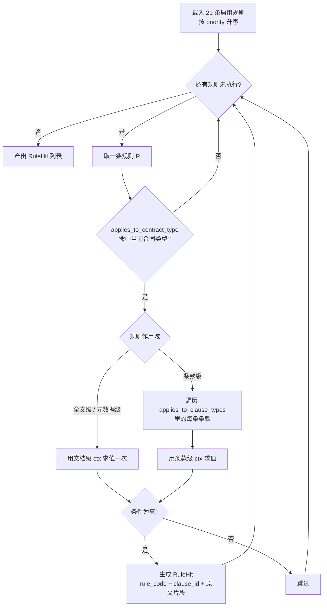

条款级规则的求值次数 = 规则数 × 该类条款数，实测约 21 × 8 = 170 次，纯 Python 正则，耗时在 20ms 量级，不需要优化。

### 11.8 与 LLM 结果的合并

合并发生在两处：**同一条款的等级裁决**（ADR-004）与**跨来源去重**。

```python
# app/review/merger.py
from dataclasses import dataclass

LEVEL_ORDER = {"LOW": 0, "MEDIUM": 1, "HIGH": 2}


@dataclass
class MergedRisk:
    risk_name: str
    risk_type: str
    clause_id: int | None
    clause_type: str | None
    risk_level: str
    source: str                 # rule / llm / rule+llm
    rule_code: str | None
    risk_reason: str
    original_text: str | None


def merge_risks(rule_hits: list[RuleHit], llm_risks: list[LlmRisk]) -> list[MergedRisk]:
    """合并规则命中与模型研判。ADR-004 的三条合并规则在此实现。"""
    out: list[MergedRisk] = []
    used_llm: set[int] = set()

    for hit in rule_hits:
        # 1) 找同条款 + 同条款类型的模型结果（"同一维度"的定义）
        same_dim = [
            (i, r) for i, r in enumerate(llm_risks)
            if r.clause_id == hit.clause_id
            and r.clause_type == hit.clause_type
            and i not in used_llm
        ]

        if not same_dim:
            out.append(_from_rule(hit, source="rule"))
            continue

        i, llm = same_dim[0]
        used_llm.add(i)

        if LEVEL_ORDER[llm.risk_level] <= LEVEL_ORDER[hit.risk_level]:
            # 2) 模型等级不高于规则 → 规则等级胜出，模型的理由文本保留（更具体）
            out.append(_from_rule(hit, source="rule+llm",
                                  reason=llm.risk_reason, name=llm.risk_name))
        else:
            # 3) 模型等级高于规则 → 仅当引用了原文片段才接受，否则回退到规则等级
            if llm.original_text and _cited_text_exists(llm.original_text, hit.clause_text):
                out.append(_from_llm(llm, source="rule+llm", rule_code=hit.rule_code))
            else:
                out.append(_from_rule(hit, source="rule",
                                      reason=hit.risk_reason + "（模型提示更严重，但未引用原文，按规则等级处理）"))

    # 4) 规则没命中、模型独立发现的
    for i, llm in enumerate(llm_risks):
        if i not in used_llm:
            out.append(_from_llm(llm, source="llm", rule_code=None))

    return out


def _cited_text_exists(cited: str, clause_text: str) -> bool:
    """模型引用必须能在原文中找到（去空白后子串匹配，允许长度 ≥8 的片段）。"""
    norm = lambda s: "".join(s.split())
    c = norm(cited)
    return len(c) >= 8 and c in norm(clause_text)
```

`_cited_text_exists` 是防幻觉的硬闸门：模型想把风险升到更高等级，必须交出原文中的片段，且该片段必须真实存在于被审条款中。做不到就退回规则等级，并在 `risk_reason` 里留一句说明，让法务知道这里存在分歧。

**去重与覆盖**：`risk_item.uk_dedup = (task_id, review_version, rule_code, clause_id)` 只能拦住「同一规则重复跑」，拦不住「R-LIA-01 与 R-LIA-03 同时命中一条款」这类情况——那本来就该是两条不同维度的风险（无限责任 vs 违约金比例），不合并。真正的重复来自**同一规则、同一文本重复出现**（例如付款里程碑分三段写了三次「我方承担全部损失」），由 8.4 的幂等键与 `clause_id` 粒度共同保证只记一条。

### 11.9 规则版本管理

| 场景 | 处理 |
|------|------|
| 修改规则条件 | `sql/seed/rules.yaml` 改完 → 重启服务（启动时按 `rule_code` upsert）→ `risk_rule.version + 1`。**不提供界面化编辑**（RC-03） |
| 已审查任务的旧结果 | 不回溯重算。`risk_item` 不记录规则版本号，只记录 `review_version`（任务侧版本）。理由：回溯需要重跑全部任务，对课程项目无收益 |
| 规则被禁用 | `is_enabled = 0`，下次审查不再命中；历史 `risk_item` 保留 |
| 规则被删除 | 不物理删除，只置 `is_enabled = 0`。理由：`risk_item.rule_code` 是字符串不是外键，删掉 `risk_rule` 行不影响历史数据，但会让法务看不到「这条风险当初依据什么规则」 |
| 同一条规则的不同版本能否共存 | 不能。`uk_rule_code` 保证一个 `rule_code` 只有一行，`version` 是自增的修改计数而非多版本共存 |

## 12. 提示词工程设计

### 12.1 设计原则

| 编号 | 原则 | 落实方式 |
|------|------|---------|
| PE-01 | **模型只做判断，不做计算，不做长文本生成** | 数值比较、缺失检测全部在规则引擎完成（ADR-002）。模型输出限定为枚举值与短理由（≤120 字） |
| PE-02 | **每个提示词都要求结构化 JSON 输出，且给出 JSON Schema** | 提示词里直接内嵌目标 JSON 的样例，不靠「请返回 JSON」一句话 |
| PE-03 | **模型输出的每个事实性字段都必须可回溯** | 风险判定提示词强制要求 `original_text` 字段，且该字段必须是被审条款的子串，由 `_cited_text_exists` 校验 |
| PE-04 | **不要求模型输出法律条文编号** | 需求原文没有给法条，模型编出来的《民法典》第 X 条无法验证。统一要求模型只写「风险成因」与「修改方向」，法条位置留给 `risk_rule.basis`，未知时写「依据：待法务确认」 |
| PE-05 | **温度 0** | 四个提示词全部 `temperature = 0`（`deepseek-flash` 支持），保证同一输入两次调用结果一致，便于做回归测试 |

### 12.2 模型调用清单

| 编号 | 用途 | 触发时机 | 输入规模 | 温度 | max_tokens | 超时 | 失败重试 |
|------|------|---------|---------|------|-----------|------|---------|
| P1 | 条款归类（规则打分不达标时） | 条款切分后，对每条 `classify_rule_hit` 为空或置信度 <0.6 的条款 | 单条款正文，截断至 1500 字 | 0 | 120 | 20s | 1 次 |
| P2 | 元数据抽取 | 规则抽取后，对 `is_missing` 的核心字段，一次性批量 | 全文摘要 + 缺失字段列表，截断至 6000 字 | 0 | 600 | 30s | 1 次 |
| P3 | 风险研判 | 规则执行后，逐条对每个条款 | 条款正文 + 条款类型 + 合同级上下文头 | 0 | 300 | 25s | 1 次 |
| P4 | 修改建议生成 | 风险项 `source` 含 `llm` 且无模板命中时 | 风险项 + 条款正文 + 我方角色 | 0 | 500 | 30s | 1 次 |

调用量估算（以第 15 章的 C-01 为基准，12 页、112 条款、18 条风险）：P1 约 12 次（大部分条款规则可归类）、P2 1 次、P3 112 次、P4 约 8 次，合计约 133 次。按单次 6 秒、并发 4 计算，P3 耗时约 112 × 6 / 4 = 168 秒，加上 P1/P2/P4 约 30 秒，总计约 200 秒，落在 NFR-P-01 的 3 分钟目标内（ADR-005 已记录该约束）。

### 12.3 P1 条款归类提示词

**先说一个与常见做法的分歧**：这份设计里，**条款切分（在哪里断句成条）完全由规则完成，不使用模型**；模型只负责切分之后的**归类**（这一段属于 13 类中的哪一类）。因此本节写的是「条款归类」而不是「条款切分」提示词。理由是 ADR-002 的核心分工——切分是一个纯结构问题（编号格式 + 长度），规则能 100% 复现，而模型做切分每次结果可能不同，一旦不稳定，下游的锚点偏移、条款索引、`risk_item` 去重键全会跟着漂移。**被放弃的方案**：把整份合同丢给模型让它输出「条款数组 + 每条的起止字符」，理由是模型能理解「哪几段在讲同一件事」；放弃的理由是模型返回的字符偏移经常与原文对不齐（差几个字就会让锚点定位到错误位置），且 12 页合同的条款数组输出要 4000+ token，得不偿失。

**System 提示词要点**（`app/review/llm/prompts.py::CLASSIFY_SYSTEM`）：

1. 角色设定：企业合同文本分类器，输入一段合同条款，输出该条款属于 13 类中的哪一类。
2. 强制给出完整 13 类清单与每类一句话定义（清单与 `<classify>` 章节的枚举一一对应，直接复用 PRD 第 8 章的类型清单）。
3. 明确边界规则三条：一段条款涉及多类时取**主导内容**（合同权利义务的主要指向）；无法归类时必须返回 `OTHER`，**不允许猜测**；不要根据条款序号判断类型。
4. 输出格式：只输出一个 JSON 对象，不输出任何解释、不加 Markdown 代码块围栏。

**输入变量**：

| 变量 | 来源 | 说明 |
|------|------|------|
| `{{clause_text}}` | `clause.clause_text` | 截断至 1500 字，超长时取首 1000 字 + 「……（略）」+ 末 500 字 |
| `{{clause_title}}` | `clause.clause_title` | 可为空字符串 |
| `{{contract_type}}` | `task.contract_type` | 供模型参考采购/销售/服务的语境 |

**输出 JSON Schema**：

```json
{
  "type": "object",
  "required": ["clause_type", "confidence", "reason"],
  "additionalProperties": false,
  "properties": {
    "clause_type": { "enum": ["PARTY_INFO","SUBJECT_MATTER","PAYMENT","DELIVERY_ACCEPTANCE","LIABILITY","CONFIDENTIALITY","IP","DATA_SECURITY","DISPUTE","TERM_EFFECTIVE","TERMINATION","FORCE_MAJEURE","OTHER"] },
    "confidence": { "type": "number", "minimum": 0, "maximum": 1 },
    "reason": { "type": "string", "maxLength": 60 }
  }
}
```

**输出示例**：

```json
{"clause_type": "LIABILITY", "confidence": 0.86, "reason": "约定违约责任承担方式，未涉及其他类型内容"}
```

**是否使用 few-shot：不提供。** 理由：13 类各有定义且在 system 里已充分描述，few-shot 会把提示词从约 900 token 推到约 2000 token，而 P1 的调用次数是四个提示词里最多的（每次审查约 12 次，加上调试期重跑，累计调用量大）。实测如果 `clause_type=OTHER` 的比例超过 20%（对应 G-02 的归类准确率要求），再补 3 个边界样例（同时含付款与验收的条款、纯定义条款、附件引用条款），这是 19.2 的待确认项之一。

**失败处理**：JSON 解析失败 → 重试 1 次（重试时在 user 消息末尾追加「上次输出无法解析，请只输出 JSON」）→ 仍失败则该条款归为 `OTHER`，`clause_type_confidence = null`，记一条 WARN 日志，不阻塞流程。

### 12.4 P2 元数据抽取提示词

**System 提示词要点**：

1. 角色设定：从合同全文中抽取指定字段，字段不存在时返回 `null`，**禁止推测**（例如不许根据合同类型猜履约周期）。
2. 逐字段给出抽取规则：`amount` 返回数字字符串不带千分位；`currency` 返回 ISO 4217 三字母代码；日期统一 `YYYY-MM-DD`；`party_b_credit_status` 不抽取（由 Mock 企业信息接口提供）。
3. 要求每个成功抽取的字段附带 `evidence`：原文中支持该字段的最短片段（≤40 字），且必须是原文子串。
4. 金额需同时返回阿拉伯数字与大写金额解析结果。

**输入变量**：

| 变量 | 来源 | 说明 |
|------|------|------|
| `{{missing_fields}}` | 规则抽取后仍为空的字段列表 | 只请求缺失字段，已抽取到的字段不重复请求，减少模型工作与幻觉面 |
| `{{doc_text}}` | `parse_result.full_text` | 截断至 6000 字：首 3000 字（主体、金额、期限通常在前部）+ 末 3000 字（签署页在后部） |

**输出 JSON Schema**：

```json
{
  "type": "object",
  "additionalProperties": false,
  "properties": {
    "fields": {
      "type": "array",
      "items": {
        "type": "object",
        "required": ["field_key", "value", "evidence"],
        "additionalProperties": false,
        "properties": {
          "field_key": { "enum": ["party_a_name","party_a_uscc","party_b_name","party_b_uscc","contract_no","sign_date","effective_date","perform_start_date","perform_end_date","amount","amount_in_words_value","currency","deliver_place","contract_title"] },
          "value": { "type": ["string", "null"] },
          "evidence": { "type": ["string", "null"], "maxLength": 40 }
        }
      }
    }
  }
}
```

**输出示例**：

```json
{
  "fields": [
    { "field_key": "perform_end_date", "value": "2027-06-30", "evidence": "履约期限自2026年7月1日至2027年6月30日" },
    { "field_key": "party_b_uscc", "value": "91310000MA1K3QXW2T", "evidence": "统一社会信用代码：91310000MA1K3QXW2T" },
    { "field_key": "deliver_place", "value": null, "evidence": null }
  ]
}
```

**后处理校验**（`app/review/llm/metadata.py`）：

| 校验 | 不通过时的动作 |
|------|--------------|
| `evidence` 必须是 `doc_text` 的子串（去空白后匹配） | 丢弃该字段，视为未抽取 |
| `party_*_uscc` 必须通过 `validate_uscc()` 校验位 | 丢弃该字段 |
| `amount` 必须能转成 `Decimal` 且 > 0 | 丢弃该字段 |
| `*_date` 必须能解析为 `YYYY-MM-DD` 且落在 `[2000-01-01, 2100-01-01]` | 丢弃该字段 |
| `currency` 必须在 ISO 4217 白名单内（本项目用 `CNY`/`USD`/`EUR`/`HKD`） | 丢弃该字段 |

**是否使用 few-shot：使用 1 组。** 理由：P2 只调用 1 次/任务，token 成本可忽略，而「日期格式」「金额不带千分位」这类格式约束用样例表达比用文字描述更稳定。示例固定为「采购合同金额与期限」场景，放在 system 消息末尾。

**失败处理**：JSON 解析失败 → 重试 1 次 → 仍失败则只用规则抽取结果，缺失字段保持 `is_missing = 1`，由 R-SUB-01 等规则产出缺项风险，任务继续。

### 12.5 P3 风险研判提示词

**System 提示词要点**：

1. 角色设定：企业法务审查助手，判断给定条款是否存在对我方不利的法律或商业风险。
2. **明确告知模型「确定性判断已由规则完成」**，要求它只关注规则做不到的事：条款表述是否实质不公平、是否隐含不利后果、条款之间是否矛盾。
3. 我方角色由 `{{our_party_role}}` 注入（`A` = 甲方、`B` = 乙方），要求所有判断以该立场出发；未提供时按中立视角判断并降低 `confidence`。
4. 强制输出字段 `original_text`（触发风险的最短原文片段，≤80 字，必须逐字来自输入条款）；找不到具体片段时必须返回 `risk_level = "NONE"`。**这一条是防幻觉的核心约束。**
5. 输出等级只能是 `HIGH` / `MEDIUM` / `LOW` / `NONE` 四选一，并禁止输出法条编号（PE-04）。

**输入变量**：

| 变量 | 来源 | 说明 |
|------|------|------|
| `{{contract_header}}` | 任务级共享上下文 | 合同类型、我方角色、合同金额、相对方名称。**ADR-005 的合同级上下文头，只在这一处注入，条款级不重复传合同全文** |
| `{{clause_type}}` | `clause.clause_type` | 让模型知道当前条款扮演什么角色 |
| `{{clause_text}}` | `clause.clause_text` | 截断至 2000 字 |
| `{{rule_hints}}` | 已命中的规则编号与名称 | 例：`["R-LIA-01 我方单方承担无限责任"]`。**只给名称不给等级**，避免模型被规则等级锚定而不敢提出不同意见 |

**输出 JSON Schema**：

```json
{
  "type": "object",
  "required": ["risk_level", "risk_name", "risk_reason", "original_text", "confidence"],
  "additionalProperties": false,
  "properties": {
    "risk_level": { "enum": ["HIGH", "MEDIUM", "LOW", "NONE"] },
    "risk_name": { "type": "string", "maxLength": 40 },
    "risk_reason": { "type": "string", "maxLength": 300 },
    "original_text": { "type": ["string", "null"], "maxLength": 80 },
    "suggested_direction": { "type": ["string", "null"], "maxLength": 200 },
    "confidence": { "type": "number", "minimum": 0, "maximum": 1 }
  }
}
```

**输出示例（有风险）**：

```json
{
  "risk_level": "HIGH",
  "risk_name": "付款条件与验收脱钩",
  "risk_reason": "约定货到即付全款，未将验收合格设为付款前提。若货物存在质量瑕疵，我方付款后将丧失以款项制约供应商履约的手段。",
  "original_text": "货到后 15 个工作日内，甲方向乙方支付合同全部价款。",
  "suggested_direction": "将付款拆分为预付款、验收合格款、质保金三个阶段，以验收单为付款前提",
  "confidence": 0.88
}
```

**输出示例（无风险）**：

```json
{ "risk_level": "NONE", "risk_name": "", "risk_reason": "条款表述中立，双方权利义务基本对等。", "original_text": null, "suggested_direction": null, "confidence": 0.9 }
```

**是否使用 few-shot：使用 2 组。** 理由：P3 是四个提示词里质量要求最高的一个，且「什么算 HIGH、什么算 NONE」的边界无法用文字定义清楚。两组样例固定为：(1) 一个明确的 HIGH 案例（含 `original_text`）；(2) 一个明确的 NONE 案例（`original_text` 为 null），用来示范「不要为了凑数而报风险」。两组样例合计约 400 token，乘以 112 次调用是可接受的成本。

**NONE 的处理**：`risk_level = "NONE"` 时不生成风险项，但把 `confidence` 记入 `parse_result` 之外的统计（内存计数，随任务结束丢弃），用于 G-05 的误报率统计口径说明。这条不计入 `risk_item`，避免空风险污染列表。

**失败处理**：JSON 解析失败或超时 → 重试 1 次（超时重试时把 `clause_text` 截断长度从 2000 降到 1200，降低延迟）→ 仍失败则跳过该条款，**该任务记一次 `llm_failed_clauses += 1`**；若失败条款数超过总条款数的 30%，任务标记 `review_degraded = 1`，`review_degraded_reason = "模型服务不稳定，N/112 条条款未完成语义研判，结果仅含规则命中"`，并在前端顶部显示黄色横幅（SSE `degraded` 事件）。

### 12.6 P4 修改建议生成提示词

**System 提示词要点**：

1. 角色设定：合同条款改写助手，针对已识别风险生成**可直接替换原文**的条款文本。
2. 硬性要求：生成文本必须是**完整的可用条款**（含「甲方」「乙方」等主体称谓与完整句子），不能只给修改说明；保持与合同其他部分一致的称谓与文风。
3. 硬性要求：**不得编造具体数字与法条**。需要留空让法务填写的地方用 `【待填写：X%】` 形式标注，例如「违约金不超过合同总金额的【待填写：百分比】」。
4. 长度约束：生成文本不超过原文长度的 2.5 倍。
5. 只输出一个 JSON 对象。

**输入变量**：

| 变量 | 来源 | 说明 |
|------|------|------|
| `{{risk_name}}` / `{{risk_reason}}` | `risk_item` | 让模型知道要解决什么问题 |
| `{{clause_text}}` | `clause.clause_text` | 要改写的原文 |
| `{{our_party_role}}` | `task.our_party_role` | 立场 |
| `{{fix_direction}}` | 命中规则的 `fix_direction`，或 P3 输出的 `suggested_direction` | 修改方向 |

**输出 JSON Schema**：

```json
{
  "type": "object",
  "required": ["suggested_text"],
  "additionalProperties": false,
  "properties": {
    "suggested_text": { "type": "string", "minLength": 20, "maxLength": 1200 },
    "changed_points": { "type": "array", "maxItems": 5, "items": { "type": "string", "maxLength": 60 } }
  }
}
```

**输出示例**：

```json
{
  "suggested_text": "本合同项下由乙方开发的全部成果，其知识产权归甲方所有。乙方在签订本合同前已合法拥有的知识产权仍归乙方所有，但乙方在此授予甲方在合同期内及合同终止后永久、免费、不可撤销、可转授的使用许可。乙方应向甲方交付与本合同项下开发成果相关的完整源代码及技术文档。",
  "changed_points": ["知识产权归属由乙方改为甲方", "保留乙方既有知识产权并附加永久许可", "补充源代码交付义务"]
}
```

**是否使用 few-shot：使用 1 组（固定模板优先）。** 实现上是**先查模板后调模型**：`clause_template` 表中 `rule_code` 或 `contract_type + clause_type` 命中的模板直接作为 `suggested_text`，`suggestion_source = "template"`；只有无模板命中时才调 P4，`suggestion_source = "llm"`。理由：模板文本是人工审过的，质量与合规性优于模型生成，且能省掉大部分 P4 调用（第 15 章示例合同中共 12 条风险可被模板覆盖）。few-shot 那一组样例正是为了示范「原标题 → 改写后条款」的格式，让模型输出稳定的完整句而非片段。

**失败处理**：生成失败（超时、JSON 错误、`suggested_text` 长度 <20）→ 重试 1 次 → 仍失败则该 `suggestion` 行不写入，`risk_item` 照常存在，前端风险卡片显示「建议生成失败，请手动编写」并提供「手动填写建议」入口（写入 `suggestion`，`suggestion_source = "manual"`，`status = "pending"`）。**风险项不因为建议失败而消失**，这是需求 2.4.10「能针对风险条款生成可落地的修改示范条款并支持法务编辑」的降级路径。

### 12.7 统一输出解析

```python
# app/review/llm/client.py
import json
import re

from loguru import logger

FENCE_RE = re.compile(r"^\s*```(?:json)?\s*|\s*```\s*$", re.MULTILINE)


class LlmOutputError(Exception):
    pass


def parse_llm_json(raw: str, schema: type[BaseModel]) -> BaseModel:
    """模型输出 → 结构化对象。三次尝试：原样 → 去围栏 → 截取首个大括号块。"""
    text = raw.strip()
    for candidate in (text, FENCE_RE.sub("", text), _first_json_block(text)):
        if not candidate:
            continue
        try:
            return schema.model_validate(json.loads(candidate))
        except Exception:                       # noqa: BLE001 —— 三种尝试都要试完
            continue
    logger.warning(f"模型输出无法解析，原文前 200 字: {text[:200]}")
    raise LlmOutputError("模型输出不是合法 JSON")


def _first_json_block(text: str) -> str | None:
    """模型有时会在 JSON 前后加一句解释。截取第一个平衡的大括号块。"""
    start = text.find("{")
    if start < 0:
        return None
    depth = 0
    in_str = False
    esc = False
    for i in range(start, len(text)):
        ch = text[i]
        if in_str:
            if esc:
                esc = False
            elif ch == "\\":
                esc = True
            elif ch == '"':
                in_str = False
            continue
        if ch == '"':
            in_str = True
        elif ch == "{":
            depth += 1
        elif ch == "}":
            depth -= 1
            if depth == 0:
                return text[start:i + 1]
    return None
```

调用侧统一走一个带重试的封装：

```python
async def call_llm(prompt_name: str, messages: list[dict], schema: type[BaseModel],
                   timeout: float, max_retries: int = 1) -> BaseModel:
    last_err: Exception | None = None
    for attempt in range(max_retries + 1):
        try:
            raw = await _chat(messages, temperature=0.0,
                              max_tokens=PROMPT_SPECS[prompt_name].max_tokens,
                              timeout=timeout)
            return parse_llm_json(raw, schema)
        except (LlmOutputError, httpx.TimeoutException, httpx.HTTPStatusError) as e:
            last_err = e
            logger.warning(f"{prompt_name} 第 {attempt + 1} 次调用失败: {e}")
            messages = _append_retry_hint(messages)
    raise LlmOutputError(f"{prompt_name} 重试 {max_retries} 次后仍失败: {last_err}")
```

### 12.8 幻觉控制清单

| 编号 | 幻觉风险 | 控制手段 | 兜底 |
|------|---------|---------|------|
| HAL-01 | 模型编造原文中不存在的片段作为风险证据 | P3 要求 `original_text` 必须是输入条款的子串，服务端用 `_cited_text_exists()` 校验（≥8 字去空白子串匹配） | 校验失败则不采纳模型升高的等级；独立风险（无规则命中）直接丢弃该风险项 |
| HAL-02 | 模型编造法律条文编号 | 提示词明确禁止输出法条；`risk_item.legal_basis` 只从 `risk_rule.basis` 取值，不接收模型输出 | 字段来源固定，模型无从写入 |
| HAL-03 | 模型编造合同中没有的金额、日期 | P2 要求每个字段带 `evidence` 且必须是 `doc_text` 子串；金额/日期/ZIP 后再做格式与范围校验 | 校验不过则丢弃该字段，保持 `is_missing = 1` |
| HAL-04 | 模型输出超出枚举范围的等级或类型 | pydantic 联合类型的字面量约束 + `additionalProperties: false` | 解析失败走 12.7 的重试，最终按 12.3/12.5 的失败处理降级 |
| HAL-05 | 模型把「没有风险」也说成有风险（凑数） | P3 输出含 `NONE` 选项并配 NONE 样例；`confidence < 0.5` 的模型独立风险不写入 `risk_item` | 只保留规则命中项，前端显示「本轮无模型侧新发现」 |
| HAL-06 | 模型生成的建议与风险不对应 | P4 输入里同时给 `risk_name` 与 `risk_reason`；生成后校验 `suggested_text` 长度 ≥20 且与原文不完全相同 | 校验不过按 12.6 的失败处理，让法务手写 |

### 12.9 成本与限流

| 项 | 取值 | 依据 |
|----|------|------|
| 单次审查的模型调用次数 | 约 120~140 次（112 条款 + 元数据 + 归类 + 建议） | 12.2 的估算 |
| 单次审查的 token 消耗 | 输入约 95k，输出约 22k | P3 每次约 750 输入 + 180 输出 × 112 次 |
| 并发上限 | 4（`asyncio.Semaphore(4)`） | ADR-005：串行 112 × 6s = 11.2 分钟超过 3 分钟目标；并发 4 得 168 秒。并发再高会触发服务端限流，反而变慢 |
| 单任务超时 | 480 秒（`asyncio.wait_for` 包住整个审查段） | 60 秒解析 + 200 秒审查 + 余量 |
| 限流与退避 | `httpx` 收到 429 时按 `1s / 2s / 4s` 退避重试最多 2 次 | 服务端限流是外部依赖，属 NFR 的降级路径 |
| 结果缓存 | **不做**。同一任务不会重复审查同一版本，`review_version` 变化视为新任务 | 缓存键设计成本高于收益，60 小时预算内不做 |

## 13. 前端实现方案

### 13.1 技术栈与取舍

| 项 | 选择 | 理由 |
|----|------|------|
| 框架 | Vue 3.4 + `<script setup>` | 需求已锁定（提示词给定），不推翻 |
| 构建 | Vite 5 | 同上 |
| 路由 | vue-router 4 | 3 个页面，用最简的静态路由配置，不使用动态路由与路由守卫 |
| 状态 | Pinia 2 | 工作台需要跨组件共享任务状态与风险列表（左栏高亮要读右栏选中项），prop drilling 会很难维护 |
| HTTP | 原生 `fetch` | 需求与响应结构简单（统一包装 + 35 个接口），`axios` 的拦截器能力本项目用不上，少一个依赖 |
| 组件库 | **Element Plus 2.x** | 决定取舍见下方说明 |
| 样式 | 手写 CSS + CSS 变量 | 双栏工作台的布局与高亮是自定义的（`<mark>` 背景、absolutely-positioned bbox 层），组件库的栅格帮不上忙 |
| 图标 | Font Awesome 4.7 CDN | 与用户既有习惯一致（CLAUDE.md 约定），不额外装图标库 |

**组件库的取舍**：本项目前端同学只会基础 HTML 与原生 JS、Vue3 刚上手。三个页面里真正需要复杂组件的是大盘页（表格 + 分页 + 筛选 + 上传）和规则页（树形列表 + 分页）。用 Element Plus 的 `el-table` / `el-pagination` / `el-upload` / `el-tree` 能省下约 6~8 小时的表格与上传实现时间，代价是引入约 1MB 的样式与 30 分钟的学习成本。**放弃的方案**：(1) 纯手写表格与分页——省下依赖但多花 6 小时以上，且分页边界容易写错；(2) 用 Tailwind 手工搭——Tailwind 只提供原子样式，表格与分页的交互逻辑仍要自己写；(3) Naive UI——文档质量接近但国内社区示例少于 Element Plus，遇到问题可查的资料更少。**结论：用 Element Plus，但只在大盘页与规则页使用，工作台页不使用任何组件库组件**（工作台的布局与高亮全是自定义的，混入组件库反而增加样式冲突风险）。

### 13.2 路由表

| 路径 | 页面组件 | 说明 | 进入方式 |
|------|---------|------|---------|
| `/` | 重定向到 `/contracts` | | |
| `/contracts` | `views/ContractList.vue` | 合同审查大盘页 | 导航栏 |
| `/workbench/:taskId` | `views/ReviewWorkbench.vue` | 智能审查工作台（双栏） | 列表行点击、回写后跳转 |
| `/rules` | `views/RuleConfig.vue` | 合规规则与模板页（只读，RC-03/RC-05） | 导航栏 |
| `/:pathMatch(.*)*` | `views/NotFound.vue` | 兜底 | |

工作台通过 `route.params.taskId` 拿任务，**页面刷新后必须能完整恢复**：所有数据靠 `GET /api/tasks/{id}` + `GET /api/tasks/{id}/risks` + `GET /api/tasks/{id}/document` 三个请求拉取，不依赖路由 state 传递对象。

### 13.3 目录结构

```
frontend/
├─ index.html
├─ vite.config.js                 # 含 /api 代理到 http://localhost:8000
├─ src/
│  ├─ main.js
│  ├─ App.vue                     # 顶部导航 + <router-view>
│  ├─ api/
│  │  ├─ http.js                  # fetch 封装：统一包装解包、错误码到提示的映射
│  │  ├─ task.js                  # 任务、文档、风险、建议相关接口
│  │  ├─ writeback.js             # 回写、报告导出
│  │  └─ rule.js                  # 规则、模板、配置、审计日志
│  ├─ stores/
│  │  ├─ user.js                  # 当前用户与角色（本项目用顶栏下拉切换，不做登录页）
│  │  ├─ taskList.js              # 大盘页的筛选条件与列表数据
│  │  └─ workbench.js             # 工作台的核心状态（见 13.4）
│  ├─ utils/
│  │  ├─ anchor.js                # resolveAnchor（代码见 7.4.2）/ hitsByRange（代码见 7.5.2）
│  │  ├─ sse.js                   # SSE 连接与自动重连
│  │  └─ format.js                # 金额、日期、风险等级的中文文案
│  ├─ components/
│  │  ├─ DocumentPane.vue         # 左栏
│  │  ├─ RiskPane.vue             # 右栏
│  │  ├─ RiskCard.vue             # 单张风险卡片
│  │  ├─ SuggestionBox.vue        # 建议展示 / 编辑 / 采纳 / 拒绝
│  │  ├─ WritebackPanel.vue       # 回写区（预览、提交、状态、重试）
│  │  ├─ MetadataPanel.vue        # 元数据折叠面板
│  │  ├─ CommentBox.vue           # 法务批注输入与列表
│  │  ├─ StatusBadge.vue          # 任务状态 / 风险等级徽标
│  │  └─ DegradedBanner.vue       # 降级横幅
│  └─ views/
│     ├─ ContractList.vue
│     ├─ ReviewWorkbench.vue
│     ├─ RuleConfig.vue
│     └─ NotFound.vue
```

### 13.4 工作台的状态管理

```js
// src/stores/workbench.js
import { defineStore } from 'pinia'
import { ref, computed } from 'vue'

export const useWorkbenchStore = defineStore('workbench', () => {
  // —— 服务端数据 ——
  const task = ref(null)                    // TaskDetail
  const risks = ref([])                     // RiskItemOut[]
  const docMeta = ref(null)                 // { doc_type, precision_cap, full_text_length, pages }
  const paragraphs = ref([])                // { html, index, page_no }[]
  const comments = ref([])

  // —— 界面状态 ——
  const levelFilter = ref('ALL')            // ALL / HIGH / MEDIUM / LOW
  const typeFilter = ref('ALL')
  const selectedRiskId = ref(null)          // 右栏当前选中的风险卡片
  const hoverRiskId = ref(null)             // 鼠标悬停在卡片上（用于临时高亮，不滚动）
  const degraded = ref({ active: false, reason: '' })
  const progress = ref({ stage: '', current: 0, total: 0, text: '' })

  // —— 派生 ——
  const visibleRisks = computed(() => risks.value.filter(r => {
    if (levelFilter.value !== 'ALL' && r.risk_level !== levelFilter.value) return false
    if (typeFilter.value !== 'ALL' && r.clause_type !== typeFilter.value) return false
    return true
  }))

  const counts = computed(() => {
    const c = { HIGH: 0, MEDIUM: 0, LOW: 0 }
    for (const r of risks.value) if (!r.is_false_positive) c[r.risk_level]++
    return c
  })

  // —— 动作 ——
  function selectRisk(riskId) { selectedRiskId.value = riskId }
  function setTask(t) { task.value = t }
  function appendRisk(r) { if (!risks.value.some(x => x.risk_item_id === r.risk_item_id)) risks.value.push(r) }

  return { task, risks, docMeta, paragraphs, comments, levelFilter, typeFilter,
           selectedRiskId, hoverRiskId, degraded, progress,
           visibleRisks, counts, selectRisk, setTask, appendRisk }
})
```

**为什么用 Pinia 而不是 `provide/inject`**：左栏 `DocumentPane` 需要知道「哪个风险被选中」（读取 `selectedRiskId`），右栏 `RiskCard` 需要知道「哪个文本位置被点击」（触发 `selectRisk`），顶部状态栏需要读 `task.status` 与 `counts`——三方跨度超过两层，`provide/inject` 要传递多个响应式引用，改起来容易漏。Pinia 的 `setup store` 写法与 Vue3 组合式 API 一致，前端同学刚上手 Vue3 时不用再学第二个心智模型。

### 13.5 组件树

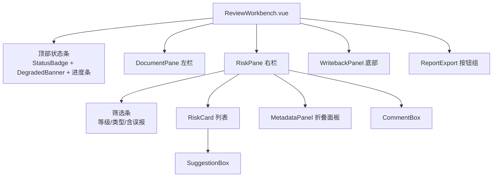

左栏结构（`DocumentPane`）：

```
┌────────────────────────────────────────────────────┐
│ [第 1/12 页]  [缩放 - 100% +]  [上一页][下一页]      │
├────────────────────────────────────────────────────┤
│  <p class="para" data-pid="p0">…</p>               │   ← DOCX：直接渲染段落 HTML
│  <p class="para" data-pid="p1">…<mark           }  │
│     data-risk="9001">…</mark>…</p>                 │   ← 风险高亮：<mark> 包裹
│  <span class="meta-hit" data-field="amount">…</span>│   ← 元数据命中：淡蓝下划线
│  …                                                 │
├────────────────────────────────────────────────────┤
│ 扫描件模式额外一层：<div class="bbox-layer">          │
│                          │   ← 页图
│   <div class="bbox" style="left:13.2%;top:47.8%…">  │   ← 从 anchor.bbox 换算的百分比定位
│ </div>                                              │
└────────────────────────────────────────────────────┘
```

右栏结构（`RiskPane`）：

```
┌────────────────────────────────────────────────────┐
│ 综合风险：● 高   高风险 4 · 中风险 2 · 低风险 0      │
│ [全部▾] [条款类型▾] [☐ 显示误报]                    │
├────────────────────────────────────────────────────┤
│ ┌── RiskCard #9001 ─────────────────────── 高 ──┐  │
│ │ 成果知识产权全部归对方        R-IP-01 · 第七条  │  │
│ │ 成因：条款约定开发成果…                        │  │
│ │ 依据：依据：待法务确认                          │  │
│ │ 原文：本合同项下开发成果的知识产权归乙方所有。   │  │
│ │ ┌ SuggestionBox ────────────────────────────┐ │  │
│ │ │ 建议文本（可编辑 textarea）                 │ │  │
│ │ │ [复制] [采纳] [拒绝] [标记误报]             │ │  │
│ │ └───────────────────────────────────────────┘ │  │
│ └───────────────────────────────────────────────┘  │
│ ┌── RiskCard #9002 ─────────────────────────────┐  │
```

### 13.6 双栏联动的两个方向

**方向一：点卡片 → 左栏滚动并高亮。** 纯前端，不需要接口。

```js
// components/RiskPane.vue 内部
async function onSelect(risk) {
  store.selectRisk(risk.risk_item_id)
  const pane = document.querySelector('.document-pane')
  const anchor = risk.anchor
  if (!anchor) { toast('该风险没有可定位的原文位置'); return }

  // 1) 扫描件：切页 + 画框，不需要文本层
  if (store.docMeta.doc_type === 'scan') {
    await gotoPage(anchor.page_no)
    pane.querySelector(`.bbox[data-risk="${risk.risk_item_id}"]`)?.classList.add('bbox-active')
    return
  }

  // 2) PDF / DOCX：确保目标页段落已加载，再用偏移解析出 DOM 范围
  await ensureParagraphsLoaded(anchor)          // 见下方说明
  const range = resolveAnchor(document.getElementById('doc-root'), anchor)
  if (!range) { toast('未能定位到原文（该风险为段落级或页级定位）'); return }
  highlightRange(range, risk.risk_item_id)      // 用 <mark data-risk> 包裹
  scrollIntoViewIfNeeded(range)
}
```

`ensureParagraphsLoaded` 是 PDF 场景必需的：PDF 的段落按需加载（接口 `GET /document?page=N`），若目标锚点在第 7 页而当前只加载了第 1 页，必须先请求第 7 页并等 DOM 更新，再计算偏移。等待用 `await nextTick()` + 一次 `requestAnimationFrame` 保证布局完成（`<mark>` 包裹会改变文本节点的分割，必须在布局稳定后再做）。

**注意 `resolveAnchor` 的调用时机**：它内部用 `TreeWalker` 遍历 `doc-root` 下的文本节点把 `global_char_start` 映射成 `[node, offset]`。段落 HTML 里如果混入了非文本元素（页码、折叠按钮），这些元素的文本也会被 `TreeWalker` 计入，导致偏移错位。**因此 `doc-root` 内只允许放段落 `<p>`，控制按钮一律放在 `doc-root` 外**（7.4.3 的硬规则）。

**方向二：左栏选中文本 → 高亮对应卡片。** 也不调接口。

```js
// components/DocumentPane.vue 内部
import { hitsByRange } from '@/utils/anchor'

function onTextSelection() {
  const sel = window.getSelection()
  if (!sel || sel.isCollapsed) return
  // 把 DOM 选区换算成文档级 [start, end)
  const [start, end] = domRangeToOffsets(document.getElementById('doc-root'), sel.getRangeAt(0))
  const ids = hitsByRange(start, end)            // 客户端区间索引二分查找
  store.hoverRiskId = ids[0] ?? null
  if (ids.length) scrollRiskIntoView(ids[0])
}
```

`hitsByRange` 的索引在 `risks.value` 变化时重建一次（`buildRangeIndex(risks)`，按 `global_char_start` 排序，代码见 7.5.2），复杂度 O(n log n)。单次审查最多几十条风险，重建成本可忽略。

**为什么不为「文本 → 卡片」加一个后端接口**：选中的文本范围本来就在浏览器里，把它发到后端再换回风险 ID 要走一次网络往返（几十到几百毫秒），而期间用户的选区可能已经变了。前端已经有全部风险锚点数据（`GET /risks` 的响应里带 `anchor`），本地排序后二分查找是微秒级。ADR-009 已记录该决定。

### 13.7 SSE 消费与断线重连

```js
// src/utils/sse.js
export function connectTaskStream(taskId, handlers) {
  let es = null
  let retry = 0
  let manualClose = false
  let lastEventAt = Date.now()
  let watchdog = null

  const EVENTS = ['snapshot','task_status','parse_progress','review_progress','risk_ready',
                  'suggestion_ready','summary_ready','degraded','writeback_status','error','heartbeat']

  function open() {
    es = new EventSource(`/api/tasks/${taskId}/stream`)
    for (const name of EVENTS) {
      es.addEventListener(name, (e) => {
        lastEventAt = Date.now()
        retry = 0                                  // 收到任何事件即认为连接健康，重置退避
        let payload = {}
        try { payload = JSON.parse(e.data) } catch { /* 空载荷事件 */ }
        handlers[name]?.(payload)
      })
    }
    es.onerror = () => {
      es.close()
      if (manualClose) return
      retry += 1
      const delay = Math.min(1000 * 2 ** (retry - 1), 15000)   // 1s / 2s / 4s / 8s / 15s 封顶
      handlers.error?.({ message: `实时连接中断，${delay / 1000} 秒后重连`, fatal: false })
      setTimeout(open, delay)
    }
  }

  // 看门狗：45 秒无任何事件（含 heartbeat）判定连接已死，主动重连
  watchdog = setInterval(() => {
    if (Date.now() - lastEventAt > 45000) { es?.close(); open() }
  }, 10000)

  open()
  return {
    close() { manualClose = true; clearInterval(watchdog); es?.close() },
  }
}
```

`onMounted` 建立连接、`onUnmounted` 关闭。**重连后必须依赖 `snapshot` 事件补状态**：`snapshot` 是服务端在连接建立后立即推送的完整状态快照（见 10.6），重连时会重新收到，因此不需要在 `onerror` 里额外拉一次任务详情。

### 13.8 关键交互的时序

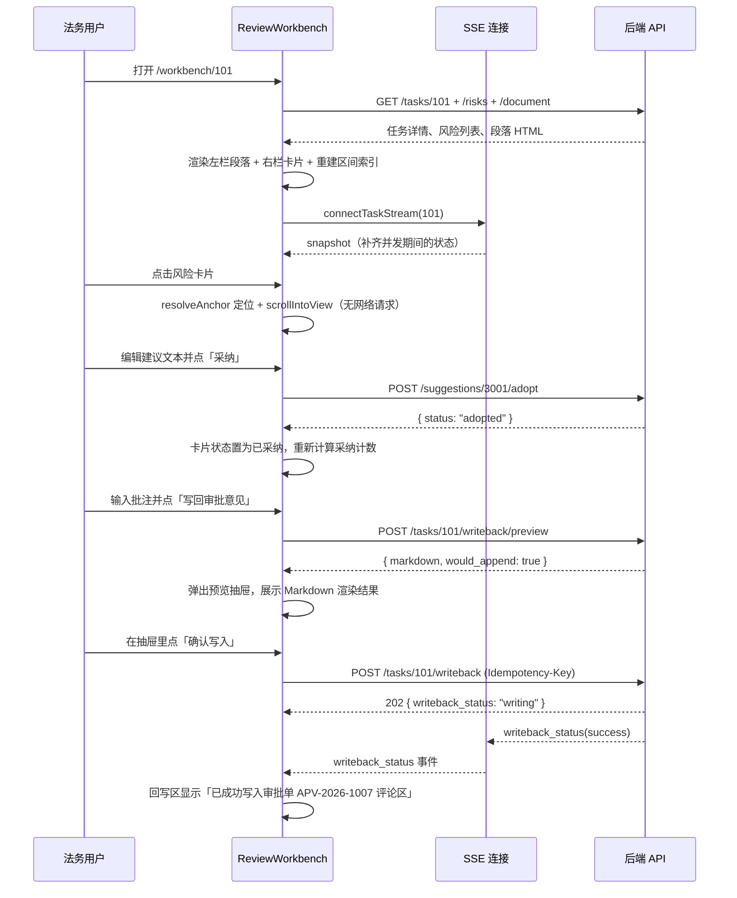

### 13.9 面向「Vue3 刚上手」的落地约束

| 编号 | 约束 | 理由 |
|------|------|------|
| FE-01 | **不使用 Vuex、不使用 `defineExpose`、不使用递归组件、不使用 `v-model` 自定义修饰符** | 这些特性学习成本高、本项目用不到 |
| FE-02 | **不使用 `watch` 的 `deep` + `flush: 'post'` 组合**，需要 DOM 就绪时用 `nextTick()` 显式等待 | `flush` 时机的坑对新手不友好，显式 `nextTick` 易于理解与调试 |
| FE-03 | **每个 `.vue` 文件不超过 300 行**，超了就拆组件 | 工作台页容易膨胀成 1000 行的巨型文件，拆成 9 个组件后每个都短 |
| FE-04 | **所有接口调用集中在 `src/api/*.js`**，组件里不直接写 `fetch` | 便于统一处理错误码与加载状态，也让前端的接口清单与第 10 章一一对应 |
| FE-05 | **样式用 `<style scoped>`**，只有 CSS 变量定义在 `App.vue` 的全局样式中 | 避免双栏布局的样式外泄影响列表页 |
| FE-06 | **风险等级、任务状态的中文文案集中在 `utils/format.js`**，不在模板里写 `v-if` 分支 | 同一状态在列表页徽标、工作台徽标、报告里三处出现，文案必须一致 |

## 14. 异常与降级设计

### 14.1 全量失败点表

| 编号 | 失败点 | 检测方式 | 降级动作 | 用户可见提示 | 任务状态变化 |
|------|-------|---------|---------|------------|------------|
| EX-01 | 上传文件超过 50MB | `UploadFile` 读取时按 `Content-Length` 与累计字节数双检 | 拒绝接收，删除临时文件 | 上传框下方红字「单个文件不超过 50MB」 | 不创建任务 |
| EX-02 | 文件格式不在白名单（`.docx/.pdf/.png/.jpg/.jpeg/.bmp/.tiff`） | 扩展名 + 文件头魔数双检（防改扩展名） | 拒绝接收 | 「仅支持 DOCX、PDF 与图片格式」 | 不创建任务 |
| EX-03 | DOCX 被加密（`msoffcrypto` 检测） | `python-docx` 打开抛 `PackageNotFoundError` 或 `KeyError: 'EncryptedPackage'` | 直接 `blocked` | 「文档已加密，请解除密码后重新上传」 | `pending → blocked`，`block_reason = ENCRYPTED_FILE` |
| EX-04 | PDF 被加密 | `fitz` 打开后 `doc.needs_pass == True` | 直接 `blocked` | 同上 | `block_reason = ENCRYPTED_FILE` |
| EX-05 | PDF 无文本层（扫描件） | 平均每页可提取字符 < 20 | 转 OCR 通道（正常路径，不算失败） | 进度条显示「正在识别扫描件，预计 90 秒」 | 保持 `parsing` |
| EX-06 | OCR 服务不可达 / 超时（90s） | `httpx.ConnectError` / `TimeoutException` | 第 1 次自动重试；仍失败 → `blocked` | 「扫描件识别服务暂时不可用」+「重新识别」按钮 | `block_reason = OCR_FAILED` |
| EX-07 | OCR 返回质量过低（中文字符占比 < 0.5 或可疑字符占比 > 0.05） | `QualityReport` 计算 | `blocked` | 「文档识别质量过低，请重新上传更清晰的扫描件」 | `block_reason = OCR_LOW_QUALITY` |
| EX-08 | 解析出的正文字符数 < 50 | `len(full_text) < 50` | `blocked` | 「未提取到有效正文内容」 | `block_reason = EMPTY_CONTENT` |
| EX-09 | 条款切分结果为 0 条 | `len(clauses) == 0` | 用长度兜底策略重切；仍为 0 → `blocked` | 「无法识别合同条款结构」 | `block_reason = SPLIT_FAILED` |
| EX-10 | 解析过程抛未预期异常 | 顶层 `try/except` 捕获 | 记录堆栈，`blocked` | 「解析失败，请重试或更换文件」 | `block_reason = PARSE_ERROR` |
| EX-11 | LLM 服务不可达 / 超时（连续失败，任务级失败率 > 30%） | `llm_failed_clauses / total_clauses > 0.3` | **不阻塞**，任务继续完成，标记降级 | 黄色横幅「模型服务不可用，当前结果仅来自规则引擎」 | `reviewing → completed`，`review_degraded = 1` |
| EX-12 | LLM 返回非 JSON | `parse_llm_json` 三次尝试全败 | 重试 1 次 → 仍失败则该条款跳过（计入 EX-11 的失败计数） | 同 EX-11（由失败率决定是否展示） | 不影响状态 |
| EX-13 | 条款归类规则打分 ≤ 0 且 LLM 也不可用 | `classify()` 返回 `OTHER` 且 `source = "fallback"` | 归为 `OTHER`，不参与条款级规则匹配 | 无（不打扰用户） | 不影响状态 |
| EX-14 | 规则库为空或全部禁用 | 启动校验：启用规则数 == 0 | 服务启动失败并报错，**不允许带病运行** | 运维侧错误，用户不可见 | — |
| EX-15 | 元数据批量抽取全部失败 | `contract_metadata` 中 `is_missing = 1` 的必填字段 ≥ 6 | 任务继续，由 R-SUB-01/R-MIS-05 产出缺项风险 | 元数据面板显示「多个字段未能自动提取，请人工补录」 | 不影响状态 |
| EX-16 | 锚点定位失败（`Page.search_for` 找不到文本） | `backfill_bboxes()` 三级回退全败 | 精度降为 `PAGE` 或 `NONE`，**不丢弃风险项** | 卡片上显示灰色「页级定位」标签；点击卡片只跳页不画框 | 不影响状态 |
| EX-17 | 校验失败的锚点（偏移越界、文本框不在段落内） | `Anchor.validate()` | **丢弃锚点**（`anchor = null`），风险项保留 | 卡片上显示「无原文定位」 | 不影响状态 |
| EX-18 | 审批 Mock 推送的事件所属合同无法下载 | `attachment_url` 请求返回非 200 | 3 次重试（间隔 5s/15s/30s）后 `blocked` | 「审批单附件下载失败」+「重新拉取」按钮 | `block_reason = ATTACHMENT_DOWNLOAD_FAILED` |
| EX-19 | 回写时 Mock 审批接口不可达 | `httpx.ConnectError` / 超时（15s） | 回写状态 `failed`，`writeback_retry_count + 1`；**支持自动重试 1 次 + 人工重试最多 3 次** | 回写区红字「回写失败：审批系统连接超时」+「重试」按钮 | 任务状态不变（`completed`），`writeback_status = failed` |
| EX-20 | 回写返回 4xx（审批单不存在 / 已关闭） | 检查 `http_status` | `failed`，**不自动重试** | 「审批单不存在或已关闭，请联系管理员」 | 同上 |
| EX-21 | 回写内容为空（无风险项且无批注） | 提交前校验 `risk_count == 0 and comment_count == 0` | 拒绝提交（42202 的姊妹错误码） | 「当前无风险项且无批注，无需回写」 | 不变 |
| EX-22 | 同一任务并发触发两次回写 | `writeback_status = 'writing'` 时拒绝 | 返回 42201 | 「回写正在进行中，请稍候」 | 不变 |
| EX-23 | 服务重启时有任务停留在中间态 | 启动时 `recover_on_startup()`（见 8.6） | 统一回退到 `pending` 并重跑 | 无（幂等键保证不重复） | `parsing/reviewing → pending` |
| EX-24 | 数据库连接失败 | 连接池 `pool_pre_ping` + 启动探测 | 服务启动失败 | — | — |
| EX-25 | 页图渲染失败（PDF 页损坏） | `page.get_pixmap()` 抛异常 | 该页返回 40402，左栏显示占位图 | 「第 N 页无法预览」+「重新加载」按钮 | 不影响状态；该页锚点降级为 `PAGE` 但无图可显示 |

### 14.2 阻塞原因枚举

`contract_task.block_reason` 的取值与对应处理建议（前端据此展示不同按钮）：

| 值 | 中文含义 | 前端展示的处理入口 | 是否消耗 `retry_count` |
|----|---------|------------------|---------------------|
| `ENCRYPTED_FILE` | 文档已加密 | 「重新上传」（必换文件） | 否 |
| `OCR_FAILED` | OCR 服务失败 | 「重新识别」+「重新上传」 | 是 |
| `OCR_LOW_QUALITY` | 扫描件识别质量过低 | 「重新上传」（建议更清晰的文件） | 是 |
| `EMPTY_CONTENT` | 未提取到有效正文 | 「重新上传」 | 否 |
| `SPLIT_FAILED` | 无法识别条款结构 | 「重新识别」+「重新上传」 | 是 |
| `PARSE_ERROR` | 解析异常 | 「重新识别」+「重新上传」 | 是 |
| `ATTACHMENT_DOWNLOAD_FAILED` | 审批附件下载失败 | 「重新拉取」 | 是 |
| `UNSUPPORTED_FORMAT` | 格式不支持 | 「重新上传」 | 否 |
| `FILE_TOO_LARGE` | 文件超限 | 「重新上传」 | 否 |
| `MANUAL_BLOCK` | 管理员人工阻塞 | 「解除阻塞」 | 否 |

**「重新上传」为什么不消耗 `retry_count`**：「重试」与「换文件」是两件事。`retry_count` 的语义是「同一个文件被重试解析了几次」（防止对同一份损坏文件无意义地重复消耗 OCR 配额）。换成新文件等于换了一个输入，重新计数。这条规则在 8.3 的转移表里已写明，这里补充界面侧的对应关系。

### 14.3 降级路径总览

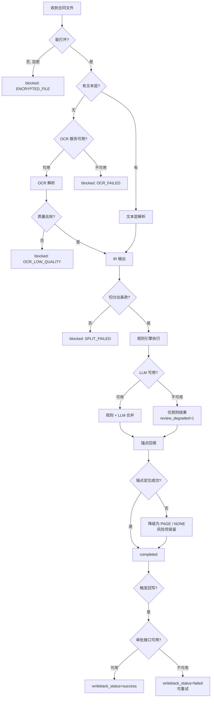

**降级的三个层次**（从轻到重，影响范围依次扩大）：

| 层次 | 含义 | 例子 | 用户可见性 |
|------|------|------|-----------|
| L1 单条降级 | 单条数据的精度或质量下降，任务整体不受影响 | 锚点降为 `PAGE`；某条建议生成失败 | 卡片上灰色标签或局部文案 |
| L2 任务降级 | 任务完成但结果不完整 | LLM 失败率 >30%；元数据多个字段缺失 | 顶部黄色横幅 |
| L3 任务阻塞 | 任务无法继续，需人工介入 | 加密文件、OCR 失败 | 红色状态 + 处理按钮 |

## 15. 非功能设计

### 15.1 性能指标与实现手段

| 编号 | 指标 | 目标值 | 实现手段 | 验证方式 |
|------|------|-------|---------|---------|
| NFR-P-01 | 单份合同端到端审查耗时（DOCX，≤15 页） | ≤ 3 分钟 | 解析与审查异步执行；LLM 并发 4（ADR-005）；规则引擎纯内存正则 | 计时日志 `parse_duration_ms` + `review_duration_ms`；第 17 章集成测试断言 |
| NFR-P-02 | 单份合同端到端审查耗时（扫描件，≤15 页） | ≤ 6 分钟 | OCR 走 MinerU 异步接口，解析与审查流水线化 | 同上 |
| NFR-P-03 | 列表页接口 P95 | ≤ 500ms | `contract_task` 的 `idx_status_risk_created` 联合索引；风险数由 `risk_item` 聚合，不做 N+1 | 压测脚本（第 17 章） |
| NFR-P-04 | 详情 / 风险列表接口 P95 | ≤ 800ms | 一次性返回风险与建议（`JOIN` 或一次 `IN` 查询），不做逐条查询 | 同上 |
| NFR-P-05 | 文档接口首屏（PDF 首页 + 页元数据）P95 | ≤ 1.5s | 页元数据全量返回（体积小），段落与页图按需 | 前端 Lighthouse / 手动计时 |
| NFR-P-06 | 页图接口 P95 | ≤ 800ms | 页图首次生成后落盘 `data/renders/{task_id}/`，后续命中缓存直接读文件 | 手动计时 + 文件存在性检查 |
| NFR-P-07 | SSE 事件延迟 | ≤ 2s | 事件入库后立即推送；`review_progress` 每 5 条合并推送一次，避免高频 | 前端显示事件时间戳与本地时间对比 |
| NFR-P-08 | 前端首屏（大盘页）可交互时间 | ≤ 2s | Vite 构建产物 gzip 后约 400KB；路由懒加载；`el-table` 按需引入 | Lighthouse |

### 15.2 并发设计

| 项 | 设计 | 说明 |
|----|------|------|
| 任务并发 | 单实例同时处理最多 3 个任务，第 4 个起排队 | 用 `asyncio.Semaphore(3)` 在任务调度处限制。理由：每个任务内部已有 4 路 LLM 并发，3 × 4 = 12 路并发调用，再高容易触发模型服务限流 |
| LLM 并发 | 单任务内 4 路（`asyncio.Semaphore(4)`） | ADR-005 |
| 数据库连接池 | `pool_size=10, max_overflow=5, pool_pre_ping=True` | 单实例够用；`pool_pre_ping` 防止 MySQL 空闲断连导致的「MySQL server has gone away」 |
| 重复提交 | 写接口用条件 UPDATE + 唯一索引；`POST /writeback` 用 `writeback_status` 检查 + 幂等键 | 见 8.4 |
| 任务抢占 | `claim_task()` 用 `UPDATE ... WHERE status = :from` + `rowcount` 检查 | 见 8.5。单实例下用不上，但保留了多实例扩展的可能，且能防住同一任务被重复调度 |
| 浏览器多标签 | 允许同一任务开多个标签，SSE 各自独立订阅 | 每个 SSE 连接一个 `asyncio.Queue`，不共享；事件总线按 `task_id` 广播 |

### 15.3 安全与权限

| 编号 | 项 | 设计 |
|------|----|------|
| SEC-01 | 身份识别 | 请求头 `X-User-Id` + `X-User-Role`。**明确说明：这是课程项目，不做密码登录与会话管理**；缺失头则 401 |
| SEC-02 | 越权访问 | 业务经办人只能访问 `applicant_id = self` 的任务；法务与管理员可访问全部。实现为 FastAPI 依赖 `require_task_access(task_id, user)`，在每个任务相关接口上调用 |
| SEC-03 | 上传文件路径 | 服务端生成路径 `data/uploads/{task_id}/{task_id}_{file_version}.{ext}`，**绝不用原始文件名拼接路径**（NFR-S-04） |
| SEC-04 | 文件类型校验 | 扩展名白名单 + 文件头魔数校验（`python-magic` 或手写的魔数表）：`PK\x03\x04` → DOCX/ZIP、`%PDF-` → PDF、`\x89PNG` / `\xFF\xD8\xFF` / `II*\0` / `MM\0*` → 图片 |
| SEC-05 | 文件大小限制 | 单文件 50MB，由 FastAPI 的流式读取累计计数拦截（不依赖 `Content-Length`，因为它可伪造） |
| SEC-06 | SQL 注入 | 全部走 SQLAlchemy 参数化查询；规则 AST 的字段名与条款类型在启动时白名单校验（11.7），不做字符串拼接 |
| SEC-07 | 正则拒绝服务（ReDoS） | 规则正则全部由 `rules.yaml` 提供，人工审核；禁止使用嵌套量词（如 `(a+)+`），启动校验时人工检查 |
| SEC-08 | 报告导出文件名 | 用 URL 编码，避免中文文件名在部分浏览器下乱码；文件名不含用户可控的特殊字符 |
| SEC-09 | 静态资源目录 | `data/renders` 与 `data/uploads` 不通过静态文件中间件直接暴露，**只能经 `/api/tasks/{id}/page-image/{n}` 带权限校验访问** |
| SEC-10 | 密钥管理 | 见 16.4。所有密钥只从环境变量读取，`.env` 文件不入库、不入版本管理（`.gitignore`） |

### 15.4 审计日志字段

`audit_log` 只追加、不提供修改与删除接口。写入统一封装：

```python
# app/core/audit.py
def write_audit(db: Session, *, operator_id: int | None, action: str,
                target_type: str, target_id: str | int | None,
                detail: dict | None = None, ip: str | None = None) -> None:
    db.add(AuditLog(operator_id=operator_id, action=action, target_type=target_type,
                    target_id=str(target_id) if target_id is not None else None,
                    detail=detail, ip=ip))
```

| 字段 | 类型 | 说明 |
|------|------|------|
| `operator_id` | BIGINT UNSIGNED NULL | 自动重试、Mock 系统触发时为 NULL |
| `action` | VARCHAR(32) | 枚举值见下表 |
| `target_type` | VARCHAR(24) | `task` / `risk_item` / `suggestion` / `metadata` / `comment` / `writeback` / `rule` |
| `target_id` | VARCHAR(64) | 目标主键的字符串形式 |
| `detail` | JSON | 变更前后快照，格式见下 |
| `ip` | VARCHAR(45) | 支持 IPv6 |
| `created_at` | DATETIME(3) | |

必须记录的动作：

| `action` | `target_type` | `detail` 内容 |
|----------|--------------|--------------|
| `CREATE_TASK` | task | `{"source_type":"UPLOAD","file_name":"…","file_md5":"…"}` |
| `RETRY_PARSE` | task | `{"retry_no":2,"retry_target":"parse","block_reason_before":"OCR_FAILED"}` |
| `REUPLOAD_FILE` | task | `{"file_version_before":1,"file_version_after":2,"file_md5_before":"…","file_md5_after":"…"}` |
| `UPDATE_METADATA` | metadata | `{"field_key":"amount","before":null,"after":"1200000.00"}` |
| `ADOPT_SUGGESTION` | suggestion | `{"suggestion_id":3001,"risk_item_id":9001,"before":null,"after":"本合同项下…"}` |
| `REJECT_SUGGESTION` | suggestion | `{"suggestion_id":3001,"reject_reason":"条款可接受"}` |
| `MARK_FALSE_POSITIVE` | risk_item | `{"risk_item_id":9002,"rule_code":"R-FOR-01","before":false,"after":true}` |
| `WRITEBACK` | writeback | `{"writeback_no":"WB…","idempotency_key":"…","result":"success","http_status":200,"replayed":false}` |
| `CLOSE_TASK` | task | `{"close_reason":"已线下协商解决"}` |
| `REOPEN_TASK` | task | `{"review_version_before":1,"review_version_after":2}` |
| `UPDATE_RULE` | rule | `{"rule_code":"R-LIA-03","before":{"is_enabled":true},"after":{"is_enabled":false}}`（本期仅供种子导入时写入） |

**批注的新增与删除也记审计**（`action = CREATE_COMMENT` / `DELETE_COMMENT`，`target_type = comment`，`detail` 含 `content` 前 200 字）。理由：需求 2.4.3 要求「补充法务意见」是审查闭环的一环，谁在什么时候加了什么意见属于需要留痕的动作。

### 15.5 关键字段的敏感信息处理

| 字段 | 处理 |
|------|------|
| `party_a_uscc` / `party_b_uscc` | 明文存储。统一社会信用代码是公开可查的企业标识，不属于个人信息 |
| 合同正文中的个人信息（身份证号、手机号） | 明文存储（合同本身就是要审的对象，脱敏会让审查无法进行）。**仅在日志中不落全文**：日志里打印合同内容时统一截断至 200 字 |
| `app_user.username` | 明文，课程项目的预置账号 |
| `LLM_API_KEY` / `MYSQL_PASSWORD` / `OCR_API_KEY` | 只从环境变量读，日志中不打印；`GET /api/config` 返回时对含 `KEY`/`PASSWORD`/`TOKEN`/`SECRET` 的项返回 `is_secret: true` 且 `value` 为 `"******"` |

### 15.6 日志规范

| 项 | 约定 |
|----|------|
| 库 | `loguru`（提示词已锁定） |
| 输出 | 控制台（开发）+ `logs/app_{time:YYYY-MM-DD}.log`（按天轮转，保留 7 天，单文件 100MB 上限） |
| 格式 | `{time:YYYY-MM-DD HH:mm:ss.SSS} | {level: <8} | {extra[trace_id]} | {name}:{line} | {message}` |
| `trace_id` | 每个 HTTP 请求与后台任务生成，通过 `logger.contextualize(trace_id=...)` 注入；500 错误响应头回传 `X-Trace-Id` |
| 必打的业务日志 | 任务状态每次变化、规则命中条数、LLM 单次调用耗时与结果状态、回写请求与响应（响应体截断 500 字）、幂等命中、降级触发 |
| 禁止打印 | 完整合同正文、API 密钥、数据库密码、模型完整 prompt（只打 prompt 名称与 token 数） |

## 16. 部署与运行

### 16.1 依赖服务清单

| 服务 | 用途 | 必需性 | 版本要求 | 不可用时的后果 |
|------|------|-------|---------|--------------|
| MySQL | 唯一持久化存储 | **必需** | 8.0.16+（需要 `CHECK` 约束与 `FULLTEXT ... WITH PARSER ngram`） | 服务无法启动 |
| LLM 服务（DeepSeek Flash 兼容接口） | 条款归类、元数据补抽、风险研判、建议生成 | 必需 | OpenAI 兼容 `/chat/completions` | 任务降级为「仅规则结果」，`review_degraded = 1`（EX-11） |
| MinerU OCR 服务 | 扫描件识别 | 条件必需 | HTTP 接口，接受图片或 PDF 页，返回文本与坐标 | 扫描件任务 `blocked`（EX-06）；DOCX/PDF 任务不受影响 |
| Mock 审批系统 | 待办推送、附件下载、评论回写 | 必需 | 本项目内嵌实现（同一 FastAPI 应用） | 回写 `failed`（EX-19） |
| 文件系统 | 上传文件、页图渲染产物 | 必需 | 本地磁盘 ≥ 2GB 可用空间 | 无法解析 |
| Redis | — | **不使用** | — | ADR-008 已说明放弃理由 |

MySQL 用 Docker 起，镜像走国内源：

```yaml
# docker-compose.yml
services:
  mysql:
    image: docker.m.daocloud.io/library/mysql:8.0.36
    container_name: cra-mysql
    restart: unless-stopped
    environment:
      MYSQL_ROOT_PASSWORD: ${MYSQL_ROOT_PASSWORD}
      MYSQL_DATABASE: contract_review
      MYSQL_USER: ${MYSQL_USER}
      MYSQL_PASSWORD: ${MYSQL_PASSWORD}
      TZ: Asia/Shanghai
    command:
      - --character-set-server=utf8mb4
      - --collation-server=utf8mb4_0900_ai_ci
      - --default-time-zone=+08:00
      - --ngram_token_size=2
    ports:
      - "3307:3306"          # 避开本机可能已占用的 3306
    volumes:
      - ./data/mysql:/var/lib/mysql
    healthcheck:
      test: ["CMD", "mysqladmin", "ping", "-h", "127.0.0.1", "-p${MYSQL_ROOT_PASSWORD}"]
      interval: 5s
      timeout: 3s
      retries: 20
```

`--ngram_token_size=2` 是 `clause.clause_text` 上那个 `FULLTEXT ... WITH PARSER ngram` 索引生效的前提，缺了它中文全文检索会退化成按整句匹配。

### 16.2 运行环境

| 项 | 要求 |
|----|------|
| Python | 3.11 |
| 依赖管理 | `uv`（国内源：`UV_INDEX_URL=https://pypi.tuna.tsinghua.edu.cn/simple`） |
| Node.js | 20 LTS（仅前端构建用；国内源 `npm config set registry https://registry.npmmirror.com`） |
| 操作系统 | Windows / macOS / Linux 均可；PDF 页图渲染依赖 PyMuPDF，无系统级依赖 |

后端依赖（`pyproject.toml`）：

```toml
[project]
name = "contract-review-agent"
requires-python = ">=3.11"
dependencies = [
  "fastapi>=0.115",
  "uvicorn[standard]>=0.32",
  "sqlalchemy>=2.0.36",
  "pymysql>=1.1",
  "alembic>=1.14",          # 仅用来自动生成初版 DDL，后续改表手写 SQL
  "pydantic>=2.9",
  "python-multipart>=0.0.12",
  "python-docx>=1.1.2",
  "pymupdf>=1.24",
  "httpx>=0.27",
  "langgraph>=0.2.50",
  "loguru>=0.7",
  "pyyaml>=6.0",
  "openpyxl>=3.1",          # 读取规则种子表（如有 Excel 形式的规则清单）
  "python-dotenv>=1.0",
  "jinja2>=3.1",            # 报告模板渲染
]

[dependency-groups]
dev = ["pytest>=8.3", "pytest-asyncio>=0.24", "ruff>=0.7", "respx>=0.21"]
```

**为什么用 `pyproject.toml` 而不拆分 `requirements.txt`**：依赖管理已定为 `uv`，`uv sync` 直接读 `pyproject.toml`，多维护一个 `requirements.txt` 只会造成版本漂移。

### 16.3 环境变量清单

`.env.example`（提交到仓库，`.env` 加入 `.gitignore`）：

```dotenv
# —— 应用 ——
APP_HOST=0.0.0.0
APP_PORT=8000
APP_ENV=dev
LOG_LEVEL=INFO
DATA_DIR=./data

# —— 数据库 ——
MYSQL_HOST=127.0.0.1
MYSQL_PORT=3307
MYSQL_DATABASE=contract_review
MYSQL_USER=cra
MYSQL_PASSWORD=change-me
MYSQL_ROOT_PASSWORD=change-me-root
DB_POOL_SIZE=10
DB_MAX_OVERFLOW=5

# —— 主推理模型 ——
LLM_BASE_URL=https://api.deepseek.com/v1
LLM_API_KEY=sk-change-me
LLM_MODEL_NAME=deepseek-flash
LLM_TIMEOUT_SECONDS=25
LLM_MAX_RETRIES=1
LLM_CONCURRENCY=4

# —— OCR 通道 ——
OCR_ENABLED=1
OCR_BASE_URL=http://127.0.0.1:8100
OCR_API_KEY=change-me
OCR_TIMEOUT_SECONDS=90
OCR_MIN_AVG_CONFIDENCE=0.85
OCR_RENDER_DPI=200

# —— 审批集成 ——
APPROVAL_MODE=mock
APPROVAL_BASE_URL=http://127.0.0.1:8000
APPROVAL_TIMEOUT_SECONDS=15
APPROVAL_MAX_RETRY=3
MOCK_APPROVAL_PUSH_ENABLED=1

# —— 上传与并发 ——
MAX_UPLOAD_MB=50
TASK_CONCURRENCY=3
TASK_TIMEOUT_SECONDS=480

# —— 前端 ——
VITE_API_BASE=/api
```

| 变量 | 是否敏感 | 说明 |
|------|---------|------|
| `MYSQL_PASSWORD` / `MYSQL_ROOT_PASSWORD` | 是 | `GET /api/config` 返回 `******` |
| `LLM_API_KEY` | 是 | 同上；日志中不打印 |
| `OCR_API_KEY` | 是 | 同上 |
| `APPROVAL_MODE` | 否 | `mock` / `real`。切到 `real` 时读取 `APPROVAL_BASE_URL` 走真实系统（见 16.7.4） |
| `OCR_ENABLED` | 否 | 置 `0` 时扫描件直接 `blocked(OCR_FAILED)`，用于本地快速调试非扫描件场景 |

### 16.4 密钥管理

| 编号 | 规则 |
|------|------|
| KEY-01 | 所有密钥只从环境变量读取，代码中不出现默认密钥。启动时校验：`LLM_API_KEY` 为空则拒绝启动并打印「请在 .env 中配置 LLM_API_KEY」 |
| KEY-02 | `.env` 加入 `.gitignore`；仓库只提交 `.env.example`。`README` 里列出获取模型 API Key 的步骤，不放任何真实 Key |
| KEY-03 | 密钥不进入日志。`loguru` 的 sink 上挂一个 `filter`，把包含 `sk-` 前缀的字符串替换为 `sk-***` |
| KEY-04 | 密钥不进入错误响应。异常处理层对外只返回错误码与中文说明，堆栈只写日志 |
| KEY-05 | 密钥不进入审计日志的 `detail`。`UPDATE_CONFIG` 类审计只记录变更的字段名，不记录值 |
| KEY-06 | 本项目不引入密钥管理服务（KMS / Vault）。理由：单机课程项目，引入外部密钥服务会带来新的部署依赖，收益为零 |

### 16.5 目录结构（运行期）

```
contract-review-agent/
├─ app/                     # 后端代码（结构见第 3 章）
├─ frontend/                # 前端代码
├─ docs/                    # 本设计文档与 PRD
├─ prompt/                  # 生成提示词
├─ sql/
│  ├─ ddl/                  # 建表 SQL
│  ├─ seed/                 # 种子数据
│  │  ├─ rules.yaml         # 21 条启用规则 + 19 条禁用规则
│  │  ├─ templates.yaml     # 示范条款模板
│  │  ├─ required_clauses.yaml
│  │  └─ users.yaml         # 预置用户
│  └─ mock/                 # Mock 审批单与附件
├─ data/                    # 运行期数据，全部加入 .gitignore
│  ├─ uploads/{task_id}/    # 上传原件
│  ├─ renders/{task_id}/    # 页图渲染产物
│  ├─ samples/              # 示例合同原件（14 份，入库的除外）
│  └─ mysql/                # Docker 数据卷
├─ logs/
├─ tests/
│  ├─ unit/
│  ├─ integration/
│  └─ fixtures/samples/     # 示例合同的预期结果 JSON
├─ docker-compose.yml
├─ .env.example
├─ pyproject.toml
└─ README.md
```

### 16.6 启动步骤

```bash
# 1) 启动数据库
cp .env.example .env            # 然后按需修改密码与 LLM_API_KEY
docker compose up -d mysql
docker compose ps               # 等 healthcheck 变成 healthy

# 2) 安装后端依赖
export UV_INDEX_URL=https://pypi.tuna.tsinghua.edu.cn/simple
uv sync

# 3) 建表 + 导入种子数据（幂等，可重复执行）
uv run python -m app.cli init-db

# 4) 启动 OCR 服务（可选；不做扫描件场景时可跳过，并把 OCR_ENABLED 置 0）
#    MinerU 按官方文档启动，监听 8100

# 5) 启动后端
uv run uvicorn app.main:app --host 0.0.0.0 --port 8000 --reload

# 6) 启动前端
cd frontend
npm config set registry https://registry.npmmirror.com
npm install
npm run dev                     # 默认 5173，vite.config.js 里把 /api 代理到 8000
```

`app.cli init-db` 的三个动作（幂等）：

| 步骤 | 行为 | 幂等方式 |
|------|------|---------|
| 建表 | 执行 `sql/ddl/*.sql`，`CREATE TABLE IF NOT EXISTS` | 表存在则跳过 |
| 导入规则 | 读 `rules.yaml`，按 `rule_code` upsert | `INSERT ... ON DUPLICATE KEY UPDATE` |
| 导入预置数据 | 用户、示范条款模板、必检条款配置、Mock 审批单 | 按唯一键 upsert |

**规则校验失败时拒绝启动**：`init-db` 与 `app.main` 启动钩子都会跑 11.7 的 `validate_rule`，任一条规则不合法则启动失败并打印具体错误（EX-14）。宁可起不来，也不带着一条会误报的规则跑。

### 16.7 Mock 审批系统的接口契约

Mock 系统实现为 `app/integration/mock_approval.py` + `app/api/mock.py`，与主服务同一个 FastAPI 应用（不同路由前缀）。**它的意义不是「假数据」，而是一份可替换的接口契约**：真实系统接入时，只要把 `APPROVAL_MODE` 从 `mock` 改成 `real`，由 `ApprovalClient` 这个抽象替换实现，业务代码零改动（ADR-006 的落地方式）。

#### 16.7.1 审查系统需要审批系统提供的接口（对上游）

| 方法 | 路径 | 用途 | 请求 | 响应 |
|------|------|------|------|------|
| GET | `/mock/approval/todos` | 拉取待办审批单 | `page`、`page_size` | `{items: [{approval_no, contract_name, applicant, applicant_dept, contract_type, attachment_url, created_at}], total}` |
| GET | `/mock/approval/attachment/{approval_no}` | 下载合同附件 | — | `application/octet-stream` 文件流 |
| POST | `/mock/approval/events` | 接收审批系统推送的事件（模拟推送） | `{event_id, approval_no, contract_name, applicant, applicant_dept, contract_type, attachment_url}` | `{received: true}` |

响应示例（`GET /mock/approval/todos`）：

```json
{
  "code": 0,
  "message": "ok",
  "data": {
    "total": 3,
    "page": 1,
    "page_size": 10,
    "items": [
      {
        "approval_no": "APV-2026-1007",
        "contract_name": "某软件采购合同",
        "applicant": "张伟",
        "applicant_dept": "信息技术部",
        "contract_type": "PURCHASE",
        "attachment_url": "http://127.0.0.1:8000/mock/approval/attachment/APV-2026-1007",
        "created_at": "2026-10-14T09:12:00.000+08:00"
      }
    ]
  }
}
```

#### 16.7.2 审查系统向审批系统提供的接口（回写）

| 方法 | 路径 | 用途 | 请求 | 响应 |
|------|------|------|------|------|
| POST | `/api/mock/approval/comments` | 写入审查评论 | 头 `Idempotency-Key`；体 `{approval_no, author, content, source}` | `{code: 0, data: {comment_id, comment_no, replayed}}` |
| GET | `/api/mock/approval/comments/{approval_no}` | 查询审批单下的评论 | — | `{items: [{comment_id, author, content, comment_no, created_at}]}` |
| GET | `/api/mock/approval/detail/{approval_no}` | 查询审批单详情与状态 | — | `{approval_no, status, contract_name, comment_count}` |

回写请求示例：

```http
POST /api/mock/approval/comments HTTP/1.1
Content-Type: application/json
Idempotency-Key: b91c2d3e4f5061728394a5b6c7d8e9f0a1b2c3d4e5f60718293a4b5c6d7e8f90

{
  "approval_no": "APV-2026-1007",
  "author": "系统-合同审查",
  "content": "## 合同审查意见（法务）\n\n**审查结论：建议拒绝或整改后重提**\n…",
  "source": "REVIEW_SYSTEM"
}
```

响应（首次）：

```json
{ "code": 0, "message": "ok", "data": { "comment_id": 4401, "comment_no": 1, "replayed": false } }
```

响应（幂等重放，同 `Idempotency-Key`）：

```json
{ "code": 0, "message": "内容未变化，已复用上次回写结果", "data": { "comment_id": 4401, "comment_no": 1, "replayed": true } }
```

**幂等契约的三条硬要求**（真系统接入时对方必须满足，否则本项目的幂等保证只到「不重复提交」这一层，无法到「不产生重复评论」）：

| 编号 | 要求 | 不满足时的后果 |
|------|------|--------------|
| MOCK-01 | 同一 `Idempotency-Key` 的重复请求必须返回**首次**产生的 `comment_id`，且 `replayed = true` | 审查系统侧仍靠 `writeback_log.uk_idem` 拦住重复提交，但若对方超时后实际写入成功而返回失败，会产生重复评论 |
| MOCK-02 | `Idempotency-Key` 的幂等窗口不少于 24 小时 | 超过窗口的重复请求会被当作新请求 |
| MOCK-03 | 同一个 `approval_no` 下的评论 `comment_no` 单调递增且不重复 | 评论顺序混乱，但内容不重复 |

#### 16.7.3 企业信息查询接口（Mock）

R-SUB-02 需要相对方的经营异常状态。这段能力不属于审批系统，单独给一个 Mock：

| 方法 | 路径 | 请求 | 响应 |
|------|------|------|------|
| GET | `/mock/enterprise/{uscc}` | — | `{uscc, name, credit_status, abnormal_reason, checked_at}` |

`credit_status` 取值：`NORMAL` / `ABNORMAL`（列入经营异常名录）/ `DISHONEST`（失信被执行人）/ `UNKNOWN`（查不到）。

```json
{ "code": 0, "message": "ok", "data": { "uscc": "91310000MA1K3QXW2T", "name": "华信科技有限公司", "credit_status": "ABNORMAL", "abnormal_reason": "未按规定期限公示年度报告", "checked_at": "2026-10-14T10:02:11.000+08:00" } }
```

Mock 数据放在 `sql/mock/enterprise.yaml`，只准备示例合同里用到的 8 家企业。**接口不可用时**：`party_b_credit_status` 置为 `UNKNOWN`，R-SUB-02 不命中（而非命中），并在元数据面板标注「企业状态未查询到」。理由与 11.4 同：查不到不等于有问题，误报代价更高。

#### 16.7.4 切换真实系统的改动点

```python
# app/integration/approval.py
class ApprovalClient(Protocol):
    def fetch_todos(self, page: int, page_size: int) -> TodoPage: ...
    def download_attachment(self, approval_no: str) -> bytes: ...
    def post_comment(self, approval_no: str, content: str,
                     idempotency_key: str, author: str) -> CommentResult: ...
    def get_comment(self, approval_no: str, comment_id: int) -> Comment | None: ...


def build_client(settings: Settings) -> ApprovalClient:
    if settings.approval_mode == "real":
        return HttpApprovalClient(settings.approval_base_url, settings.approval_timeout_seconds)
    return MockApprovalClient()
```

接入真实系统需要做的三件事，都在这一层之内：

| 步骤 | 内容 | 影响范围 |
|------|------|---------|
| 1 | 新增 `HttpApprovalClient`，按对方文档实现四个方法 | 仅 `app/integration/` |
| 2 | 在 `build_client` 里加分支，`APPROVAL_MODE=real` | 仅配置 |
| 3 | 若对方不支持 `Idempotency-Key`，在 `HttpApprovalClient.post_comment` 里改为「先按 `writeback_no` 查询是否已存在，再决定是否提交」的查询式幂等 | 仅该类内部 |

第 3 步是本设计刻意留的口子：**幂等第一道防线放在审查系统侧（`writeback_log.uk_idem` + 提交前查询），第二道才依赖对方支持幂等键**。这样即使对方是老旧系统，最坏结果也只是「超时后重试产生重复评论」这一种窄场景，而不是所有重试都重复。

### 16.8 常见启动问题

| 现象 | 原因 | 处理 |
|------|------|------|
| `MySQL server has gone away` | 连接池里的连接被 MySQL 空闲回收 | 已配 `pool_pre_ping=True`；若仍出现，把 `DB_POOL_SIZE` 降到 5 |
| 中文全文检索报 `Unknown parser 'ngram'` | MySQL 未设置 `ngram_token_size` 或版本低于 5.7 | 检查 `docker-compose.yml` 的 `command`；本项目实际不依赖全文检索，可先删掉该索引 |
| `python-docx` 读到 0 个段落 | 用了 `doc.paragraphs` 而文档内容全在表格里 | 必须走 `doc.element.body.iterchildren()`（第 5 章已说明） |
| 页图接口返回 40402 | `data/renders/{task_id}/` 下没有该页 PNG | 检查 `OCR_RENDER_DPI` 与 `data/` 目录写权限 |
| OCR 服务连接拒绝 | MinerU 未启动或端口不对 | 临时把 `OCR_ENABLED` 置 0，只测 DOCX/PDF 场景 |
| LLM 调用全部超时 | `LLM_BASE_URL` 或 `LLM_MODEL_NAME` 错误 | 用 `curl $LLM_BASE_URL/models -H "Authorization: Bearer $LLM_API_KEY"` 先确认接口可达 |
| 前端请求 404 | Vite 代理未配置 | 检查 `frontend/vite.config.js` 的 `server.proxy['/api']` |
| 规则校验失败导致起不来 | `rules.yaml` 里有未知字段名或非法正则 | 按启动日志打印的 `rule_code` 与错误信息修正，不要注释掉校验 |

## 17. 测试方案

### 17.1 测试分层与覆盖目标

| 层级 | 范围 | 工具 | 覆盖目标 | 预计用例数 | 执行时机 |
|------|------|------|---------|-----------|---------|
| 单元测试 | 纯函数：IR 校验、条款切分、归类打分、USCC 校验、中文金额转换、AST 求值、`parse_llm_json`、幂等键、`resolveAnchor` 的等价逻辑 | pytest | 关键函数行覆盖 ≥ 80% | 约 60 个 | 每次提交 |
| 集成测试 | 文件 → IR → 条款 → 规则 → 合并 → 风险项的完整链路（**LLM 用 `respx` 打桩**，返回固定 JSON） | pytest + `respx` | 第 15 章 14 份示例合同的预期结果全部断言 | 14 个主用例 + 24 个异常用例 | 每天收工前 |
| 端到端测试 | 上传 → 轮询/SSE → 采纳 → 回写 → 导出，走真实 HTTP | pytest + `httpx.ASGITransport`（LLM 与 OCR 仍打桩） | MVD 主链路 1 遍 + 阻塞重试链路 1 遍 | 2 个 | 第 3 周起 |
| 手工验证 | 双栏工作台的高亮、跳转、扫描件 bbox 对齐 | 人工 | 第 15 章每份埋雷合同至少点开一次 | — | 第 3 周 |
| 性能测试 | 单个任务端到端耗时、列表接口 P95 | 手写脚本 | NFR-P-01/03 | 2 个 | 第 3 周 |

**LLM 在所有自动化测试里都打桩**。理由有两条：(1) 真实模型调用有网络延迟与不确定性，让 CI 依赖它会让测试变得又慢又飘；(2) 第 15 章的「预期风险清单」是对**规则引擎**的断言，模型的贡献通过「打桩返回指定的 LLM 结果」来验证合并逻辑是否正确，而不是验证模型本身准不准。**模型质量的验证方式是手工跑真实模型一遍，把结果记入第 17.4 表的「实测」列**。

### 17.2 单元测试清单

| 编号 | 被测对象 | 用例要点 |
|------|---------|---------|
| UT-01 | `ParsedDocument._check_consistency` | 正常 IR 通过；违反 IR-01（`full_text` 与段落拼接不一致）、IR-02（字符区间有重叠或有空洞）、IR-03（`paragraph_index` 不连续）、IR-04（`line_boxes` 越出段落范围）各造一个反例并断言抛错 |
| UT-02 | `content_hash()` | 同一文档两次解析得到相同 hash；改动一个空格后 hash 变化 |
| UT-03 | `match_clause_no()` | 10 种编号格式各一条正例；`MAX_NO_PREFIX_LEN = 12` 的边界（前缀 12 字通过、13 字不通过）；把「3 日内支付」误判为编号的反例 |
| UT-04 | `split_clauses()` | 正常编号切分；无编号文档走长度兜底；条款跨页时不切碎（第 15 章 C-07 的复现场景）；空文档返回空列表 |
| UT-05 | `_looks_like_pseudo_heading()` | 「1. 甲方应按约定支付价款。」（句末有句号、长度 >20）不判为标题 |
| UT-06 | `classify()` | 13 类各一条正例；标题覆盖优先于正文打分；正文打分并列时取 `priority` 高者；无命中返回 `OTHER` |
| UT-07 | `validate_uscc()` | 合法码通过；校验位错 1 位不通过；长度错、含非法字符（`I`/`O`/`S`/`V`/`Z`）不通过 |
| UT-08 | `cn_amount_to_decimal()` | 第 6 章的 6 个用例表全部断言，含「壹亿贰仟万元整」= 120000000、「叁佰零伍元零角贰分」= 305.02 |
| UT-09 | `eval_predicate` 的 13 种谓词 | 每种谓词正反两例；`MISSING_FIELD` 对 `null` 与 `""` 都判缺失 |
| UT-10 | `_eval_num` | 三种单位换算：`万分之五`=5 判不超阈值、`万分之六`=6 判超阈值、`千分之六`=6 判超阈值；抽不到数字返回 `False` |
| UT-11 | 规则全量加载 | 加载 `rules.yaml` 后启用规则数 == 21；每条规则的 `validate_rule` 返回空列表 |
| UT-12 | `merge_risks` | ADR-004 三条规则各一个用例：(a) 模型等级更低 → 保留规则项且 `source = rule+llm`；(b) 模型等级更高且引用原文 → 采用模型等级；(c) 模型等级更高但引用原文不在条款中 → 退回规则等级且理由含说明文字 |
| UT-13 | `_cited_text_exists` | 引用片段 7 字 → 不通过；8 字且存在 → 通过；8 字但被换行拆开 → 通过（去空白后匹配） |
| UT-14 | `parse_llm_json` | 裸 JSON 通过；带 ```json 围栏通过；前后带解释文字通过；`{` 不闭合抛 `LlmOutputError`；JSON 合法但违反 schema 抛错 |
| UT-15 | `normalize_markdown()` | 内容相同但行尾空白、空行数量、`\r\n` 不同的两份文本得到相同结果 |
| UT-16 | `build_idempotency_key()` | 同一 `(task_id, review_version, content)` 稳定；`review_version` 变 1 后 key 变化 |
| UT-17 | `Anchor.validate()` | ANC-01（`char_start >= char_end`）、ANC-03（`global_char_end` 超出 `full_text_length`）、ANC-05（`bbox` 超出页宽高）、ANC-06（`precision = EXACT` 但 `bbox` 为 `None`）各一个反例 |
| UT-18 | `merge_parallel_blocks()` | 同一行被拆成两个 block 后合并；`rebuild_offsets()` 后全局偏移连续；合并后重新校验通过 |
| UT-19 | `hitsByRange` 的前端逻辑 | 用 Node 跑等价实现：区间完全包含、部分重叠、相邻不重叠、空数组四种情况 |
| UT-20 | 状态转移表 | 对 8.3 表里 16 条合法转移逐一断言；对 5 条非法转移（如 `completed → parsing` 不经 `REUPLOAD`）断言抛 `InvalidTransition` |

### 17.3 集成测试用例

每个用例的固定流程：`load_sample(c_xx) → parse → split → classify → extract_metadata → run_rules → merge(打桩 LLM) → 断言 risk_item 集合`。

| 编号 | 输入 | 断言重点 |
|------|------|---------|
| IT-01 | C-01 某软件采购合同（PDF 12 页） | 命中 4 条高风险 + 2 条中风险（R-IP-01/R-AMT-01/R-ACC-01/R-DIS-02/R-CON-01）；综合等级 `HIGH`；结论 `REJECT`；每条风险的 `anchor.precision = EXACT` |
| IT-02 | C-02 服务器硬件采购合同（DOCX 8 页） | 命中 R-LIA-02/R-LIA-03/R-SUB-04/R-DIS-01；**违约责任条款必须被归为 `LIABILITY` 且 `clause_index` 小于付款条款**（验证顺序不固定） |
| IT-03 | C-03 办公用品框架采购合同（DOCX 5 页，标准） | **风险项数 == 0** |
| IT-04 | C-04 原材料采购合同（扫描件 10 页） | 解析通道为 `PDF_OCR`；命中 R-LIA-01/R-FOR-01；`precision_cap` 为 `PARAGRAPH` 或 `EXACT`；若平均置信度 < 0.85 则任务带降级标记 |
| IT-05 | C-05 云服务采购合同（PDF 15 页） | 命中 R-DAT-01/R-IP-02/R-DAT-02/R-TRM-01（R-AMT-02 未实现，断言「未被规则命中但可能被 LLM 发现」，打桩 LLM 返回该项以验证合并） |
| IT-06 | C-06 大额设备销售合同（DOCX 14 页） | 命中 R-LIA-02/R-LIA-01/R-TER-01/R-CON-01；`our_party_role = B`（我方为卖方）时 R-DIS-01 不命中 |
| IT-07 | C-07 标准设备销售合同（PDF 6 页，标准） | **风险项数 == 0**；跨页条款（第 3 条横跨第 2、3 页）只切出 1 条条款，`is_cross_page() == true` |
| IT-08 | C-08 货物出口销售合同（DOCX 11 页） | 命中 R-DIS-02；`currency` 为空时 R-AMT-03 未实现，断言元数据 `currency.is_missing == 1` |
| IT-09 | C-09 技术服务合同（DOCX 9 页） | 命中 R-IP-01；R-MIS-03/R-MIS-04 未实现，断言条款表中 `CONFIDENTIALITY` 与 `TERMINATION` 类型均不存在（为将来启用这两条规则准备好输入） |
| IT-10 | C-10 管理咨询服务合同（PDF 7 页，标准） | **风险项数 == 0** |
| IT-11 | C-11 系统运维服务合同（扫描件 12 页） | 命中 R-AMT-01；`precision_cap` 为 `PARAGRAPH`；前端降级提示的数据源字段非空 |
| IT-12 | C-12 标准劳动合同（DOCX 6 页，标准） | **风险项数 == 0** |
| IT-13 | C-13 高级管理人员聘用协议（DOCX 8 页） | 命中 R-TER-01/R-IP-02/R-CON-01 |
| IT-14 | C-14 竞业限制协议（PDF 4 页） | 命中 R-LIA-01；短文档（4 页）不触发任何长度兜底的误切分 |

异常链路用例：

| 编号 | 模拟 | 断言 |
|------|------|------|
| IT-15 | 上传加密 DOCX | `status = blocked`，`block_reason = ENCRYPTED_FILE`，`retry_count` 未增加 |
| IT-16 | OCR 服务返回 500（`respx` 打桩） | 自动重试 1 次后 `blocked`，`OCR_FAILED` |
| IT-17 | OCR 返回中文占比 0.3 的文本 | `blocked`，`OCR_LOW_QUALITY` |
| IT-18 | 上传 51MB 文件 | 413，错误码 41301，未创建任务 |
| IT-19 | 上传 `.txt` 改名为 `.docx` | 415，错误码 41501（魔数校验拦下） |
| IT-20 | LLM 全部超时（打桩） | 任务仍 `completed`，`review_degraded = 1`，风险项只含规则命中 |
| IT-21 | LLM 对 30% 条款超时 | `review_degraded = 1`，其余条款正常 |
| IT-22 | LLM 返回被篡改的原文引用（编造的片段） | 该风险的等级退回规则等级，`risk_reason` 含「未引用原文」 |
| IT-23 | 回写接口连续两次相同请求 | Mock 端只有 1 条评论，第二次 `replayed = true`，`writeback_log` 只有 1 行 |
| IT-24 | 回写接口 500 后人工重试 | `writeback_retry_count` 递增到 1；重试成功后 `result = success`；**总评论数仍为 1** |
| IT-25 | 回写重试 4 次 | 第 4 次返回 42902；`writeback_status = failed` |
| IT-26 | 服务重启时有任务停在 `reviewing` | 启动后该任务回到 `pending` 并自动重跑；重跑后风险项无重复（幂等键生效） |
| IT-27 | 业务经办人访问他人任务 | 40300 |
| IT-28 | 对 `pending` 状态任务调用写回 | 42203（任务未完成审查） |

### 17.4 示例合同 → 预期风险清单对照表

「规则覆盖」列的含义：`是` 表示本期 21 条规则中有一条会在该埋点上命中；`否` 表示该埋点只能靠 LLM 语义研判发现，集成测试对它不做断言（打桩 LLM 时可选择让它返回该风险，用来验证合并逻辑）。

| 合同 | 埋入风险项 | 预期规则 | 等级 | 规则覆盖 | 集成测试断言 |
|------|-----------|---------|------|---------|------------|
| C-01 | 成果知识产权全部归对方 | R-IP-01 | 高 | 是 | IT-01 必断言 |
| C-01 | 未设置付款前置验收条件 | R-AMT-01 | 高 | 是 | IT-01 必断言 |
| C-01 | 缺失验收标准或验收期限 | R-ACC-01 | 高 | 是 | IT-01 必断言 |
| C-01 | 同时约定诉讼与仲裁 | R-DIS-02 | 高 | 是 | IT-01 必断言 |
| C-01 | 缺少保密义务期限 | R-CON-01 | 中 | 是 | IT-01 必断言 |
| C-01 | 软件采购未约定源代码交付或托管 | R-IP-03 | 中 | 否 | 不断言 |
| C-02 | 违约责任严重不对等 | R-LIA-02 | 高 | 是 | IT-02 必断言 |
| C-02 | 管辖地约定违规 | R-DIS-01 | 高 | 是 | IT-02 必断言 |
| C-02 | 违约金比例超出合理范围 | R-LIA-03 | 中 | 是 | IT-02 必断言 |
| C-02 | 我方主体名称前后不一致 | R-SUB-04 | 中 | 否 | 不断言 |
| C-03 | 无（标准合同） | — | — | — | IT-03 断言风险数 == 0 |
| C-04 | 我方单方承担无限责任 | R-LIA-01 | 高 | 是 | IT-04 必断言 |
| C-04 | 未明确不可抗力通知时效 | R-FOR-01 | 中 | 是 | IT-04 必断言 |
| C-05 | 涉及个人信息但无数据安全约定 | R-DAT-01 | 高 | 是 | IT-05 必断言 |
| C-05 | 我方原有知识产权一并转让 | R-IP-02 | 高 | 是 | IT-05 必断言 |
| C-05 | 未约定数据删除或返还义务 | R-DAT-02 | 中 | 是 | IT-05 必断言 |
| C-05 | 未约定生效条件或生效时点 | R-TRM-01 | 中 | 是 | IT-05 必断言 |
| C-05 | 预付款比例过高 | R-AMT-02 | 中 | 否 | 不断言（打桩 LLM 返回以验合并） |
| C-06 | 违约责任严重不对等 | R-LIA-02 | 高 | 是 | IT-06 必断言 |
| C-06 | 我方单方承担无限责任 | R-LIA-01 | 高 | 是 | IT-06 必断言 |
| C-06 | 单方解除权不对等 | R-TER-01 | 高 | 是 | IT-06 必断言 |
| C-06 | 缺少保密义务期限 | R-CON-01 | 中 | 是 | IT-06 必断言 |
| C-07 | 无（标准合同，且验证跨页） | — | — | — | IT-07 断言风险数 == 0 且跨页条款未切碎 |
| C-08 | 同时约定诉讼与仲裁 | R-DIS-02 | 高 | 是 | IT-08 必断言 |
| C-08 | 币种缺失或前后不一致 | R-AMT-03 | 中 | 否 | 断言的替代目标：元数据 `currency.is_missing == 1` |
| C-08 | 付款与发票义务倒挂 | R-AMT-05 | 低 | 否 | 不断言 |
| C-09 | 成果知识产权全部归对方 | R-IP-01 | 高 | 是 | IT-09 必断言 |
| C-09 | 缺失保密条款 | R-MIS-03 | 中 | 否 | 断言的替代目标：`CONFIDENTIALITY` 条款不存在 |
| C-09 | 缺失解除与终止条款 | R-MIS-04 | 中 | 否 | 断言的替代目标：`TERMINATION` 条款不存在 |
| C-10 | 无（标准合同） | — | — | — | IT-10 断言风险数 == 0 |
| C-11 | 未设置付款前置验收条件 | R-AMT-01 | 高 | 是 | IT-11 必断言 |
| C-11 | 自动续约无退出机制 | R-TRM-02 | 中 | 否 | 不断言 |
| C-11 | 解除后仍需支付全部款项 | R-TER-03 | 中 | 否 | 不断言 |
| C-12 | 无（标准合同） | — | — | — | IT-12 断言风险数 == 0 |
| C-13 | 单方解除权不对等 | R-TER-01 | 高 | 是 | IT-13 必断言 |
| C-13 | 我方原有知识产权一并转让 | R-IP-02 | 高 | 是 | IT-13 必断言 |
| C-13 | 缺少保密义务期限 | R-CON-01 | 中 | 是 | IT-13 必断言 |
| C-14 | 我方单方承担无限责任 | R-LIA-01 | 高 | 是 | IT-14 必断言 |
| C-14 | 无终止后义务处理 | R-TER-02 | 中 | 否 | 不断言 |

汇总与验收口径：

| 指标 | 数值 | 对应 PRD 目标 | 测试方式 |
|------|------|-------------|---------|
| 高风险埋点总数 | 18 | — | 本表逐行可数 |
| 高风险规则覆盖 | 18 / 18 = 100% | G-01 高风险召回 ≥ 90% | 集成测试断言（IT-01/02/04/05/06/08/09/11/13/14） |
| 中风险埋点总数 | 16 | — | 本表逐行可数 |
| 中风险规则覆盖 | 7 / 16 = 44% | 无单独指标 | 集成测试断言 |
| 低风险埋点总数 | 1 | — | — |
| 低风险规则覆盖 | 0 / 1 = 0% | — | 不断言 |
| 标准合同误报（C-03/07/10/12 共 4 份，预期 0 条） | 0 条 | G-05 高风险误报率 ≤ 15% | IT-03/07/10/12 断言风险数 == 0 |
| **中低风险整体召回目标** | **≥ 10 / 17 = 59%** | — | 手工跑真实模型后统计，记入下表 |

**为什么对中低风险只要求 59% 而不是 90%**：中风险里有 9 条（`R-SUB-04` 主体名称前后不一致、`R-AMT-02` 预付款比例、`R-AMT-03` 币种缺失、`R-IP-03` 源代码交付、`R-MIS-03/04` 必备条款缺失、`R-TRM-02` 自动续约、`R-TER-02/03`）本期没有实现规则，全靠模型研判。把中风险召回门槛设到 90% 等于要求模型在没有规则兜底的情况下找出 90% 的隐性风险，这与 G-05 的误报率上限是互相冲突的两个目标——降低模型报风险的阈值可以提高召回，但会推高误报。**高风险靠规则保证 100%，中低风险靠模型尽力而为**，这是 ADR-002 分工的直接结果，也是一个明确写在验收口径里的取舍，而不是含糊的「尽可能准确」。

真实模型实测记录表（第 3 周手工执行时填写）：

| 合同 | 高风险命中 | 中风险命中 | 误报数 | 备注 |
|------|-----------|-----------|-------|------|
| C-01 | / 4 | / 2 | | |
| C-02 | / 2 | / 2 | | |
| C-04 | / 1 | / 1 | | |
| C-05 | / 2 | / 5 | | |
| C-06 | / 3 | / 1 | | |
| C-08 | / 1 | / 2 | | |
| C-09 | / 1 | / 2 | | |
| C-11 | / 1 | / 2 | | |
| C-13 | / 2 | / 1 | | |
| C-14 | / 1 | / 1 | | |
| C-03/07/10/12 | 0（不应报） | 0（不应报） | | 误报计数 |
| 合计 | / 18 | / 16 | | |

### 17.5 幂等与重试专项测试

这三组测试是本项目的核心正确性保证，单独列出。

**第一组：回写幂等（MOCK-01 的直接验证）**

| 步骤 | 操作 | 断言 |
|------|------|------|
| 1 | 对任务 T 调用 `POST /writeback` | 202；`writeback_log` 1 行；Mock 评论 1 条 |
| 2 | 不改任何内容，再次调用 `POST /writeback` | 200；`idempotent_replay = true`；`comment_id` 与第 1 次相同；`writeback_log` 仍 1 行；Mock 评论仍 1 条 |
| 3 | 修改一条建议的 `final_text` 后调用 | 202；幂等键变化；Mock 评论变成 2 条（内容确实变了，应当新增） |
| 4 | 新增一条法务批注后调用 | 同上，评论 +1 |
| 5 | 把第 3 步的修改改回去 | 幂等键回到第 1 步的值；Mock 评论仍为第 3 步之后的条数，**不新增**（内容与最新一次不同，但……） |

第 5 步需要说清楚：`writeback_log` 的唯一键是 `(task_id, idempotency_key)`。第 5 步的 `idempotency_key` 等于第 1 步的 key，而该 key 在库中已存在，因此 **`POST /writeback` 会直接返回第 1 步的结果（`replayed = true`），不会新写一条评论**。这在语义上是正确的——「改回去」后回写内容与第 1 次完全相同，此时应当提示法务「这份意见此前已写回过，审批单评论区里已有相同内容」，而不是再贴一遍。前端在 `would_append = false` 时就显示这个提示。

**第二组：并发回写**

| 步骤 | 操作 | 断言 |
|------|------|------|
| 1 | 用 `asyncio.gather` 同时发起 5 次相同内容的 `POST /writeback` | 只有 1 次返回 202，其余返回 42201（正在回写中）或 200（幂等重放） |
| 2 | 并发 5 次直接打 Mock 的 `POST /comments`（绕过审查系统侧的状态检查） | Mock 端 `uk_approval_idem` 唯一索引生效；只有 1 条评论；另 4 次 `replayed = true` |

第 2 步是**故意绕过第一道防线**的测试，用来验证「即使审查系统侧的检查失效，Mock 端也能拦住」。这条测试对应 16.7.2 的 MOCK-01。

**第三组：解析重试与恢复**

| 步骤 | 操作 | 断言 |
|------|------|------|
| 1 | 造一个 OCR 必失败的任务 | `blocked`，`retry_count = 1`（自动重试 1 次后记 1） |
| 2 | 修好 OCR 后点「重新识别」 | `retry_count = 2`，审查成功 |
| 3 | 再点两次「重新识别」（模拟持续失败） | 第 4 次返回 42901，前端重试按钮置灰 |
| 4 | 点「重新上传」换一份好的文件 | `retry_count` 重置为 0，`file_version = 2`，解析走新文件 |
| 5 | 审查中途 kill 进程后重启 | 启动日志打印「任务 T 从中断状态 reviewing 回退到 pending」；重跑后 `risk_item` 数量与正常跑一致（无重复） |

### 17.6 性能与降级验证

| 编号 | 验证项 | 方法 | 通过标准 |
|------|-------|------|---------|
| PF-01 | 单任务端到端耗时（DOCX 8 页，C-02） | 计时日志 `parse_duration_ms + review_duration_ms` | ≤ 180s（NFR-P-01） |
| PF-02 | 单任务端到端耗时（扫描件 10 页，C-04） | 同上 | ≤ 360s（NFR-P-02） |
| PF-03 | 列表接口 P95 | 先造 200 个任务，再用脚本串行请求 200 次 | ≤ 500ms（NFR-P-03） |
| PF-04 | 风险列表接口 P95（单任务 40 条风险） | 串行请求 100 次 | ≤ 800ms（NFR-P-04） |
| PF-05 | LLM 并发是否确实生效 | 日志里统计 112 次 P3 调用的时间戳跨度 | 跨度 < 串行耗时的 1/3 |
| PF-06 | 降级横幅是否出现 | 把 `LLM_BASE_URL` 改成不存在的地址，跑 C-02 | 前端顶部出现黄色横幅；任务仍 `completed` |

### 17.7 明确不做的测试

| 项 | 不做的理由 |
|----|-----------|
| 前端单元测试（Vitest） | 工作台的价值在视觉与交互，单测覆盖不了；用第 3 周的手工验证替代。前端逻辑中最值得测的 `anchor.js` 通过 UT-19 用 Node 跑等价实现来覆盖 |
| 浏览器端到端自动化（Playwright） | 安装浏览器依赖与写脚本约需 4h，超过 60h 预算内任何一项测试的投入上限；人工点 14 份合同一遍约 2h，效果够用 |
| 模型输出质量的自动化评估 | 没有标注语料，无法自动化；用 17.4 的实测记录表逐份人工核对 |
| 压测到 QPS 上限 | 单实例课程项目，并发指标只有 NFR-P-03/04 两条；不做容量规划 |
| 安全渗透测试 | 无真实用户与数据；SEC-01~SEC-10 的实现正确性通过代码评审确认 |
| MySQL 主从 / 备份恢复 | 单机单实例，数据可在 5 分钟内用 `init-db` + 示例合同重建 |

## 18. 实施计划

### 18.1 排期假设与产能

| 项 | 取值 |
|----|------|
| 人力 | 1 人（本项目全部工作，含前后端、数据、部署、文档） |
| 周期 | 3 周 |
| 每日投入 | 4 小时 |
| 总产能 | 15 个工作日 × 4 小时 = **60 工时** |
| 专注度假设 | 4 小时为净编码时间，不含会议与沟通；不安排并行任务 |
| 技术假设 | Python / FastAPI / LangGraph / SQLAlchemy / MySQL 熟练；Vue3 刚上手 |

**总产能 60 工时是硬约束**。未经压缩的估算为 72 工时，缺口 12 工时的吸收方式见 18.5，延期项见 18.6。

### 18.2 第 1 周：地基与解析（20 工时）

本周结束时必须能跑通 `文件 → IR → 条款列表`，即「给一个 DOCX/PDF/扫描件，能拿到结构化段落与切分后的条款」。

| 编号 | 名称 | 对应需求 | 工时 | 前置依赖 | 可验证标志 |
|------|------|---------|------|---------|-----------|
| T-01 | 项目脚手架、配置加载、日志、MySQL 接入、`init-db` CLI | 2.4.6 接入与流转 | 2h | — | `docker compose up -d mysql` 后 `uv run python -m app.cli init-db` 成功；`docker exec cra-mysql mysql -e "SHOW TABLES"` 输出 20 行 |
| T-02 | 18 张业务表 + 2 张 LangGraph 表的 DDL 与 ORM 模型 | 2.4.6 | 2h | T-01 | 上述 20 张表全部建立；`app.cli seed` 导入 3 个预置用户后 `SELECT count(*) FROM app_user` 为 3 |
| T-03 | IR 数据模型与 IR-01~IR-04 一致性校验 | 2.4.4 条款提取规则 | 2h | T-01 | UT-01、UT-02 通过 |
| T-04 | 文件接入：上传接口、魔数校验、大小限制、存储路径、md5 去重 | FR-101、FR-102 | 2h | T-02 | IT-18（51MB 拒绝）、IT-19（假扩展名拒绝）通过；上传后 `data/uploads/{task_id}/` 下文件名为 `{task_id}_1.docx` |
| T-05 | DOCX 解析通道 | 2.4.1 文档解析 | 3h | T-03、T-04 | C-02 解析出段落数 > 100；`ParagraphNode.page_no` 全为 `null`；`precision_cap = EXACT` |
| T-06 | PDF 解析通道（文本层 + 页图渲染 + 页图接口） | 2.4.1、2.4.5 文档视窗 | 3h | T-03、T-04 | C-01 解析出 12 页；`GET /api/tasks/{id}/page-image/1` 返回 200 且 `Content-Type: image/png` |
| T-07 | OCR 通道（MinerU 对接、质量报告、失败降级） | 2.4.1、约束 1 | 3h | T-06 | C-04 走 `PDF_OCR` 通道成功；把 `OCR_BASE_URL` 改成无效地址后 IT-16 通过（`blocked: OCR_FAILED`） |
| T-08 | 条款切分（编号正则 + 长度兜底 + 伪标题判定） | 2.4.4 条款提取规则 | 3h | T-05、T-06 | UT-03、UT-04、UT-05 通过；C-07 的跨页条款只切出 1 条且 `is_cross_page() == true` |

**本周的收尾验收**：用 `python -m app.cli parse --file data/samples/C-01.pdf --dump json` 命令直接输出 C-01 的段落与条款 JSON，不需要起服务。

### 18.3 第 2 周：结构化与审查（20 工时）

本周结束时必须能跑通 `条款列表 → 归类 → 元数据 → 锚点 → 规则命中`，即「不起前端，用命令行能打印出 C-01 的风险清单」。

| 编号 | 名称 | 对应需求 | 工时 | 前置依赖 | 可验证标志 |
|------|------|---------|------|---------|-----------|
| T-09 | 条款归类（标题覆盖 + 加权打分 + `OTHER` 兜底） | PRD 第 8 章 | 2h | T-08 | UT-06 通过；C-02 的违约责任条款（物理位置第 3 条）被归为 `LIABILITY` |
| T-10 | 元数据抽取（13 字段规则抽取 + USCC 校验 + 中文大写金额转换） | FR-301、FR-302 | 3h | T-08 | UT-07、UT-08 全部用例通过；C-01 抽出至少 9 个字段 |
| T-11 | 锚点生成与回填、`Anchor.validate()`、与 `anchor.js` 的字段约定 | 2.4.4、2.4.5 | 3h | T-09 | UT-17、UT-18 通过；C-01 中 4 条高风险风险的 `anchor.precision == EXACT` |
| T-12 | 规则引擎：AST、求值器、启动校验、种子导入 | 2.4.4 合规审查判定 | 4h | T-09、T-10 | UT-09、UT-10、UT-11、UT-20 通过；故意写一条非法正则的规则，启动时被拦下并打印 `rule_code` |
| T-13 | 21 条启用规则 + 19 条禁用规则的 YAML 编写与逐条冒烟核对 | 2.4.4 | 2h | T-12 | 用 `app.cli run-rules --sample C-xx` 对 14 份示例合同逐个跑，21 条启用规则每条至少在一个样本上命中或被明确验证为「样本中无此情形」 |
| T-14 | LLM 客户端、`parse_llm_json`、四类提示词、幻觉闸门 | 2.4.2、2.4.6 智能审查引擎 | 4h | T-10 | UT-13、UT-14 通过；用真实 API Key 调一次 P3，返回合法 JSON 且 `original_text` 能在条款里找到 |
| T-15 | LangGraph 审查图、并发调度（4）、MySQL checkpointer、启动恢复 | 2.4.6、编排约束 | 2h | T-12、T-14 | 任务能跑完 `reviewing → completed`；审查中途 kill 进程后重启，IT-26 通过 |

**本周的收尾验收**：`python -m app.cli review --sample C-01` 打印出 4 高 2 中的风险清单，与 17.4 表的 C-01 行一致。

### 18.4 第 3 周：交互、集成与交付（20 工时）

本周结束时必须能完成需求 2.4.10 第 8 条的演示：拉取 → 解析 → 审查 → 复核 → 回写 → 导出。

| 编号 | 名称 | 对应需求 | 工时 | 前置依赖 | 可验证标志 |
|------|------|---------|------|---------|-----------|
| T-16 | 合并器、摘要合成、风险与建议入库 | 2.4.4、ADR-004 | 2h | T-15 | UT-12 通过；IT-01 的风险集合断言通过（4 高 2 中） |
| T-17 | 任务状态机、幂等键、条件 UPDATE、状态转移校验 | 2.4.4 任务状态流转 | 2h | T-16 | IT-15、IT-22、IT-28 通过 |
| T-18 | API 接口（33 个，不含 API-33/34） | 2.4.10 | 2h | T-17 | `GET /api/health` 返回四项全绿；`GET /docs` 列出 33 个路径 |
| T-19 | SSE 事件总线与 11 类事件 | FR-701、2.4.5 协同回写 | 1h | T-18 | `curl -N http://127.0.0.1:8000/api/tasks/1/stream` 先收到 `snapshot`，任务跑完能收到 `task_status` |
| T-20 | Mock 审批系统与回写幂等（预览、提交、状态、重试） | 2.4.6 审批回写、约束 3 | 2h | T-18 | 17.5 第一组 5 步与第二组 2 步全部通过 |
| T-21 | 审查报告生成（Markdown） | 2.4.8 报告格式 | 1h | T-20 | `GET /api/tasks/1/report?format=md` 返回的五节标题与 10.5 完全一致 |
| T-22 | 前端大盘页（列表、筛选、上传、状态轮询） | 2.4.3 大盘页 | 2h | T-18 | 列表展示 8 份示例任务；上传一份合同后 5 秒内在列表首行出现 |
| T-23 | 前端工作台（双栏、双向高亮、风险卡片、建议编辑、回写区、SSE） | 2.4.3 工作台、2.4.5 | 3h | T-22、T-19 | 点击 C-01 的「成果知识产权全部归对方」卡片，左栏滚动到第 7 页并高亮原文；在左栏选中该句，右栏对应卡片高亮 |
| T-24 | 前端规则页（只读单页表格） | 2.4.3 规则页 | 1h | T-18 | 列出 40 条规则，21 条显示为启用 |
| T-25 | 示例合同集：生成脚本 + 8 份核心合同（C-01~C-08） | 2.4.10、交付物 | 2h | — | IT-01~IT-08 全部通过；`data/samples/` 下有 8 份文件（含 1 份扫描件 PDF） |
| T-26 | 端到端联调与演示彩排 | 2.4.10 第 8 条 | 2h | 全部 | 按 18.7 的演示脚本连走两遍，第二遍不出现 500 错误、不出现未定位的风险卡片 |

**T-25 可与其他任务并行的理由**：示例合同是用脚本从 Markdown 源生成的（`scripts/build_samples.py`，用 `python-docx` 写 DOCX、`reportlab`/`pypdf` 生成 PDF、`img2pdf` 生成扫描件），与后端代码无编译依赖，可以在第 1 周的剩余时间或晚上加班时提前做。

### 18.5 工时汇总与压缩说明

| 周 | 任务编号 | 工时小计 |
|----|---------|---------|
| 第 1 周（地基与解析） | T-01 ~ T-08 | 20h |
| 第 2 周（结构化与审查） | T-09 ~ T-15 | 20h |
| 第 3 周（交互与交付） | T-16 ~ T-26 | 20h |
| **合计** | 26 个任务 | **60h** |

未经压缩的估算为 72 工时，缺口 12 工时按下表吸收。每一行都写明代价——压缩不是免费的。

| 任务 | 原估 | 最终 | 压缩方式 | 代价 |
|------|------|------|---------|------|
| T-06 PDF 通道 | 5h | 3h | 只做 `page.get_text("dict")` 取块 + 页图渲染，不做多栏排版与图表区域的 block 合并启发式 | 双栏排版的 PDF，段落顺序可能错乱从而影响锚点精度。8 份示例合同全部是单栏，不触发；真实合同的适用性存疑 |
| T-08 条款切分 | 4h | 3h | 只实现「编号正则」与「长度兜底」两级策略，不做多轮调参 | 少数少见编号格式（如「（三）」「第三部分」）会落到兜底策略，条款粒度变粗 |
| T-11 锚点回填 | 4h | 3h | 回退阶梯从三级（全文 → 首 12 字 → 末 12 字）减为两级 | 超过 1000 字且跨页的超长条款定位可能失败，降级为 `PARAGRAPH` |
| T-12 规则引擎 | 5h | 4h | 谓词类型从 13 种减到 12 种（`CLAUSE_COUNT` 不做 `unit` 参数化） | 无法表达「条款数量 > N 且 N 以天数计」类规则，本期 21 条用不到 |
| T-13 规则编写 | 4h | 2h | 21 条启用规则写完整 AST；19 条禁用规则只写 `rule_code`、`rule_name` 与 `condition_text`，`condition_ast` 留空 | 将来启用这 19 条时要补齐 AST 并重跑冒烟 |
| T-18 API 接口 | 5h | 2h | 延后 API-33（配置查询）与 API-34（审计日志查询）；其余 33 个接口不抽 service 层，路由函数直接查库并组装响应 | 路由函数平均 30 行且含业务判断，将来重构要动路由层；审计日志只写不查 |
| T-23 前端工作台 | 5h | 3h | 扫描件 bbox 层只做固定宽度渲染，不做缩放与拖拽 | 高分辨率扫描件需要横向滚动查看局部 |
| **合计** | **32h** | **20h** | 吸收 12h | |

### 18.6 延期清单（不计入 60 工时）

| 编号 | 内容 | 工时 | 延期的理由 | 若提前完成的前置条件 |
|------|------|------|-----------|-------------------|
| T-27 | 剩余 6 份示例合同（C-09 ~ C-14） | 2h | 需求要求 10~15 份，8 份已能满足演示；后 6 份只增加覆盖度，不增加功能验证 | 第 1 周提前完成 T-01~T-08 |
| T-28 | PDF 报告导出（`xhtml2pdf`） | 4h | 需求 2.4.8 要求 PDF 与 Markdown 两种格式，RC-02 已将其降为 P1；Markdown 可满足「导出报告」的演示需要。**ADR-012 提到「在第 18 章把 T-28 的工时从 2 提到 4」——这里兑现该数字：2h 只能做出排版极粗的 PDF，4h 才能把风险表格正确分页** | 第 3 周 T-16~T-26 全部完成且剩余 ≥4h |
| T-29 | OCR 本地 PaddleOCR 兜底通道 | 3h | RC-01 已说明：MinerU 不可用时降级为 `blocked`，不做本地兜底 | MinerU 在部署环境不可用（此时它从「延期」变成「必须」） |
| T-30 | 规则与模板的界面化编辑 | 4h | RC-03 已说明：本期规则通过 YAML 维护、重启生效；界面只读 | 后端规则校验与版本管理稳定运行 |
| T-31 | 审计日志查询接口与页面 | 2h | T-18 的压缩项；写入侧完整，查询侧缺失 | 33 个接口全部联调通过 |
| T-32 | 扫描件 bbox 层的缩放与拖拽 | 2h | T-23 的压缩项 | T-23 的手工验证通过 |
| **合计** | | **17h** | | |

**60h 内已交付的能力**：解析（3 种格式）、条款切分与归类、元数据抽取、21 条规则、LLM 四类提示词、锚点双向定位、双栏工作台、幂等回写、Markdown 报告、Mock 审批链路、8 份示例合同。

### 18.7 MVD 技术边界与演示脚本

**MVD 边界（技术口径）**：

> 输入一份 DOCX / PDF / 扫描件合同 → 解析为统一 IR → 切分条款并归类 → 抽取元数据 → 21 条规则命中 + LLM 逐条款研判 → 合并为风险项并回填锚点 → 双栏工作台双向高亮 → 法务采纳建议并批注 → 幂等回写 Mock 审批单评论区 → 导出 Markdown 审查报告。

边界之外的能力（PDF 报告导出、规则界面化编辑、审计日志查询、剩余 6 份示例合同、扫描件缩放交互）见 18.6。

**演示脚本（3 分钟，对应 2.4.10 第 8 条）**：

| 步骤 | 操作 | 展示内容 | 时间 |
|------|------|---------|------|
| 1 | 打开大盘页 | 列表里有 8 份合同，其中 C-01 显示「审查完成 · 高风险」 | 15s |
| 2 | 点开 C-01 工作台 | 左栏 PDF 正文，右栏 4 高 2 中的风险卡片 | 20s |
| 3 | 点「成果知识产权全部归对方」卡片 | 左栏跳转到第 7 页并高亮原文 | 20s |
| 4 | 在左栏选中「到货后 7 日内一次性支付全部合同款」 | 右栏对应卡片自动高亮并滚动到位（反向联动） | 20s |
| 5 | 展开元数据面板 | 13 个字段中 9 个已自动抽取，展示合同金额与相对方 | 15s |
| 6 | 编辑建议文本并点「采纳」 | 卡片状态变为已采纳，底部采纳计数 +1 | 20s |
| 7 | 输入批注「请业务部门重新谈判知识产权条款」 | 批注出现在批注列表 | 15s |
| 8 | 点「写回审批意见」→ 预览抽屉 → 确认写入 | 回写状态从 `writing` 变为 `success`，展示 Mock 审批单的评论列表里出现了这条意见 | 25s |
| 9 | 再次点「写回审批意见」 | 提示「内容未变化，不会重复写入」，Mock 评论列表条数不变（**幂等演示**） | 15s |
| 10 | 点「导出报告」下载 Markdown | 打开报告，展示五节结构 | 15s |

备选演示（若 C-01 出问题）：C-06 大额设备销售合同（DOCX，14 页，3 高 1 中）。

**阻塞重试演示（30 秒，对应 2.4.10 第 7 条）**：预先准备一份加密的 DOCX 或把 `OCR_BASE_URL` 指向无效地址，上传后任务进入 `blocked` 并显示原因，点「重新上传」换成正常文件后任务重新流转到「审查完成」。

## 19. 风险与未决问题

### 19.1 技术风险

| 编号 | 风险 | 影响 | 概率 | 应对措施 | 触发后的决策 |
|------|------|------|------|---------|------------|
| R-01 | LLM 单次调用延迟高于 6 秒，导致单任务审查超过 3 分钟（NFR-P-01） | 演示时等待过久 | 中 | 并发 4；P3 的 `clause_text` 截断至 2000 字；`max_tokens` 压到 300 | 把并发提到 8；若仍超时，P3 只对「命中规则的条款 + 高风险类型（LIABILITY/PAYMENT/IP/DISPUTE）」执行，其余跳过并标记 `review_degraded` |
| R-02 | 模型输出 JSON 不稳定（加解释、缺字段、用中文引号） | 单条条款研判失败 | 高 | `parse_llm_json` 三次尝试；重试时追加「只输出 JSON」提示；pydantic 严格校验 | 已有失败处理（12.3/12.5），失败率 > 30% 时任务降级而非阻塞 |
| R-03 | MinerU 服务在部署环境无法启动或接口与文档不符 | 扫描件场景不可用，涉及 C-04、C-11 两份示例合同 | 中 | 第 1 周 T-07 就把 OCR 通道跑通，早暴露 | 启用 T-29（本地 PaddleOCR 兜底，3h）或把扫描件演示改为「展示 blocked 与重试」（仍然满足 2.4.10 第 7 条） |
| R-04 | **LangGraph 没有官方 MySQL checkpointer**（官方只有 SQLite 与 Postgres 实现） | 审查段状态无法持久化 | 高 | 自实现 `MySQLCheckpointer(BaseCheckpointSaver)`，落 `lg_checkpoint` 与 `lg_checkpoint_writes` 两张表（DDL 见 9.2），约 80 行 | 若实现超过 2h，退回 `MemorySaver` + 8.6 的「启动时回退到 `pending` 重跑」策略。**该策略本身已能保证正确性**（幂等键保证不产生脏数据），checkpointer 只是省一次重跑时间 |
| R-05 | 条款切分准确率不足（切太碎或切太粗） | 连锁影响归类、规则匹配、锚点定位 | 中 | 4 级策略 + 长度兜底；用 14 份样本逐份核对；`clause.char_count < 20` 时合并到相邻条款 | 若 8 份样本中超过 2 份切分明显异常，改为主用长度兜底 + 编号作为辅助边界，牺牲精度换稳定性 |
| R-06 | 扫描件的锚点精度只有 `PARAGRAPH` 甚至 `NONE` | 演示时点卡片无法精确高亮 | 中 | 锚点协议本身就是分级的（第 7 章）；前端对 `PAGE`/`NONE` 有明确的展示分支 | 演示时扫描件只展示「跳页 + 整页可读」，精确高亮用 PDF 的 C-01 演示 |
| R-07 | 单人开发在第 2 周末发现落后于计划 | 第 3 周被迫砍功能 | 中 | 每周设一个命令行级的收尾验收（18.2/18.3 的「本周的收尾验收」），第 1 周末未通过即触发降级 | 按 19.3 的顺序逐级砍 |
| R-08 | 用脚本生成的示例合同与真实合同差异过大（编号格式、跨页方式） | 规则正则在真实合同上失灵 | 中 | 生成脚本尽量模仿真实合同结构：DOCX 用「第一条」中文编号，PDF 12~15 页以触发跨页 | 手工改造 2 份样本，加入「（三）」式编号与表格内条款，验证正则的鲁棒性 |
| R-09 | 标准合同（C-03/07/10/12）报出风险，拉高误报率 | G-05 高风险误报率超标 | 中 | 这 4 份在编写时严格避开 21 条规则的触发词；IT-03/07/10/12 直接断言风险数 == 0 | 逐条检查是哪条规则误命中，收紧该规则的正则（例如 R-CON-01 的期限正则要排除「保密期限见第 X 条」这类引用式表述） |
| R-10 | 前端同学在 Vue3 响应式与双栏高亮上卡住 | 工作台做不完，演示缺核心画面 | 中 | FE-01~FE-06 的六条约束；`anchor.js` 由后端同学写好并配 UT-19 | 工作台降级为「左栏纯文本 + 右栏卡片 + 点卡片滚动到段落」（无精确 `<mark>` 高亮），仍满足 2.4.10 第 4 条的「双向定位」但精度降低 |
| R-11 | 真实审批系统不支持 `Idempotency-Key`，幂等只到「不重复提交」这一层 | 换真实系统后可能出现重复评论 | 低（本期用 Mock） | 16.7.4 第 3 步的查询式幂等兜底；`writeback_log.uk_idem` 是审查系统侧的第二道防线 | 在 `HttpApprovalClient` 里实现「先查后写」；若对方连查询接口都没有，退回「回写前人工确认 + 回写后人工核对」 |
| R-12 | 18.5 的 12 工时压缩项带来质量代价（尤其中低风险召回） | 演示效果打折 | 中 | 压缩项都写明了代价与触发条件（18.5 最后一列） | 若第 3 周有富余工时，按「T-23 → T-18 → T-11 → T-13」的顺序回补压缩项 |

### 19.2 需要产品与法务确认的事项

| 编号 | 待确认事项 | 本设计的推荐做法 | 确认方 | 不确认的后果 |
|------|-----------|----------------|-------|------------|
| Q-01 | 全部规则的 `basis` 字段。PRD 与本文档统一写「依据：待法务确认」 | 保持「依据：待法务确认」，并在 `fix_direction` 里给出修改方向 | 法务 / 课程指导老师 | 无法写出具体的合规依据，界面上的依据栏只能显示占位文字 |
| Q-02 | RC-01~RC-06 的范围缩减是否被接受（不做本地 OCR 兜底、PDF 导出降为 P1、规则只读、只实现 21 条规则、PDF 报告风险表延后） | 按本文档的缩减方案执行 | 产品负责人 | 60 工时内无法交付全部 PRD 功能 |
| Q-03 | 违约金「合理范围」的阈值：合同总额 20%、日违约金万分之五 | 采用 20% 与万分之五，写成 `R-LIA-03` 的 `threshold_value` | 法务 | 该规则可能对某些行业偏松或偏紧 |
| Q-04 | `our_party_role`（我方是甲方还是乙方）由谁填写？能否自动判断？ | 上传时由申请人手动选择，默认 `A`；不自动判断 | 产品 | 自动判断错误会导致 R-DIS-01 等方向性规则整条误判 |
| Q-05 | 中低风险召回只要求 ≥ 59%（17.4 的口径）是否可接受 | 接受。高风险由规则保证 100%，中低风险靠模型尽力 | 产品 | 若要求中风险召回 ≥90%，需扩到全部 38 条规则，工时超出 60h 至少 10h |
| Q-06 | 扫描件质量阈值：中文字符占比 < 0.5、可疑字符占比 > 0.05、平均置信度 < 0.85 触发降级 | 采用这三条阈值，写入 `OCR_MIN_AVG_CONFIDENCE` 可配 | 产品 | 阈值过严会让正常扫描件被误判为「质量过低」而阻塞 |
| Q-07 | MinerU 是否返回逐行置信度 | 按「可能不返回」设计：不返回时用四条替代信号（5.1 的降级质量信号表） | 技术（本地部署时验证） | 若确实不返回置信度，`ocr_avg_confidence` 字段为空，降级判定只能靠替代信号 |
| Q-08 | 真实环境下相对方经营异常信息从哪个接口来 | 本期用 Mock（16.7.3），`credit_status = UNKNOWN` 时不命中 R-SUB-02 | 产品 | 该规则在真实环境无数据源，R-SUB-02 形同虚设 |
| Q-09 | `X-User-Id` / `X-User-Role` 这种无密码的身份头是否可接受 | 课程项目可接受，SEC-01 已明确记录 | 产品 | 若要求真实登录，需增加用户表密码字段、登录接口与会话管理，约 +4h |
| Q-10 | 示例合同集最终交付 8 份还是 14 份 | 60h 内交付 8 份（C-01~C-08），14 份为延期的 T-27 | 产品 | 需求原文写「10~15 份」，8 份低于下限 |

### 19.3 进度落后时的降级顺序

若第 2 周末的收尾验收未通过，或第 3 周第 3 天仍未联调通，按以下顺序逐级削减，每一级都保留 2.4.10 的验收能力：

| 级别 | 削减内容 | 保留的能力 | 影响的验收标准 |
|------|---------|-----------|--------------|
| 一级 | 砍 T-24（规则页）、T-27 剩余示例合同 | 大盘页、工作台、回写、报告 | 无（规则页不在 2.4.10 里） |
| 二级 | 扫描件锚点降为「跳页 + 整页可读」，不做 bbox 层 | 三种格式仍都能解析 | 2.4.10 第 1 条仍满足；第 4 条的定位精度下降 |
| 三级 | LLM 只对「高风险条款类型」（`LIABILITY`/`PAYMENT`/`IP`/`DISPUTE`/`DATA_SECURITY`）执行 P3，其余只跑规则 | 高风险召回仍为 100% | 2.4.10 第 3 条仍满足；中风险召回下降 |
| 四级 | 工作台的双向高亮降为单向（点卡片 → 定位原文），去掉左栏选区反查 | 原文与卡片仍有联动 | 2.4.10 第 4 条的「双向」变成单向 |
| 五级（最后手段） | 只保留 DOCX 与 PDF 文本层，扫描件直接走 `blocked` 展示重试链路 | 阻塞重试链路完整（2.4.10 第 7 条） | 2.4.10 第 1 条的「图片扫描件」变成「进入阻塞并展示原因」 |
