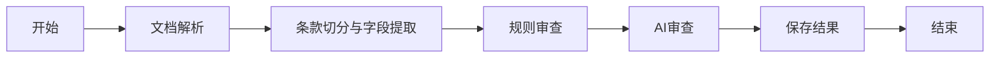

# 模块 04：LangGraph 流程框架

本次交付可编译的主流程框架，业务节点按模块逐步实现。新增代码不会在导入时启动任务，也不访问数据库或外部模型服务。

## 流程和文件



| 文件 | 用途 |
|---|---|
| `app/graph/state.py` | `ReviewState`：在节点之间传递任务 ID、文件 ID、审查版本以及逐步增加的处理结果 |
| `app/graph/nodes/` | 每个业务节点独立一个 Python 文件，`__init__.py` 集中导出函数 |
| `app/graph/errors.py` | 节点共用的异常定义 |
| `app/graph/review_graph.py` | 注册节点、定义边、编译图；通过 `ReviewNodes` 替换节点实现 |
| `tests/unit/test_review_graph.py` | 用真实 LangGraph 验证顺序执行、状态合并、异常中止 |

节点接收完整共享状态，返回自己更新的字段。LangGraph 会把这些字段合并到状态再交给下一步，节点不需要重复返回所有字段。`ReviewState` 是内部类型声明，不替代 FastAPI 请求参数校验；解析 IR、条款和风险的数据结构在对应模块实现时加入。

## 当前可以执行到哪里

```python
from app.graph import build_review_graph

graph = build_review_graph()
# 可以查看图结构，compile 本身不会处理合同。
print(graph.get_graph().draw_mermaid())

# 当前会明确抛出 NodeNotImplementedError，提示解析节点尚未实现。
graph.invoke({"task_id": 1, "file_id": 1, "review_version": 1})
```

五个默认节点都是明确抛错的占位函数，没有真实解析或审查能力。测试注入独立处理函数验证框架，不把测试结果作为真实审查结果。`START`、`END` 是图的执行标记，进入 `END` 不会自动修改数据库任务状态。

## 与原技术方案的调整

技术方案 ADR-007 原定只有审查阶段使用 LangGraph，解析与切分使用顺序代码。按本次讨论，调整为解析、结构化、规则、AI、保存结果均作为主流程节点，方便逐步查看每个模块在流程中的位置。底层处理函数仍独立实现，图只安排执行顺序和传递状态。

本次没有接入上传后自动执行、后台任务 runner、条件分支、SSE、数据库任务状态流转或 MySQL 检查点。`build_review_graph(checkpointer=...)` 保留检查点接入位置，默认无检查点持久化，重启后不能恢复执行进度。失败如何转换为数据库 `blocked`、AI 服务降级如何继续，会随真实模块和执行器一起实现。

## 验证与下一步

新增三个测试通过，Ruff 检查及格式检查通过。验证命令：

```powershell
.\.venv\Scripts\python.exe -m pytest tests/unit/test_review_graph.py -q
```

下一步实现 DOCX 解析模块，并让 `parse_document` 调用真实处理函数。
