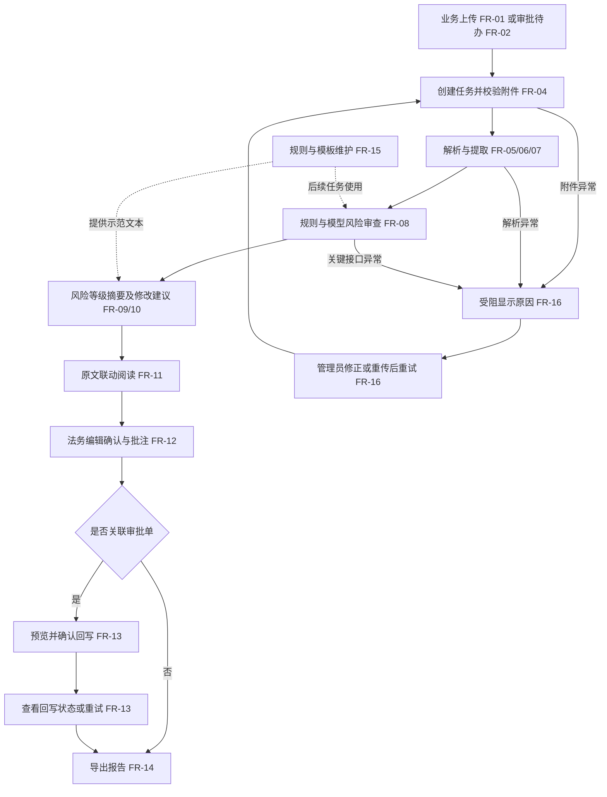
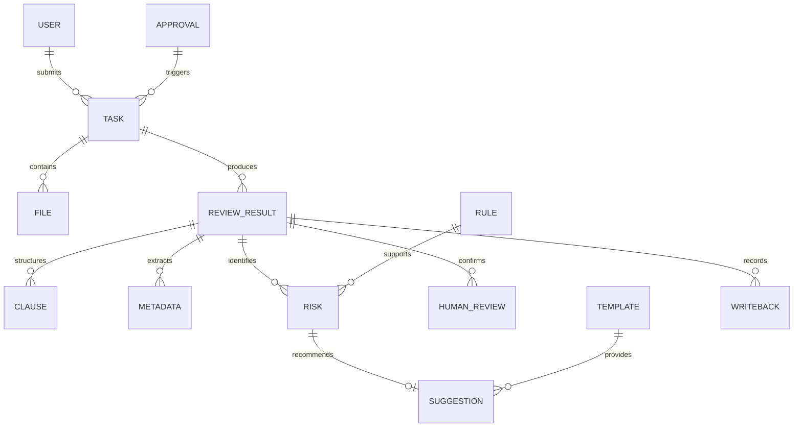

# 合同审批审查系统 PRD（重整草稿）

| 项目 | 内容 |
|---|---|
| 版本 | R0.2 |
| 日期 | 2026-10-15 |
| 作者角色 | 产品需求整理 |
| 状态 | 评审稿，部分产品决策已确认；技术试验与指标待验证，尚未成为编码基线 |
| 需求来源 | 《合同审查系统.md》2.4～2.4.10，路径：`D:/尚硅谷-上课资料/WH20260713/项目实战/合同审查系统.md` |
| 已确认方向 | 保留原始验收要求；简化文档和技术设计；分阶段实现；已有代码先保留 |
| 配套说明 | [原始需求核对与重整建议](00-原始需求核对与重整建议.md) |

本稿描述产品行为、范围与验收；数据库列、接口路径、模型提示词和算法留给后续 spec。新版 FR 编号独立于旧文档，不能直接混用。正文中的“建议”不是原始任务书规定；第 11 章区分用户已确认的产品决策与尚待验证的技术/指标事项，详见[决策记录](01B-产品决策记录.md)。

## 1. 产品目标与价值

帮助业务经办人提交合同，由系统结合规则、模型和标准示范条款识别风险并给出修改建议，供法务查看原文、复核后回写审批意见与导出报告。系统提供辅助审查意见，审批决定由人作出。

### 1.1 成功标准

| 目标 | 可验证结果 | 来源 |
|---|---|---|
| 多格式合同可审查 | DOCX、文本 PDF、扫描件/图片三类各有成功用例，即 3/3 类通过；异常用例明确报因 | 2.4.10 第 1、7 条 |
| 核心信息与风险可追溯 | 验收清单中的字段、条款及风险证据均可核对原文；缺失内容不编造位置 | 2.4.10 第 2～4 条 |
| 能完成业务审查 | 覆盖 4.3 的原文点名风险情形，每项至少有命中与适用的正常对照；输出等级、成因及依据 | 2.4.4、2.4.9、2.4.10 第 3 条；对照方法为本稿建议 |
| 人工复核可交付 | 原文八项验收逐项通过，即 8/8；至少一个典型场景贯通拉取、解析、审查、复核、回写与导出 | 2.4.9、2.4.10 |
| 原始交付内容不遗漏 | 三个核心页面、规则/模板维护、角色操作、Markdown/PDF 两种报告均有操作验收记录 | 2.4.1～2.4.8 |

以上是目标，不是已实现或已测结果。不继承旧文档中未经确认的 38 条规则、14 份样本、60 工时以及性能/召回百分比。

### 1.2 产品边界

最终范围保留原始任务书全部明确能力，包括审批模拟模块、标准示范条款库、规则条件编辑与批量操作。阶段只表示先后，不表示最终可以不交付。

本稿建议不增加真实企业审批厂商接入、电子签章、任意代码规则平台、法规自动更新、历史相似合同检索或多租户。真实企业信用数据服务尚未确定，不把未查询到等同于企业正常。技术栈、向量检索和工作流节点数量不属于产品硬要求。

## 2. 用户角色与权限矩阵

三类角色来自 2.4.2；业务仅看本人、法务审查全部送审任务、管理员运维的边界已由用户确认。对任务范围的限制应由后端执行。

| 操作 | 业务经办人 | 法务审查人 | 系统管理员 |
|---|---|---|---|
| 本地上传并发起任务 | 本人任务 | 默认不提供，待确认 | 默认不提供，待确认 |
| 查看列表、原文、风险、建议及状态 | 本人任务 | 全部送审任务 | 全部任务，便于排查 |
| 查看原文证据、复制建议、下载报告 | 本人任务 | 允许 | 允许 |
| 编辑并确认建议、填写法务批注 | 不允许 | 允许 | 不因管理员身份自动获得法务确认权 |
| 确认并回写审批意见 | 不允许 | 允许 | 默认不允许代替法务确认 |
| 规则、等级、审查清单和模板维护 | 不允许 | 查看 | 维护 |
| 审批参数配置、阻塞重试、重新上传修正文件 | 不允许管理其他任务 | 查看原因 | 操作并留痕 |

课程演示可以采用预置身份选择，不在本期建设注册/SSO；这属于建议的身份实现边界，不代表允许前端自行声明管理员权限。

## 3. 用户故事

| 编号 | 用户故事 | 对应功能 |
|---|---|---|
| US-01 | 作为业务经办人，我希望上传合同并填写送审信息，以便发起审查 | FR-01 |
| US-02 | 作为业务经办人，我希望按状态、风险查询任务，以便知道处理进度 | FR-03、FR-04 |
| US-03 | 作为法务审查人，我希望读取不同格式的合同与核心信息，以便核对审查对象 | FR-05～FR-07 |
| US-04 | 作为法务审查人，我希望每项风险有原文、原因和依据，以便判断风险是否成立 | FR-08、FR-09、FR-11 |
| US-05 | 作为法务审查人，我希望从标准条款得到修改建议并编辑确认，以便形成适合当前合同的意见 | FR-10、FR-12 |
| US-06 | 作为法务审查人，我希望点击风险卡片跳到原文并反向定位，以便快速复核 | FR-11 |
| US-07 | 作为法务审查人，我希望预览并写回最终意见，以便与审批流程衔接 | FR-13 |
| US-08 | 作为业务经办人，我希望下载报告及原文/建议对照，以便整改合同 | FR-14 |
| US-09 | 作为系统管理员，我希望修正阻塞原因并重试，以便恢复处理 | FR-04、FR-16 |
| US-10 | 作为系统管理员，我希望维护合同分类规则和示范条款，以便调整审查要求 | FR-15 |
| US-11 | 作为系统管理员，我希望接收审批待办并配置回写参数，以便完成模拟集成 | FR-02、FR-17 |
| US-12 | 作为法务审查人，我希望识别审查不完整或依据待确认的情况，以便避免将未知结果当作安全结论 | FR-08～FR-10、FR-18 |

## 4. 功能需求清单

### 4.1 优先级与实施阶段

P0 为原始交付必需；P1 为本稿建议的改进；P2 为可选扩展，均不因列出就承诺实施。

阶段 A：审查主链与基础工作台；B：多格式与定位；C：复核与管理；D：审批集成、导出与完整验收。阶段是里程碑，基础能力按依赖提前实施，例如 A 即需要示范模板和风险用例。

| 编号 | 模块/功能 | 优先级 | 阶段 | 产品要求与原始依据 |
|---|---|---|---|---|
| FR-01 | 上传创建任务 | P0 | A→B | 必填合同文件、合同类型、我方甲/乙角色；申请人从当前身份取得。主体名称与金额先提取，缺失提示；其他送审信息按需补充。格式覆盖随 B 补齐。2.4.3、2.4.4、2.4.8；必填划分是已确认的细化决策 |
| FR-02 | 审批待办接入 | P0 | D | 通过模拟模块推送或拉取待办，下载附件、校验完整性、避免重复任务。2.4.6、2.4.7 |
| FR-03 | 大盘及筛选 | P0 | A | 展示名称、申请人、业务类型、金额、状态、综合风险、创建时间；按状态、风险筛选。2.4.3 |
| FR-04 | 状态与进度 | P0 | A→D | 任务五态、回写四态，展示当前阶段、异常和重试结果。2.4.4 |
| FR-05 | 三格式解析 | P0 | A→B | DOCX、文本 PDF、扫描件/图片成功读取，失败明确原因。2.4.1、2.4.10 |
| FR-06 | 核心元数据 | P0 | A→B | 提取双方名称/信用代码、金额、币种、期限、生效条件等；报告需名称/编号。未识别显示缺失，不补造。2.4.4、2.4.8 |
| FR-07 | 条款结构化 | P0 | A→B | 切分并归类主要条款，保留层级、原文位置；不确定类型可见。2.4.4 |
| FR-08 | 风险审查 | P0 | A | 规则与模型共同覆盖 4.3，保留证据、成因、依据及审查不确定性。2.4.4、2.4.6 |
| FR-09 | 综合等级和摘要 | P0 | A | 展示三级风险、关注事项和通过/整改/建议拒绝结论；建议取已识别风险的最高等级，审查不完整另行标识。2.4.8；合成方式为本稿建议 |
| FR-10 | 修改建议 | P0 | A | 结合标准示范条款与模型，为风险点生成可编辑替代文本；失败可重试或人工补充。2.4.4、2.4.6 |
| FR-11 | 分页预览与联动 | P0 | A→B | 保留可阅读排版，分页展示，风险和元数据高亮，原文与卡片双向跳转；展示实际定位精度。2.4.3、2.4.5 |
| FR-12 | 法务复核与批注 | P0 | C | 原文/建议文本对照，复制、编辑、采纳、人工确认、批注；刷新后保存，回写采用最终确认文本。2.4.5、2.4.7 |
| FR-13 | 审批意见回写 | P0 | D | 预览风险摘要、整改建议与批注，法务确认后写入模拟审批评论，显示状态；失败可重试，不重复评论。2.4.7、2.4.8；幂等为补充验收建议 |
| FR-14 | 报告导出 | P0 | D | Markdown 和 PDF；内容含 2.4.8 要素、原文位置和原文/建议对照；预览与下载一致。2.4.1、2.4.7、2.4.8 |
| FR-15 | 规则与模板维护 | P0 | C | 按合同类型维护审查清单、规则触发条件、等级、启停及示范文本；条件编辑限于支持的业务参数。2.4.1、2.4.3、2.4.5 |
| FR-16 | 阻塞修正与重试 | P0 | A→B | 解析或关键接口异常显示原因，管理员修正配置/重传/重试；保留操作记录。2.4.4、2.4.7 |
| FR-17 | 审批对接配置 | P0 | D | 管理员维护模拟审批接入及回写参数，验证连接；敏感值不回显。2.4.2 |
| FR-18 | 示例及演示链路 | P0 | A→D | 提供采购、销售、劳动等标准与风险样例；至少一个典型场景全链成功，异常和正常对照有记录。2.4 交付形式、2.4.9、2.4.10 |
| FR-19 | 列表批量操作 | P0 | C→D | 支持勾选及结果逐项反馈；已确认先支持管理员批量重试、用户批量导出有权查看的报告。2.4.5 |
| FR-20 | 元数据人工修正 | P1 | 待定 | 建议法务可修正提取字段，保留原始值与记录；原始任务书未明确要求此操作 |
| FR-21 | 历史结果对比 | P2 | 待定 | 可选地比较不同审查批次结果；不作为原始验收前置 |

### 4.2 关键行为约定

- **送审上下文**：必填文件、类型和我方甲/乙角色；申请人取当前身份。主体名称、金额等先自动提取，缺失时提示。主体性质影响风险适用性，无法确认时提示补充；劳动者等自然人不因没有企业信用代码而被机械判为企业主体信息缺失。
- **位置与未知**：字段缺失、必备条款缺失没有可指向的文字，不编造高亮。已有风险片段必须来自对应原件；识别了真实文字不代表其法律判断必然正确。
- **任务状态**：`pending` 待处理、`parsing` 解析中、`reviewing` 审查中、`blocked` 受阻、`completed` 审查完成。回写独立使用 `not_written/writing/success/failed`。completed 不等于法务确认或审批通过。
- **异常与完整性**：已确认模型调用失败先有限自动重试，仍失败则进入 blocked，保留已有规则结果，允许人工触发重试，不显示完整审查完成。具体次数和超时由 spec 明确。仅修改建议生成失败不丢弃风险，法务可重试或手工补充，确认后回写。不沿用旧 spec 默认“模型审查失败仍完成”的行为。
- **回写前置**：有审批单关联、法务已确认本次结果与最终意见，才允许回写。对没有审批关联的本地任务可导出报告，不显示虚假回写成功；演示可在模拟模块关联审批单。
- **重审影响**：修正原件或重审后，以当前结果重新复核；已确认/已回写状态不能无条件沿用到变更结果。报告、回写均标明对应合同和审查批次。
- **管理生效**：规则/模板修改影响后续新任务或主动重审，不静默改写历史结果；页面显示保存是否成功，不向产品用户暴露文件路径作为维护操作。

### 4.3 原文点名的审查情形

本表列产品判定目标，不规定用几条规则或几次模型调用实现。关键词仅可帮助筛选，不能单凭词语出现就认定风险。

| 情形 | 等级要求 | 必须考虑的上下文与依据 |
|---|---|---|
| 主体信息缺失 | 高 | 根据企业/自然人性质和合同类型判断必要身份信息 |
| 主体列入经营异常 | 高 | 需明确查询/演示数据来源；无结果应显示未核实，不认定异常或正常 |
| 我方无限责任或严重不对等 | 高 | 先识别我方角色、责任对象、范围及其他条款中的限制 |
| 违规管辖约定 | 高 | 区分法律不适当、缺少事实信息和仅不符合商业偏好，不把“非我方所在地”直接等同违法 |
| 未设付款前置验收条件 | 高 | 按适用交易场景，检查相关付款和验收约定，不因两段分开就认定缺失 |
| 缺少保密期限 | 中 | 检查引用条款及持续生效约定，不只查同一句中的数字 |
| 未明确不可抗力通知时效 | 中 | 检查有效的通知时限及相关引用 |
| 违约金比例合理性风险 | 中 | 标注审查基准来源与适用场景；原文 20% 是示范修改方向，不写成普遍法定上限 |
| 软件采购知识产权与付款场景 | 原文场景列为高风险 | 以样例采购目标和我方权益为前提，结合许可/权属及验收支付条件；不将一切供应商保留知识产权认定违法 |

企业审查依据、法条来源和阈值由 Q-02 确认；有依据待确认的卡片必须标明状态，不能编造具体法条，也不能把统一占位文字当作最终依据验收完成。

## 5. 非功能需求

原始任务书未给并发、耗时或准确率百分比，本稿不把旧数字视为事实。下表“验收目标”属于可测试建议；负载与时间预算待 Q-05 确认后进入基线。

| 类别 | 草稿验收目标/测量口径 | 状态 |
|---|---|---|
| 权限与敏感数据 | 每项受限操作覆盖允许/拒绝各一例；未授权操作被拒绝；日志和界面中明文密钥泄漏为 0 | 建议验收目标 |
| 结果持久性 | 已确认建议、批注、规则修改保存后刷新仍存在；每类至少一例 | 原始操作要求的量化验收细化 |
| 可观测性 | 每种纳入验收的失败均有任务关联、原因和恢复入口；测试中静默失败为 0 | 原始异常要求的量化验收细化 |
| 回写可靠性 | 同一批次相同内容连续提交 3 次，只产生 1 条评论；超时结果待核实时不盲目新增 | 建议用例数量，未代表生产可靠性承诺 |
| 性能 | 分别记录解析、模型、整任务、查询、跳转和导出耗时；固定样本重复测量。建议首轮非模型查询及卡片操作各 ≤2 秒，目标环境见 Q-05 | 建议时间预算，待实测确认；未承诺所有文档在固定时间内完成 |
| 并发与恢复 | 至少测试 2 个同时提交的任务，均有明确状态，不丢任务；服务中断后未完成任务可识别和恢复，不显示假完成 | 建议最小验证规模；实际并发上限待 Q-05 |
| 外部依赖 | OCR、模型、审批调用均有可配置超时，失败有可见结果；每类覆盖成功、超时、错误返回 | 建议验收覆盖，不预设超时数值 |
| 文件与兼容性 | 支持格式见 FR-05；建议暂沿现有 50MB 配置上限，边界内/外各测一次；确定一个验收浏览器和部署环境 | 上限是现有配置与建议，待 Q-05 确认 |

不在课程演示未确认条件下承诺 99.9% SLA、集群高可用、通用法律准确率或企业生产合规认证。安全检查和可恢复性仍必须落实。

## 6. 核心业务流程



回写失败只改变回写状态，不将已经完成的解析变成失败。待办重复事件、重试和服务恢复的细节由 spec 明确，产品上应能区分“处理中”“失败”“结果待核实”。

## 7. 关键页面原型说明

### 7.1 合同审查大盘

```text
[角色/当前用户]                       [上传合同]
[状态筛选] [风险筛选] [查询] [重置]
[勾选] 名称 申请人 类型 金额 状态 风险 创建时间 操作
[批量操作]                         [分页]
[管理员：受阻原因 / 重传 / 重试]
```

上传表单含合同文件及必要送审信息；提取的金额和送审金额若不一致应可核对。查看任务、下载、重试等按钮按角色和状态呈现。进度信息不可要求用户手工刷新才能知道失败。

### 7.2 智能审查工作台

```text
[合同信息 / 审查状态 / 完整性提示 / 回到列表]
┌ 原文：分页、缩放、风险和字段高亮 ┬ 风险卡片：高/中/低筛选 ┐
│ 点击原文定位对应卡片             │ 名称、原文、成因、依据 │
│ 页码与定位精度                   │ 原文/建议对照、编辑采纳 │
└────────────────────────────────┴────────────────────────┘
[综合等级 / 结论建议 / 关注事项]
[法务批注 / 人工确认] [回写预览与状态] [报告预览/导出]
```

卡片不能把“没有证据的位置”显示成可精确跳转。对缺项风险展示“未发现该项”，支持查看相关审查说明；原文明确识别项必须可跳转。Word 原始分页及映射方式待 Q-03 验证，不以伪页码替代。

### 7.3 规则与模板管理

```text
[合同类型] [规则/必检清单/示范条款] [查询]
规则树/列表 | 名称、启停、等级、适用范围、支持的条件参数
模板列表    | 类型、示范文本、适用说明、依据来源
[编辑] [保存] [生效说明]
[管理员：审批对接配置]
```

普通业务字段表单即可，不要求写代码或通用表达式。规则与模板均应有实际维护操作，不能用“去修改 YAML 文件”替代页面要求。无需复制旧文档的所有管理子页面。

## 8. 数据实体初稿

只定义业务对象及关系，不指定数据表数量、主键类型或 JSON/关系存储方案。



| 实体 | 主要业务内容 |
|---|---|
| 用户/任务/原件 | 用户角色；申请信息、类型、我方角色、任务状态；原件、来源及与审批的关联 |
| 审查结果/条款/字段 | 本次审查及完整性、等级与摘要；条款类型与层级；字段原文/标准值、缺失与原文位置 |
| 风险/建议 | 风险级别、来源、成因、依据及证据；示范依据、建议文本及生成状态 |
| 人工复核 | 法务身份、批注、原文/建议对照、最终编辑文本及确认记录 |
| 规则/模板 | 适用合同类型、受支持条件参数、等级、启停、依据/示范文本与生效记录 |
| 审批/回写 | 模拟审批单及附件、评论；回写目标、内容、状态及操作记录 |

任务状态、回写状态、人工确认分别表达，不混成一个“完成”字段。结果与原件需可追溯，重新审查时不混用旧版证据。

## 9. 验收标准

### 9.1 P0 功能验收

所有用例均使用有预期结果的样本；数量与业务基准在第 11 章确认。以下是测试目标，不代表已经通过。

| 功能 | 前置—操作—预期 |
|---|---|
| FR-01 | 业务经办人上传支持文件并填写必要信息，创建可查询任务；非法格式/超限给出原因，不产生可审查的伪任务 |
| FR-02 | Mock 产生含附件的待办，接入后下载并创建任务；重复事件不重复建相同任务，失败可见且可恢复 |
| FR-03 | 准备不同状态/等级及不同申请人的任务，筛选后内容符合条件及权限，字段与详情一致 |
| FR-04 | 执行成功任务、受阻任务、回写成功/失败各路径，状态符合流程；刷新后状态与实际持久结果一致 |
| FR-05 | 分别提供 DOCX、文本 PDF、可读扫描件，三类均能成功解析；加密、空正文、严重模糊用例显示明确原因 |
| FR-06 | 对照标注样本核对核心字段与原文位置；未写字段显示未识别；自然人身份按其适用字段核验 |
| FR-07 | 对照条款层级与主要类别，正文不被静默遗漏；跨段条款保留来源，不确定类别明确标识 |
| FR-08 | 逐项执行 4.3 的风险样例和正常对照，风险有等级、成因及可核验依据；不能用伪造原文或固定关键词证明语义结论 |
| FR-09 | 已识别多等级风险时展示一致的综合等级及摘要；完整审查零风险时可显示“未发现风险”；审查失败或不完整不得输出等同完整审查的安全结论 |
| FR-10 | 为风险提供关联示范文本和模型修改建议；不可用时明确标记并可重试/人工补充，不显示虚构的生成成功 |
| FR-11 | 在三类文档中分别点击卡片及对应原文，双向正确定位；跨页片段可阅读，字段高亮与实际证据一致；降级精度可见但不代替成功定位验收 |
| FR-12 | 法务修改建议、采纳并批注后保存，刷新仍存在；业务经办人无法执行受限复核，最终文本用于后续报告/回写 |
| FR-13 | 法务确认后预览并提交，Mock 评论可读取相同内容；失败显示 failed 并支持恢复；无确认、无审批关联或身份不足时拒绝 |
| FR-14 | 导出 Markdown 与 PDF，对照合同信息、综合结论、风险、依据、原文/建议及批注；PDF 中文和分页可读，报告对应当前审查批次 |
| FR-15 | 管理员修改受支持触发参数、等级或模板并保存，新审查体现修改；关闭规则后新任务不再使用该规则；历史结果不被静默改写 |
| FR-16 | 制造解析或关键接口超时，显示 blocked 及原因；管理员修正后重新审查，能恢复且不会重复生成无关联结果 |
| FR-17 | 管理员保存 Mock 对接参数后验证连接；错误地址/凭据有明确反馈，普通用户不能维护，密钥不明文回显 |
| FR-18 | 采购、销售、劳动等类别有标准/风险样例；原文两个典型场景至少任选一个，完整执行拉取→解析→审查→复核→回写→两种报告导出 |
| FR-19 | 勾选多任务进行已确认的批量操作，逐项反馈成功/失败，单项失败不伪装整批成功；权限逐项校验 |

### 9.2 原始八项验收追溯

| 原始 2.4.10 条目 | 新版功能 | 主要证据 |
|---|---|---|
| 1 三格式解析 | FR-01、FR-02、FR-05 | 三类成功样例与异常记录 |
| 2 元数据/条款及位置 | FR-06、FR-07、FR-11 | 人工标注对照及位置核验 |
| 3 缺项/不对等/高危审查 | FR-08、FR-09 | 4.3 情形的风险及正常对照记录 |
| 4 双向高亮与跳转 | FR-11 | 三类阅读视窗双向跳转记录 |
| 5 可落地建议及法务编辑 | FR-10、FR-12、FR-15 | 示范条款、编辑与确认结果 |
| 6 回写审批评论 | FR-02、FR-13、FR-17 | Mock 实际评论及状态记录 |
| 7 异常阻塞重试 | FR-04、FR-16 | 异常注入与修正恢复记录 |
| 8 至少一典型全链演示 | FR-18 及上述相关功能 | 完整演示、两种报告及回写评论 |

页面维护、角色、批量操作和两种报告另由 9.1 覆盖，不因八条总验收没有逐字重复而删除。

## 10. 依赖与约束

| 依赖/约束 | 当前已知 | 处理边界 |
|---|---|---|
| 原始需求 | 本地任务书已提供，原始能力保留 | 未确认变动不进入基线；旧 PRD/spec 保留作历史参考 |
| 已有实现 | 环境、上传、DOCX、结构化、风险数据结构已有部分实现 | 本稿不要求删除；符合新版需求的优先复用，不将现有代码视为产品事实 |
| 模型与 OCR | 用户已有服务并自行填写密钥；真实调用能力尚需验证 | 不虚构模型能力、延迟或 OCR 结果；不在文档记录密钥 |
| 审批集成 | 原始任务书允许模拟模块 | 完成实际模拟请求/附件/评论链路，不要求真实厂商接口 |
| 标准条款和依据 | 需要业务样例、示范文本及来源 | 是必要业务输入；知识库形式由 spec 决定，不能用“无向量库”代替没有条款库 |
| 企业资质 | 演示阶段采用明确标注的模拟数据，暂无真实查询服务 | 无结果显示“未核实”，不声称已核实真实企业信用；具体样例待准备 |
| 开发方式 | 用户要求逐个模块实现并查看过程，提交前征求同意 | 文档重整期间暂停代码开发；不未经同意提交/推送 |
| 时间与部署 | 已确认先用当前 Windows 开发机和一个固定浏览器演示；浏览器版本在试验时记录 | 演示期限、性能和并发预算待定；不继承旧工时承诺或静默缩减能力 |

技术方案只承接确认后的产品需求，不以“spec 优先”自行覆盖本 PRD。

## 11. 已确认决策与待验证事项

| 编号 | 事项 | 当前结论与后续工作 | 状态/责任方 |
|---|---|---|---|
| Q-01 | 权限、送审与批量操作 | 业务看本人；法务审查全部送审任务；管理员维护与重试且不能代替法务确认。必填文件、类型、我方角色，申请人取当前身份。先支持批量重试/报告导出；具体字段展示在 spec 细化 | 核心决策已确认/用户 |
| Q-02 | 审查依据、模板与企业异常数据 | 已确认使用有来源的清单/模板，区分企业要求、谈判建议、法律依据；企业异常用显式模拟数据，未知标未核实。具体资料及每条判断依据尚待收集核验 | 处理原则已确认；资料待核验/用户与业务审核方 |
| Q-03 | Word 分页及定位 | 已确认保留 DOCX 原件、转换 PDF 预览；用户协助开发试验转换，不等待本机工具即可先写 spec。排版/页码/映射仍需核验，最终产品转换组件另定，PDF 审查报告仍由系统导出 | 协助试验安排已确认；结果待验证/用户和技术 |
| Q-04 | 模型审查及建议失败 | 已确认有限自动重试后受阻并保留规则结果；仅建议失败允许重试/人工补充，确认后回写 | 产品行为已确认；次数和超时待 spec/技术 |
| Q-05 | 环境、样本、性能与排期 | 已确认 Windows 开发机和固定浏览器；先覆盖采购/销售/劳动正常与风险及格式/异常用例，同一样例可覆盖多项。先实测服务与转换，再确认性能并发预算和排期，不承诺固定样本总数或 60 工时 | 方向已确认；浏览器版本、指标与日期待定/用户和技术 |

### 草稿自检

| Skill 检查项 | 本稿检查结果 |
|---|---|
| 产品目标与可测标准 | 第 1 章给出格式、场景及八项验收覆盖；准确性/性能百分比未凭空设为硬指标 |
| 角色与权限 | 第 2 章有矩阵，数据范围及待确认项显式标记 |
| 用户故事与功能映射 | 12 条故事映射新版 FR，P0/P1/P2 分开，实施阶段另列 |
| 流程/页面/实体一致 | 主流程、三个页面、业务实体及状态相互对应；不复制 DDL 或接口实现 |
| P0 均可验收 | FR-01～FR-19 均有 AC；原始八条验收单独映射 |
| 非功能可测且不臆造事实 | 第 5 章区分建议目标和待确认预算，未声明实际已达标；性能/容量基线待 Q-05 |
| 依赖、约束与待决问题 | 第 10、11 章记录来源、缺口和建议确认方 |

结论：主要产品决策已确认；资料来源、转换验证、真实模型效果、性能与日期仍有未决事项，不将确认试验方向写成通过试验。按用户最新安排先形成[简化 spec 草稿](02-技术设计规格-重整草稿.md)，Word 开发试验转换由用户协助；现有代码继续保留，不据本稿批量改造。
