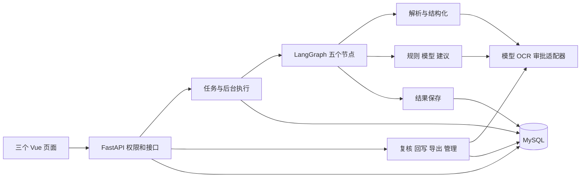
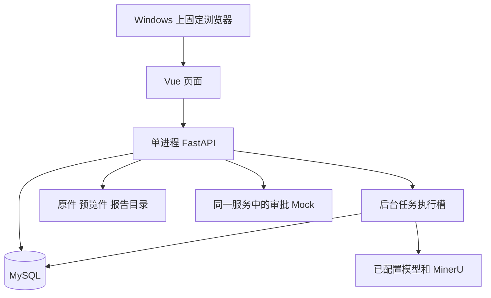
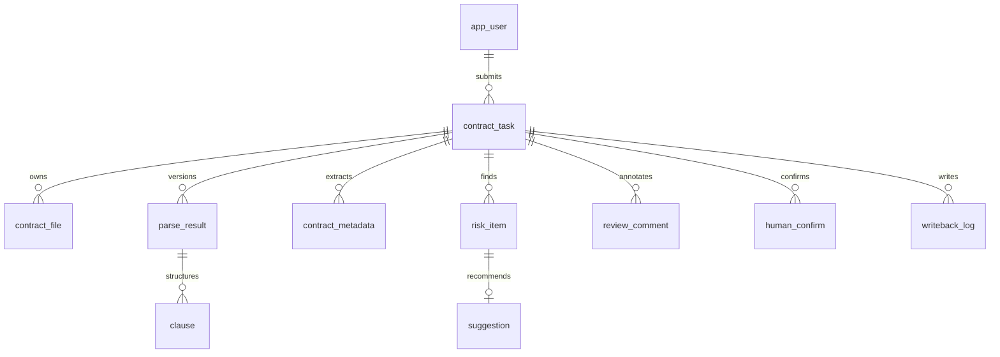
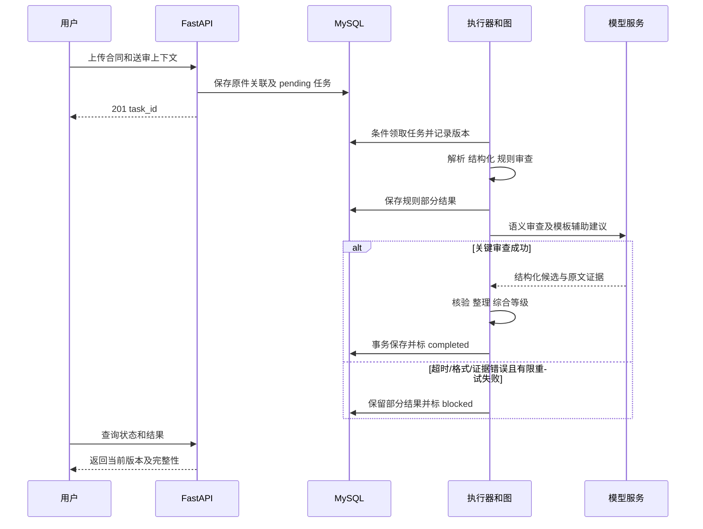

# 合同审批审查系统技术设计规格

| 项目 | 内容 |
|---|---|
| 版本 / 日期 | R0.1 / 2026-10-15 |
| 作者角色 / 状态 | 技术设计整理 / 评审草稿，尚未实施 |
| 依据 | [PRD R0.2](01-产品需求文档-重整草稿.md)、[简版](01A-产品需求简版.md)、[已确认决策](01B-产品决策记录.md) |
| 最新约定 | 用户协助完成开发试验用 Word 转 PDF；不等待模型和转换实测即可先完成设计草稿 |

本稿确定模块、关键数据、接口和开发顺序。技术建议不修改 PRD 范围，未验证项不写成已可用。原代码、旧文档、DDL 暂时保留；实际迁移和改代码须另按模块实施，不因文档出现新方案就自动执行。

## 1. 架构设计概述

采用 **Vue 前端 + FastAPI 单个后端 + MySQL + 文件存储**。LangGraph 串联解析、结构化、规则审查、模型审查/建议、保存结果，节点内部调用普通函数。继续复用现有环境，不拆微服务、不先建设通用规则语言或向量平台。

两个核心约束：**结果与其原件/审查版本绑定；只有关键审查成功并保存后，任务才能 completed。** 模型失败保留规则结果但标受阻，不能退化成“审查完整且无风险”。

当前已实现上传后端、DOCX 解析、结构化节点及风险结构；规则/模型/保存节点、后台执行和业务页面仍待实施。本稿不等于这些能力已经交付。

## 2. 技术栈与依赖

| 层 | 选型 | 现状与用途 |
|---|---|---|
| 前端 | Vue 3、Vite、Element Plus、Pinia | 已有项目骨架；实现三个业务页面 |
| 接口/模型 | FastAPI、Pydantic | 已有；格式校验、权限、请求与结果结构 |
| 数据 | SQLAlchemy、MySQL、本地文件目录 | 已有；任务和结果持久化、原件和预览件存储 |
| 流程 | LangGraph、单进程后台执行器 | 图已有；执行器待实现，先用数据库 pending 任务作为持久待处理来源 |
| 解析 | python-docx、PyMuPDF、MinerU HTTP 服务 | DOCX 已有；文本 PDF、OCR 适配待实现 |
| 模型 | 已配置兼容服务、httpx | 客户端待实现；当前未启用/缺密钥，合成样本试验未调用成功 |
| 预览/报告 | PDF 预览组件、PDF 报告生成组件 | 待选型验证；Word 转换试验由用户协助，报告 PDF 仍需系统导出 |

不因示范条款库需要而默认引入 embedding/Milvus。先按合同类型、条款类别和适用说明选择已维护模板；确有检索不足再单独评估。

## 3. 模块划分与职责



| 模块 | 职责、边界 | 对应 PRD |
|---|---|---|
| 接口与权限 `app/api` | 校验输入、查当前身份与任务权限，调用业务服务；不在路由中堆模型提示词 | FR-01、03、12、17、19 |
| 任务/执行服务（新增） | 创建、领取、状态转换、版本及重试保护；不把 HTTP 请求对象传入图 | FR-01、02、04、16 |
| 解析/结构化 `app/parsing`、`app/structuring` | 文件到 IR、条款和字段；保留原文证据，不决定风险是否成立 | FR-05～07、11 |
| 审查 `app/review` | 固定规则处理器、模型校验、风险整理、模板与建议；不直接接收前端任意可执行条件 | FR-08～10、15 |
| 集成适配（新增） | 模型、MinerU、审批、预览关联与报告组件的外部协议，返回明确失败 | FR-02、05、11、13、14、17 |
| 结果与人工服务（新增） | 保存结果、建议编辑/确认、批注、回写快照与报告数据；共享同一当前结果 | FR-09、12～14 |
| 前端三个页面 | 列表、工作台、规则模板管理；调用接口，不在前端重算权限或最终等级 | FR-03、04、11～15、17、19 |

FR-18 的样例与验证贯穿各模块。P1 字段手工修正、P2 历史对比不作为本轮 P0 实现前置。

## 4. 部署与执行方式



开发/单元测试采用现有 `.venv`；数据库集成使用独立测试数据；演示使用当前 Windows 机，记录实际浏览器和外部服务版本。生产部署、高可用和多实例不在本稿承诺范围，不引入 K8s、Redis 或消息队列。

后台执行建议先配置一个任务执行槽，接收多个任务时其余保持 pending；并发参数后续实测调整。接口保存任务并返回，不同步等待审查。执行器按数据库 pending 条件领取，使用事务/条件更新防止重复执行；不能只把待办放在易丢失的内存队列。

每个节点执行时校验版本。外部 HTTP、解析期间不长时间持有数据库事务。节点边界保存进度与可用部分结果；服务退出后残留 parsing/reviewing 任务在启动恢复时转 blocked（执行中断），由管理员重试。不在这一版承诺任意节点断点续跑；LangGraph 检查点数据库可暂不启用。

## 5. 数据模型与版本边界

保留现有 [DDL](../../sql/ddl/001_schema.sql) 为结构参考，不复制全部列。下表说明本轮实际使用及必须单独迁移的差异；数据类型/约束须在对应模块迁移中落定后才能执行，现有表不删、不重建。



| 对象 | 必要字段/约束及处理 |
|---|---|
| `contract_task` | 复用 ID、申请人、类型、我方角色、原五态、回写四态、`review_version`、摘要与错误；创建时不再默认为甲方。`contract_name` 未填时先用安全展示名，提取后更新。建议新增 `review_revision INT UNSIGNED NOT NULL DEFAULT 0`、`confirmation_snapshot JSON NULL`，保存已确认版本/revision、内容哈希、确认者与时间。旧 `closed` 暂保留但新流程不依赖 |
| `contract_file` | 复用原件路径、哈希、文件版本。预览关联建议新增 `preview_path VARCHAR(512) NULL`、`preview_source_sha256 CHAR(64) NULL`、`preview_sha256 CHAR(64) NULL`、`preview_status VARCHAR(16) NOT NULL DEFAULT 'missing'`、`preview_mapping JSON NULL`；状态限定 missing/pending/ready/failed |
| `parse_result` / `clause` | 复用 IR 快照与 `(task_id, version)`、条款顺序/父关系。`version` 对齐审查版本；保存时将内存 `clause_index` 映射为数据库 `clause_id`，不将二者混用 |
| `contract_metadata` | 现有唯一键只有 `(task_id, field_key)`，会覆盖历史；建议新增 `review_version INT UNSIGNED`，以 `(task_id, review_version, field_key)` 唯一。警告可新增 `warnings JSON NULL`；不能靠当前值冒充旧结果 |
| `risk_item` / `suggestion` | 复用风险三类/三级/来源与证据。风险存审查版本；建议记录生成失败、最终文本、确认者和确认时间。缺项 `clause_id` 可空，去重必须在锁定任务后由应用保证，不依赖 MySQL 对 NULL 的唯一约束 |
| `review_comment` / `human_confirm` | `human_confirm` 已有任务/风险/审查版本，保留逐项采纳留痕；整体确认快照由任务保存。`review_comment` 需新增 `review_version INT UNSIGNED` 并补任务/版本索引，防止旧批注混入当前确认 |
| `risk_rule` / `clause_template` | 复用编号、类型、等级、启停、依据、模板及版本。原 `condition_ast` 暂承载版本化的受限配置，如 `{kind, params}`；不实现旧通用 AST/编译器，旧数据由迁移适配，不直接执行 |
| Mock / `writeback_log` | 复用事件编号、模拟附件/评论及回写状态；幂等键由目标审批单、审查版本、最终内容哈希计算。复用 `mock_idempotency` 的 `(approval_no,idempotency_key)` 唯一约束，与评论同一事务写入；不能认为 `mock_comment` 自身已有该唯一键 |

版本新增字段不可盲目回填覆盖已有历史，先核对数据与唯一键再写迁移。数据库已有表不等于相应业务已实现；初期只补当前模块需要的 ORM。

### 5.1 原文与预览如何关联

开发试验由用户提供同一 DOCX 转出的 PDF，人工记录原件与预览件哈希。PDF 不是新合同，不替换原件，也不作为全新任务重复审查。最终产品的转换组件仍待确认，本稿不把用户协助试验推成所有业务用户必须手工转换。

DOCX IR 字符区间继续是原文依据；PDF 预览使用页码和矩形框。映射以原件版本、上下文文字匹配及必要人工核验建立；重复文本不能只取首次命中。只有唯一/已核验映射可标精确定位，未匹配项显示待定位或段落级提示。新原件使旧预览映射失效。

原始任务要求的三格式双向定位验收仍需通过。人工提供 PDF 不能自动证明 Word 分页、文本一致性或映射已经正确；报告 PDF 是另外的系统生成能力，不能由用户转换报告替代。

## 6. 关键接口契约

沿用现有成功包 `{code:0,message:"ok",data:...}` 和错误包 `{code,message,data:null,errors?}`。除现有上传/当前用户接口外，下述均为拟实现契约。所有任务操作先校验当前身份及范围；法务确认权不授予普通管理员。

| 方法与路径（分组） | 请求 | 成功响应 `data` / HTTP | 关键失败 |
|---|---|---|---|
| `POST /api/tasks/upload` | multipart：`file`、`contract_type`、`our_party_role` 必填；名称/部门可选，申请人取身份 | 201：`{task_id,task_no,status,duplicated}`；重复判断须包含用户和送审上下文 | 格式 422、文件过大 413、不支持 415 |
| `GET /api/tasks`；`GET /api/tasks/{id}` | 列表 `status,risk_level,page,page_size`；详情无请求体 | 200：列表 `{items,total,page,page_size}`；详情含送审信息、当前版本、阶段、状态、阻塞、回写和完整性 | 身份 401、范围 403/404 |
| `GET /api/tasks/{id}/document`；`GET /api/tasks/{id}/risks` | `review_version` 可选，默认当前；风险可传等级/分页 | 200：原文/预览资源引用、IR及定位映射；风险条目、建议、依据状态与完整性 | 结果未就绪 409、资源不存在 404 |
| `PATCH /api/tasks/{id}/review` | `review_version,expected_revision`；编辑建议列表、批注、`confirm`，省略项不修改 | 200：`{review_version,revision,confirmed}`；一次事务保存，confirm 绑定保存后的最终快照 | 非法务 403、版本/修订冲突 409 |
| `POST /api/tasks/{id}/retry`；`POST /api/tasks/batch` | 重试：`review_version,reason`；批量：`action:retry|export,task_ids,format?` | 202：新执行版本/待处理状态；批量返回逐项 accepted/denied/error | 重复处理中/旧版本 409、逐项权限拒绝 |
| `POST /api/tasks/{id}/writeback`；`GET /api/tasks/{id}/report` | 回写：版本及已确认 `revision`；报告：版本、`format:md|pdf`、`download` | 回写 202/已成功则 200：`{writeback_status,request_id}`；报告预览 JSON 数据，下载为文件流 | 未确认/无审批关联/处理中 409、无权限 403 |
| `GET/PATCH /api/rules/{code}`；`GET/POST/PATCH /api/templates[/{id}]` | 管理筛选/编辑：`expected_version`、支持的参数、等级、启停、依据/模板文本 | 200/创建 201：保存后对象及版本；规则集合另用 `GET /api/rules` | 未授权 403、未支持参数 422、旧版本 409 |
| `POST /api/mock/events`；`GET/PUT /api/admin/approval-config` | Mock：`event_id,approval_no,attachment_ref,contract_type,our_party_role`；配置：版本及参数 | Mock 202：任务和去重结果；配置 200：脱敏参数及验证结果；评论接口见下文 | 非管理员 403、附件失败留任务原因、参数错误 422 |

补充：模板集合用 `GET /api/templates`；当前身份复用 `/api/users/me`。Mock 评论写入 `POST /api/mock/approvals/{no}/comments`，参数 `{idempotency_key,content}`，首次 201、同键同内容重放 200、同键异内容 409；演示查看使用对应 GET。预览原件和报告下载都经授权接口返回，不暴露本地绝对路径。以上辅助契约随所属模块细化，不在此复制全部 API 文档。

Mock 附件只接受受控资源引用，不根据外部输入任意读取本地路径或下载任意地址。

错误段位沿用现有：参数 `40001`（格式使用 HTTP 422）、身份 `40100`、权限 `40300`、不存在 `404xx`、状态/版本 `409xx`、文件 `413xx/415xx`、内部/上游 `500xx/502xx/504xx`。新增具体码在模块实现时登记；HTTP 超时后任务仍由持久状态查询，前端不能猜测成功。

上传差异需要显式修正：现接口强制 `contract_name`、允许 UNKNOWN、默认甲方且仅接 DOCX；新契约按 PRD 调整，不宣称现接口已符合。去重不能仅按文件哈希复用其他人的任务或忽略我方角色/合同类型。

OpenAPI 示例（上传新契约节选，响应须使用现有包装）：

```yaml
paths:
  /api/tasks/upload:
    post:
      requestBody:
        required: true
        content:
          multipart/form-data:
            schema:
              type: object
              required: [file, contract_type, our_party_role]
              properties:
                file: {type: string, format: binary}
                contract_type: {type: string, enum: [PURCHASE, SALES, SERVICE, LABOR]}
                our_party_role: {type: string, enum: [A, B]}
                contract_name: {type: string, maxLength: 255}
      responses:
        '201': {description: 已保存待处理任务，返回包装后的 TaskCreated}
        '422': {description: 缺少或不合法字段，code 为 40001}
        '413': {description: 文件超过已配置上限}
        '415': {description: 不支持或内容与格式不符}
```

## 7. 关键处理流程



节点顺序继续使用现有五节点。State 复用 `document/clauses/metadata`，后续补 `rule_risks/ai_risks/suggestions` 与完整性信息；不重复在图里定义另一套 Clause/RiskItem。类型无法判定的条款进入模型候选，不因 OTHER 就跳过所有审查。

合同类型、我方角色从任务记录加载并进入 State 与 RuleReviewInput，不能要求模型猜测。目前已由解析节点利用现有任务/原件查询加载这两个字段，见[开发记录 19](../开发记录/19-审查输入的送审上下文.md)。后台执行器仍待实现，后续补规则/模板版本快照及执行版本保护，不必为相同上下文另建重复查询节点。

规则采用固定处理器注册表加受限配置：配置包含编号、适用类型、处理器类型、支持参数、等级、依据、模板关联与版本。未知参数拒绝保存，无 eval/exec。先把首条主体缺失规则跑通，再覆盖 PRD 4.3；自然人、我方身份、跨条款例外等必须纳入规则输入。具体业务阈值仍需来源确认。

模型使用原文片段与送审上下文，显式将合同内容视为数据；输出经格式、原文子串、条款范围和依据来源校验，不能让模型提供不受核验的坐标或法条。首轮可按条款/相关条款组调用，批量粒度在试验中确定，长文本不得静默截断。

保留不同风险维度；同一规则、同一条款不重复记。规则与模型确认为同一问题时保留双方证据和较高等级，否则分别保留供复核，不靠名称相似强行合并。只有覆盖完整且无风险时才可输出“未发现风险”；证据不足/依据待确认同时展示，不当作完整安全证明。

法务保存编辑时递增 revision，确认绑定版本和最终内容哈希。回写前重新验证当前版本/revision及权限，先保存请求快照再调用 Mock，不持锁等 HTTP；相同键重试由 Mock 唯一约束去重。超时进入 failed 并标结果待核实，先按键查评论再重放；重审、修改最终意见后旧确认失效。

外部返回后的状态更新仍需匹配请求的版本/revision；若期间发生新审查或编辑，保留旧请求日志，不能用旧成功覆盖新结果的未确认/未回写状态。

## 8. 非功能设计与验证

| PRD 目标 | 设计手段与检查 |
|---|---|
| 权限正确、无明文密钥泄漏 | 复用现有身份与数据库角色核验，任务访问集中检查；预置身份仅限受控演示，正式认证另评审；配置脱敏，日志不记 Authorization 或完整合同 |
| 刷新后复核内容仍在 | 编辑/确认/批注在事务中保存，版本和 revision 做条件更新；接口超时后允许重新查询，不在前端单独当作已确认 |
| 失败可见、任务不丢 | 数据库待处理任务、领取保护、节点边界部分保存、启动恢复、有限重试；错误日志关联 task/file/version/request_id |
| 查询及定位耗时可测 | 列表分页、已有状态/申请人索引；文档与风险按需加载，分页预览只加载可见页，记录阶段与接口耗时；建议预算需实测，不保证已达 ≤2 秒 |
| 同时提交不丢任务 | 默认一个执行槽先排队验证两个任务；重试/新执行前锁定当前版本，旧执行提交失败即丢弃过期更新 |
| 外部服务有超时 | 模型/OCR/审批各自设置连接与总等待上限，重试次数可配且有界；网络断开、格式错和不可信证据分别记录，不无限循环 |
| 报告和回写一致 | 同一已确认结果快照生成两种报告及评论；PDF 字体/分页/表格需独立渲染检查，不能只确认文件可下载 |

不以本轮文档检查替代服务性能、模型效果或生产可用性测试。模型 Key 与文档转换尚未准备好，不阻碍接口和模块草稿，但相关能力不能记为通过验收。

## 9. 关键设计决策

| 编号 | 决策 | 理由与代价 |
|---|---|---|
| ADR-01 | 复用单后端和五节点图 | 已有代码可沿用，业务函数集中；不先微服务，单实例恢复和并发上限需明确 |
| ADR-02 | 固定规则处理器 + 数据配置 | 保留页面编辑能力，省去通用语言/编译器；新增全新判定种类需后端增加处理器 |
| ADR-03 | MySQL 任务领取，先一个执行槽 | 少依赖且任务持久；不承诺高吞吐或多实例，服务中断任务显式受阻重试 |
| ADR-04 | 前端先查询轮询 | 无需先建 SSE；回写状态及任务进度都可查询，轮询间隔在 UI 阶段设定和实测 |
| ADR-05 | Word 预览试验由用户协助转换 | 先保留原件和关联 PDF，继续设计其他能力；最终转换方式及精确映射仍待确认，不能降低最终定位要求 |
| ADR-06 | 模型失败与建议失败分开处理 | 已确认产品行为：前者受阻并保留规则，后者可人工补充；需保留部分结果而非最终提交才保存 |
| ADR-07 | 模板先结构化维护，不先向量化 | 完成原文要求的示范条款库并保留来源；复杂相似检索若需要，后续另行评估 |

## 10. 实现任务与依赖

以下是开发顺序，不是工时承诺。每项单独实现、注释、验证后给用户查看，不一次性完成整张表。

| 任务 | 内容与可验证产物 | 依赖 |
|---|---|---|
| T-01 | 核对现有实现与本稿差异：上传默认值、旧日期限制、格式分支、角色权限、数据版本；列出保留/需改，不立即重构 | 本稿评审 |
| T-02 | 准备有来源的首条主体缺失规则及正反/自然人用例，规则配置和处理器最小接口 | T-01、业务资料 |
| T-03 | 实现首条确定性规则、风险证据校验，接 rule_review；规则结果可单独查看 | T-02 |
| T-04 | 设计并验证新增数据迁移和部分结果保存，保留旧数据；版本/重复执行测试 | T-01；T-03 提供首个结果 |
| T-05 | 配置模型后跑合成/获准真实合同探针，再实现适配器、审查/建议和有限重试 | T-03、T-04、模型配置、模板 |
| T-06 | 完成 save_results 与执行器：事务落库、状态、领取、部分结果、启动恢复 | T-04、T-05 |
| T-07 | 列表/详情/文档/风险查询及基础工作台，形成 DOCX 主链阶段 A | T-06 |
| T-08 | PDF/MinerU 及预览映射试验、转换件关联、分页/双向定位，完成阶段 B | T-01、可提前试验；联调依赖 T-07 与用户提供转换件 |
| T-09 | 建议编辑确认/批注、规则模板管理、权限及批量重试，完成阶段 C | T-07，实际定位联调依赖 T-08 |
| T-10 | Mock 待办/附件/评论、配置、幂等回写与状态查询 | T-09 |
| T-11 | Markdown/PDF 报告、批量导出及跨流程正常/异常/重启演示，完成阶段 D | T-08～T-10 |

开发人员可提前做独立格式和模型试验；当前会话继续逐项推进。P0 功能追溯由第 3、6 章对应 PRD，最终验收使用 PRD 第 9 章，不以接口数量或单元测试数量代替交付。

## 11. 待明确事项与草稿检查

| 编号 | 尚需落实 | 当前处理与确认方 |
|---|---|---|
| S-01 | 用户转换的 DOCX/PDF 样本及最终转换方式 | 用户提供试验转换件；技术核对哈希、页面、重复文本及映射。最终产品转换组件另确认 |
| S-02 | 真实模型/OCR 能力与重试/超时参数 | Key 由用户自行配置；使用已获准样本试验，记录服务耗时和限制，不发未经授权的合同 |
| S-03 | 规则、阈值、依据及示范文本资料 | 用户/业务审核方确认来源和适用边界；模拟企业异常显式标注 |
| S-04 | 新字段、确认快照、版本唯一键迁移与已有数据 | T-01 核对，T-04 提供具体迁移和回滚方案；未批准前不执行删表/重建 |
| S-05 | 报告 PDF 与前端预览组件、浏览器/性能/日期 | 技术提出候选并做中文排版试验，用户确认演示环境与时间；不与 Word 转换混为一项 |

草稿检查：11 个主章节齐全；模块及任务映射 P0，关键接口含输入/输出/失败，数据复用与迁移差异显式列出，有部署图、数据图、主流程时序及 ADR；非功能目标均有实现手段。**模型、映射和新迁移尚未验证，因此本稿不是已实施基线。**

本轮只写设计，不修改业务代码、数据库或 `.env`，不提交或推送 Git。后续先审第 3、6、10 章，按 T-01 开始核对再逐模块实施。
