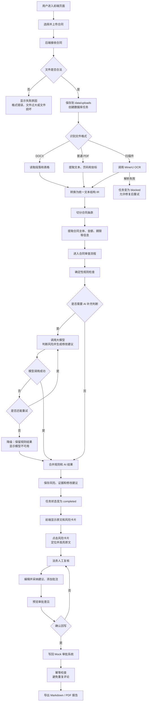
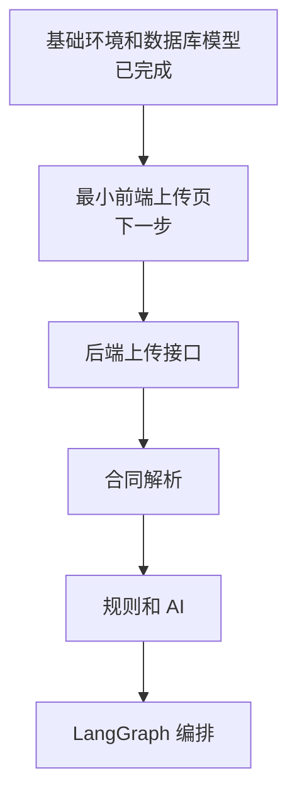

# 合同审批审查系统项目流程图

## 流程与代码目录对应关系

| 流程 | 主要代码位置 |
|---|---|
| 页面上传和结果展示 | `frontend/src/` |
| 接收请求和返回结果 | `app/api/` |
| 保存上传文件、审批系统对接 | `app/integration/` |
| DOCX、PDF、OCR 解析 | `app/parsing/` |
| 条款切分和元数据提取 | `app/structuring/` |
| 确定性规则审查 | `app/review/rules/` |
| AI 模型调用 | `app/review/llm/` |
| LangGraph 流程编排 | `app/graph/` |
| 数据库模型 | `app/models/` |
| 配置、数据库连接和日志 | `app/core/` |

## 当前开发位置

